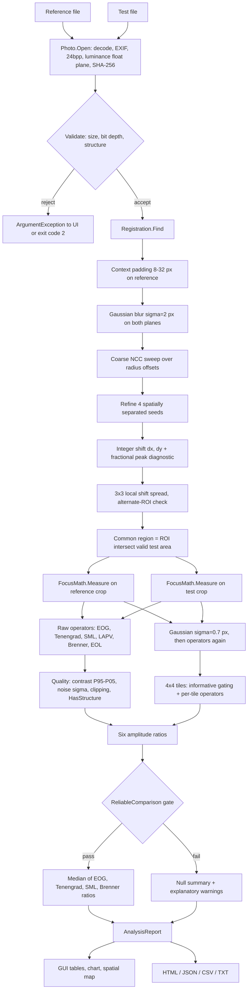
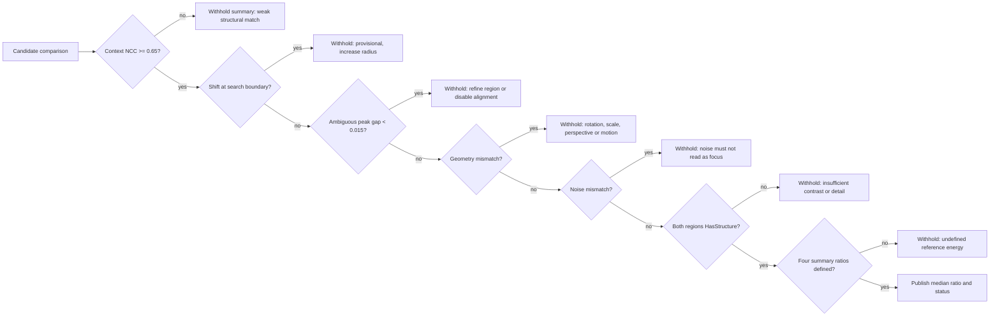

<div align="center">

# PhotoCompare 2.1

**Reference-anchored image sharpness comparison for Windows — align any test frame to a trusted control, measure six detail operators, and get a spatially resolved, reproducible verdict.**

[](https://learn.microsoft.com/en-us/dotnet/framework/install/guide-for-developers)
[](PhotoCompare.csproj)
[](src/ProductInfo.cs)
[](LICENSE)
[](#tech-stack--architecture)
[](tests/PhotoTests.cs)

</div>

> [!IMPORTANT]
> This repository ships a **standalone Windows desktop application**, not a server-side or console-first product. `PhotoCompare.exe` is a WinForms/GDI+ executable that runs by itself: no installer, no Python, no OpenCV, no NuGet packages and no network access. Configuration is expressed through CLI flags and in-window controls only — there are deliberately no environment variables and no configuration files.

---

## Table of Contents

- [Features](#features)
- [Tech Stack & Architecture](#tech-stack--architecture)
  - [Core Stack](#core-stack)
  - [Project Structure](#project-structure)
  - [Key Design Decisions](#key-design-decisions)
  - [Analysis Pipeline](#analysis-pipeline)
  - [Reliability Gate](#reliability-gate)
- [Getting Started](#getting-started)
  - [Prerequisites](#prerequisites)
  - [Installation](#installation)
  - [Building from Source](#building-from-source)
  - [Troubleshooting](#troubleshooting)
- [Testing](#testing)
  - [Core Numerical Checks](#core-numerical-checks)
  - [Command-Line Integration Checks](#command-line-integration-checks)
  - [UI Smoke Checks](#ui-smoke-checks)
  - [Benchmarks](#benchmarks)
  - [Test Coverage Matrix](#test-coverage-matrix)
- [Deployment](#deployment)
  - [Portable Distribution](#portable-distribution)
  - [CI/CD Integration](#cicd-integration)
  - [Containerization](#containerization)
- [Usage](#usage)
  - [GUI Quick Start](#gui-quick-start)
  - [What the Percentage Means](#what-the-percentage-means)
  - [Command-Line Usage](#command-line-usage)
  - [Batch Processing](#batch-processing)
  - [Exports](#exports)
  - [Advanced Usage](#advanced-usage)
  - [Keyboard Reference](#keyboard-reference)
- [Configuration](#configuration)
  - [Command-Line Options](#command-line-options)
  - [GUI Settings](#gui-settings)
  - [Environment Variables](#environment-variables)
  - [Fixed Engine Constants](#fixed-engine-constants)
  - [Report Schemas](#report-schemas)
- [License](#license)
- [Contacts & Community Support](#contacts--community-support)

---

## Features

### Measurement core

- **Reference-anchored scoring.** Every comparison is expressed against the detail level of a user-selected reference region, so results stay meaningful across cameras, lenses, sensors and processing pipelines.
- **Six independent detail operators** — EOG, Tenengrad, SML, LAPV, Brenner 2D and EOL (thermal mask) — computed with identical definitions on both images.
- **Median-of-four summary.** The headline percentage is the median amplitude ratio of EOG, Tenengrad, SML and Brenner 2D, which is robust against a single outlier operator. LAPV and EOL remain diagnostic.
- **Uniform Gaussian σ = 0.7 px pre-filtering** applied to both regions before ratios are formed, suppressing pixel-grid noise while preserving fine detail.
- **Energy-aware ratios.** Squared-gradient metrics are compared through the square root of the ratio (true amplitude), while SML uses a linear ratio.
- **Above-100% results are never clipped.** Sharper detail, added noise and digital sharpening can legitimately push the score past the reference level.
- **Optional contrast normalization** by `reference (P95−P05) / test (P95−P05)`, off by default because it can mask defocus-induced contrast loss.

### Alignment and geometry

- **Sub-window translation search** with a default ±32 px radius, adjustable up to ±256 px, after Gaussian σ = 2 px smoothing.
- **Coarse-to-fine NCC search** with multi-seed refinement, so periodic targets such as four-bar charts do not collapse onto an alias peak.
- **Context padding** (8–32 px) around the selected region for alignment only; metrics are always measured inside the common region in original pixels.
- **Fractional peak estimate** (parabolic interpolation of the correlation peak) reported as a diagnostic — measurements themselves are never resampled.
- **Geometry screening** via 3×3 local-shift sampling and alternate-ROI correlation; rotation, scale change, perspective and independent foreground motion are detected and reported instead of being mistaken for defocus.
- **Translation-only policy.** No automatic rescaling, rotation correction or perspective warping is ever applied.

### Reliability engineering

- **Summary withholding.** The percentage is suppressed when alignment is weak, ambiguous or at the search boundary, when geometry is inconsistent, when noise contributions differ strongly, or when the region lacks usable detail. All raw metrics stay available.
- **Input-quality diagnostics**: P95−P05 contrast, mean luminance, standard deviation, clipping percentage, robust noise-σ estimate, noise energy fraction, blur-retention ratio and structural-validity flags.
- **Multi-level warnings** mirrored into the GUI, HTML, JSON, CSV and TXT outputs.

### Spatial analysis

- **Up to 4×4 tile map** over the common region, with per-tile informative/uninformative classification driven by the reference.
- **Smooth background gradients are excluded** so soft illumination ramps cannot vote as focus evidence.
- **Global summary, local median and local P25–P75 range** reported separately — a sharp area can no longer hide a blurred one behind a global average.
- **Colour-coded overlays** in both previews, plus a dedicated *Spatial tiles* table.

### Productivity and integration

- **Batch processing** over a folder of images with per-file error isolation, cache reuse of reference measurements, cancellation, and CSV/JSON export.
- **Four export formats** — self-contained HTML (no scripts, no embedded photographs), complete JSON, flat CSV and human-readable TXT.
- **Provenance by design**: SHA-256 of every source file, tool version, settings and measured-region coordinates travel with each report.
- **Source images are never modified**; the exporter refuses to write a report over an input path.
- **Deterministic culture**: the process forces `en-US` for culture and UI culture so numeric parsing and formatting never depend on the host.
- **Full CLI parity** for single-pair and batch runs, with stable exit codes for automation.
- **Cancellation everywhere** — mid-analysis `Esc`/`Cancel`, cooperative `CancellationToken` checks inside blur, operator and alignment loops.
- **Bounded in-memory cache** (`AnalysisSession`) that reuses reference and test measurements plus alignment when only tolerance or contrast mode changes.
- **Zero third-party dependencies**: entire application is a single compiled executable against the .NET Framework class library.

---

## Tech Stack & Architecture

### Core Stack

| Layer | Technology | Notes |
| --- | --- | --- |
| Language | **C#** (C# 5-compatible syntax) | No `async`, no interpolated strings, no expression-bodied members |
| Runtime | **.NET Framework 4.8** | Ships with Windows 10 1903+ / Windows 11; targeting pack needed only to build |
| UI | **Windows Forms** (`System.Windows.Forms`) | Interface constructed entirely in code — no `.Designer.cs`, no XAML, no resources |
| Imaging | **GDI+** (`System.Drawing`) | Decoding, EXIF orientation, 24-bpp compositing, preview rendering |
| Serialization | **`System.Web.Script.Serialization.JavaScriptSerializer`** | JSON reports; no Newtonsoft/System.Text.Json dependency |
| Build (IDE) | **MSBuild / Visual Studio 2022** | Solution format 12.00, VS 17 toolset |
| Build (CLI) | **`csc.exe` from `%WINDIR%\Microsoft.NET\Framework64\v4.0.30319`** | Invoked by `Build.ps1`; no package restore |
| Scripting | **Windows PowerShell 5.1** | `Build.ps1`, `Run-Tests.ps1`, `Run-Benchmark.ps1` |
| Concurrency | **TPL** (`Parallel.For`) + `CancellationToken` | Activated above 300 000 pixels; parallelism capped at `min(8, cores−1)` |
| Binary | **AnyCPU, `WinExe`** | Runs x86 or x64 without change |

> [!NOTE]
> `TreatWarningsAsErrors` is enabled in `PhotoCompare.csproj` and `/warnaserror+` is passed by `Build.ps1`. A warning is a build failure — this keeps the codebase free of silent numeric/dead-code drift in a project where a single changed constant would invalidate published measurements.

### Project Structure

```text
reference-sharpness-comparator2/
├── PhotoCompare.sln              # VS 2022 solution (Debug/Release, AnyCPU)
├── PhotoCompare.csproj           # v4.8 WinExe, RootNamespace=PhotoFocus, same source list as Build.ps1
├── PhotoCompare.exe              # prebuilt AnyCPU binary, kept in sync with src/ by BUILD.bat
├── START.bat                     # launch the root EXE in place
├── BUILD.bat                     # Build.ps1 wrapper, pauses on failure
├── BUILD_AND_RUN.bat             # Build.ps1 -Launch wrapper
├── Build.ps1                     # csc-based build with staging + atomic replace
├── Run-Tests.ps1                 # core checks + CLI integration (+ optional UI smoke)
├── Run-Benchmark.ps1             # synthetic performance harness
├── LICENSE                       # Apache License 2.0
├── README.md
├── src/
│   ├── Program.cs                # entry point, argument parser, shell modes     (~108 lines)
│   ├── ProductInfo.cs            # name, version, flavour switch                 (~12 lines)
│   ├── AssemblyInfo.cs           # Win32 executable metadata                     (~7 lines)
│   ├── FocusAnalysis.cs          # imaging, operators, alignment, reports        (~650 lines)
│   ├── AnalysisSession.cs        # bounded measurement/alignment cache           (~43 lines)
│   ├── PhotoForms.cs             # main window, canvases, chart, tiles           (~414 lines)
│   ├── BatchAnalysis.cs          # batch engine + batch window                   (~150 lines)
│   └── ReportHtml.cs             # self-contained HTML report + SVG plot         (~79 lines)
├── tests/
│   ├── PhotoTests.cs             # 61 numerical / data-quality checks            (~238 lines)
│   ├── Benchmark.cs              # reproducible synthetic timing cases           (~52 lines)
│   └── output/                   # generated fixtures, reports, benchmark JSON
├── bin/Release/                  # compiler output (exe + pdb)
└── obj/                          # staging and MSBuild intermediates
```

<details>
<summary><strong>File-level responsibilities, generated artifacts and why the build output is committed</strong></summary>

**Source files and their contracts**

| File | Owns | Depends on |
| --- | --- | --- |
| `src/Program.cs` | Option grammar, mode selection, English locale enforcement, exit codes, `%TEMP%` error log | `ProductInfo`, `FocusMath`, `BatchAnalysis`, `ReportFiles`, `PhotoForms` |
| `src/ProductInfo.cs` | `Name`, `Version`, `FileVersion`, `Description`, `IsComparison` flavour switch | — |
| `src/FocusAnalysis.cs` | `GrayPlane`, `Photo`, `OperatorValues`, `ImageMeasures`, `TileMeasure`, `AlignmentResult`, `AnalysisReport`, `FocusMath`, `Registration`, `ReportFiles` | GDI+, `System.Web.Extensions` |
| `src/AnalysisSession.cs` | Caching keyed by object identity (`ReferenceEquals`) + region + settings | `FocusMath`, `Registration` |
| `src/PhotoForms.cs` | `PhotoCanvas` (paint/zoom/pan/ROI/drag-drop/tile overlay), `PhotoForm`, chart control, tabbed results | WinForms |
| `src/BatchAnalysis.cs` | `BatchItem`, `BatchAnalysis.Run/Save`, `BatchForm` with `BackgroundWorker` | `AnalysisSession`, WinForms |
| `src/ReportHtml.cs` | Inline CSS, SVG bar chart, tile grid, HTML encoding | `AnalysisReport` |

**Generated artifacts (safe to delete, regenerated on demand)**

- `bin/Debug`, `bin/Release` — MSBuild output. IDE builds land here; the CLI build deliberately does **not** overwrite them.
- `obj/command-line` — staging folder used by `Build.ps1` for the atomic EXE replacement.
- `tests/output` — synthetic fixtures (`reference.png`, `working.png`, `shifted.png`, `color-test.png`, `large-native.png`), a `batch-input` folder containing a deliberately broken `broken.png`, and the reports/JSON produced by the checks.

Because the build output is byte-for-byte reproducible from source with the in-box compiler, the repository keeps a prebuilt `PhotoCompare.exe` at the root purely as a convenience so the tool can be used on a machine with no SDK. It is not the authoritative artifact — `src/` is.

**Assembly identity**

`RootNamespace` is `PhotoFocus` while the assembly name is `PhotoCompare`. That mismatch is intentional: namespaces describe the domain module, the assembly name describes the shipped product. `Build.ps1` reads `AssemblyName` from the project file, validates it against `^[A-Za-z][A-Za-z0-9_.-]*$`, and derives the staging and destination paths from it, so renaming the product does not require touching the script.

</details>

### Key Design Decisions

<details>
<summary><strong>1. A relative reference scale instead of a universal sharpness threshold</strong></summary>

There is no absolute, transferable "in focus" number for a single photograph: scene texture, noise, exposure, demosaicing, denoising and sharpening all move high-frequency energy. The engine therefore answers exactly one question — *how much measured detail does this test region contain compared with this reference region?* — and states it plainly:

- `100%` is the **measured detail level of the selected reference**, not perfect optical focus. A blurred control defines its own 100%.
- `80%` means the combined detail amplifiers are lower than the reference; it is **not** a claim that the lens is "20% out of focus".
- `115%` means more high-frequency content is measured, which may come from sharper detail, more noise or stronger digital sharpening.

The single-image `Detail index` (`100 × √Tenengrad(σ=0.7) / (P95−P05)`) exists in the engine and is exercised by the checks, but it is an unbounded relative scale and is not surfaced by this flavour of the application (`ProductInfo.IsComparison = true`).

</details>

<details>
<summary><strong>2. Ratios of amplitudes, not ratios of energies, and a median instead of a mean</strong></summary>

EOG, Tenengrad and Brenner 2D are quadratic in pixel amplitude, so a naive ratio of those energies reports something closer to a variance than to a sharpness change. The engine compares them through the square root of the ratio (`100 × √(working / reference)`), while SML — already a first-difference-of-amplitude measure — uses the linear ratio. The four summary ratios are then reduced with a **median**, so a single operator that behaves unusually (for example on a predominantly vertical texture) cannot drag the headline number.

Both regions are filtered with the same Gaussian σ = 0.7 px before ratios are formed, which makes the comparison phase-symmetric and suppresses the noise floor without deleting the detail band the operators are designed to see.

</details>

<details>
<summary><strong>3. Refusing to answer is a feature</strong></summary>

A comparator that always returns a number will always return a wrong number in the ambiguous cases. `ReliableComparison` is `true` only when **all** of the following hold:

- context NCC ≥ 0.65,
- the best shift is not at the search boundary,
- no equally plausible alternate peak (ambiguity gap < 0.015 between the best and the strongest spatially distant peak),
- no geometry mismatch (alternate-ROI gain > 0.12 at ≥ 3 px displacement, or local-shift spread > 3.5 px across ≥ 4 accepted tiles),
- no noise mismatch (noisier σ > max(3, 2 × quieter σ + 0.5), noise energy fraction > 0.5, blur retention < 0.3),
- both regions report `HasStructure`,
- all four summary ratios are defined.

When the gate fails, `Status` becomes `Reliable comparison unavailable`, `RelativeDetailPercent` is `null`, and warnings explain which condition failed. Individual metric rows remain populated so the operator can still diagnose the case.

</details>

<details>
<summary><strong>4. Integer-pixel measurement, no hidden resampling</strong></summary>

Alignment returns an integer shift; a fractional estimate is derived from the correlation peak purely as a diagnostic. The measured images are **never** interpolated, because interpolation is itself a low-pass filter and would systematically depress the sharpness of whichever image is resampled. Consequently:

- rotation, scale and perspective are not corrected, only detected;
- differing file dimensions are allowed only if the object keeps the same pixel scale;
- a fractional offset can produce a pixel-phase error on very fine periodic bars, and the report says so.

</details>

<details>
<summary><strong>5. Fail fast on unsupported input rather than silently degrade</strong></summary>

GDI+ silently narrows some 16-bit PNGs to 8-bit. Rather than accept a quietly wrong measurement, `Photo.Open` inspects the IHDR bit-depth byte of the PNG header, reads the TIFF `BitsPerSample` tag (0x102), and rejects high-bit-depth data with an actionable message. Limits are enforced before allocation: 24 000 000 pixels total and 16 000 pixels per side. EXIF orientation (0x112) is applied so the preview and the measurement agree. Transparency is composited onto white with an explicit warning. Only the first frame of a multi-page or animated file is loaded, also with a warning.

</details>

<details>
<summary><strong>6. Deterministic, auditable outputs</strong></summary>

- The process pins `CultureInfo` to `en-US` on the default thread, the UI culture and the current thread, so `int.Parse`/`ToString` never follow the host locale.
- CSV numeric fields are written with the round-trip format `G17` in invariant culture; display values in TXT/HTML are rounded to three decimals.
- Every report carries the tool version (`PhotoCompare 2.1`) and SHA-256 digests of both source files.
- The HTML report is a single file with inline CSS and an inline SVG chart — **no `<script>`, no ``** — so it renders identically from email, an air-gapped machine or a compliance archive, and cannot exfiltrate or execute anything.
- File names and warning strings are HTML-encoded with `WebUtility.HtmlEncode`; batch CSV cells beginning with `= + - @` are prefixed with `'` to neutralise spreadsheet formula injection.

</details>

<details>
<summary><strong>7. Bounded state, explicit lifetimes</strong></summary>

`Photo` implements `IDisposable` and owns its `Bitmap`; the loader copies pixels into a `float[]` luminance plane (0–255) and releases the file handle immediately, so a source file can be renamed or deleted while the analysis window is open. `AnalysisSession` holds at most one reference measurement, one test measurement and one alignment, is invalidated by `Clear()`, and is created per window and per batch — no static image state is shared between windows or worker threads. `Program` disposes decoded photos in `finally` blocks.

</details>

<details>
<summary><strong>8. No configuration surface beyond flags and controls</strong></summary>

A measurement tool that silently picks up a `.env`, a registry key or a roaming settings file is a measurement tool you cannot reproduce six months later. Every input to the engine is either an explicit argument or a visible control, and every output records those values. The interface also refuses contradictory invocations: duplicate options, mixed modes (`--image` with `--batch`), both contrast modes, and comparison options in a single-image flavour all raise argument errors.

</details>

<details>
<summary><strong>9. Atomic build, isolated faults</strong></summary>

`Build.ps1` compiles into `obj/command-line/` and only then moves the result over the root executable. A compile failure — or a locked destination because the app is still running — leaves the previously working binary untouched, and the script says so. Batch analysis applies the same philosophy at runtime: a damaged or missing file becomes a per-row error while the remaining images continue, and the process exits with `1` rather than aborting.

</details>

### Analysis Pipeline

<details open>
<summary><strong>End-to-end data flow: from two files to a gated percentage</strong></summary>



</details>

<details>
<summary><strong>Operator definitions and units as implemented</strong></summary>

| Operator | Index | Definition in code | Unit | Role |
| --- | --- | --- | --- | --- |
| `EOG` | 0 | Mean squared forward differences along X and Y | levels²/px | Summary |
| `Tenengrad` | 1 | Mean Sobel X/Y energy; each kernel divided by 8 | levels²/px | Summary |
| `SML` | 2 | Mean absolute second differences along X/Y; step 1, threshold 0 | levels/px | Summary (linear ratio) |
| `LAPV` | 3 | Variance of the four-neighbour Laplacian | levels² | Diagnostic |
| `Brenner 2D` | 4 | Half the sum of mean squared step-2 differences along X and Y | levels²/px | Summary |
| `EOL (thermal)` | 5 | Mean squared response of the centre-20 / neighbour-−4 / diagonal-−1 mask | levels²/px | Diagnostic |

All six are averaged over the valid interior positions only (`(w−2)(h−2)` normalisation for interior operators, `(w−1)(h−1)` for EOG, `h(w−2)` and `(h−2)w` for the two Brenner axes), computed on the original pixel grid. The σ = 0.7 column repeats the identical definitions on the filtered plane, so "original vs filtered" is a like-for-like comparison rather than a change of formula.

</details>

<details>
<summary><strong>Registration algorithm in detail</strong></summary>

1. **Context region.** With alignment enabled, the selected ROI is inflated by `min(32, max(8, min(w,h)/4))` pixels and intersected with the reference bounds. This context helps locate a strongly blurred or low-contrast target; it never contributes to the metric region.
2. **Smoothing.** Both the reference context and the test search window are blurred with σ = 2 px to make NCC insensitive to noise and fine aliasing.
3. **Search window.** The test window is the context inflated by `radius + 5`, so every candidate shift up to the radius remains fully inside the test image.
4. **Coarse sweep.** Offsets are sampled on a stride of `ceil(radius / 12)` (plus `0`, `−radius`, `+radius`), scored by normalised cross-correlation on a strided subgrid of about 40 samples per axis.
5. **Multi-seed refinement.** Up to four spatially separated coarse peaks are refined at full neighbourhood resolution with a finer stride (`/72`). This prevents locking onto an alias of a regular four-bar target.
6. **Ambiguity detection.** The best score is compared with the strongest candidate at least `max(6, 2 × coarse)` px away; a gap below 0.015 with both scores above 0.65 marks the result ambiguous.
7. **Fractional estimate.** A parabolic fit over the horizontal and vertical neighbours of the peak yields `FractionalDx/FractionalDy`, clamped to ±0.5 px. Values beyond 0.25 px from the integer shift generate a pixel-phase warning.
8. **Geometry screening.** If ROI NCC < 0.85, an alternate search maximising local-ROI correlation is run; a much better alternate peak far from the primary indicates geometry mismatch. For ROIs ≥ 128×128 px, nine local 3×3-block searches within ±3 px measure the residual shift spread; spread > 3.5 px across ≥ 4 confident tiles flags rotation, scale, perspective or independent motion.
9. **Common region.** `ROI ∩ valid working area` is measured; if alignment removed more than 20% of the selected area, a warning is emitted.

A reported shift `dx, dy` means reference pixel `(x, y)` corresponds to test pixel `(x + dx, y + dy)`.

</details>

### Reliability Gate

<details>
<summary><strong>Decision logic that decides whether a percentage may be shown</strong></summary>



Every withheld case still returns the metric table, tile map, diagnostics and warnings. `ReliableComparison` is serialised in JSON so automation can branch on it instead of on the exit code.

</details>

---

## Getting Started

### Prerequisites

| Requirement | Version / Notes | Needed for |
| --- | --- | --- |
| Windows | Windows 10 1903+ or Windows 11 (any edition) | Running the GUI |
| .NET Framework | **4.8** runtime — preinstalled on supported Windows builds | Running the app |
| PowerShell | **Windows PowerShell 5.1** (`powershell.exe`, not only `pwsh`) | `Build.ps1`, `Run-Tests.ps1`, `Run-Benchmark.ps1` |
| .NET Framework 4.8 Developer Pack | Only if building with **Visual Studio** | MSBuild/VS compile |
| Visual Studio 2022 (optional) | Workload *.NET desktop development* | IDE editing and debugging |
| `csc.exe` | `%WINDIR%\Microsoft.NET\Framework64\v4.0.30319\csc.exe` | Script-based build with no SDK |

> [!TIP]
> If `PhotoCompare.exe` already starts on your machine, you have everything required to *use* the tool. The compiler, SDK and PowerShell scripts are only needed to *modify* it.

> [!WARNING]
> Windows on ARM runs this application under x64 emulation only where the .NET Framework 4.8 is present. macOS, Linux and Wine are not supported targets: the UI is WinForms and the imaging layer is GDI+, neither of which is cross-platform.

### Installation

No installer exists. Clone and run:

```powershell
# 1. Clone the repository
git clone https://github.com/DroneNotes/reference-sharpness-comparator2.git
cd reference-sharpness-comparator2

# 2. Verify the runtime is present (prints the 4.8 release key, e.g. 528040)
reg query "HKLM\SOFTWARE\Microsoft\NET Framework Setup\NDP\v4\Full" /v Release

# 3. Launch the prebuilt binary
.\START.bat
# or directly:
.\PhotoCompare.exe
```

Prefer a build you compiled yourself? Replace step 3 with:

```powershell
# Rebuild the root executable from src/, then launch it
.\BUILD_AND_RUN.bat
```

**First run walkthrough**

1. Click **1. Open reference…** (or `Ctrl+Shift+O`, or drop a file onto the left preview).
2. Click **2. Open test image…** (or `Ctrl+O`, or drop onto the right preview).
3. Drag with the left mouse button to select a target or textured object **in the reference preview**.
4. Analysis starts automatically. Read the headline percentage, the metric table and the warnings tab.
5. Toggle **Spatial map** or open the **Spatial tiles** tab to inspect local differences.
6. Use **Save result…** (`Ctrl+S`) to export HTML, JSON, CSV or TXT.

### Building from Source

<details>
<summary><strong>Script build, Visual Studio build, manual <code>csc</code> invocation and script parameters</strong></summary>

#### A. Script build (no SDK required)

```powershell
# Rebuild .\PhotoCompare.exe from src/
powershell -NoProfile -ExecutionPolicy Bypass -File .\Build.ps1

# Rebuild, then launch
powershell -NoProfile -ExecutionPolicy Bypass -File .\Build.ps1 -Launch

# Rebuild, then run the full check suite
powershell -NoProfile -ExecutionPolicy Bypass -File .\Build.ps1 -Tests
```

`Build.ps1` behaviour, step by step:

1. Locates exactly one `*.csproj` in the script folder and fails otherwise.
2. Reads `<AssemblyName>` and validates it against `^[A-Za-z][A-Za-z0-9_.-]*$`.
3. Resolves `csc.exe` from `Framework64` first, falling back to `Framework`.
4. Expands every `<Compile Include=…>` entry and rejects any path escaping the project root.
5. Compiles to `obj\command-line\<AssemblyName>.exe` with `/target:winexe /platform:anycpu /optimize+ /warn:4 /warnaserror+ /main:PhotoFocus.Program`.
6. Moves the temporary file over `.\PhotoCompare.exe` — atomically preserving the previous binary on any failure.

#### B. Visual Studio

```powershell
# Command-line MSBuild equivalent of "Build Solution" for the Release configuration
msbuild .\PhotoCompare.sln /t:Rebuild /p:Configuration=Release /p:Platform="Any CPU"
```

Open `PhotoCompare.sln` for interactive work; IDE output lands in `bin\Debug` or `bin\Release`. Requires the .NET Framework 4.8 Developer/Targeting Pack ([Microsoft setup guide](https://learn.microsoft.com/en-us/dotnet/framework/install/guide-for-developers)).

#### C. Manual compiler invocation

```powershell
$csc = "$env:WINDIR\Microsoft.NET\Framework64\v4.0.30319\csc.exe"
& $csc /nologo /target:winexe /platform:anycpu /optimize+ /warn:4 /warnaserror+ /main:PhotoFocus.Program `
  /out:.\PhotoCompare.exe `
  /r:System.dll,System.Core.dll,System.Drawing.dll,System.Windows.Forms.dll,System.Web.Extensions.dll `
  .\src\ProductInfo.cs .\src\AssemblyInfo.cs .\src\Program.cs .\src\FocusAnalysis.cs `
  .\src\AnalysisSession.cs .\src\PhotoForms.cs .\src\BatchAnalysis.cs .\src\ReportHtml.cs
```

#### D. Adding a source file

New `.cs` files must be listed in **both** `PhotoCompare.csproj` (`<Compile Include=…>`) and, implicitly, nothing else — `Build.ps1` derives its file list from the project file, so the project file is the single source of truth. Keep new code C# 5-compatible if you intend to build with the in-box compiler; introduce newer syntax only if you raise the language version in both build paths.

</details>

### Troubleshooting

<details>
<summary><strong>Common build and runtime failures and their exact causes</strong></summary>

| Symptom | Cause | Fix |
| --- | --- | --- |
| `Expected one C# project file in this folder.` | Zero or several `.csproj` files | Keep exactly one project file beside `Build.ps1` |
| `The Windows .NET Framework C# compiler was not found.` | Running outside Windows, or a stripped-down environment | Install .NET Framework 4.8 or use Visual Studio 2022 |
| `Compilation failed. The previous executable has been preserved.` | A compile error, or a new language feature the in-box compiler rejects | Fix the error; keep syntax C# 5-compatible or build with the VS toolset |
| `Close the running application and build again.` | Destination EXE is locked by a running instance | Close PhotoCompare, rebuild |
| `error CS0246: … System.Web.Extensions` | Reference list altered | Keep the five references listed in the project file |
| `Run BUILD.bat before running checks.` | `Run-Tests.ps1` requires a root EXE | Build first, then re-run |
| `16-bit PNG is not supported.` | IHDR bit depth > 8 | Export an 8-bit display image without resizing |
| `TIFF channels above 8 bits are not supported.` | `BitsPerSample` > 8 | Export 8-bit TIFF |
| `The limit is 24 million pixels and 16,000 pixels per side.` | Oversized file | Crop at original resolution instead of resizing |
| `The region must be inside the image and at least 16×16 pixels.` | ROI too small or out of bounds | Use ≥ 48×48 px on a textured object |
| `No common image region.` | Alignment cannot place the ROI inside the test frame | Enlarge the test canvas or reduce the search radius |
| `A report cannot overwrite a source image.` | `--out` equals an input path | Choose a different output path |
| `Unknown option or missing value: …` | Typo or a flag passed without its value | Compare against the options table |
| `Duplicate option: …` | Same switch given twice | Pass each option once |
| `Batch, single-image and test modes must be run separately.` | Two of `--image`, `--batch`, `--smoke`, `--smoke-batch` combined | Run one mode per process |
| `Specify --image / --batch, or start the application without arguments.` | Options given without a mode | Add a mode or start the GUI |
| SmartScreen "unknown publisher" | Binary is unsigned | Verify the SHA-256 against your build, then allow; or sign your own build |
| Values differ from a colleague's run | Different floating-point paths, different tool version, or a different region | Compare `ToolVersion`, `RequestedArea` and source SHA-256 in the JSON |

**Exit code 2 with no dialog** is expected in CLI mode: the message is written to `%TEMP%\PhotoCompare-error.txt` because a GUI subsystem process has no attached console. Read that file, then fix the invocation.

</details>

---

## Testing

The suite is intentionally split into **pure numerical checks** (fast, deterministic, no GUI) and **application-level integration checks** (real process launches, real exports, real exit codes).

```powershell
# Everything: core checks + CLI integration checks
powershell -NoProfile -ExecutionPolicy Bypass -File .\Run-Tests.ps1

# Everything, plus GUI smoke runs of the main window and the batch window
powershell -NoProfile -ExecutionPolicy Bypass -File .\Run-Tests.ps1 -Ui

# Synthetic performance harness (medians of three runs)
powershell -NoProfile -ExecutionPolicy Bypass -File .\Run-Benchmark.ps1
```

> [!IMPORTANT]
> `Run-Tests.ps1` requires a previously built `PhotoCompare.exe` in the project root and exits non-zero on the first failure with a `FAIL: <check name>` message in stderr. A successful run ends with `PASS: PhotoCompare local numerical, command-line, export and batch checks.` and writes `tests/output/test-results.json` containing the pass count and key measurements.

### Core Numerical Checks

`Run-Tests.ps1` compiles `ProductInfo.cs`, `FocusAnalysis.cs`, `AnalysisSession.cs`, `ReportHtml.cs`, `BatchAnalysis.cs` together with `tests/PhotoTests.cs` into `tests/output/CoreChecks.exe` (no GUI sources), then executes it with the output folder as `argv[0]`. Fixtures are generated in-process from fixed seeds (`Random(72)`, `Random(91)`, `Random(103)`), so results are bit-stable across machines.

The harness builds a deliberately non-periodic synthetic scene — modulated sinusoids, two four-bar groups at different orientations, a disc and a slanted edge — plus helpers that apply gain/offset/noise/shift (`Change`) and rotation/scale/subpixel warps (`Warp`).

```powershell
# Run only the core checks (equivalent to what the suite does internally)
powershell -NoProfile -Command "& .\tests\output\CoreChecks.exe .\tests\output"
```

Each check prints `PASS: <name>`; the final line is `All 61 checks passed.` The recorded result file looks like:

```json
{"passed":61,"identity":100,"gain":100.45,"sharper":155.59,"noise":11.99,
 "measurements":[{"sigma":0.5,"score":97.64,"ncc":0.99997},
                 {"sigma":1.0,"score":83.50,"ncc":0.99941},
                 {"sigma":1.8,"score":64.38,"ncc":0.99543},
                 {"sigma":3.0,"score":38.53,"ncc":0.98071}]}
```

### Command-Line Integration Checks

After the core checks pass, `Run-Tests.ps1` launches the real executable with `Start-Process -WindowStyle Hidden -Wait` and asserts exit codes and output content:

1. **Four export paths** — `application.json`, `.html`, `.csv`, `.txt` must each succeed with exit code `0`.
2. **Identity semantics** — `ToolVersion` starts with `PhotoCompare `, the reported working width is `320`, and a reference-vs-itself comparison yields `RelativeDetailPercent == 100` within `1e-7`.
3. **Batch fault isolation** — a folder with two valid images and a `broken.png` text file must exit with `1` and produce exactly three rows of which exactly one carries an `Error`.
4. **Source immutability** — hashing the test image before and after an attempt to export over it must be unchanged, and the attempt must exit with `2`.

### UI Smoke Checks

`-Ui` adds two headless-ish smoke runs that exercise the full WinForms construction path:

```powershell
powershell -NoProfile -ExecutionPolicy Bypass -File .\Run-Tests.ps1 -Ui
```

- `--smoke <folder>` — opens the reference/test pair, selects the ROI, completes an analysis and saves `compare-ui.png` / `compare-ui.json`.
- `--smoke-batch <folder>` — opens the batch engine with a synthetic reference and writes `compare-batch-ui.png` / `compare-batch-ui.json`.

The run fails if any of those four files is missing.

### Benchmarks

```powershell
powershell -NoProfile -ExecutionPolicy Bypass -File .\Run-Benchmark.ps1
# → tests/output/benchmark.json
```

`tests/Benchmark.cs` warms up on a 48×48 case, then measures **single** and **compare** modes at **640×512** and **3840×2400** with three timed repetitions each (median reported). Built with `/define:PHOTO_V2`, it adds a `compare_cached_settings` case that runs 25 iterations through a warm `AnalysisSession` with a wobbling tolerance, isolating the cost of the settings-only path. The JSON output records machine name, processor count, runtime version and raw sample arrays, so regressions can be attributed to hardware or code.

> [!TIP]
> Use the benchmark before and after touching anything in `GrayPlane`, `Operators` or `Registration`. The 300 000-pixel threshold that switches on `Parallel.For`, the block size of 64 rows, and the cap of `min(8, cores−1)` are all performance-critical; changing them changes both timings and — through different summation orders — the last digits of every metric.

### Test Coverage Matrix

<details>
<summary><strong>What the 61 core checks actually assert</strong></summary>

| Area | Representative assertions |
| --- | --- |
| Identity & algebra | Identical images score exactly 100%; every operator ratio equals 100; `dx = dy = 0` |
| Monotonic blur response | Gaussian σ = 0.5 → 97.6%, 1.0 → 83.5%, 1.8 → 64.4%, 3.0 → 38.5%, strictly decreasing |
| Alignment correctness | Shifts `(11,−7)`, `(−17,12)`, `(0,19)` recovered exactly and score returns to 100 ± 0.01 |
| Canvas independence | Same scene on a larger canvas with offset `(9,5)` yields identical score; no rescaling |
| Ambiguity | A 4-px bar pattern reports `Ambiguous` and withholds the summary |
| Search boundary | A 32-px shift with `radius = 32` reports `AtSearchLimit` and is not reliable |
| Geometry | 3° rotation, 1.05× scale and an independently moved foreground block all fail the gate |
| Subpixel honesty | A `(0.4,−0.3)` warp yields a fractional estimate within 0.18 px while metrics stay uninterpolated |
| Contrast | Gain 0.65 + offset 25 scores 100.45% with normalization, ~65% without |
| Normalization risk | A sinusoidal blur that reads 80% raw jumps above 95% when normalized, and emits a mask warning |
| Noise | Added σ = 18 noise triggers `NoiseMismatch`; a noise-only image is flagged and gets no focus index |
| Over-sharpening | Comparing a blurred reference against the sharp original yields 155.6% — never clipped to 100% |
| Operator math | Linear ramp `2x + 3y`: EOG = Tenengrad = 13, Brenner = 26, SML/EOL/LAPV = 0 (analytic) |
| Gaussian accuracy | Optimized separable σ = 0.7 blur matches a direct 2-D convolution within 1e-3, boundaries included |
| ROI isolation | Pixels outside the selected region cannot change any metric |
| Strided vs cropped | View-based operators equal independently cropped operators within 1e-12 relative |
| Headless robustness | Uniform images, flat references, background ramps and reversed structure are all rejected as evidence |
| Spatial map | Half-blurred image shows P75−P25 > 20 and 0 < `LowerDetailTiles` < `InformativeTiles`; grids match 16 tiles |
| Export integrity | CSV holds every metric; JSON deserialises without cycles; HTML contains SVG and all tiles, no `<script>`, no `` |
| Escaping | `<script>` in a file name or warning is encoded; `&` becomes `&amp;` |
| Nan/Inf hygiene | Flat-image HTML contains neither `NaN` nor `Infinity` |
| Caching | Settings-only change reuses image and alignment caches (2 measure + 1 align computations), `Clear()` invalidates |
| Cancellation | Pre-cancelled tokens abort even on cache hits; 1024×768 analysis aborts mid-flight |
| Loader contract | Native luminance and dimensions preserved; file handle released after load; SHA-256 is 64 hex chars |
| Batch | Mixed valid/missing files isolate errors and still export both CSV and JSON |

</details>

---

## Deployment

### Portable Distribution

PhotoCompare deploys as a **loose executable in a folder**. There is no MSI, no service, no registry footprint and no user-profile state.

```powershell
# 1. Produce a release binary (optimized, warning-free)
powershell -NoProfile -ExecutionPolicy Bypass -File .\Build.ps1

# 2. Verify the artifact before shipping
powershell -NoProfile -ExecutionPolicy Bypass -File .\Run-Tests.ps1
Get-FileHash .\PhotoCompare.exe -Algorithm SHA256

# 3. Assemble the distribution folder
$dist = ".\dist\PhotoCompare-2.1"
New-Item -ItemType Directory -Force $dist | Out-Null
Copy-Item .\PhotoCompare.exe, .\README.md, .\LICENSE, .\START.bat $dist
Compress-Archive -Path $dist -DestinationPath ".\dist\PhotoCompare-2.1-win-anycpu.zip" -Force
```

**Release checklist**

- [ ] `Run-Tests.ps1` reports `PASS` and `All 61 checks passed.`
- [ ] `Run-Tests.ps1 -Ui` produces all four smoke artifacts
- [ ] `benchmark.json` regenerated and compared against the previous release
- [ ] `ProductInfo.Version` and `FileVersion` bumped; `README.md` reflects the new version
- [ ] SHA-256 of the shipped EXE published alongside the archive
- [ ] Archive contains no `tests/output`, no `bin`, no `obj`
- [ ] Signed with an Authenticode certificate if distributing outside your organisation

> [!CAUTION]
> Distribute only binaries you built from a reviewed commit. A prebuilt `PhotoCompare.exe` in a repository is a convenience for the maintainer; a downloaded unsigned EXE from an untrusted mirror is an unnecessary supply-chain risk. Publish its SHA-256 and, ideally, Authenticode-sign it.

<details>
<summary><strong>Code signing a release build</strong></summary>

```powershell
$cert = Get-ChildItem Cert:\CurrentUser\My -CodeSigningCert | Select-Object -First 1
Set-AuthenticodeSignature -FilePath .\PhotoCompare.exe -Certificate $cert `
  -TimestampServer "http://timestamp.digicert.com" -HashAlgorithm SHA256
Get-AuthenticodeSignature .\PhotoCompare.exe | Format-List Status, SignerCertificate
```

`Status` must read `Valid`. Sign **after** the final build and **before** hashing or archiving; re-running `Build.ps1` replaces the file and discards the signature.

</details>

### CI/CD Integration

No workflow files are committed to this repository, so there is no live pipeline badge to display. The following GitHub Actions workflow is a drop-in starting point; it runs on `windows-latest`, which already provides the .NET Framework 4.8 targeting pack and PowerShell 5.1.

```yaml
# .github/workflows/windows-build.yml
name: Windows build and checks

on:
  push:
    branches: [main]
  pull_request:
  workflow_dispatch:

jobs:
  build-and-test:
    runs-on: windows-latest
    steps:
      - uses: actions/checkout@v4

      - name: Show runtime
        shell: powershell
        run: |
          reg query "HKLM\SOFTWARE\Microsoft\NET Framework Setup\NDP\v4\Full" /v Release

      - name: Build root executable
        shell: powershell
        run: powershell -NoProfile -ExecutionPolicy Bypass -File .\Build.ps1

      - name: Core and integration checks
        shell: powershell
        run: powershell -NoProfile -ExecutionPolicy Bypass -File .\Run-Tests.ps1

      - name: UI smoke checks
        shell: powershell
        run: powershell -NoProfile -ExecutionPolicy Bypass -File .\Run-Tests.ps1 -Ui

      - name: Benchmark
        shell: powershell
        run: powershell -NoProfile -ExecutionPolicy Bypass -File .\Run-Benchmark.ps1

      - name: Upload results
        uses: actions/upload-artifact@v4
        with:
          name: photocompare-results
          path: |
            tests/output/test-results.json
            tests/output/benchmark.json
            tests/output/compare-ui.json
            tests/output/compare-batch-ui.json
```

> [!NOTE]
> The UI smoke steps need an interactive desktop session. GitHub-hosted Windows runners provide one for WinForms; if your runner runs as a service without a desktop, drop the `-Ui` step and keep the core and integration checks.

**Automation contract.** A CLI invocation is safe to schedule. Exit codes are stable: `0` = completed (including an unreliable comparison), `1` = batch completed with per-file errors, `2` = input, argument or output error. Branch on `ReliableComparison` in the JSON, not on the exit code, when the comparison validity matters.

### Containerization

<details>
<summary><strong>Why there is no supported container image, and what a Windows-container experiment looks like</strong></summary>

The application targets **.NET Framework 4.8** and **Windows Forms**, both of which depend on Win32/GDI+ user-session APIs. There is no Linux container path: `mcr.microsoft.com/dotnet/framework/*` images can host the *runtime*, but a `WinExe` GUI still needs a desktop session, and `System.Drawing` operations require GDI+ present in the image. Treat containerization as unsupported and use a portable folder plus a scheduled task, SSH session or CI runner instead.

If you control a Windows container host and accept the constraints, this experimental Dockerfile demonstrates the only viable shape — build and run inside a Windows image with an interactive session:

```dockerfile
# Dockerfile.windows — EXPERIMENTAL, Windows containers only, interactive session required
FROM mcr.microsoft.com/dotnet/framework/sdk:4.8-windowsservercore-ltsc2022 AS build
WORKDIR C:\src
COPY . .
RUN powershell -NoProfile -ExecutionPolicy Bypass -File .\Build.ps1

FROM mcr.microsoft.com/dotnet/framework/runtime:4.8-windowsservercore-ltsc2022
WORKDIR C:\app
COPY --from=build C:\src\PhotoCompare.exe .
COPY --from=build C:\src\README.md .
# A GUI session must already exist in the container host; this is not a headless service.
ENTRYPOINT ["C:\\app\\PhotoCompare.exe"]
```

An equivalent Compose file only adds orchestration around that constraint:

```yaml
services:
  photocompare:
    build:
      context: .
      dockerfile: Dockerfile.windows
    isolation: process
    stdin_open: true
    tty: true
```

> [!WARNING]
> This path is untested in the project's check suite and is not a supported deployment target. For unattended batch work, prefer the documented CLI on a normal Windows host or CI runner — that is the configuration the integration tests actually verify.

</details>

---

## Usage

### GUI Quick Start

The window is built entirely in code and is divided into five regions: the toolbar, the option strip, the two previews (only the reference preview accepts a region drag), the verdict block, and a three-tab lower panel (*Metrics and chart*, *Spatial tiles*, *Interpretation and warnings*).

**Reference workflow**

1. Load the control image into the left preview.
2. Load the image under assessment into the right preview.
3. Drag a rectangle on a textured object **in the reference**. The same region is located in the test image by alignment.
4. Read the headline percentage and the `Status` sentence.
5. Inspect the metric table: `Reference raw`, `Test raw`, `Raw, %`, `σ0.7, %` (or `σ0.7 / C, %` with contrast correction), and `In summary`.
6. Open *Interpretation and warnings* — this is where withheld summaries and their causes appear.
7. Save an HTML report for sharing or a JSON report for archival.

**Practical rules for trustworthy numbers**

- Use the same object at the same pixel scale and orientation in both images.
- Keep camera processing, AGC/DDE, denoising and display settings identical.
- Minimum region is 16×16 px; **48×48 px or larger is preferable**, and 128×128 px enables full geometry screening.
- Preview zoom never changes the pixels used for measurement — zooming is purely visual.
- Include structure. Sky, blank walls and smooth gradients carry no focus evidence and are excluded from the spatial vote.

### What the Percentage Means

| Reading | Interpretation |
| --- | --- |
| `100%` | Summary metrics match the reference level — **not** proof of perfect optical focus |
| `95–105%` | Within the default ±5% UI tolerance: "metrics are close to the reference" |
| `< 100 − tolerance` | "Less detail than the reference" — lower combined detail amplitude |
| `> 100 + tolerance` | "More high-frequency content than the reference" — sharper detail, noise or digital sharpening |
| `—` (withheld) | `ReliableComparison = false`; see the warnings for the failing condition |

- **Raw, %** shows amplitude ratios before the σ = 0.7 filter (and without contrast correction).
- **σ0.7, %** shows the filtered ratios that feed the summary; with contrast correction enabled this column is additionally normalised.
- **Close to reference ±%** (default ±5%) only changes the displayed category and the tile counts. It is a **UI tolerance**, not an established production acceptance limit — calibrate acceptance criteria against your own control pairs.

> [!IMPORTANT]
> A sharp area can hide a blurred area in any global score. Always check the local median, the P25–P75 range and the spatial map before approving or rejecting a unit. P25–P75 describes variation across tiles, **not a confidence interval**.

### Command-Line Usage

Run from the folder that contains the executable.

```powershell
# Compare one test image against a reference over an explicit ROI, export HTML
.\PhotoCompare.exe `
  --reference "C:\Images\reference.png" `
  --image     "C:\Images\test.png" `
  --roi       100,100,240,240 `
  --radius    48 `
  --out       "C:\Results\comparison.html"

# Same comparison, no alignment (images are already registered), JSON out
.\PhotoCompare.exe --reference .\ctl.png --image .\unit42.png --no-align --out .\unit42.json

# Contrast-corrected comparison with a tighter UI tolerance, plain text out
.\PhotoCompare.exe --reference .\ctl.png --image .\unit42.png --normalize --tolerance 3 --out .\unit42.txt

# Batch a whole folder against one reference, CSV summary
.\PhotoCompare.exe --reference "C:\Images\reference.png" --batch "C:\Images\series" --roi 100,100,240,240 --out "C:\Results\batch.csv"
```

> [!WARNING]
> `PhotoCompare.exe` is a **Windows GUI subsystem** executable. In a script you must wait for it before reading the output file or checking `$LASTEXITCODE`; otherwise you will race the analysis and read a stale or missing report.

```powershell
# Correct pattern for automation
$run = Start-Process -FilePath ".\PhotoCompare.exe" `
  -ArgumentList '--reference "C:\Images\reference.png" --image "C:\Images\test.png" --out "C:\Results\comparison.json"' `
  -Wait -PassThru
$run.ExitCode                       # 0 | 1 | 2

$report = Get-Content "C:\Results\comparison.json" -Raw -Encoding UTF8 | ConvertFrom-Json
"score  = {0:N2}%" -f $report.RelativeDetailPercent
"status = {0}"     -f $report.Status
"reliable = {0}"   -f $report.ReliableComparison
$report.Warnings | ForEach-Object { "! $_" }
```

**Exit codes**

| Code | Meaning |
| --- | --- |
| `0` | Completed — including an unreliable or insufficient-data comparison. Inspect `ReliableComparison`. |
| `1` | Batch completed with at least one per-file error. Valid rows are still present in the output. |
| `2` | Input, argument or output error. Details in `%TEMP%\PhotoCompare-error.txt`. |

`--roi` uses `x,y,width,height` in **reference-image pixels**. Without it, the full reference image is selected — acceptable only when both files are already cropped to the same scene. A batch scans only the named folder, **without recursion**, in case-insensitive name order, and only for `.png`, `.jpg`, `.jpeg`, `.bmp`, `.tif`, `.tiff`.

### Batch Processing

**From the GUI:** open a reference, select a region, then click **Batch images…**. The current reference, region, search radius, contrast setting and tolerance are applied to every selected test image.

**From the CLI:** `--batch <folder> --out <file.csv|file.json>` (plus `--reference`, `--roi`, `--radius`, `--normalize`, `--tolerance`, `--no-align` as needed).

Batch behaviour:

- Images are processed **one at a time** on a worker thread, with reference measurements and alignment reused through a single `AnalysisSession`.
- A damaged, missing or unsupported file is recorded as an **error row** and does not stop the run.
- **Cancel** keeps completed rows so partial results remain exportable.
- Batch output supports **CSV and JSON only**; per-file HTML/TXT reports are a single-pair feature.
- Exit code is `1` if any row has an error, `0` otherwise.

### Exports

| Format | Content | Notes |
| --- | --- | --- |
| **HTML** | Self-contained report with inline CSS, SVG bar chart, tile grid, parameters, warnings, hashes | No `<script>`, no ``, no embedded photographs; print-friendly |
| **JSON** | Complete `AnalysisReport`: measures, alignment, tiles, parameters, caches, warnings | Round-trip numeric precision; branch automation on this file |
| **CSV** | One row per metric with region coordinates, settings, version and SHA-256 | Round-trip `G17` numbers, invariant culture, formula-injection guarded |
| **TXT** | Human-readable summary with metrics, diagnostics, warnings and timing | Rounded display values |

> [!NOTE]
> Reports cannot overwrite source images — the exporter compares full paths and refuses. Display values are rounded (three decimals), while JSON and CSV retain full precision. Single-pair exports accept `.html`, `.json`, `.csv`, `.txt`; batch exports accept `.csv` and `.json`. Any other extension is an argument error.

### Advanced Usage

<details>
<summary><strong>Using the engine as a C# library (<code>AnalysisSession</code>, <code>FocusMath</code>, <code>ReportFiles</code>)</summary>

`src/FocusAnalysis.cs` exposes public types with no UI dependency, which is exactly how `Run-Tests.ps1` compiles `CoreChecks.exe`. The pattern below compiles against `ProductInfo.cs`, `FocusAnalysis.cs`, `AnalysisSession.cs`, `ReportHtml.cs` (add `BatchAnalysis.cs` only if you need batch).

```csharp
using System;
using System.Drawing;
using System.Threading;
using PhotoFocus;

// A session caches at most one reference measurement, one test measurement
// and one alignment; create one per document window or per batch run.
using (AnalysisSession session = new AnalysisSession())
using (Photo reference = Photo.Open(@"C:\Images\reference.png"))
using (Photo working   = Photo.Open(@"C:\Images\test.png"))
{
    // ROI is in reference-image pixels; 16x16 is the hard minimum, 48x48+ is advisable.
    Rectangle roi = new Rectangle(100, 100, 240, 240);

    // Wall-clock budget: cooperative cancellation is honoured inside blur,
    // operator and alignment loops, not only between stages.
    using (CancellationTokenSource cts = new CancellationTokenSource(TimeSpan.FromSeconds(30)))
    {
        AnalysisReport report = session.Compare(
            reference, working,
            roi,
            align: true,            // translation search (integer pixels only)
            radius: 32,             // +/- search radius, 0..256
            normalize: false,       // contrast correction OFF by default
            tolerance: 5.0,         // UI tolerance only, 0..50
            token: cts.Token);

        // Never assume a number: gate on validity first.
        if (report.ReliableComparison && report.RelativeDetailPercent.HasValue)
        {
            Console.WriteLine("detail = {0:0.0}% of reference", report.RelativeDetailPercent.Value);
            Console.WriteLine("test shift dx={0} dy={1}, NCC={2:0.000}",
                report.Alignment.Dx, report.Alignment.Dy, report.Alignment.Correlation);
        }
        else
        {
            Console.WriteLine("summary withheld: " + report.Status);
        }

        foreach (string warning in report.Warnings) Console.WriteLine("warning: " + warning);

        // Re-running with a different tolerance reuses cached measurements
        // and alignment; only the presentation logic changes.
        AnalysisReport again = session.Compare(reference, working, roi, true, 32, false, 10.0);
        Console.WriteLine("cache: ref={0} test={1} align={2}",
            again.CachedReference, again.CachedWorking, again.CachedAlignment);

        // Persist with the same validated writer the application uses.
        ReportFiles.Save(@"C:\Results\single.html", again);  // refuses to overwrite inputs
        ReportFiles.Save(@"C:\Results\single.json", again);
    }
    session.Clear(); // drop cached planes before the photos are disposed
}
```

Operators can also be used directly on a luminance plane:

```csharp
GrayPlane plane = new GrayPlane(320, 240, pixelValues);        // float[], 0..255 luminance
OperatorValues raw      = FocusMath.Operators(plane);         // EOG, Tenengrad, SML, LAPV, Brenner, EOL
OperatorValues filtered = FocusMath.Operators(plane.Blur(0.7)); // same definitions, sigma 0.7
double eogRaw = raw.EOG;
```

</details>

<details>
<summary><strong>Choosing an ROI, a search radius and a tolerance that survive review</strong></summary>

**Region selection**

- Pick a rigid, textured object with edges in at least two orientations; slanted edges and four-bar groups are ideal.
- Avoid repeating patterns that are periodic within the search radius — they make registration genuinely ambiguous and the gate will (correctly) withhold the summary.
- Avoid artificial transparency boundaries, saturated highlights, deep shadow clipping and compression blocks.
- ≥ 48×48 px is the practical floor; ≥ 128×128 px unlocks the 3×3 local-shift geometry screen.
- When the region contains a moving object in front of a static background, the geometry screen will flag it rather than let the background mask the motion.

**Search radius**

- Default ±32 px suits tripod-to-tripod or re-crop comparisons. Use ±64–256 px for hand-held or multi-frame captures.
- If `AtSearchLimit` appears, the true offset is probably larger than the radius. Increase it — do not "fix" the result by shrinking the region.
- Disable alignment entirely (`--no-align`) when both images are already registered; it removes one failure mode and saves time.

**Tolerance**

- The default ±5% is a **display** threshold. It colours the verdict and counts tiles below the band.
- Derive your acceptance band empirically: run 20–50 representative good units, take the spread of scores, and set the band from that distribution. Record the derivation — future reviewers will ask.

</details>

<details>
<summary><strong>Edge cases: thermal, HDR, JPEG, animated and odd-dimension inputs</strong></summary>

| Case | Behaviour | Recommended handling |
| --- | --- | --- |
| **Thermal images** | Luminance-only; EOL operator measures the 20/−4/−1 thermal mask | Keep palette, gain/AGC, DDE, denoising and display scale identical in both images; no temperatures or radiometric values are measured |
| **16-bit PNG/TIFF or raw sensor data** | Rejected with an explicit message (bit-depth detection before decoding) | Export an 8-bit display image at native resolution |
| **Animated / multi-page file** | First page/frame loaded; warning emitted | Flatten to a single frame before comparing |
| **Transparency** | Composited onto white; loader warning emitted | Exclude alpha boundaries from the ROI |
| **Different dimensions** | Allowed if pixel scale matches; common region measured, no rescaling | Crop, never resize; a warning records the mismatch |
| **JPEG** | Accepted; blocking and quantisation add high-frequency content | Prefer PNG/BMP for repeatable measurement |
| **Motion blur** | Counts as detail loss, indistinguishable from defocus in the metric | Check EXIF exposure; recapture if motion is suspected |
| **Digital sharpening / DDE** | Can push scores above 100% | Keep processing identical across the series, or compare raw vs filtered columns |
| **Global contrast change** | Distorts ratios | Enable contrast correction, then inspect raw ratios too — it can mask defocus-induced contrast loss |
| **Rotation / scale / perspective** | Detected by geometry screening, summary withheld | Re-capture at matching geometry; the tool does not warp |
| **Subpixel offset** | Fractional shift reported; metrics stay uninterpolated | Fine periodic bars may show a pixel-phase error — move the ROI |
| **Uniform or flat region** | `HasStructure = false`, no focus index | Select a textured target |
| **Noise-only region** | Flagged as `NoiseDominated`; index suppressed | Denoise identically, or exclude the region |
| **Output path equals an input path** | Refused with exit code `2` | Choose a separate output directory |

</details>

### Keyboard Reference

| Action | Control |
| --- | --- |
| Open a test image | `Ctrl+O` |
| Open a reference | `Ctrl+Shift+O` |
| Select the measurement region | Left drag in the reference preview |
| Zoom / pan a preview | Mouse wheel / right drag |
| Reset a preview | **Fit preview** |
| Recalculate (compare / analyze) | `F5` |
| Save the result | `Ctrl+S` |
| Cancel a running analysis | `Cancel` or `Esc` |

---

## Configuration

### Command-Line Options

| Option | Value | Default | Range / Rules |
| --- | --- | --- | --- |
| `--reference <path>` | Reference image | — | Required in comparison flavour and for `--batch` |
| `--image <path>` | Single test image | — | Mutually exclusive with `--batch`, `--smoke`, `--smoke-batch` |
| `--batch <folder>` | Folder of test images | — | Non-recursive; `.png .jpg .jpeg .bmp .tif .tiff`; must be non-empty |
| `--out <path>` | Report destination | — | Required with `--image` and `--batch`; `.html .json .csv .txt` (single) / `.csv .json` (batch); must not equal an input path |
| `--roi x,y,w,h` | Measurement region | Full reference image | Four comma-separated integers in reference-image pixels; ≥ 16×16 |
| `--radius <px>` | Alignment search radius | `32` | `0`–`256` (GUI spinner exposes `1`–`256`) |
| `--tolerance <pct>` | "Close to reference" band | `5` | `0`–`50`; presentation only |
| `--no-align` | Disable translation search | alignment on | Flag |
| `--normalize` | Enable contrast correction | off | Conflicts with `--no-normalize` |
| `--no-normalize` | Explicitly disable correction | off | Conflicts with `--normalize` |
| `--smoke <folder>` | Internal UI smoke harness | — | Test-only; writes `compare-ui.*` |
| `--smoke-batch <folder>` | Internal batch smoke harness | — | Test-only; writes `compare-batch-ui.*` |

**Grammar rules enforced by the parser**

- Option names are case-insensitive; each may appear **at most once** (duplicates raise `Duplicate option`).
- Flags take no value; every other option consumes exactly one following token (`Unknown option or missing value` otherwise).
- A run must select exactly one mode, or none at all (GUI). Mixing modes raises `Batch, single-image and test modes must be run separately.`
- Passing only options without a mode raises `Specify --image / --batch, or start the application without arguments.`
- Comparison-only options (`--reference`, `--no-align`, `--radius`, `--normalize`, `--no-normalize`, `--tolerance`) are rejected by the single-image flavour.

### GUI Settings

| Control | Effect | Default |
| --- | --- | --- |
| **Open reference… / Open test image…** | Load a file; drag-and-drop onto a preview also works | — |
| **Full image** | Set the ROI to the whole reference | ROI = full image after load |
| **Fit preview** | Reset zoom and pan (never changes measured pixels) | fit on load |
| **Spatial map** | Overlay per-tile values on both previews | off |
| **Align translation** | Enable the NCC translation search | on |
| **± px** | Search radius spinner | `32` |
| **Contrast correction** | Normalise by reference/test P95−P05 ratio | off |
| **Close to reference ±%** | Verdict band and low-tile counting | `5` |
| **Compare (F5) / Analyze (F5)** | Recompute with current settings | auto after ROI change |
| **Save result…** | Export HTML/JSON/CSV/TXT | — |
| **Batch images…** | Run the batch window with current settings | — |

Settings live only in the window's lifetime by design — nothing is persisted to disk or the registry.

### Environment Variables

> [!NOTE]
> **PhotoCompare reads no environment variables and no configuration files.** This is a deliberate reproducibility guarantee: the only inputs are CLI arguments, the images themselves and the visible controls. The single environment dependency is the standard `%WINDIR%` used by the build scripts to locate `csc.exe`, and the standard `%TEMP%` used for the error log.

| Variable | Used by | Purpose |
| --- | --- | --- |
| `%WINDIR%` | `Build.ps1`, `Run-Tests.ps1`, `Run-Benchmark.ps1` | Locate `Microsoft.NET\Framework64\v4.0.30319\csc.exe` (falls back to `Framework`) |
| `%TEMP%` | `Program.cs` | Write `PhotoCompare-error.txt` when a CLI invocation fails |

Runtime artifacts written outside the project:

```text
%TEMP%\PhotoCompare-error.txt     # stack trace of a failed CLI run (only when arguments were supplied)
tests\output\                     # fixtures, reports, benchmark.json, test-results.json (working tree only)
```

### Fixed Engine Constants

<details>
<summary><strong>All hard-coded measurement constants (changing any of these invalidates historical reports)</strong></summary>

| Constant | Value | Where | Consequence |
| --- | --- | --- | --- |
| Metric pre-filter | Gaussian σ = 0.7 px | `FocusMath.FilterSigma` | Defines the `σ0.7` column and the summary |
| Alignment pre-filter | Gaussian σ = 2 px | `Registration.Find` | Robustness of NCC against noise |
| Minimum ROI | 16×16 px | `FocusMath.ValidateArea` | Smaller regions raise an argument error |
| Small-region warning | < 48 px on the short side | `Measure` | Result sensitive to single pixels |
| Maximum image | 24 000 000 px, 16 000 px/side | `Photo.Open` | Pre-allocated rejection |
| Supported depth | 8 bits per channel | `Photo.Open` | 16-bit PNG/TIFF rejected |
| Luminance | `Y = 0.299R + 0.587G + 0.114B`, 0–255 | `Photo.Open` | Colour → measurement plane |
| Alignment radius | 0–256 px, default 32 | `Compare`, `Registration` | Search extent |
| Context padding | `min(32, max(8, min(w,h)/4))` px | `Registration.Find` | Alignment context, never measured |
| Ambiguity gap | < 0.015 with both peaks > 0.65 | `Registration.Find` | Triggers ambiguity flag |
| Minimum NCC for reliability | ≥ 0.65 (context), ≥ 0.65 (ROI warning) | `Compare` | Gate input |
| Alternate-ROI suspicion | gain > 0.12 at ≥ 3 px | `Registration.Find` | Geometry mismatch |
| Local-shift screening | 3×3 samples, ±3 px, ROI ≥ 128×128 | `Registration.Find` | Rotation/scale detection |
| Residual spread limit | > 3.5 px over ≥ 4 confident tiles | `Registration.Find` | Geometry mismatch |
| Tile grid | `min(4, w/32)` × `min(4, h/32)` | `Measure` | Up to 4×4 |
| Informative tile gate | contrast ≥ 5, EOG > 0.0025, SML ≥ max(0.01, 0.0025·contrast) | `Measure` | Excludes smooth ramps |
| `HasStructure` gate | contrast ≥ 5, σ ≥ 1, filtered EOG > 0.0025 | `Measure` | Evidence requirement |
| `NoiseDominated` gate | noise fraction > 0.9 and blur retention < 0.12 | `Measure` | Index suppression |
| Noise mismatch | σ > max(3, 2σ_quiet + 0.5), fraction > 0.5, retention < 0.3 | `Compare` | Gate input |
| Clipping | ≤ 1 or ≥ 254 counted | `Measure` | > 10% warning |
| Blur retention curve | σ = 0, 0.7, 1.4, 2.8 | `Measure` | Single-image chart |
| Metric disagreement | max − min > 20 pp | `Compare` | Warning to inspect rows |
| Uneven loss | P75 − P25 > 20 pp with ≥ 4 tiles | `Compare` | Warning to inspect the map |
| Region consumed by alignment | > 20% removed | `Compare` | Warning |
| Fractional-offset warning | > 0.25 px from integer shift | `Compare` | Pixel-phase warning |
| Parallel threshold | 300 000 px | `GrayPlane.Blur`, `Operators` | Serial below, TPL above |
| Parallel cap | `min(8, ProcessorCount − 1)` | same | Deterministic summation blocks of 64 rows |
| JSON size limits | 16 MB single, 64 MB batch | `ReportFiles`, `BatchAnalysis` | Serializer guard |
| Locale | `en-US`, forced | `Program.Main` | Locale-independent output |

</details>

### Report Schemas

<details>
<summary><strong>Single-pair JSON schema (<code>AnalysisReport</code>)</strong></summary>

Key names, nesting and types below are taken from the serializer; numeric example values are illustrative only.


```jsonc
{
  "ToolVersion": "PhotoCompare 2.1",
  "Mode": "compare",                        // "compare" | "single"
  "ReferenceFile": "C:\\Images\\reference.png",
  "WorkingFile": "C:\\Images\\test.png",
  "Status": "Metrics are close to the reference",
  "Interpretation": "100% is the level of the selected reference, not ideal optical focus. ...",
  "CreatedLocal": "/Date(1795291154431)/",   // JavaScriptSerializer date form
  "RequestedArea": { "X": 100, "Y": 100, "Width": 240, "Height": 240 /* + Left/Top/Right/Bottom/Size */ },

  "Reference": {                             // ImageMeasures of the measured reference region
    "Raw":      { "EOG": 789.301, "Tenengrad": 371.626, "SML": 14.585, "LaplacianVariance": 1780.528, "Brenner": 784.050, "EOL": 59218.504 },
    "Filtered": { "EOG": 302.653, "Tenengrad": 235.860, "SML": 7.709,  "LaplacianVariance": 272.028,  "Brenner": 477.906, "EOL": 9594.490 },
    "Width": 320, "Height": 240,
    "Mean": 95.896, "StandardDeviation": 46.078,
    "ContrastP95P05": 156,
    "NoiseSigmaEstimate": 0.247,
    "ClippedPercent": 0,
    "DetailIndex": 9.845,
    "BlurSigmas": [0, 0.7, 1.4, 2.8],
    "BlurEnergy": [789.301, 302.653, 132.688, 25.602],
    "HasStructure": true,
    "NoiseDominated": false,
    "NoiseEnergyFractionEstimate": 0.00031,
    "BlurRetention": 0.383,
    "Tiles": [ { "Area": { /* Rectangle */ }, "Contrast": 140, "DetailIndex": 9.923, "Informative": true, "Filtered": { /* OperatorValues */ } } ],
    "Warnings": []
  },
  "Working": { /* same shape, measured over the aligned test region */ },

  "Alignment": {
    "Dx": 0, "Dy": 0, "SearchRadius": 32,
    "Correlation": 0.9999, "SecondPeakCorrelation": 0.61,
    "RoiCorrelation": 0.9998,
    "FractionalDx": 0.02, "FractionalDy": -0.01,
    "ResidualShiftSpread": 0.0,
    "AlternateRoiCorrelation": 0.0, "AlternateRoiDx": 0, "AlternateRoiDy": 0,
    "GeometrySamples": 9, "GeometryMismatch": false,
    "ContextArea": { /* Rectangle */ },
    "Enabled": true, "Ambiguous": false, "AtSearchLimit": false,
    "ReferenceArea": { /* Rectangle, measured */ },
    "WorkingArea": { /* Rectangle, measured */ }
  },

  "Metrics": [
    { "Metric": "EOG", "Unit": "levels²/px", "ReferenceRaw": 789.301, "WorkingRaw": 302.653,
      "ReferenceFiltered": 302.653, "WorkingFiltered": 235.860,
      "RawAmplitudePercent": 61.94, "AdjustedAmplitudePercent": 88.27, "UsedForSummary": true }
  ],
  "Warnings": ["..."],
  "ContrastAdjusted": false,
  "ReliableComparison": true,
  "NoiseMismatch": false,
  "RelativeDetailPercent": 99.4,             // null when withheld
  "LossPercent": 0.6,                        // 100 - RelativeDetailPercent, null when withheld
  "TolerancePercent": 5,
  "AnalysisMilliseconds": 412.7,
  "Tiles": [ { "Area": { /* Rectangle */ }, "RelativePercent": 98.7, "Informative": true } ],
  "LocalMedianPercent": 99.1,
  "LocalP25Percent": 96.4, "LocalP75Percent": 101.2,
  "MetricMinPercent": 94.8, "MetricMaxPercent": 103.1,
  "InformativeTiles": 16, "LowerDetailTiles": 0,
  "CachedReference": false, "CachedWorking": false, "CachedAlignment": false,
  "ReferenceSha256": "…64 hex chars…", "WorkingSha256": "…64 hex chars…"
}
```

`Rectangle` values serialise with `Location`, `Size`, `X`, `Y`, `Width`, `Height`, `Left`, `Top`, `Right`, `Bottom`, `IsEmpty`.

</details>

<details>
<summary><strong>CSV column contracts</strong></summary>

**Single-pair CSV** — one header row, then one row per operator (six rows):

```text
metric,reference_raw,working_raw,reference_filtered,working_filtered,
raw_amplitude_percent,adjusted_amplitude_percent,used_for_summary,
tool_version,contrast_adjusted,tolerance_percent,requested_roi,
reference_roi,working_roi,reference_sha256,working_sha256
```

- `*_raw` and `*_filtered` use round-trip `G17` in invariant culture.
- `used_for_summary` is `1` for EOG, Tenengrad, SML and Brenner 2D, `0` otherwise.
- Rectangles are encoded as `x:y:width:height`.
- In single-image mode the reference columns stay empty and the working values populate `reference_raw`/`reference_filtered` positions.

**Batch CSV** — one header row, then one row per file, **including failures**:

```text
file,status,relative_detail_percent,detail_index,local_p25,local_median,local_p75,
lower_detail_tiles,informative_tiles,ncc,dx,dy,
roi_x,roi_y,roi_width,roi_height,contrast_adjusted,tolerance_percent,
tool_version,warnings,error
```

- Error rows carry `status = error`, a populated `error` column and blank measurements.
- `warnings` joins multiple messages with ` | `.
- Cells are quoted; a leading `=`, `+`, `-` or `@` is prefixed with `'` to prevent spreadsheet formula execution.

</details>

<details>
<summary><strong>HTML report contents</strong></summary>

The generated document is a single file with everything inlined:

1. Title line (`PhotoCompare 2.1 — analysis report`), heading and timestamp.
2. Result line: percentage of reference + `Status`, or `Detail index` in single mode.
3. Test/reference file names, requested region, measured region and contrast-correction state.
4. Tolerance statement with the metric range, explicitly labelled "not a confidence interval or a production acceptance limit".
5. Alignment paragraph: `dx`, `dy`, context NCC, ROI NCC, fractional estimate, local-shift spread.
6. Interpretation paragraph and a warnings list.
7. Metrics table (reference raw, test raw, raw %, σ0.7 %, summary membership).
8. Inline SVG bar chart with a dashed 100% reference line; bars expand above 100%; diagnostic or provisional bars are grey.
9. Input diagnostics: contrast, mean, noise estimate, clipping, noise energy fraction.
10. Spatial tiles grid with per-tile percentages, plus local median and P25–P75.
11. Reproducibility block: luminance formula, filter σ, coordinate system, SHA-256 of both files, analysis time and cache flags.

Styling is print-aware (`break-inside: avoid` for tables and figures) and responsive down to narrow phone widths. Nothing executes and nothing loads from the network.

</details>

---

## License

This project is licensed under the **Apache License 2.0**. The full text is in [`LICENSE`](LICENSE).

[](LICENSE)

| Permission | Condition | Limitation |
| --- | --- | --- |
| Commercial use | Include the license and copyright notice | No trademark rights |
| Modification | State significant changes | No liability |
| Distribution | Retain `NOTICE` if one exists | No warranty |
| Patent use | Patent grant is included | Terminates on patent litigation |
| Private use | — | — |

> [!NOTE]
> There is no `NOTICE` file in this repository and no CLA. Contributions are accepted under the same Apache-2.0 terms. If you redistribute a modified build, keep the Apache-2.0 text with it and make clear which changes you made — measurement tools are only auditable when provenance survives distribution.

---

## Contacts & Community Support

## Support the Project

[](https://devs-in-exile.pages.dev/)
[](https://www.patreon.com/OstinFCT)
[](https://ko-fi.com/fctostin)
[](https://boosty.to/ostinfct)
[](https://www.youtube.com/@FCT-Ostin)
[](https://t.me/FCTostin)

If you find this tool useful, consider leaving a star on GitHub or supporting the author directly.
