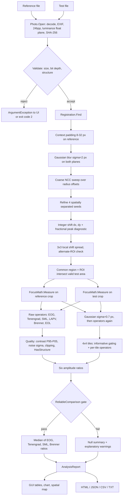
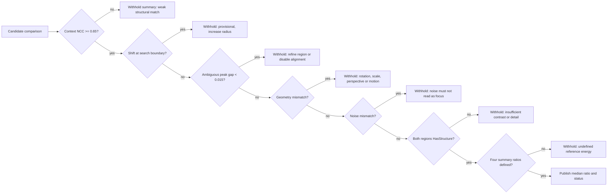

<div align="center">

# PhotoCompare 2.1

**Comparación de nitidez de imágenes anclada a una referencia para Windows — alinee cualquier fotograma de prueba contra un control de confianza, mida seis operadores de detalle y obtenga un veredicto reproducible con resolución espacial.**

[](https://learn.microsoft.com/en-us/dotnet/framework/install/guide-for-developers)
[](PhotoCompare.csproj)
[](src/ProductInfo.cs)
[](LICENSE)
[](#stack-tecnológico-y-arquitectura)
[](tests/PhotoTests.cs)

</div>

> [!IMPORTANT]
> Este repositorio distribuye una **aplicación de escritorio independiente para Windows**, no un producto del lado del servidor ni orientado a consola. `PhotoCompare.exe` es un ejecutable WinForms/GDI+ que funciona por sí solo: sin instalador, sin Python, sin OpenCV, sin paquetes NuGet y sin acceso a la red. La configuración se expresa únicamente mediante flags de CLI y controles de la ventana — **deliberadamente no existen** variables de entorno ni archivos de configuración.

---

## Tabla de contenidos

- [Características](#características)
- [Stack tecnológico y arquitectura](#stack-tecnológico-y-arquitectura)
  - [Stack principal](#stack-principal)
  - [Estructura del proyecto](#estructura-del-proyecto)
  - [Decisiones de diseño clave](#decisiones-de-diseño-clave)
  - [Pipeline de análisis](#pipeline-de-análisis)
  - [Compuerta de fiabilidad](#compuerta-de-fiabilidad)
- [Primeros pasos](#primeros-pasos)
  - [Requisitos previos](#requisitos-previos)
  - [Instalación](#instalación)
  - [Compilar desde el código fuente](#compilar-desde-el-código-fuente)
  - [Solución de problemas](#solución-de-problemas)
- [Pruebas](#pruebas)
  - [Comprobaciones numéricas del núcleo](#comprobaciones-numéricas-del-núcleo)
  - [Comprobaciones de integración por línea de comandos](#comprobaciones-de-integración-por-línea-de-comandos)
  - [Comprobaciones de humo de UI](#comprobaciones-de-humo-de-ui)
  - [Benchmarks](#benchmarks)
  - [Matriz de cobertura de pruebas](#matriz-de-cobertura-de-pruebas)
- [Despliegue](#despliegue)
  - [Distribución portátil](#distribución-portátil)
  - [Integración CI/CD](#integración-cicd)
  - [Contenedorización](#contenedorización)
- [Uso](#uso)
  - [Inicio rápido en la GUI](#inicio-rápido-en-la-gui)
  - [Qué significa el porcentaje](#qué-significa-el-porcentaje)
  - [Uso por línea de comandos](#uso-por-línea-de-comandos)
  - [Procesamiento por lotes](#procesamiento-por-lotes)
  - [Exportación](#exportación)
  - [Uso avanzado](#uso-avanzado)
  - [Referencia de teclado](#referencia-de-teclado)
- [Configuración](#configuración)
  - [Opciones de línea de comandos](#opciones-de-línea-de-comandos)
  - [Ajustes de la GUI](#ajustes-de-la-gui)
  - [Variables de entorno](#variables-de-entorno)
  - [Constantes fijas del motor](#constantes-fijas-del-motor)
  - [Esquemas de informe](#esquemas-de-informe)
- [Licencia](#licencia)
- [Contactos y soporte de la comunidad](#contactos-y-soporte-de-la-comunidad)

---

## Características

### Núcleo de medición

- **Puntuación anclada a una referencia.** Cada comparación se expresa respecto al nivel de detalle de una región de referencia elegida por el usuario, por lo que los resultados conservan su significado entre cámaras, objetivos, sensores y pipelines de procesado.
- **Seis operadores de detalle independientes** — EOG, Tenengrad, SML, LAPV, Brenner 2D y EOL (máscara térmica) — calculados con definiciones idénticas en ambas imágenes.
- **Resumen por mediana de cuatro operadores.** El porcentaje principal es la mediana de las relaciones de amplitud de EOG, Tenengrad, SML y Brenner 2D, robusta frente al comportamiento atípico de un operador. LAPV y EOL permanecen como diagnóstico.
- **Prefiltrado gaussiano uniforme σ = 0.7 px** aplicado a ambas regiones antes de formar las relaciones, suprimiendo el ruido de la rejilla de píxeles sin eliminar el detalle fino.
- **Relaciones conscientes de la energía.** Las métricas de gradiente al cuadrado se comparan mediante la raíz cuadrada de la relación (amplitud real), mientras que SML emplea una relación lineal.
- **Los resultados por encima del 100 % nunca se recortan.** Un detalle más nítido, ruido añadido y un enfoque digital agresivo pueden elevar legítimamente la puntuación por encima del nivel de referencia.
- **Normalización de contraste opcional** mediante `referencia (P95−P05) / prueba (P95−P05)`, desactivada por defecto porque puede enmascarar la pérdida de contraste causada por el desenfoque.

### Alineación y geometría

- **Búsqueda de traslación en subventana** con radio por defecto de ±32 px, ajustable hasta ±256 px, tras un suavizado gaussiano σ = 2 px.
- **Búsqueda NCC de grueso a fino** con refinamiento multi-semilla, de modo que objetivos periódicos como las cartas de cuatro barras no colapsan sobre un pico de alias.
- **Relleno de contexto** (8–32 px) alrededor de la región seleccionada solo para la alineación; las métricas siempre se miden dentro de la región común en píxeles originales.
- **Estimación fraccional del pico** (interpolación parabólica del pico de correlación) reportada como diagnóstico — las mediciones nunca se remuestrean.
- **Cribado geométrico** mediante muestreo 3×3 de desplazamientos locales y correlación de ROI alternativa; la rotación, el cambio de escala, la perspectiva y el movimiento independiente del primer plano se detectan y se reportan en lugar de confundirse con desenfoque.
- **Política de solo traslación.** Nunca se aplica reescalado automático, corrección de rotación ni deformación de perspectiva.

### Ingeniería de fiabilidad

- **Retención del resumen.** El porcentaje se suprime cuando la alineación es débil, ambigua o está en el límite de búsqueda, cuando la geometría es inconsistente, cuando las contribuciones de ruido difieren mucho o cuando la región carece de detalle utilizable. Todas las métricas brutas siguen disponibles.
- **Diagnóstico de calidad de entrada**: contraste P95−P05, luminancia media, desviación estándar, porcentaje de recorte, estimación robusta de ruido σ, fracción de energía de ruido, ratio de retención de desenfoque y flags de validez estructural.
- **Advertencias multinivel** replicadas en la GUI, HTML, JSON, CSV y TXT.

### Análisis espacial

- **Mapa de hasta 4×4 baldosas** sobre la región común, con clasificación informativa/no informativa por baldosa impulsada por la referencia.
- **Los degradados suaves de fondo se excluyen** para que las rampas de iluminación no puedan votar como evidencia de enfoque.
- **Resumen global, mediana local y rango local P25–P75** reportados por separado — una zona nítida ya no puede ocultar una borrosa tras un promedio global.
- **Superposiciones codificadas por color** en ambas vistas previas, más una tabla dedicada *Spatial tiles*.

### Productividad e integración

- **Procesamiento por lotes** sobre una carpeta de imágenes con aislamiento de errores por archivo, reutilización en caché de las mediciones de referencia, cancelación y exportación a CSV/JSON.
- **Cuatro formatos de exportación** — HTML autocontenido (sin scripts ni fotografías incrustadas), JSON completo, CSV plano y TXT legible.
- **Procedencia por diseño**: el SHA-256 de cada archivo fuente, la versión de la herramienta, los ajustes y las coordenadas de la región medida acompañan a cada informe.
- **Las imágenes de origen nunca se modifican**; el exportador se niega a escribir un informe sobre una ruta de entrada.
- **Cultura determinista**: el proceso fuerza `en-US` para culture y UI culture, por lo que el análisis y el formateo de números nunca dependen del host.
- **Paridad completa por CLI** para ejecuciones de par único y por lotes, con códigos de salida estables para automatización.
- **Cancelación en todas partes** — `Esc`/`Cancel` en mitad del análisis, comprobaciones cooperativas de `CancellationToken` dentro de los bucles de desenfoque, operadores y alineación.
- **Caché acotada en memoria** (`AnalysisSession`) que reutiliza las mediciones de referencia y prueba más la alineación cuando solo cambian la tolerancia o el modo de contraste.
- **Cero dependencias de terceros**: toda la aplicación es un único ejecutable compilado contra la biblioteca de clases de .NET Framework.

---

## Stack tecnológico y arquitectura

### Stack principal

| Capa | Tecnología | Notas |
| --- | --- | --- |
| Lenguaje | **C#** (sintaxis compatible con C# 5) | Sin `async`, sin cadenas interpoladas, sin miembros con cuerpo de expresión |
| Runtime | **.NET Framework 4.8** | Incluido en Windows 10 1903+ / Windows 11; el targeting pack solo se necesita para compilar |
| UI | **Windows Forms** (`System.Windows.Forms`) | Interfaz construida íntegramente en código — sin `.Designer.cs`, sin XAML, sin recursos |
| Imagen | **GDI+** (`System.Drawing`) | Decodificación, orientación EXIF, composición a 24 bpp, renderizado de vistas previas |
| Serialización | **`System.Web.Script.Serialization.JavaScriptSerializer`** | Informes JSON; sin dependencia de Newtonsoft/System.Text.Json |
| Compilación (IDE) | **MSBuild / Visual Studio 2022** | Formato de solución 12.00, toolset VS 17 |
| Compilación (CLI) | **`csc.exe` de `%WINDIR%\Microsoft.NET\Framework64\v4.0.30319`** | Invocado por `Build.ps1`; sin restauración de paquetes |
| Scripts | **Windows PowerShell 5.1** | `Build.ps1`, `Run-Tests.ps1`, `Run-Benchmark.ps1` |
| Concurrencia | **TPL** (`Parallel.For`) + `CancellationToken` | Se activa por encima de 300 000 píxeles; paralelismo limitado a `min(8, cores−1)` |
| Binario | **AnyCPU, `WinExe`** | Se ejecuta en x86 o x64 sin cambios |

> [!NOTE]
> `TreatWarningsAsErrors` está habilitado en `PhotoCompare.csproj` y `Build.ps1` pasa `/warnaserror+`. Una advertencia es un fallo de compilación — en un proyecto donde cambiar una sola constante invalida mediciones publicadas, esto evita la deriva numérica silenciosa y el código muerto.

### Estructura del proyecto

```text
reference-sharpness-comparator2/
├── PhotoCompare.sln              # Solución VS 2022 (Debug/Release, AnyCPU)
├── PhotoCompare.csproj           # v4.8 WinExe, RootNamespace=PhotoFocus, misma lista de fuentes que Build.ps1
├── PhotoCompare.exe              # Binario AnyCPU precompilado, sincronizado con src/ por BUILD.bat
├── START.bat                     # Lanza el EXE raíz en su sitio
├── BUILD.bat                     # Envoltorio de Build.ps1, hace pausa si falla
├── BUILD_AND_RUN.bat             # Envoltorio de Build.ps1 -Launch
├── Build.ps1                     # Compilación basada en csc con staging y reemplazo atómico
├── Run-Tests.ps1                 # Comprobaciones del núcleo + integración CLI (+ humo de UI opcional)
├── Run-Benchmark.ps1             # Arnés sintético de rendimiento
├── LICENSE                       # Apache License 2.0
├── README.md
├── src/
│   ├── Program.cs                # Punto de entrada, parser de argumentos, modos de shell   (~108 líneas)
│   ├── ProductInfo.cs            # Nombre, versión, conmutador de variante                  (~12 líneas)
│   ├── AssemblyInfo.cs           # Metadatos del ejecutable Win32                         (~7 líneas)
│   ├── FocusAnalysis.cs          # Imagen, operadores, alineación, informes               (~650 líneas)
│   ├── AnalysisSession.cs        # Caché acotada de medición/alineación                   (~43 líneas)
│   ├── PhotoForms.cs             # Ventana principal, lienzos, gráfico, baldosas           (~414 líneas)
│   ├── BatchAnalysis.cs          # Motor por lotes + ventana por lotes                    (~150 líneas)
│   └── ReportHtml.cs             # Informe HTML autocontenido + gráfico SVG               (~79 líneas)
├── tests/
│   ├── PhotoTests.cs             # 61 comprobaciones numéricas/de calidad de datos        (~238 líneas)
│   ├── Benchmark.cs              # Casos de temporización sintéticos reproducibles         (~52 líneas)
│   └── output/                   # Fixtures generados, informes, JSON de benchmark
├── bin/Release/                  # Salida del compilador (exe + pdb)
└── obj/                          # Staging e intermedios de MSBuild
```

<details>
<summary><strong>Responsabilidades por archivo, artefactos generados y por qué la salida de compilación está versionada</strong></summary>

**Archivos fuente y sus contratos**

| Archivo | Responsable de | Depende de |
| --- | --- | --- |
| `src/Program.cs` | Gramática de opciones, selección de modo, forzado de la configuración regional inglesa, códigos de salida, log de errores en `%TEMP%` | `ProductInfo`, `FocusMath`, `BatchAnalysis`, `ReportFiles`, `PhotoForms` |
| `src/ProductInfo.cs` | `Name`, `Version`, `FileVersion`, `Description`, conmutador de variante `IsComparison` | — |
| `src/FocusAnalysis.cs` | `GrayPlane`, `Photo`, `OperatorValues`, `ImageMeasures`, `TileMeasure`, `AlignmentResult`, `AnalysisReport`, `FocusMath`, `Registration`, `ReportFiles` | GDI+, `System.Web.Extensions` |
| `src/AnalysisSession.cs` | Caché indexada por identidad de objeto (`ReferenceEquals`) + región + ajustes | `FocusMath`, `Registration` |
| `src/PhotoForms.cs` | `PhotoCanvas` (pintado/zoom/pan/ROI/arrastrar y soltar/superposición de baldosas), `PhotoForm`, control de gráfico, resultados en pestañas | WinForms |
| `src/BatchAnalysis.cs` | `BatchItem`, `BatchAnalysis.Run/Save`, `BatchForm` con `BackgroundWorker` | `AnalysisSession`, WinForms |
| `src/ReportHtml.cs` | CSS en línea, gráfico de barras SVG, rejilla de baldosas, codificación HTML | `AnalysisReport` |

**Artefactos generados (seguros de borrar, se regeneran bajo demanda)**

- `bin/Debug`, `bin/Release` — salida de MSBuild. Las compilaciones del IDE aterrizan aquí; la compilación por CLI **deliberadamente no** las sobrescribe.
- `obj/command-line` — carpeta de staging que usa `Build.ps1` para el reemplazo atómico del EXE.
- `tests/output` — fixtures sintéticos (`reference.png`, `working.png`, `shifted.png`, `color-test.png`, `large-native.png`), una carpeta `batch-input` con un `broken.png` dañado a propósito, y los informes/JSON producidos por las comprobaciones.

Como la salida de compilación es reproducible byte a byte desde las fuentes con el compilador incluido, el repositorio mantiene un `PhotoCompare.exe` precompilado en la raíz únicamente por comodidad, para poder usar la herramienta en una máquina sin SDK. No es el artefacto autoritativo — lo es `src/`.

**Identidad del ensamblado**

`RootNamespace` es `PhotoFocus` mientras que el nombre del ensamblado es `PhotoCompare`. Esta discrepancia es intencionada: los espacios de nombres describen el módulo de dominio, el nombre del ensamblado describe el producto distribuido. `Build.ps1` lee `AssemblyName` del archivo de proyecto, lo valida con `^[A-Za-z][A-Za-z0-9_.-]*$` y deriva de él las rutas de staging y destino, por lo que renombrar el producto no requiere tocar el script.

</details>

### Decisiones de diseño clave

<details>
<summary><strong>1. Una escala relativa de referencia en lugar de un umbral universal de nitidez</strong></summary>

No existe un número absoluto y transferible de «en foco» para una fotografía individual: la textura de la escena, el ruido, la exposición, el demosaicing, la reducción de ruido y el enfoque mueven todos la energía de alta frecuencia. Por eso el motor responde exactamente a una pregunta — *¿cuánto detalle medido contiene esta región de prueba comparada con esta región de referencia?* — y lo declara sin ambigüedad:

- `100 %` es el **nivel de detalle medido de la referencia seleccionada**, no un enfoque óptico perfecto. Un control borroso define su propio 100 %.
- `80 %` significa que las amplitudes de detalle combinadas son menores que en la referencia; **no** es una afirmación de que el objetivo esté «un 20 % desenfocado».
- `115 %` significa que se mide más contenido de alta frecuencia, lo que puede provenir de un detalle más nítido, más ruido o un enfoque digital más fuerte.

El `Detail index` de imagen única (`100 × √Tenengrad(σ=0.7) / (P95−P05)`) existe en el motor y está cubierto por las comprobaciones, pero es una escala relativa sin límite superior y esta variante de la aplicación (`ProductInfo.IsComparison = true`) no la expone.

</details>

<details>
<summary><strong>2. Relaciones de amplitudes, no de energías, y mediana en lugar de media</strong></summary>

EOG, Tenengrad y Brenner 2D son cuadráticos respecto a la amplitud de píxel, por lo que una relación ingenua de esas energías reporta algo más cercano a una varianza que a un cambio de nitidez. El motor las compara mediante la raíz cuadrada de la relación (`100 × √(working / reference)`), mientras que SML — ya una medida lineal de diferencia de amplitud — usa la relación lineal. Las cuatro relaciones de resumen se reducen con una **mediana**, de modo que un operador que se comporta de forma inusual (por ejemplo, sobre una textura predominantemente vertical) no puede arrastrar el número titular.

Ambas regiones se filtran con el mismo gaussiano σ = 0.7 px antes de formar las relaciones, lo que hace la comparación simétrica en fase y suprime el suelo de ruido sin eliminar la banda de detalle que los operadores están diseñados para ver.

</details>

<details>
<summary><strong>3. Negarse a responder es una característica</strong></summary>

Un comparador que siempre devuelve un número siempre devolverá un número equivocado en los casos ambiguos. `ReliableComparison` es `true` solo cuando se cumplen **todas** estas condiciones:

- NCC de contexto ≥ 0.65,
- el mejor desplazamiento no está en el límite de búsqueda,
- no hay un pico alternativo igualmente plausible (separación de ambigüedad < 0.015 entre el mejor pico y el pico fuerte espacialmente distante),
- no hay desajuste geométrico (ganancia de ROI alternativa > 0.12 con desplazamiento ≥ 3 px, o dispersión de desplazamientos locales > 3.5 px en ≥ 4 baldosas aceptadas),
- no hay desajuste de ruido (σ del más ruidoso > max(3, 2 × σ del más silencioso + 0.5), fracción de energía de ruido > 0.5, retención de desenfoque < 0.3),
- ambas regiones reportan `HasStructure`,
- las cuatro relaciones de resumen están definidas.

Cuando la compuerta falla, `Status` pasa a `Reliable comparison unavailable`, `RelativeDetailPercent` es `null` y las advertencias explican qué condición falló. Las filas de métricas individuales siguen pobladas para que el ingeniero pueda seguir diagnosticando.

</details>

<details>
<summary><strong>4. Medición en píxeles enteros, sin remuestreo oculto</strong></summary>

La alineación devuelve un desplazamiento entero; la estimación fraccional se deriva del pico de correlación únicamente como diagnóstico. Las imágenes medidas **nunca** se interpolan, porque la interpolación es en sí misma un filtro paso bajo y deprimiría sistemáticamente la nitidez de la imagen remuestreada. En consecuencia:

- la rotación, la escala y la perspectiva no se corrigen, solo se detectan;
- se permiten dimensiones de archivo distintas solo si el objeto conserva la misma escala de píxel;
- un desplazamiento fraccional puede producir un error de fase de píxel en barras periódicas muy finas, y el informe lo dice explícitamente.

</details>

<details>
<summary><strong>5. Fallar rápido ante entradas no soportadas en lugar de degradar en silencio</strong></summary>

GDI+ reduce silenciosamente algunos PNG de 16 bits a 8 bits. En lugar de aceptar una medición silenciosamente incorrecta, `Photo.Open` inspecciona el byte de profundidad de bits IHDR de la cabecera PNG, lee la etiqueta TIFF `BitsPerSample` (0x102) y rechaza los datos de alta profundidad con un mensaje accionable. Los límites se aplican antes de la asignación: 24 000 000 de píxeles totales y 16 000 píxeles por lado. Se aplica la orientación EXIF (0x112) para que la vista previa y la medición coincidan. La transparencia se compone sobre blanco con una advertencia explícita. Solo se carga el primer fotograma de un archivo multipágina o animado, también con advertencia.

</details>

<details>
<summary><strong>6. Salidas deterministas y auditables</strong></summary>

- El proceso fija `CultureInfo` en `en-US` en el hilo por defecto, la UI culture y el hilo actual, de modo que `int.Parse`/`ToString` nunca siguen la configuración regional del host.
- Los campos numéricos del CSV se escriben con el formato de ida y vuelta `G17` en cultura invariante; los valores mostrados en TXT/HTML se redondean a tres decimales.
- Cada informe lleva la versión de la herramienta (`PhotoCompare 2.1`) y los digests SHA-256 de ambos archivos fuente.
- El informe HTML es un único archivo con CSS en línea y gráfico SVG en línea — **sin `<script>`, sin ``** — por lo que se renderiza igual desde un correo, una máquina aislada o un archivo de cumplimiento, y no puede ejecutar ni exfiltrar nada.
- Los nombres de archivo y las cadenas de advertencia se codifican con `WebUtility.HtmlEncode`; las celdas CSV por lotes que empiezan por `= + - @` reciben el prefijo `'` para neutralizar la inyección de fórmulas.

</details>

<details>
<summary><strong>7. Estado acotado, ciclos de vida explícitos</strong></summary>

`Photo` implementa `IDisposable` y posee su `Bitmap`; el cargador copia los píxeles a un plano de luminancia `float[]` (0–255) y libera el handle del archivo de inmediato, por lo que un archivo fuente puede renombrarse o borrarse mientras la ventana de análisis está abierta. `AnalysisSession` retiene como máximo una medición de referencia, una de prueba y una alineación, se invalida con `Clear()` y se crea por ventana y por lote — no se comparte estado estático de imagen entre ventanas ni hilos de trabajo. `Program` libera las fotos decodificadas en bloques `finally`.

</details>

<details>
<summary><strong>8. Ninguna superficie de configuración más allá de flags y controles</strong></summary>

Una herramienta de medición que captura en silencio un `.env`, una clave del registro o un archivo de ajustes móvil es una herramienta que no se puede reproducir seis meses después. Cada entrada del motor es un argumento explícito o un control visible, y cada salida registra esos valores. La interfaz también rechaza invocaciones contradictorias: opciones duplicadas, modos mezclados (`--image` con `--batch`), ambos modos de contraste y opciones de comparación en una variante de imagen única generan errores de argumento.

</details>

<details>
<summary><strong>9. Compilación atómica, fallos aislados</strong></summary>

`Build.ps1` compila en `obj/command-line/` y solo después mueve el resultado sobre el ejecutable raíz. Un fallo de compilación — o un destino bloqueado porque la aplicación sigue en ejecución — deja intacto el binario que funcionaba y el script lo indica. El análisis por lotes aplica la misma filosofía en tiempo de ejecución: un archivo dañado o ausente se convierte en un error de fila mientras el resto de imágenes continúa, y el proceso sale con `1` en lugar de abortar.

</details>

### Pipeline de análisis

<details open>
<summary><strong>Flujo de datos de extremo a extremo: de dos archivos a un porcentaje con compuerta</strong></summary>



</details>

<details>
<summary><strong>Definiciones y unidades de los operadores tal como están implementadas</strong></summary>

| Operador | Índice | Definición en el código | Unidad | Rol |
| --- | --- | --- | --- | --- |
| `EOG` | 0 | Media de los cuadrados de las diferencias hacia delante en X e Y | levels²/px | Resumen |
| `Tenengrad` | 1 | Energía Sobel X/Y media; cada kernel dividido entre 8 | levels²/px | Resumen |
| `SML` | 2 | Media de las diferencias segundas absolutas en X/Y; paso 1, umbral 0 | levels/px | Resumen (relación lineal) |
| `LAPV` | 3 | Varianza del Laplaciano de cuatro vecinos | levels² | Diagnóstico |
| `Brenner 2D` | 4 | La mitad de la suma de las medias de los cuadrados de las diferencias de paso 2 en X e Y | levels²/px | Resumen |
| `EOL (thermal)` | 5 | Media del cuadrado de la respuesta de la máscara centro-20 / vecino-−4 / diagonal-−1 | levels²/px | Diagnóstico |

Los seis se promedian solo sobre las posiciones interiores válidas (normalización `(w−2)(h−2)` para los operadores interiores, `(w−1)(h−1)` para EOG, `h(w−2)` y `(h−2)w` para los dos ejes de Brenner) y se calculan sobre la rejilla de píxeles original. La columna σ = 0.7 repite definiciones idénticas sobre el plano filtrado, por lo que «original frente a filtrado» es una comparación de igual a igual, no un cambio de fórmula.

</details>

<details>
<summary><strong>El algoritmo de registro en detalle</strong></summary>

1. **Región de contexto.** Con la alineación activada, la ROI seleccionada se infla `min(32, max(8, min(w,h)/4))` píxeles y se intersecta con los límites de la referencia. Este contexto ayuda a localizar un objetivo muy desenfocado o de bajo contraste; nunca contribuye a la región de métricas.
2. **Suavizado.** Tanto el contexto de referencia como la ventana de búsqueda de prueba se desenfocan con σ = 2 px para que la NCC sea insensible al ruido y al aliasing fino.
3. **Ventana de búsqueda.** La ventana de prueba es el contexto inflado por `radius + 5`, de modo que todo desplazamiento candidato hasta el radio permanece completamente dentro de la imagen de prueba.
4. **Barrido grueso.** Los desplazamientos se muestrean con un paso de `ceil(radius / 12)` (más `0`, `−radius`, `+radius`), puntuados por correlación cruzada normalizada sobre una subrejilla muestreada de unas 40 muestras por eje.
5. **Refinamiento multi-semilla.** Hasta cuatro picos gruesos espacialmente separados se refinan a resolución completa de vecindad con un paso más fino (`/72`). Esto evita fijarse en un alias de una carta de cuatro barras regular.
6. **Detección de ambigüedad.** La mejor puntuación se compara con el candidato más fuerte al menos a `max(6, 2 × coarse)` px; una separación inferior a 0.015 con ambas puntuaciones por encima de 0.65 marca el resultado como ambiguo.
7. **Estimación fraccional.** Un ajuste parabólico sobre los vecinos horizontales y verticales del pico produce `FractionalDx/FractionalDy`, recortados a ±0.5 px. Valores más allá de 0.25 px respecto al desplazamiento entero generan una advertencia de fase de píxel.
8. **Cribado geométrico.** Si la NCC de ROI < 0.85, se ejecuta una búsqueda alternativa que maximiza la correlación de la ROI local; un pico alternativo mucho mejor y lejos del primario indica desajuste geométrico. Para ROI ≥ 128×128 px, nueve búsquedas locales de bloque 3×3 dentro de ±3 px miden la dispersión residual de desplazamientos; una dispersión > 3.5 px en ≥ 4 baldosas confiadas señala rotación, escala, perspectiva o movimiento independiente.
9. **Región común.** Se mide `ROI ∩ área válida de prueba`; si la alineación eliminó más del 20 % del área seleccionada, se emite una advertencia.

Un desplazamiento reportado `dx, dy` significa que el píxel de referencia `(x, y)` corresponde al píxel de prueba `(x + dx, y + dy)`.

</details>

### Compuerta de fiabilidad

<details>
<summary><strong>Lógica de decisión sobre si se permite mostrar un porcentaje</strong></summary>



Cada caso retenido sigue devolviendo la tabla de métricas, el mapa de baldosas, el diagnóstico y las advertencias. `ReliableComparison` se serializa en JSON para que la automatización pueda ramificar por él y no por el código de salida.

</details>

---

## Primeros pasos

### Requisitos previos

| Requisito | Versión / Notas | Necesario para |
| --- | --- | --- |
| Windows | Windows 10 1903+ o Windows 11 (cualquier edición) | Ejecutar la GUI |
| .NET Framework | Runtime **4.8** — preinstalado en las compilaciones compatibles de Windows | Ejecutar la aplicación |
| PowerShell | **Windows PowerShell 5.1** (`powershell.exe`, no solo `pwsh`) | `Build.ps1`, `Run-Tests.ps1`, `Run-Benchmark.ps1` |
| .NET Framework 4.8 Developer Pack | Solo si compila con **Visual Studio** | Compilación MSBuild/VS |
| Visual Studio 2022 (opcional) | Carga de trabajo *.NET desktop development* | Edición y depuración en IDE |
| `csc.exe` | `%WINDIR%\Microsoft.NET\Framework64\v4.0.30319\csc.exe` | Compilación por script sin SDK |

> [!TIP]
> Si `PhotoCompare.exe` ya se inicia en su máquina, tiene todo lo necesario para *usar* la herramienta. El compilador, el SDK y los scripts de PowerShell solo se necesitan para *modificarla*.

> [!WARNING]
> Windows on ARM ejecuta esta aplicación mediante emulación x64 solo cuando está presente .NET Framework 4.8. macOS, Linux y Wine no son objetivos soportados: la UI es WinForms y la capa de imagen es GDI+, ninguna de las cuales es multiplataforma.

### Instalación

No existe instalador. Clone y ejecute:

```powershell
# 1. Clonar el repositorio
git clone https://github.com/DroneNotes/reference-sharpness-comparator2.git
cd reference-sharpness-comparator2

# 2. Verificar que el runtime está presente (imprime la clave de versión 4.8, p. ej. 528040)
reg query "HKLM\SOFTWARE\Microsoft\NET Framework Setup\NDP\v4\Full" /v Release

# 3. Lanzar el binario precompilado
.\START.bat
# o directamente:
.\PhotoCompare.exe
```

¿Prefiere una compilación propia? Sustituya el paso 3 por:

```powershell
# Recompilar el ejecutable raíz desde src/ y luego lanzarlo
.\BUILD_AND_RUN.bat
```

**Recorrido del primer uso**

1. Haga clic en **1. Open reference…** (o `Ctrl+Shift+O`, o suelte un archivo sobre la vista previa izquierda).
2. Haga clic en **2. Open test image…** (o `Ctrl+O`, o suelte sobre la vista previa derecha).
3. Arrastre con el botón izquierdo para seleccionar un objetivo u objeto texturizado **en la vista previa de referencia**.
4. El análisis comienza automáticamente. Revise el porcentaje principal, la tabla de métricas y las advertencias.
5. Active **Spatial map** o abra **Spatial tiles** para inspeccionar las diferencias locales.
6. Use **Save result…** (`Ctrl+S`) para exportar a HTML, JSON, CSV o TXT.

### Compilar desde el código fuente

<details>
<summary><strong>Compilación por script, Visual Studio, invocación manual de <code>csc</code> y parámetros de los scripts</strong></summary>

#### A. Compilación por script (sin SDK)

```powershell
# Recompilar .\PhotoCompare.exe desde src/
powershell -NoProfile -ExecutionPolicy Bypass -File .\Build.ps1

# Recompilar y luego lanzar
powershell -NoProfile -ExecutionPolicy Bypass -File .\Build.ps1 -Launch

# Recompilar y luego ejecutar el conjunto completo de comprobaciones
powershell -NoProfile -ExecutionPolicy Bypass -File .\Build.ps1 -Tests
```

Comportamiento de `Build.ps1`, paso a paso:

1. Localiza exactamente un `*.csproj` en la carpeta del script y falla en caso contrario.
2. Lee `<AssemblyName>` y lo valida contra `^[A-Za-z][A-Za-z0-9_.-]*$`.
3. Resuelve `csc.exe` primero desde `Framework64`, con respaldo en `Framework`.
4. Expande cada entrada `<Compile Include=…>` y rechaza cualquier ruta que escape de la raíz del proyecto.
5. Compila en `obj\command-line\<AssemblyName>.exe` con `/target:winexe /platform:anycpu /optimize+ /warn:4 /warnaserror+ /main:PhotoFocus.Program`.
6. Mueve el archivo temporal sobre `.\PhotoCompare.exe` — preservando atómicamente el binario anterior ante cualquier fallo.

#### B. Visual Studio

```powershell
# Equivalente por línea de comandos de «Build Solution» para la configuración Release
msbuild .\PhotoCompare.sln /t:Rebuild /p:Configuration=Release /p:Platform="Any CPU"
```

Abra `PhotoCompare.sln` para el trabajo interactivo; la salida del IDE aterriza en `bin\Debug` o `bin\Release`. Requiere el .NET Framework 4.8 Developer/Targeting Pack ([guía de Microsoft](https://learn.microsoft.com/en-us/dotnet/framework/install/guide-for-developers)).

#### C. Invocación manual del compilador

```powershell
$csc = "$env:WINDIR\Microsoft.NET\Framework64\v4.0.30319\csc.exe"
& $csc /nologo /target:winexe /platform:anycpu /optimize+ /warn:4 /warnaserror+ /main:PhotoFocus.Program `
  /out:.\PhotoCompare.exe `
  /r:System.dll,System.Core.dll,System.Drawing.dll,System.Windows.Forms.dll,System.Web.Extensions.dll `
  .\src\ProductInfo.cs .\src\AssemblyInfo.cs .\src\Program.cs .\src\FocusAnalysis.cs `
  .\src\AnalysisSession.cs .\src\PhotoForms.cs .\src\BatchAnalysis.cs .\src\ReportHtml.cs
```

#### D. Añadir un archivo fuente

Los nuevos archivos `.cs` deben listarse en **`PhotoCompare.csproj`** (`<Compile Include=…>`) y en ningún otro sitio — `Build.ps1` deriva su lista de archivos del proyecto, por lo que el archivo de proyecto es la única fuente de verdad. Mantenga el código nuevo compatible con C# 5 si piensa compilar con el compilador incluido; introduzca sintaxis más reciente solo si eleva la versión de lenguaje en ambas rutas de compilación.

</details>

### Solución de problemas

<details>
<summary><strong>Fallos habituales de compilación y ejecución y sus causas exactas</strong></summary>

| Síntoma | Causa | Solución |
| --- | --- | --- |
| `Expected one C# project file in this folder.` | Cero o varios archivos `.csproj` | Mantenga exactamente un archivo de proyecto junto a `Build.ps1` |
| `The Windows .NET Framework C# compiler was not found.` | Ejecución fuera de Windows o en un entorno recortado | Instale .NET Framework 4.8 o use Visual Studio 2022 |
| `Compilation failed. The previous executable has been preserved.` | Error de compilación, o una característica de lenguaje que el compilador incluido rechaza | Corrija el error; mantenga la sintaxis compatible con C# 5 o compile con el toolset de VS |
| `Close the running application and build again.` | El EXE de destino está bloqueado por una instancia en ejecución | Cierre PhotoCompare y recompile |
| `error CS0246: … System.Web.Extensions` | Se alteró la lista de referencias | Mantenga las cinco referencias del archivo de proyecto |
| `Run BUILD.bat before running checks.` | `Run-Tests.ps1` requiere un EXE raíz | Compile primero y vuelva a ejecutar |
| `16-bit PNG is not supported.` | Profundidad de bits IHDR > 8 | Exporte una imagen de visualización de 8 bits sin redimensionar |
| `TIFF channels above 8 bits are not supported.` | `BitsPerSample` > 8 | Exporte un TIFF de 8 bits |
| `The limit is 24 million pixels and 16,000 pixels per side.` | Archivo demasiado grande | Recorte a resolución original en lugar de redimensionar |
| `The region must be inside the image and at least 16×16 pixels.` | ROI demasiado pequeña o fuera de límites | Use ≥ 48×48 px sobre un objeto texturizado |
| `No common image region.` | La alineación no puede situar la ROI dentro del fotograma de prueba | Amplíe el lienzo de prueba o reduzca el radio de búsqueda |
| `A report cannot overwrite a source image.` | `--out` coincide con una ruta de entrada | Elija otra ruta de salida |
| `Unknown option or missing value: …` | Error tipográfico o flag sin su valor | Compare con la tabla de opciones |
| `Duplicate option: …` | El mismo conmutador se pasó dos veces | Pase cada opción una sola vez |
| `Batch, single-image and test modes must be run separately.` | Dos de `--image`, `--batch`, `--smoke`, `--smoke-batch` combinados | Ejecute un modo por proceso |
| `Specify --image / --batch, or start the application without arguments.` | Opciones sin modo | Añada un modo o inicie la GUI |
| SmartScreen «editor desconocido» | Binario sin firmar | Verifique el SHA-256 contra su propia compilación y permita; o firme su build |
| Los valores difieren del equipo de un colega | Distintas rutas de coma flotante, distinta versión o distinta región | Compare `ToolVersion`, `RequestedArea` y el SHA-256 de origen en el JSON |

**El código de salida 2 sin diálogo** es lo esperado en modo CLI: un proceso de subsistema GUI no tiene consola asociada, por lo que el mensaje se escribe en `%TEMP%\PhotoCompare-error.txt`. Lea ese archivo y corrija la invocación.

</details>

---

## Pruebas

La suite está dividida intencionadamente en **comprobaciones numéricas puras** (rápidas, deterministas, sin GUI) y **comprobaciones a nivel de aplicación** (lanzamientos reales de proceso, exportaciones reales, códigos de salida reales).

```powershell
# Todo: comprobaciones del núcleo + comprobaciones de integración CLI
powershell -NoProfile -ExecutionPolicy Bypass -File .\Run-Tests.ps1

# Todo, más ejecuciones de humo de la GUI de la ventana principal y la ventana por lotes
powershell -NoProfile -ExecutionPolicy Bypass -File .\Run-Tests.ps1 -Ui

# Arnés sintético de rendimiento (medianas de tres ejecuciones)
powershell -NoProfile -ExecutionPolicy Bypass -File .\Run-Benchmark.ps1
```

> [!IMPORTANT]
> `Run-Tests.ps1` requiere un `PhotoCompare.exe` previamente compilado en la raíz del proyecto y termina con código distinto de cero en el primer fallo con un mensaje `FAIL: <check name>` en stderr. Una ejecución correcta termina con `PASS: PhotoCompare local numerical, command-line, export and batch checks.` y escribe `tests/output/test-results.json` con el recuento de aprobados y las mediciones clave.

### Comprobaciones numéricas del núcleo

`Run-Tests.ps1` compila `ProductInfo.cs`, `FocusAnalysis.cs`, `AnalysisSession.cs`, `ReportHtml.cs`, `BatchAnalysis.cs` junto con `tests/PhotoTests.cs` en `tests/output/CoreChecks.exe` (sin fuentes de GUI) y luego lo ejecuta con la carpeta de salida como `argv[0]`. Los fixtures se generan en proceso a partir de semillas fijas (`Random(72)`, `Random(91)`, `Random(103)`), por lo que los resultados son estables bit a bit entre máquinas.

El arnés construye una escena sintética deliberadamente no periódica — sinusoides moduladas, dos grupos de cuatro barras en orientaciones distintas, un disco y un borde inclinado — además de ayudantes que aplican ganancia/offset/ruido/desplazamiento (`Change`) y rotación/escala/deformaciones subpíxel (`Warp`).

```powershell
# Ejecutar solo las comprobaciones del núcleo (equivalente a lo interno de la suite)
powershell -NoProfile -Command "& .\tests\output\CoreChecks.exe .\tests\output"
```

Cada comprobación imprime `PASS: <name>`; la línea final es `All 61 checks passed.` El archivo de resultados registrado tiene este aspecto:

```json
{"passed":61,"identity":100,"gain":100.45,"sharper":155.59,"noise":11.99,
 "measurements":[{"sigma":0.5,"score":97.64,"ncc":0.99997},
                 {"sigma":1.0,"score":83.50,"ncc":0.99941},
                 {"sigma":1.8,"score":64.38,"ncc":0.99543},
                 {"sigma":3.0,"score":38.53,"ncc":0.98071}]}
```

### Comprobaciones de integración por línea de comandos

Tras las comprobaciones del núcleo, `Run-Tests.ps1` lanza el ejecutable real con `Start-Process -WindowStyle Hidden -Wait` y verifica códigos de salida y contenido:

1. **Cuatro rutas de exportación** — `application.json`, `.html`, `.csv`, `.txt` deben completarse cada una con código de salida `0`.
2. **Semántica de identidad** — `ToolVersion` empieza por `PhotoCompare `, el ancho de trabajo reportado es `320`, y una comparación de la referencia consigo misma produce `RelativeDetailPercent == 100` dentro de `1e-7`.
3. **Aislamiento de fallos por lotes** — una carpeta con dos imágenes válidas y un archivo de texto `broken.png` debe salir con `1` y producir exactamente tres filas de las cuales exactamente una lleva `Error`.
4. **Inmutabilidad de la fuente** — el hash de la imagen de prueba antes y después de un intento de exportar sobre ella debe ser idéntico, y el intento debe salir con `2`.

### Comprobaciones de humo de UI

`-Ui` añade dos ejecuciones de humo que recorren toda la ruta de construcción de WinForms:

```powershell
powershell -NoProfile -ExecutionPolicy Bypass -File .\Run-Tests.ps1 -Ui
```

- `--smoke <folder>` — abre el par referencia/prueba, selecciona la ROI, completa un análisis y guarda `compare-ui.png` / `compare-ui.json`.
- `--smoke-batch <folder>` — abre el motor por lotes con una referencia sintética y escribe `compare-batch-ui.png` / `compare-batch-ui.json`.

La ejecución falla si falta cualquiera de esos cuatro archivos.

### Benchmarks

```powershell
powershell -NoProfile -ExecutionPolicy Bypass -File .\Run-Benchmark.ps1
# → tests/output/benchmark.json
```

`tests/Benchmark.cs` calienta con un caso de 48×48, luego mide los modos **single** y **compare** a **640×512** y **3840×2400** con tres repeticiones cronometradas cada uno (se reporta la mediana). Compilado con `/define:PHOTO_V2`, añade un caso `compare_cached_settings` que ejecuta 25 iteraciones a través de un `AnalysisSession` ya caliente con una tolerancia variable, aislando el coste de la ruta de solo ajustes. La salida JSON registra el nombre de la máquina, el número de procesadores, la versión del runtime y los arrays de muestras brutas, de modo que las regresiones pueden atribuirse al hardware o al código.

> [!TIP]
> Ejecute el benchmark antes y después de tocar cualquier cosa en `GrayPlane`, `Operators` o `Registration`. El umbral de 300 000 píxeles que activa `Parallel.For`, el tamaño de bloque de 64 filas y el límite de `min(8, cores−1)` son críticos para el rendimiento; cambiarlos altera tanto los tiempos como — mediante distintos órdenes de suma — los últimos dígitos de cada métrica.

### Matriz de cobertura de pruebas

<details>
<summary><strong>Qué afirman realmente las 61 comprobaciones del núcleo</strong></summary>

| Área | Afirmaciones representativas |
| --- | --- |
| Identidad y álgebra | Imágenes idénticas puntúan exactamente 100 %; cada relación de operador es 100; `dx = dy = 0` |
| Respuesta monótona al desenfoque | Gaussiano σ = 0.5 → 97.6 %, 1.0 → 83.5 %, 1.8 → 64.4 %, 3.0 → 38.5 %, estrictamente decreciente |
| Corrección de alineación | Los desplazamientos `(11,−7)`, `(−17,12)`, `(0,19)` se recuperan exactamente y la puntuación vuelve a 100 ± 0.01 |
| Independencia del lienzo | La misma escena en un lienzo mayor con offset `(9,5)` produce idéntica puntuación; sin reescalado |
| Ambigüedad | Un patrón de barras de 4 px reporta `Ambiguous` y retiene el resumen |
| Límite de búsqueda | Un desplazamiento de 32 px con `radius = 32` reporta `AtSearchLimit` y no es fiable |
| Geometría | Una rotación de 3°, una escala de 1.05× y un bloque de primer plano movido de forma independiente fallan la compuerta |
| Honestidad subpíxel | Una deformación de `(0.4,−0.3)` produce una estimación fraccional dentro de 0.18 px mientras las métricas siguen sin interpolar |
| Contraste | Ganancia 0.65 + offset 25 puntúa 100.45 % con normalización y ~65 % sin ella |
| Riesgo de normalización | Un desenfoque sinusoidal que se lee al 80 % bruto supera el 95 % al normalizar, y emite una advertencia de enmascaramiento |
| Ruido | Un ruido añadido σ = 18 dispara `NoiseMismatch`; una imagen solo de ruido se marca y no obtiene índice de nitidez |
| Sobreenfoque | Comparar una referencia borrosa con el original nítido produce 155.6 % — nunca recortado a 100 % |
| Matemática de operadores | Rampa lineal `2x + 3y`: EOG = Tenengrad = 13, Brenner = 26, SML/EOL/LAPV = 0 (analítico) |
| Precisión gaussiana | El desenfoque optimizado σ = 0.7 coincide con una convolución 2-D directa dentro de 1e-3, incluidos los bordes |
| Aislamiento de ROI | Los píxeles fuera de la región seleccionada no pueden cambiar ninguna métrica |
| Con zancada frente a recortado | Los operadores basados en vista igualan a los recortados de forma independiente dentro de 1e-12 relativo |
| Robustez sin estructura | Imágenes uniformes, referencias planas, rampas de fondo y estructura invertida se rechazan como evidencia |
| Mapa espacial | Una imagen medio borrosa muestra P75−P25 > 20 y 0 < `LowerDetailTiles` < `InformativeTiles`; las rejillas coinciden en 16 baldosas |
| Integridad de exportación | El CSV contiene todas las métricas; el JSON se deserializa sin ciclos; el HTML contiene SVG y todas las baldosas, sin `<script>` ni `` |
| Escape | `<script>` en un nombre de archivo o advertencia se codifica; `&` pasa a `&amp;` |
| Higiene de NaN/Inf | El HTML de una imagen plana no contiene ni `NaN` ni `Infinity` |
| Caché | Cambiar solo los ajustes reutiliza las cachés de imagen y alineación (2 mediciones + 1 alineación), `Clear()` las invalida |
| Cancelación | Los tokens precancelados abortan incluso con acierto de caché; un análisis de 1024×768 se aborta en vuelo |
| Contrato del cargador | Luminancia y dimensiones nativas preservadas; handle de archivo liberado tras la carga; SHA-256 de 64 caracteres hex |
| Lotes | Archivos válidos/ausentes mezclados aíslan errores y aun así exportan CSV y JSON |

</details>

---

## Despliegue

### Distribución portátil

PhotoCompare se despliega como un **ejecutable suelto en una carpeta**. No hay MSI, ni servicio, ni huella en el registro, ni estado en el perfil del usuario.

```powershell
# 1. Producir un binario de release (optimizado, sin advertencias)
powershell -NoProfile -ExecutionPolicy Bypass -File .\Build.ps1

# 2. Verificar el artefacto antes de distribuirlo
powershell -NoProfile -ExecutionPolicy Bypass -File .\Run-Tests.ps1
Get-FileHash .\PhotoCompare.exe -Algorithm SHA256

# 3. Montar la carpeta de distribución
$dist = ".\dist\PhotoCompare-2.1"
New-Item -ItemType Directory -Force $dist | Out-Null
Copy-Item .\PhotoCompare.exe, .\README.md, .\LICENSE, .\START.bat $dist
Compress-Archive -Path $dist -DestinationPath ".\dist\PhotoCompare-2.1-win-anycpu.zip" -Force
```

**Lista de verificación de release**

- [ ] `Run-Tests.ps1` reporta `PASS` y `All 61 checks passed.`
- [ ] `Run-Tests.ps1 -Ui` produce los cuatro artefactos de humo
- [ ] `benchmark.json` regenerado y comparado con la release anterior
- [ ] `ProductInfo.Version` y `FileVersion` incrementados; `README.md` refleja la nueva versión
- [ ] SHA-256 del EXE distribuido publicado junto al archivo
- [ ] El archivo no contiene `tests/output`, ni `bin`, ni `obj`
- [ ] Firmado con un certificado Authenticode si se distribuye fuera de su organización

> [!CAUTION]
> Distribuya solo binarios compilados desde un commit revisado. El `PhotoCompare.exe` precompilado del repositorio es una comodidad para el mantenedor; un EXE sin firmar descargado de un espejo no confiable es un riesgo innecesario para la cadena de suministro. Publique su SHA-256 y, preferiblemente, fírmelo con Authenticode.

<details>
<summary><strong>Firma de código para una compilación de release</strong></summary>

```powershell
$cert = Get-ChildItem Cert:\CurrentUser\My -CodeSigningCert | Select-Object -First 1
Set-AuthenticodeSignature -FilePath .\PhotoCompare.exe -Certificate $cert `
  -TimestampServer "http://timestamp.digicert.com" -HashAlgorithm SHA256
Get-AuthenticodeSignature .\PhotoCompare.exe | Format-List Status, SignerCertificate
```

`Status` debe leer `Valid`. Firme **después** de la compilación final y **antes** de calcular el hash o archivar; volver a ejecutar `Build.ps1` reemplaza el archivo y descarta la firma.

</details>

### Integración CI/CD

Este repositorio no incluye archivos de workflow, por lo que no hay un badge de pipeline en vivo. El siguiente workflow de GitHub Actions es un punto de partida listo para usar; se ejecuta en `windows-latest`, que ya proporciona el targeting pack de .NET Framework 4.8 y PowerShell 5.1.

```yaml
# .github/workflows/windows-build.yml
name: Windows build and checks

on:
  push:
    branches: [main]
  pull_request:
  workflow_dispatch:

jobs:
  build-and-test:
    runs-on: windows-latest
    steps:
      - uses: actions/checkout@v4

      - name: Show runtime
        shell: powershell
        run: |
          reg query "HKLM\SOFTWARE\Microsoft\NET Framework Setup\NDP\v4\Full" /v Release

      - name: Build root executable
        shell: powershell
        run: powershell -NoProfile -ExecutionPolicy Bypass -File .\Build.ps1

      - name: Core and integration checks
        shell: powershell
        run: powershell -NoProfile -ExecutionPolicy Bypass -File .\Run-Tests.ps1

      - name: UI smoke checks
        shell: powershell
        run: powershell -NoProfile -ExecutionPolicy Bypass -File .\Run-Tests.ps1 -Ui

      - name: Benchmark
        shell: powershell
        run: powershell -NoProfile -ExecutionPolicy Bypass -File .\Run-Benchmark.ps1

      - name: Upload results
        uses: actions/upload-artifact@v4
        with:
          name: photocompare-results
          path: |
            tests/output/test-results.json
            tests/output/benchmark.json
            tests/output/compare-ui.json
            tests/output/compare-batch-ui.json
```

> [!NOTE]
> Los pasos de humo de UI necesitan una sesión de escritorio interactiva. Los runners Windows alojados en GitHub la proporcionan para WinForms; si su runner se ejecuta como servicio sin escritorio, elimine el paso `-Ui` y mantenga las comprobaciones del núcleo e integración.

**Contrato de automatización.** Una invocación CLI es segura para programar. Los códigos de salida son estables: `0` = completado (incluida una comparación no fiable), `1` = lote completado con errores por archivo, `2` = error de entrada, argumentos o salida. Ramifique por `ReliableComparison` en el JSON, no por el código de salida, cuando importe la validez de la comparación.

### Contenedorización

<details>
<summary><strong>Por qué no hay una imagen de contenedor soportada y cómo se ve un experimento con contenedores Windows</strong></summary>

La aplicación está dirigida a **.NET Framework 4.8** y **Windows Forms**, que dependen de APIs de sesión de usuario Win32/GDI+. No existe una ruta de contenedor Linux: las imágenes `mcr.microsoft.com/dotnet/framework/*` pueden alojar el *runtime*, pero un GUI `WinExe` sigue necesitando una sesión de escritorio, y las operaciones `System.Drawing` requieren GDI+ presente en la imagen. Considere la contenedorización como no soportada y use una carpeta portátil más una tarea programada, una sesión SSH o un runner de CI.

Si controla un host de contenedores Windows y acepta las restricciones, este Dockerfile experimental demuestra la única forma viable — compilar y ejecutar dentro de una imagen Windows con sesión interactiva:

```dockerfile
# Dockerfile.windows — EXPERIMENTAL, solo contenedores Windows, requiere sesión interactiva
FROM mcr.microsoft.com/dotnet/framework/sdk:4.8-windowsservercore-ltsc2022 AS build
WORKDIR C:\src
COPY . .
RUN powershell -NoProfile -ExecutionPolicy Bypass -File .\Build.ps1

FROM mcr.microsoft.com/dotnet/framework/runtime:4.8-windowsservercore-ltsc2022
WORKDIR C:\app
COPY --from=build C:\src\PhotoCompare.exe .
COPY --from=build C:\src\README.md .
# Debe existir ya una sesión GUI en el host del contenedor; esto no es un servicio headless.
ENTRYPOINT ["C:\\app\\PhotoCompare.exe"]
```

Un archivo Compose equivalente solo añade orquestación alrededor de esa restricción:

```yaml
services:
  photocompare:
    build:
      context: .
      dockerfile: Dockerfile.windows
    isolation: process
    stdin_open: true
    tty: true
```

> [!WARNING]
> Esta ruta no está verificada por la suite de comprobaciones del proyecto y no es un objetivo de despliegue soportado. Para trabajo por lotes desatendido, prefiera la CLI documentada en un host Windows normal o en un runner de CI — esa es la configuración que realmente validan las pruebas de integración.

</details>

---

## Uso

### Inicio rápido en la GUI

La ventana se construye íntegramente en código y se divide en cinco regiones: la barra de herramientas, la franja de opciones, las dos vistas previas (solo la de referencia acepta el arrastre de región), el bloque de veredicto y un panel inferior con tres pestañas (*Metrics and chart*, *Spatial tiles*, *Interpretation and warnings*).

**Flujo de trabajo con referencia**

1. Cargue la imagen de control en la vista previa izquierda.
2. Cargue la imagen a evaluar en la vista previa derecha.
3. Arrastre un rectángulo sobre un objeto texturizado **en la imagen de referencia**. La misma región se localiza en la imagen de prueba mediante alineación.
4. Lea el porcentaje principal y la frase de `Status`.
5. Inspeccione la tabla de métricas: `Reference raw`, `Test raw`, `Raw, %`, `σ0.7, %` (o `σ0.7 / C, %` con corrección de contraste) e `In summary`.
6. Abra *Interpretation and warnings* — allí aparecen los resúmenes retenidos y sus causas.
7. Guarde un informe HTML para compartir o un informe JSON para archivar.

**Reglas prácticas para números fiables**

- Use el mismo objeto, con la misma escala de píxel y orientación, en ambas imágenes.
- Mantenga idénticos el procesado de cámara, AGC/DDE, la reducción de ruido y los ajustes de visualización.
- La región mínima es 16×16 px; **se prefieren 48×48 px o más**, y 128×128 px habilita el cribado geométrico completo.
- El zoom de la vista previa nunca cambia los píxeles usados para medir — el zoom es puramente visual.
- Incluya estructura. El cielo, las paredes vacías y los degradados suaves no aportan evidencia de enfoque y se excluyen del voto espacial.

### Qué significa el porcentaje

| Lectura | Interpretación |
| --- | --- |
| `100 %` | Las métricas de resumen coinciden con el nivel de referencia — **no** es prueba de un enfoque óptico perfecto |
| `95–105 %` | Dentro de la tolerancia de UI ±5 % por defecto: «las métricas están cerca de la referencia» |
| `< 100 − tolerance` | «Menos detalle que la referencia» — menor amplitud de detalle combinada |
| `> 100 + tolerance` | «Más contenido de alta frecuencia que la referencia» — detalle más nítido, ruido o enfoque digital |
| `—` (retenido) | `ReliableComparison = false`; consulte las advertencias para la condición que falló |

- **Raw, %** muestra las relaciones de amplitud antes del filtro σ = 0.7 (y sin corrección de contraste).
- **σ0.7, %** muestra las relaciones filtradas que alimentan el resumen; con la corrección de contraste activada, esta columna se normaliza además.
- **Close to reference ±%** (±5 % por defecto) solo cambia la categoría mostrada y el recuento de baldosas. Es una **tolerancia de UI**, no un límite de aceptación de producción establecido — calibre los criterios de aceptación con sus propios pares de control.

> [!IMPORTANT]
> Cualquier puntuación global puede ocultar una zona borrosa tras una nítida. Compruebe siempre la mediana local, el rango P25–P75 y el mapa espacial antes de aprobar o rechazar una unidad. P25–P75 describe la variación entre baldosas, **no un intervalo de confianza**.

### Uso por línea de comandos

Ejecute desde la carpeta que contiene el ejecutable.

```powershell
# Comparar una imagen de prueba contra una referencia sobre una ROI explícita, exportar HTML
.\PhotoCompare.exe `
  --reference "C:\Images\reference.png" `
  --image     "C:\Images\test.png" `
  --roi       100,100,240,240 `
  --radius    48 `
  --out       "C:\Results\comparison.html"

# La misma comparación sin alineación (las imágenes ya están registradas), salida JSON
.\PhotoCompare.exe --reference .\ctl.png --image .\unit42.png --no-align --out .\unit42.json

# Comparación con corrección de contraste y tolerancia de UI más estricta, salida de texto
.\PhotoCompare.exe --reference .\ctl.png --image .\unit42.png --normalize --tolerance 3 --out .\unit42.txt

# Procesar por lotes una carpeta completa contra una referencia, resumen CSV
.\PhotoCompare.exe --reference "C:\Images\reference.png" --batch "C:\Images\series" --roi 100,100,240,240 --out "C:\Results\batch.csv"
```

> [!WARNING]
> `PhotoCompare.exe` es un ejecutable del **subsistema GUI de Windows**. En un script debe esperar a que termine antes de leer el archivo de salida o comprobar `$LASTEXITCODE`; de lo contrario competirá con el análisis y leerá un informe obsoleto o inexistente.

```powershell
# Patrón correcto para automatización
$run = Start-Process -FilePath ".\PhotoCompare.exe" `
  -ArgumentList '--reference "C:\Images\reference.png" --image "C:\Images\test.png" --out "C:\Results\comparison.json"' `
  -Wait -PassThru
$run.ExitCode                       # 0 | 1 | 2

$report = Get-Content "C:\Results\comparison.json" -Raw -Encoding UTF8 | ConvertFrom-Json
"score  = {0:N2}%" -f $report.RelativeDetailPercent
"status = {0}"     -f $report.Status
"reliable = {0}"   -f $report.ReliableComparison
$report.Warnings | ForEach-Object { "! $_" }
```

**Códigos de salida**

| Código | Significado |
| --- | --- |
| `0` | Completado — incluida una comparación no fiable o con datos insuficientes. Inspeccione `ReliableComparison`. |
| `1` | Lote completado con al menos un error por archivo. Las filas válidas siguen presentes en la salida. |
| `2` | Error de entrada, argumentos o salida. Detalles en `%TEMP%\PhotoCompare-error.txt`. |

`--roi` usa `x,y,width,height` en **píxeles de la imagen de referencia**. Sin él se selecciona toda la imagen de referencia — aceptable solo cuando ambos archivos ya están recortados a la misma escena. Un lote escanea solo la carpeta indicada, **sin recursión**, en orden de nombre sin distinguir mayúsculas, y solo para `.png`, `.jpg`, `.jpeg`, `.bmp`, `.tif`, `.tiff`.

### Procesamiento por lotes

**Desde la GUI:** abra una referencia, seleccione una región y haga clic en **Batch images…**. La referencia, la región, el radio de búsqueda, el ajuste de contraste y la tolerancia actuales se aplican a todas las imágenes de prueba.

**Desde la CLI:** `--batch <folder> --out <file.csv|file.json>` (más `--reference`, `--roi`, `--radius`, `--normalize`, `--tolerance`, `--no-align` según necesidad).

Comportamiento del lote:

- Las imágenes se procesan **de una en una** en un hilo de trabajo, reutilizando las mediciones de referencia y la alineación mediante un único `AnalysisSession`.
- Un archivo dañado, ausente o no soportado se registra como **fila de error** y no detiene la ejecución.
- **Cancel** conserva las filas completadas, por lo que los resultados parciales siguen siendo exportables.
- La salida por lotes solo admite **CSV y JSON**; los informes HTML/TXT por archivo son una función de par único.
- El código de salida es `1` si alguna fila tiene error, `0` en caso contrario.

### Exportación

| Formato | Contenido | Notas |
| --- | --- | --- |
| **HTML** | Informe autocontenido con CSS en línea, gráfico de barras SVG, rejilla de baldosas, parámetros, advertencias y hashes | Sin `<script>`, sin ``, sin fotografías incrustadas; apto para impresión |
| **JSON** | `AnalysisReport` completo: mediciones, alineación, baldosas, parámetros, cachés, advertencias | Precisión numérica de ida y vuelta; ramifique la automatización por este archivo |
| **CSV** | Una fila por operador con coordenadas de región, ajustes, versión y SHA-256 | Números `G17` de ida y vuelta, cultura invariante, protegido contra inyección de fórmulas |
| **TXT** | Resumen legible con métricas, diagnóstico, advertencias y tiempos | Valores redondeados para visualización |

> [!NOTE]
> Los informes no pueden sobrescribir las imágenes de origen — el exportador compara rutas completas y se niega. Los valores mostrados se redondean (tres decimales), mientras que JSON y CSV conservan la precisión completa. La exportación de par único acepta `.html`, `.json`, `.csv`, `.txt`; la de lotes acepta `.csv` y `.json`. Cualquier otra extensión es un error de argumentos.

### Uso avanzado

<details>
<summary><strong>Usar el motor como biblioteca de C# (<code>AnalysisSession</code>, <code>FocusMath</code>, <code>ReportFiles</code>)</summary>

`src/FocusAnalysis.cs` expone tipos públicos sin dependencia de UI, que es exactamente como `Run-Tests.ps1` compila `CoreChecks.exe`. El patrón siguiente se compila contra `ProductInfo.cs`, `FocusAnalysis.cs`, `AnalysisSession.cs`, `ReportHtml.cs` (añada `BatchAnalysis.cs` solo si necesita lotes).

```csharp
using System;
using System.Drawing;
using System.Threading;
using PhotoFocus;

// Una sesión cachea como máximo una medición de referencia, una de prueba
// y una alineación; cree una por ventana de documento o por ejecución de lote.
using (AnalysisSession session = new AnalysisSession())
using (Photo reference = Photo.Open(@"C:\Images\reference.png"))
using (Photo working   = Photo.Open(@"C:\Images\test.png"))
{
    // La ROI está en píxeles de la imagen de referencia; el mínimo duro es 16x16, se aconseja 48x48+.
    Rectangle roi = new Rectangle(100, 100, 240, 240);

    // Presupuesto de tiempo: la cancelación cooperativa se respeta dentro de los bucles
    // de desenfoque, operadores y alineación, no solo entre etapas.
    using (CancellationTokenSource cts = new CancellationTokenSource(TimeSpan.FromSeconds(30)))
    {
        AnalysisReport report = session.Compare(
            reference, working,
            roi,
            align: true,            // búsqueda de traslación (solo píxeles enteros)
            radius: 32,             // radio de búsqueda +/- , 0..256
            normalize: false,       // corrección de contraste DESACTIVADA por defecto
            tolerance: 5.0,         // solo tolerancia de UI, 0..50
            token: cts.Token);

        // Nunca asuma que hay un número: pase primero por la compuerta de validez.
        if (report.ReliableComparison && report.RelativeDetailPercent.HasValue)
        {
            Console.WriteLine("detail = {0:0.0}% of reference", report.RelativeDetailPercent.Value);
            Console.WriteLine("test shift dx={0} dy={1}, NCC={2:0.000}",
                report.Alignment.Dx, report.Alignment.Dy, report.Alignment.Correlation);
        }
        else
        {
            Console.WriteLine("summary withheld: " + report.Status);
        }

        foreach (string warning in report.Warnings) Console.WriteLine("warning: " + warning);

        // Volver a ejecutar con otra tolerancia reutiliza las mediciones
        // y la alineación en caché; solo cambia la lógica de presentación.
        AnalysisReport again = session.Compare(reference, working, roi, true, 32, false, 10.0);
        Console.WriteLine("cache: ref={0} test={1} align={2}",
            again.CachedReference, again.CachedWorking, again.CachedAlignment);

        // Persistir con el mismo escritor validado que usa la aplicación.
        ReportFiles.Save(@"C:\Results\single.html", again);  // se niega a sobrescribir entradas
        ReportFiles.Save(@"C:\Results\single.json", again);
    }
    session.Clear(); // descartar los planos en caché antes de liberar las fotos
}
```

Los operadores también pueden usarse directamente sobre un plano de luminancia:

```csharp
GrayPlane plane = new GrayPlane(320, 240, pixelValues);        // float[], luminancia 0..255
OperatorValues raw      = FocusMath.Operators(plane);         // EOG, Tenengrad, SML, LAPV, Brenner, EOL
OperatorValues filtered = FocusMath.Operators(plane.Blur(0.7)); // mismas definiciones, sigma 0.7
double eogRaw = raw.EOG;
```

</details>

<details>
<summary><strong>Elegir una ROI, un radio de búsqueda y una tolerancia que resistan una revisión</strong></summary>

**Selección de región**

- Elija un objeto rígido y texturizado con bordes en al menos dos orientaciones; los bordes inclinados y las cartas de cuatro barras son ideales.
- Evite patrones repetitivos que sean periódicos dentro del radio de búsqueda — hacen que el registro sea genuinamente ambiguo y la compuerta (correctamente) retendrá el resumen.
- Evite bordes artificiales de transparencia, altas luces saturadas, recorte profundo de sombras y bloques de compresión.
- ≥ 48×48 px es el mínimo práctico; ≥ 128×128 px desbloquea el cribado geométrico de desplazamientos locales 3×3.
- Cuando la región contenga un objeto en movimiento delante de un fondo estático, el cribado geométrico lo marcará en lugar de dejar que el fondo enmascare el movimiento.

**Radio de búsqueda**

- El ±32 px por defecto sirve para comparaciones trípode a trípode o de recorte. Use ±64–256 px para capturas a mano o multifotograma.
- Si aparece `AtSearchLimit`, el desplazamiento real probablemente supera el radio. Auméntelo — no «arregle» el resultado reduciendo la región.
- Desactive la alineación por completo (`--no-align`) cuando ambas imágenes ya estén registradas; elimina un modo de fallo y ahorra tiempo.

**Tolerancia**

- El ±5 % por defecto es un umbral de **visualización**. Colorea el veredicto y cuenta las baldosas por debajo de la banda.
- Deduzca su banda de aceptación empíricamente: ejecute 20–50 unidades buenas representativas, tome la dispersión de puntuaciones y fije la banda a partir de esa distribución. Documente la deducción — los revisores futuros lo preguntarán.

</details>

<details>
<summary><strong>Casos límite: térmicas, HDR, JPEG, animadas y entradas de dimensiones atípicas</strong></summary>

| Caso | Comportamiento | Manejo recomendado |
| --- | --- | --- |
| **Imágenes térmicas** | Solo luminancia; el operador EOL mide la máscara térmica 20/−4/−1 | Mantenga idénticos la paleta, la ganancia/AGC, el DDE, la reducción de ruido y la escala de visualización en ambas imágenes; no se miden temperaturas ni valores radiométricos |
| **PNG/TIFF de 16 bits o datos crudos de sensor** | Se rechazan con un mensaje explícito (detección de profundidad antes de decodificar) | Exporte una imagen de visualización de 8 bits a resolución nativa |
| **Archivo animado / multipágina** | Se carga la primera página/fotograma; se emite advertencia | Aplane a un solo fotograma antes de comparar |
| **Transparencia** | Se compone sobre blanco; el cargador emite advertencia | Excluya los bordes alfa de la ROI |
| **Dimensiones distintas** | Permitido si la escala de píxel coincide; se mide la región común, sin reescalado | Recorte, nunca redimensione; una advertencia registra la discrepancia |
| **JPEG** | Aceptado; el bloqueo y la cuantización añaden contenido de alta frecuencia | Prefiera PNG/BMP para mediciones repetibles |
| **Desenfoque de movimiento** | Cuenta como pérdida de detalle, indistinguible del desenfoque en la métrica | Compruebe la exposición EXIF; recapture si sospecha movimiento |
| **Enfoque digital / DDE** | Puede empujar las puntuaciones por encima del 100 % | Mantenga el procesado idéntico en toda la serie, o compare las columnas bruta y filtrada |
| **Cambio global de contraste** | Distorsiona las relaciones | Active la corrección de contraste y luego inspeccione también las relaciones brutas — puede enmascarar la pérdida de contraste por desenfoque |
| **Rotación / escala / perspectiva** | Detectadas por el cribado geométrico, resumen retenido | Recapture con geometría coincidente; la herramienta no deforma |
| **Desplazamiento subpíxel** | Se reporta el desplazamiento fraccional; las métricas siguen sin interpolar | Las barras periódicas finas pueden mostrar un error de fase de píxel — mueva la ROI |
| **Región uniforme o plana** | `HasStructure = false`, sin índice de nitidez | Seleccione un objetivo texturizado |
| **Región solo de ruido** | Marcada como `NoiseDominated`; índice suprimido | Reduzca el ruido de forma idéntica o excluya la región |
| **Ruta de salida igual a una de entrada** | Rechazado con código de salida `2` | Elija un directorio de salida distinto |

</details>

### Referencia de teclado

| Acción | Control |
| --- | --- |
| Abrir una imagen de prueba | `Ctrl+O` |
| Abrir una referencia | `Ctrl+Shift+O` |
| Seleccionar la región de medición | Arrastre con el botón izquierdo en la vista previa de referencia |
| Zoom / pan de una vista previa | Rueda del ratón / arrastre con el botón derecho |
| Restablecer una vista previa | **Fit preview** |
| Recalcular (comparar / analizar) | `F5` |
| Guardar el resultado | `Ctrl+S` |
| Cancelar un análisis en curso | `Cancel` o `Esc` |

---

## Configuración

### Opciones de línea de comandos

| Opción | Valor | Por defecto | Rango / Reglas |
| --- | --- | --- | --- |
| `--reference <path>` | Imagen de referencia | — | Obligatoria en la variante de comparación y para `--batch` |
| `--image <path>` | Una imagen de prueba | — | Mutuamente excluyente con `--batch`, `--smoke`, `--smoke-batch` |
| `--batch <folder>` | Carpeta de imágenes de prueba | — | Sin recursión; `.png .jpg .jpeg .bmp .tif .tiff`; no debe estar vacía |
| `--out <path>` | Destino del informe | — | Obligatorio con `--image` y `--batch`; `.html .json .csv .txt` (par único) / `.csv .json` (lotes); no debe coincidir con una ruta de entrada |
| `--roi x,y,w,h` | Región de medición | Imagen de referencia completa | Cuatro enteros separados por comas en píxeles de la referencia; ≥ 16×16 |
| `--radius <px>` | Radio de búsqueda de alineación | `32` | `0`–`256` (el spinner de la GUI expone `1`–`256`) |
| `--tolerance <pct>` | Banda «cerca de la referencia» | `5` | `0`–`50`; solo presentación |
| `--no-align` | Desactivar la búsqueda de traslación | alineación activada | Flag |
| `--normalize` | Activar la corrección de contraste | desactivada | Entra en conflicto con `--no-normalize` |
| `--no-normalize` | Desactivar explícitamente la corrección | desactivada | Entra en conflicto con `--normalize` |
| `--smoke <folder>` | Arnés interno de humo de UI | — | Solo para pruebas; escribe `compare-ui.*` |
| `--smoke-batch <folder>` | Arnés interno de humo por lotes | — | Solo para pruebas; escribe `compare-batch-ui.*` |

**Reglas gramaticales que impone el parser**

- Los nombres de opción no distinguen mayúsculas; cada uno puede aparecer **como máximo una vez** (los duplicados lanzan `Duplicate option`).
- Los flags no toman valor; cualquier otra opción consume exactamente un token siguiente (si no, `Unknown option or missing value`).
- Una ejecución debe seleccionar exactamente un modo, o ninguno (GUI). Mezclar modos lanza `Batch, single-image and test modes must be run separately.`
- Pasar solo opciones sin modo lanza `Specify --image / --batch, or start the application without arguments.`
- Las opciones exclusivas de comparación (`--reference`, `--no-align`, `--radius`, `--normalize`, `--no-normalize`, `--tolerance`) son rechazadas por la variante de imagen única.

### Ajustes de la GUI

| Control | Efecto | Por defecto |
| --- | --- | --- |
| **Open reference… / Open test image…** | Cargar un archivo; también funciona arrastrar y soltar sobre una vista previa | — |
| **Full image** | Establecer la ROI a toda la referencia | ROI = imagen completa tras cargar |
| **Fit preview** | Restablecer zoom y pan (nunca cambia los píxeles medidos) | ajuste automático al cargar |
| **Spatial map** | Superponer valores por baldosa en ambas vistas previas | desactivado |
| **Align translation** | Activar la búsqueda NCC de traslación | activado |
| **± px** | Spinner del radio de búsqueda | `32` |
| **Contrast correction** | Normalizar por la relación P95−P05 referencia/prueba | desactivado |
| **Close to reference ±%** | Banda del veredicto y recuento de baldosas bajas | `5` |
| **Compare (F5) / Analyze (F5)** | Recalcular con los ajustes actuales | automático tras cambiar la ROI |
| **Save result…** | Exportar HTML/JSON/CSV/TXT | — |
| **Batch images…** | Abrir la ventana por lotes con los ajustes actuales | — |

Los ajustes viven solo durante la vida de la ventana por diseño — nada se persiste en disco ni en el registro.

### Variables de entorno

> [!NOTE]
> **PhotoCompare no lee ninguna variable de entorno ni archivo de configuración.** Es una garantía deliberada de reproducibilidad: las únicas entradas son los argumentos CLI, las imágenes mismas y los controles visibles. La única dependencia de entorno es el `%WINDIR%` estándar que usan los scripts de compilación para localizar `csc.exe`, y el `%TEMP%` estándar para el log de errores.

| Variable | Usada por | Propósito |
| --- | --- | --- |
| `%WINDIR%` | `Build.ps1`, `Run-Tests.ps1`, `Run-Benchmark.ps1` | Localizar `Microsoft.NET\Framework64\v4.0.30319\csc.exe` (con respaldo en `Framework`) |
| `%TEMP%` | `Program.cs` | Escribir `PhotoCompare-error.txt` cuando falla una invocación CLI |

Artefactos de runtime escritos fuera del proyecto:

```text
%TEMP%\PhotoCompare-error.txt     # traza de pila de una ejecución CLI fallida (solo si se pasaron argumentos)
tests\output\                     # fixtures, informes, benchmark.json, test-results.json (solo árbol de trabajo)
```

### Constantes fijas del motor

<details>
<summary><strong>Todas las constantes de medición codificadas (cambiar cualquiera invalida los informes históricos)</strong></summary>

| Constante | Valor | Ubicación | Consecuencia |
| --- | --- | --- | --- |
| Prefiltro de métricas | Gaussiano σ = 0.7 px | `FocusMath.FilterSigma` | Define la columna `σ0.7` y el resumen |
| Prefiltro de alineación | Gaussiano σ = 2 px | `Registration.Find` | Robustez de la NCC frente al ruido |
| ROI mínima | 16×16 px | `FocusMath.ValidateArea` | Regiones menores lanzan error de argumento |
| Advertencia de región pequeña | < 48 px en el lado corto | `Measure` | Resultado sensible a píxeles individuales |
| Imagen máxima | 24 000 000 px, 16 000 px/lado | `Photo.Open` | Rechazo previo a la asignación |
| Profundidad soportada | 8 bits por canal | `Photo.Open` | PNG/TIFF de 16 bits rechazados |
| Luminancia | `Y = 0.299R + 0.587G + 0.114B`, 0–255 | `Photo.Open` | Color → plano de medición |
| Radio de alineación | 0–256 px, por defecto 32 | `Compare`, `Registration` | Extensión de búsqueda |
| Relleno de contexto | `min(32, max(8, min(w,h)/4))` px | `Registration.Find` | Contexto de alineación, nunca medido |
| Separación de ambigüedad | < 0.015 con ambos picos > 0.65 | `Registration.Find` | Dispara el flag de ambigüedad |
| NCC mínimo para fiabilidad | ≥ 0.65 (contexto), ≥ 0.65 (advertencia de ROI) | `Compare` | Entrada de la compuerta |
| Sospecha de ROI alternativa | ganancia > 0.12 a ≥ 3 px | `Registration.Find` | Desajuste geométrico |
| Cribado de desplazamientos locales | 3×3 muestras, ±3 px, ROI ≥ 128×128 | `Registration.Find` | Detección de rotación/escala |
| Límite de dispersión residual | > 3.5 px en ≥ 4 baldosas confiadas | `Registration.Find` | Desajuste geométrico |
| Rejilla de baldosas | `min(4, w/32)` × `min(4, h/32)` | `Measure` | Hasta 4×4 |
| Compuerta de baldosa informativa | contrast ≥ 5, EOG > 0.0025, SML ≥ max(0.01, 0.0025·contrast) | `Measure` | Excluye rampas suaves |
| Compuerta `HasStructure` | contrast ≥ 5, σ ≥ 1, EOG filtrado > 0.0025 | `Measure` | Requisito de evidencia |
| Compuerta `NoiseDominated` | fracción de ruido > 0.9 y retención de desenfoque < 0.12 | `Measure` | Supresión del índice |
| Desajuste de ruido | σ > max(3, 2σ_quiet + 0.5), fracción > 0.5, retención < 0.3 | `Compare` | Entrada de la compuerta |
| Recorte | se cuentan ≤ 1 o ≥ 254 | `Measure` | Advertencia > 10 % |
| Curva de retención de desenfoque | σ = 0, 0.7, 1.4, 2.8 | `Measure` | Gráfico de imagen única |
| Discrepancia entre métricas | max − min > 20 pp | `Compare` | Advertencia para inspeccionar filas |
| Pérdida desigual | P75 − P25 > 20 pp con ≥ 4 baldosas | `Compare` | Advertencia para inspeccionar el mapa |
| Región consumida por alineación | > 20 % eliminado | `Compare` | Advertencia |
| Advertencia de offset fraccional | > 0.25 px respecto al entero | `Compare` | Advertencia de fase de píxel |
| Umbral de paralelismo | 300 000 px | `GrayPlane.Blur`, `Operators` | Serie por debajo, TPL por encima |
| Límite de paralelismo | `min(8, ProcessorCount − 1)` | igual | Suma determinista en bloques de 64 filas |
| Límites de tamaño JSON | 16 MB único, 64 MB por lotes | `ReportFiles`, `BatchAnalysis` | Protección del serializador |
| Configuración regional | `en-US`, forzada | `Program.Main` | Salida independiente de la locale |

</details>

### Esquemas de informe

<details>
<summary><strong>Esquema JSON de par único (<code>AnalysisReport</code>)</strong></summary>

Los nombres de clave, el anidamiento y los tipos a continuación provienen del serializador; los valores numéricos de ejemplo son solo ilustrativos.

```jsonc
{
  "ToolVersion": "PhotoCompare 2.1",
  "Mode": "compare",                        // "compare" | "single"
  "ReferenceFile": "C:\\Images\\reference.png",
  "WorkingFile": "C:\\Images\\test.png",
  "Status": "Metrics are close to the reference",
  "Interpretation": "100% is the level of the selected reference, not ideal optical focus. ...",
  "CreatedLocal": "/Date(1795291154431)/",   // forma de fecha de JavaScriptSerializer
  "RequestedArea": { "X": 100, "Y": 100, "Width": 240, "Height": 240 /* + Left/Top/Right/Bottom/Size */ },

  "Reference": {                             // ImageMeasures de la región de referencia medida
    "Raw":      { "EOG": 789.301, "Tenengrad": 371.626, "SML": 14.585, "LaplacianVariance": 1780.528, "Brenner": 784.050, "EOL": 59218.504 },
    "Filtered": { "EOG": 302.653, "Tenengrad": 235.860, "SML": 7.709,  "LaplacianVariance": 272.028,  "Brenner": 477.906, "EOL": 9594.490 },
    "Width": 320, "Height": 240,
    "Mean": 95.896, "StandardDeviation": 46.078,
    "ContrastP95P05": 156,
    "NoiseSigmaEstimate": 0.247,
    "ClippedPercent": 0,
    "DetailIndex": 9.845,
    "BlurSigmas": [0, 0.7, 1.4, 2.8],
    "BlurEnergy": [789.301, 302.653, 132.688, 25.602],
    "HasStructure": true,
    "NoiseDominated": false,
    "NoiseEnergyFractionEstimate": 0.00031,
    "BlurRetention": 0.383,
    "Tiles": [ { "Area": { /* Rectangle */ }, "Contrast": 140, "DetailIndex": 9.923, "Informative": true, "Filtered": { /* OperatorValues */ } } ],
    "Warnings": []
  },
  "Working": { /* misma estructura, medida sobre la región de prueba alineada */ },

  "Alignment": {
    "Dx": 0, "Dy": 0, "SearchRadius": 32,
    "Correlation": 0.9999, "SecondPeakCorrelation": 0.61,
    "RoiCorrelation": 0.9998,
    "FractionalDx": 0.02, "FractionalDy": -0.01,
    "ResidualShiftSpread": 0.0,
    "AlternateRoiCorrelation": 0.0, "AlternateRoiDx": 0, "AlternateRoiDy": 0,
    "GeometrySamples": 9, "GeometryMismatch": false,
    "ContextArea": { /* Rectangle */ },
    "Enabled": true, "Ambiguous": false, "AtSearchLimit": false,
    "ReferenceArea": { /* Rectangle, medido */ },
    "WorkingArea": { /* Rectangle, medido */ }
  },

  "Metrics": [
    { "Metric": "EOG", "Unit": "levels²/px", "ReferenceRaw": 789.301, "WorkingRaw": 302.653,
      "ReferenceFiltered": 302.653, "WorkingFiltered": 235.860,
      "RawAmplitudePercent": 61.94, "AdjustedAmplitudePercent": 88.27, "UsedForSummary": true }
  ],
  "Warnings": ["..."],
  "ContrastAdjusted": false,
  "ReliableComparison": true,
  "NoiseMismatch": false,
  "RelativeDetailPercent": 99.4,             // null cuando se retiene
  "LossPercent": 0.6,                        // 100 - RelativeDetailPercent, null cuando se retiene
  "TolerancePercent": 5,
  "AnalysisMilliseconds": 412.7,
  "Tiles": [ { "Area": { /* Rectangle */ }, "RelativePercent": 98.7, "Informative": true } ],
  "LocalMedianPercent": 99.1,
  "LocalP25Percent": 96.4, "LocalP75Percent": 101.2,
  "MetricMinPercent": 94.8, "MetricMaxPercent": 103.1,
  "InformativeTiles": 16, "LowerDetailTiles": 0,
  "CachedReference": false, "CachedWorking": false, "CachedAlignment": false,
  "ReferenceSha256": "…64 hex chars…", "WorkingSha256": "…64 hex chars…"
}
```

Los valores `Rectangle` se serializan con `Location`, `Size`, `X`, `Y`, `Width`, `Height`, `Left`, `Top`, `Right`, `Bottom`, `IsEmpty`.

</details>

<details>
<summary><strong>Contratos de columnas CSV</strong></summary>

**CSV de par único** — una fila de cabecera y luego una fila por operador (seis filas):

```text
metric,reference_raw,working_raw,reference_filtered,working_filtered,
raw_amplitude_percent,adjusted_amplitude_percent,used_for_summary,
tool_version,contrast_adjusted,tolerance_percent,requested_roi,
reference_roi,working_roi,reference_sha256,working_sha256
```

- `*_raw` y `*_filtered` usan el round-trip `G17` en cultura invariante.
- `used_for_summary` es `1` para EOG, Tenengrad, SML y Brenner 2D, y `0` en caso contrario.
- Los rectángulos se codifican como `x:y:width:height`.
- En modo de imagen única las columnas de referencia quedan vacías y los valores de prueba ocupan las posiciones `reference_raw`/`reference_filtered`.

**CSV por lotes** — una fila de cabecera y luego una fila por archivo, **incluidos los fallidos**:

```text
file,status,relative_detail_percent,detail_index,local_p25,local_median,local_p75,
lower_detail_tiles,informative_tiles,ncc,dx,dy,
roi_x,roi_y,roi_width,roi_height,contrast_adjusted,tolerance_percent,
tool_version,warnings,error
```

- Las filas de error llevan `status = error`, una columna `error` poblada y mediciones vacías.
- `warnings` une varios mensajes con ` | `.
- Las celdas van entrecomilladas; un `=`, `+`, `-` o `@` inicial recibe el prefijo `'` para evitar la ejecución de fórmulas de hoja de cálculo.

</details>

<details>
<summary><strong>Contenido del informe HTML</strong></summary>

El documento generado es un único archivo con todo en línea:

1. Línea de título (`PhotoCompare 2.1 — analysis report`), encabezado y marca de tiempo.
2. Línea de resultado: porcentaje de la referencia + `Status`, o `Detail index` en modo de imagen única.
3. Nombres de archivo de prueba/referencia, región solicitada, región medida y estado de la corrección de contraste.
4. Declaración de tolerancia con el rango de métricas, etiquetada explícitamente como «no es un intervalo de confianza ni un límite de aceptación de producción».
5. Párrafo de alineación: `dx`, `dy`, NCC de contexto, NCC de ROI, estimación fraccional, dispersión de desplazamientos locales.
6. Párrafo de interpretación y lista de advertencias.
7. Tabla de métricas (referencia bruta, prueba bruta, bruto %, σ0.7 %, pertenencia al resumen).
8. Gráfico de barras SVG en línea con línea de referencia discontinua al 100 %; las barras pueden superar el 100 %; las barras diagnósticas o provisionales son grises.
9. Diagnóstico de entrada: contraste, media, estimación de ruido, recorte, fracción de energía de ruido.
10. Rejilla de baldosas espaciales con porcentajes por baldosa, más mediana local y P25–P75.
11. Bloque de reproducibilidad: fórmula de luminancia, σ del filtro, sistema de coordenadas, SHA-256 de ambos archivos, tiempo de análisis y flags de caché.

El estilo respeta la impresión (`break-inside: avoid` para tablas y figuras) y es adaptable hasta anchos de teléfono estrechos. No se ejecuta nada y no se carga nada de la red.

</details>

---

## Licencia

Este proyecto está licenciado bajo la **Apache License 2.0**. El texto completo está en [`LICENSE`](LICENSE).

[](LICENSE)

| Permiso | Condición | Limitación |
| --- | --- | --- |
| Uso comercial | Incluir la licencia y el aviso de copyright | Sin derechos de marca |
| Modificación | Indicar los cambios significativos | Sin responsabilidad |
| Distribución | Conservar el `NOTICE` si existe | Sin garantía |
| Uso de patentes | Se incluye la concesión de patente | Termina en caso de litigio de patentes |
| Uso privado | — | — |

> [!NOTE]
> No hay archivo `NOTICE` en este repositorio ni CLA. Las contribuciones se aceptan bajo los mismos términos Apache-2.0. Si redistribuye una compilación modificada, incluya el texto Apache-2.0 y deje claro qué cambios hizo — las herramientas de medición solo son auditables cuando la procedencia sobrevive a la distribución.

---

## Contactos y soporte de la comunidad

## Support the Project

[](https://devs-in-exile.pages.dev/)
[](https://www.patreon.com/OstinFCT)
[](https://ko-fi.com/fctostin)
[](https://boosty.to/ostinfct)
[](https://www.youtube.com/@FCT-Ostin)
[](https://t.me/FCTostin)

If you find this tool useful, consider leaving a star on GitHub or supporting the author directly.
