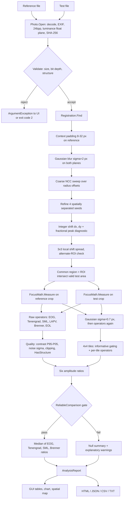
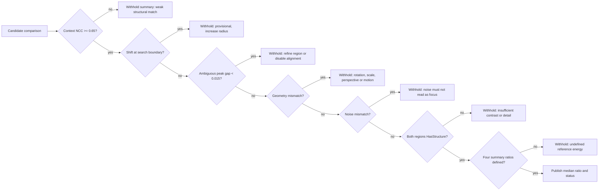

<div align="center">

# PhotoCompare 2.1

**Windows 向けの参照基準画像シャープネス比較ツール — 任意のテストフレームを信頼できるコントロールに位置合わせし、6 種類のディテール演算子で測定、空間分解能を持つ再現可能な判定を得られます。**

[](https://learn.microsoft.com/en-us/dotnet/framework/install/guide-for-developers)
[](PhotoCompare.csproj)
[](src/ProductInfo.cs)
[](LICENSE)
[](#技術スタックとアーキテクチャ)
[](tests/PhotoTests.cs)

</div>

> [!IMPORTANT]
> このリポジトリが提供するのは**スタンドアロンの Windows デスクトップアプリケーション**であり、サーバーサイド製品でもコンソール主体の製品でもありません。`PhotoCompare.exe` は WinForms/GDI+ の実行ファイルで、単体で動作します。インストーラー、Python、OpenCV、NuGet パッケージ、ネットワークアクセスはいずれも不要です。設定は CLI フラグとウィンドウ内のコントロールのみで表現され、**環境変数と設定ファイルは意図的に存在しません**。

---

## 目次

- [機能](#機能)
- [技術スタックとアーキテクチャ](#技術スタックとアーキテクチャ)
  - [コアスタック](#コアスタック)
  - [プロジェクト構成](#プロジェクト構成)
  - [主要な設計判断](#主要な設計判断)
  - [解析パイプライン](#解析パイプライン)
  - [信頼性ゲート](#信頼性ゲート)
- [はじめに](#はじめに)
  - [前提条件](#前提条件)
  - [インストール](#インストール)
  - [ソースからのビルド](#ソースからのビルド)
  - [トラブルシューティング](#トラブルシューティング)
- [テスト](#テスト)
  - [コア数値チェック](#コア数値チェック)
  - [コマンドライン統合チェック](#コマンドライン統合チェック)
  - [UI スモークチェック](#ui-スモークチェック)
  - [ベンチマーク](#ベンチマーク)
  - [テストカバレッジマトリクス](#テストカバレッジマトリクス)
- [デプロイ](#デプロイ)
  - [ポータブル配布](#ポータブル配布)
  - [CI/CD 連携](#cicd-連携)
  - [コンテナ化](#コンテナ化)
- [使い方](#使い方)
  - [GUI クイックスタート](#gui-クイックスタート)
  - [パーセント値の意味](#パーセント値の意味)
  - [コマンドラインでの使用](#コマンドラインでの使用)
  - [バッチ処理](#バッチ処理)
  - [エクスポート](#エクスポート)
  - [高度な使い方](#高度な使い方)
  - [キーボードリファレンス](#キーボードリファレンス)
- [設定](#設定)
  - [コマンドラインオプション](#コマンドラインオプション)
  - [GUI 設定項目](#gui-設定項目)
  - [環境変数](#環境変数)
  - [固定エンジン定数](#固定エンジン定数)
  - [レポートスキーマ](#レポートスキーマ)
- [ライセンス](#ライセンス)
- [連絡先とコミュニティサポート](#連絡先とコミュニティサポート)

---

## 機能

### 測定コア

- **参照基準にアンカーしたスコアリング。** すべての比較はユーザーが選択した参照領域のディテール水準に対して表現されるため、カメラ、レンズ、センサー、処理パイプラインが異なっても結果は意味を保ちます。
- **6 種類の独立したディテール演算子** — EOG、Tenengrad、SML、LAPV、Brenner 2D、EOL（サーマルマスク）— を両画像に同一の定義で適用します。
- **4 演算子の中央値による要約。** 主要パーセント値は EOG、Tenengrad、SML、Brenner 2D の振幅比の中央値で、単一演算子の外れ値に強い指標です。LAPV と EOL は診断用です。
- **同一のガウシアン σ = 0.7 px プリフィルタ**を両領域に適用してから比を算出し、ピクセルグリッドのノイズを抑えつつ細部を保持します。
- **エネルギーを考慮した比。** 二乗勾配系の指標は比の平方根（真の振幅）で比較し、SML は線形比を使用します。
- **100 % を超える結果は切り捨てません。** より鋭いディテール、付加ノイズ、強いデジタルシャープ化は、参照水準を超える正規の結果となり得ます。
- **任意のコントラスト正規化**（`参照 (P95−P05) / テスト (P95−P05)`）。デフォーカス由来のコントラスト低下を隠す可能性があるため既定では無効です。

### 位置合わせと幾何

- **サブウィンドウ平行移動探索**：既定半径 ±32 px、最大 ±256 px。探索前にガウシアン σ = 2 px 平滑化を適用します。
- **粗から密への NCC 探索**を複数シードで精緻化するため、4 バーチャートのような周期的ターゲットがエイリアスピークに張り付きません。
- **コンテキスト拡張**（8–32 px）は位置合わせ専用。指標は常に共通領域内で元のピクセルのまま測定します。
- **サブピクセルピーク推定**（相関ピークの放物線補間）は診断値として報告され、測定自体は再サンプリングしません。
- **幾何スクリーニング**：3×3 の局所シフトサンプリングと代替 ROI 相関により、回転、スケール変化、遠近、前景の独立運動をデフォーカスと誤認せず検出・報告します。
- **平行移動のみのポリシー。** 自動再スケーリング、回転補正、遠近ワープは一切行いません。

### 信頼性エンジニアリング

- **要約値の保留。** 位置合わせが弱い・曖昧・探索境界に到達、幾何が不整合、ノイズ寄与が大きく異なる、領域に有効なディテールがない——いずれかの場合にパーセント値を抑止します。生の指標はすべて参照可能です。
- **入力品質診断**：P95−P05 コントラスト、平均輝度、標準偏差、クリッピング率、ロバストなノイズ σ 推定、ノイズエネルギー比率、ぼけ保持率、構造妥当性フラグ。
- **多段警告**を GUI、HTML、JSON、CSV、TXT に反映します。

### 空間解析

- **最大 4×4 のタイルマップ**を共通領域に適用し、参照画像に基づいて各有効/無効タイルを分類します。
- **滑らかな背景グラデーションは除外**され、照明ランプがピントの証拠として投票することはありません。
- **グローバル要約、局所中央値、局所 P25–P75 範囲**を個別に報告——シャープな領域がぼけた領域をグローバル平均で隠せなくなります。
- **カラーコードのオーバーレイ**を両プレビューに表示し、専用の *Spatial tiles* テーブルも用意します。

### 生産性と連携

- **バッチ処理**：フォルダ内の画像を一括処理し、ファイルごとのエラー分離、参照測定のキャッシュ再利用、キャンセル、CSV/JSON エクスポートを提供します。
- **4 つのエクスポート形式** — 自己完結型 HTML（スクリプトなし、写真埋め込みなし）、完全な JSON、フラットな CSV、可読な TXT。
- **設計による来歴**：各ソースファイルの SHA-256、ツールバージョン、設定、測定領域の座標がすべてのレポートに付随します。
- **元画像は決して変更しません**。エクスポーターはレポートを入力パスへ上書きすることを拒否します。
- **決定論的なカルチャ**：プロセスは culture と UI culture を `en-US` に固定するため、数値の解析・書式設定がホストに依存しません。
- **完全な CLI パリティ**：単一ペア実行とバッチ実行に対応し、自動化向けに安定した終了コードを提供します。
- **全経路でのキャンセル** — 解析中の `Esc`/`Cancel`、ぼかし・演算子・位置合わせループ内での協調的 `CancellationToken` チェック。
- **有界メモリキャッシュ**（`AnalysisSession`）：許容差やコントラストモードのみ変更した場合に参照・テスト測定と位置合わせを再利用します。
- **サードパーティ依存ゼロ**：アプリケーション全体が .NET Framework クラスライブラリに対してコンパイルされた単一の実行ファイルです。

---

## 技術スタックとアーキテクチャ

### コアスタック

| レイヤー | 技術 | 備考 |
| --- | --- | --- |
| 言語 | **C#**（C# 5 互換構文） | `async` なし、補間文字列なし、式形式メンバーなし |
| ランタイム | **.NET Framework 4.8** | Windows 10 1903 以降 / Windows 11 に同梱。targeting pack はビルド時のみ必要 |
| UI | **Windows Forms**（`System.Windows.Forms`） | インターフェースはすべてコードで構築。`.Designer.cs`、XAML、リソースは不使用 |
| 画像処理 | **GDI+**（`System.Drawing`） | デコード、EXIF 方向、24 bpp 合成、プレビュー描画 |
| シリアライズ | **`System.Web.Script.Serialization.JavaScriptSerializer`** | JSON レポート。Newtonsoft/System.Text.Json への依存なし |
| ビルド（IDE） | **MSBuild / Visual Studio 2022** | ソリューション形式 12.00、VS 17 ツールセット |
| ビルド（CLI） | **`%WINDIR%\Microsoft.NET\Framework64\v4.0.30319` の `csc.exe`** | `Build.ps1` が呼び出し。パッケージ復元なし |
| スクリプト | **Windows PowerShell 5.1** | `Build.ps1`、`Run-Tests.ps1`、`Run-Benchmark.ps1` |
| 並行処理 | **TPL**（`Parallel.For`）+ `CancellationToken` | 300 000 ピクセル超で有効化。並列度は `min(8, cores−1)` に制限 |
| バイナリ | **AnyCPU、`WinExe`** | 変更なしで x86 / x64 の両方で動作 |

> [!NOTE]
> `PhotoCompare.csproj` で `TreatWarningsAsErrors` が有効であり、`Build.ps1` も `/warnaserror+` を渡します。警告はビルド失敗です。定数 1 つの変更が公開済み測定値を無効にするプロジェクトにおいて、数値の暗黙的なドリフトやデッドコードの混入を防ぎます。

### プロジェクト構成

```text
reference-sharpness-comparator2/
├── PhotoCompare.sln              # VS 2022 ソリューション（Debug/Release、AnyCPU）
├── PhotoCompare.csproj           # v4.8 WinExe、RootNamespace=PhotoFocus、Build.ps1 と同じソース一覧
├── PhotoCompare.exe              # プリビルド AnyCPU バイナリ。BUILD.bat で src/ と同期
├── START.bat                     # ルート EXE をその場で起動
├── BUILD.bat                     # Build.ps1 ラッパー。失敗時は一時停止
├── BUILD_AND_RUN.bat             # Build.ps1 -Launch ラッパー
├── Build.ps1                     # csc ベースのビルド。ステージングと原子的置換
├── Run-Tests.ps1                 # コアチェック + CLI 統合チェック（任意の UI スモーク）
├── Run-Benchmark.ps1             # 合成パフォーマンスハーネス
├── LICENSE                       # Apache License 2.0
├── README.md
├── src/
│   ├── Program.cs                # エントリポイント、引数パーサー、シェルモード      （約 108 行）
│   ├── ProductInfo.cs            # 名前、バージョン、フレーバースイッチ            （約 12 行）
│   ├── AssemblyInfo.cs           # Win32 実行ファイルのメタデータ                   （約 7 行）
│   ├── FocusAnalysis.cs          # 画像処理、演算子、位置合わせ、レポート          （約 650 行）
│   ├── AnalysisSession.cs        # 有界な測定/位置合わせキャッシュ                 （約 43 行）
│   ├── PhotoForms.cs             # メインウィンドウ、キャンバス、グラフ、タイル     （約 414 行）
│   ├── BatchAnalysis.cs          # バッチエンジン + バッチウィンドウ               （約 150 行）
│   └── ReportHtml.cs             # 自己完結型 HTML レポート + SVG グラフ            （約 79 行）
├── tests/
│   ├── PhotoTests.cs             # 61 件の数値/データ品質チェック                  （約 238 行）
│   ├── Benchmark.cs              # 再現可能な合成タイミングケース                  （約 52 行）
│   └── output/                   # 生成されたフィクスチャ、レポート、ベンチマーク JSON
├── bin/Release/                  # コンパイラ出力（exe + pdb）
└── obj/                          # ステージングと MSBuild 中間ファイル
```

<details>
<summary><strong>ファイル単位の責務、生成物、ビルド出力がバージョン管理されている理由</strong></summary>

**ソースファイルとその契約**

| ファイル | 責務 | 依存先 |
| --- | --- | --- |
| `src/Program.cs` | オプション文法、モード選択、英語ロケールの強制、終了コード、`%TEMP%` のエラーログ | `ProductInfo`、`FocusMath`、`BatchAnalysis`、`ReportFiles`、`PhotoForms` |
| `src/ProductInfo.cs` | `Name`、`Version`、`FileVersion`、`Description`、`IsComparison` フレーバースイッチ | — |
| `src/FocusAnalysis.cs` | `GrayPlane`、`Photo`、`OperatorValues`、`ImageMeasures`、`TileMeasure`、`AlignmentResult`、`AnalysisReport`、`FocusMath`、`Registration`、`ReportFiles` | GDI+、`System.Web.Extensions` |
| `src/AnalysisSession.cs` | オブジェクト同一性（`ReferenceEquals`）+ 領域 + 設定をキーとするキャッシュ | `FocusMath`、`Registration` |
| `src/PhotoForms.cs` | `PhotoCanvas`（描画/ズーム/パン/ROI/ドラッグ&ドロップ/タイルオーバーレイ）、`PhotoForm`、グラフコントロール、タブ化された結果 | WinForms |
| `src/BatchAnalysis.cs` | `BatchItem`、`BatchAnalysis.Run/Save`、`BackgroundWorker` を用いた `BatchForm` | `AnalysisSession`、WinForms |
| `src/ReportHtml.cs` | インライン CSS、SVG 棒グラフ、タイルグリッド、HTML エンコード | `AnalysisReport` |

**生成物（削除しても安全、必要に応じて再生成）**

- `bin/Debug`、`bin/Release` — MSBuild 出力。IDE ビルドはここに出力され、CLI ビルドは**意図的に**上書きしません。
- `obj/command-line` — `Build.ps1` が EXE を原子的に置換するためのステージングフォルダ。
- `tests/output` — 合成フィクスチャ（`reference.png`、`working.png`、`shifted.png`、`color-test.png`、`large-native.png`）、意図的に破損させた `broken.png` を含む `batch-input` フォルダ、およびチェックが生成するレポート/JSON。

ビルド出力は同梱コンパイラによってソースからバイト単位で再現可能であるため、リポジトリは SDK のないマシンでも使えるよう、便宜上ルートにプリビルドの `PhotoCompare.exe` を保持しています。これは権威ある成果物ではなく、`src/` がそれに当たります。

**アセンブリ識別子**

`RootNamespace` は `PhotoFocus` である一方、アセンブリ名は `PhotoCompare` です。この相違は意図的です。名前空間はドメインモジュールを表し、アセンブリ名は出荷製品を表します。`Build.ps1` はプロジェクトファイルから `AssemblyName` を読み取り、`^[A-Za-z][A-Za-z0-9_.-]*$` で検証し、ステージング/出力パスをそこから導出するため、製品名の変更にスクリプト修正は不要です。

</details>

### 主要な設計判断

<details>
<summary><strong>1. 汎用シャープネスしきい値ではなく、参照基準の相対スケール</strong></summary>

単一の写真に対して「ピントが合っている」を表す絶対的で移植可能な数値は存在しません。シーンのテクスチャ、ノイズ、露出、デモザイク、ノイズリダクション、シャープ化はいずれも高周波エネルギーを変化させます。そこでエンジンはただ 1 つの問いに答えます — *このテスト領域は、この参照領域と比べてどれだけの測定可能なディテールを含むか？* — そしてそれを明示します。

- `100 %` は**選択した参照の測定ディテール水準**であり、完璧な光学ピントではありません。ぼけたコントロールは独自の 100 % を定義します。
- `80 %` は合成ディテール振幅が参照より低いことを意味し、レンズが「20 % ピント外れ」という主張では**ありません**。
- `115 %` はより多くの高周波成分が測定されたことを意味し、より鋭いディテール、ノイズ増加、または強いデジタルシャープ化に由来し得ます。

単一画像の `Detail index`（`100 × √Tenengrad(σ=0.7) / (P95−P05)`）はエンジン内に存在しチェックで検証されていますが、上限のない相対スケールであり、このアプリケーションフレーバー（`ProductInfo.IsComparison = true`）では公開されません。

</details>

<details>
<summary><strong>2. エネルギー比ではなく振幅比、平均ではなく中央値</strong></summary>

EOG、Tenengrad、Brenner 2D はピクセル振幅に対して二次的であるため、これらのエネルギーを単純に比率化するとシャープネス変化よりも分散に近いものを報告します。エンジンは比の平方根で比較し（`100 × √(working / reference)`）、SML は既に振幅の一次差分指標であるため線形比を使用します。4 つの要約比は**中央値**で統合されるため、特定のテクスチャ（例えば縦方向主体）で異常な挙動を示す単一演算子が主要数値を引きずることはありません。

両領域は比を形成する前に同一のガウシアン σ = 0.7 px でフィルタされ、比較が位相対称になり、演算子が対象とするディテール帯域を削除せずにノイズフロアを抑えます。

</details>

<details>
<summary><strong>3. 答えないことが機能である</strong></summary>

常に数値を返す比較器は、曖昧なケースでも常に誤った数値を返します。`ReliableComparison` が `true` になるのは、**次のすべて**を満たす場合のみです。

- コンテキスト NCC ≥ 0.65
- 最良シフトが探索境界にない
- 同等に妥当な代替ピークが存在しない（最良ピークと空間的に離れた強ピークの差が 0.015 未満で曖昧）
- 幾何不整合がない（代替 ROI のゲイン > 0.12 かつ変位 ≥ 3 px、または ≥ 4 個の採用タイルで局所シフトの広がり > 3.5 px）
- ノイズ不整合がない（ノイズの多い側の σ > max(3, 2 × 静かな側の σ + 0.5)、ノイズエネルギー比率 > 0.5、ぼけ保持 < 0.3）
- 両領域が `HasStructure` を報告
- 4 つの要約比がすべて定義されている

ゲートを通過しない場合、`Status` は `Reliable comparison unavailable` になり、`RelativeDetailPercent` は `null` となり、警告がどの条件で失敗したかを示します。個々の指標行は引き続き値を持つため、エンジニアは診断を継続できます。

</details>

<details>
<summary><strong>4. 整数ピクセルでの測定、隠れた再サンプリングなし</strong></summary>

位置合わせは整数シフトを返します。小数推定は相関ピークから純粋に診断値として導出されます。測定画像は**決して**補間されません。補間自体がローパスフィルタであり、再サンプリングされた側のシャープネスを系統的に低下させるからです。その結果：

- 回転、スケール、遠近は補正されず、検出されるのみ
- 異なるファイル寸法はオブジェクトが同じピクセルスケールを保つ場合にのみ許容
- 小数オフセットは非常に細かい周期バーでピクセル位相誤差を生じ得るが、レポートはそれを明示

</details>

<details>
<summary><strong>5. 非対応入力では静かに劣化せず、即座に失敗する</strong></summary>

GDI+ は一部の 16 ビット PNG を静かに 8 ビットへ縮小します。静かに誤った測定を受け入れる代わりに、`Photo.Open` は PNG ヘッダの IHDR ビット深度バイトを検査し、TIFF の `BitsPerSample` タグ（0x102）を読み、実行可能なメッセージとともに高ビット深度データを拒否します。上限はメモリ割り当て前に適用されます（合計 24 000 000 ピクセル、片辺 16 000 ピクセル）。プレビューと測定を一致させるため EXIF 方向（0x112）を適用します。透過は白背景に合成し、明示的な警告を出します。多ページまたはアニメーションファイルは最初のフレームのみを読み込み、これも警告付きです。

</details>

<details>
<summary><strong>6. 決定論的で監査可能な出力</strong></summary>

- プロセスは既定スレッド、UI culture、現在のスレッドの `CultureInfo` を `en-US` に固定するため、`int.Parse`/`ToString` がホストロケールに従うことはありません。
- CSV の数値フィールドは不変カルチャのラウンドトリップ形式 `G17` で書き出され、TXT/HTML の表示値は小数 3 桁に丸められます。
- すべてのレポートにツールバージョン（`PhotoCompare 2.1`）と両ソースファイルの SHA-256 ダイジェストが付きます。
- HTML レポートはインライン CSS とインライン SVG グラフを持つ単一ファイルで、**`<script>` も `` も含みません**。そのためメール、オフライン環境、コンプライアンスアーカイブから同一に描画され、何も実行・送信できません。
- ファイル名と警告文字列は `WebUtility.HtmlEncode` でエンコードされ、バッチ CSV の `= + - @` で始まるセルには `'` を前置して表計算ソフトの数式インジェクションを無効化します。

</details>

<details>
<summary><strong>7. 有界な状態、明示的なライフタイム</strong></summary>

`Photo` は `IDisposable` を実装し自身の `Bitmap` を所有します。ローダーはピクセルを輝度プレーン `float[]`（0–255）へコピーした直後にファイルハンドルを解放するため、解析ウィンドウを開いたままソースファイルをリネーム・削除できます。`AnalysisSession` は最大で参照測定 1 件、テスト測定 1 件、位置合わせ 1 件を保持し、`Clear()` で無効化され、ウィンドウごと・バッチごとに生成されます。ウィンドウやワーカースレッド間で静的な画像状態は共有されません。`Program` はデコードした写真を `finally` ブロックで解放します。

</details>

<details>
<summary><strong>8. フラグとコントロール以外の設定面を持たない</strong></summary>

`.env`、レジストリキー、ローミング設定ファイルを静かに読み取る測定ツールは、半年後に再現できない測定ツールです。エンジンへの入力はすべて明示的な引数か可視のコントロールであり、出力はすべてその値を記録します。インターフェースは矛盾した呼び出しも拒否します。重複オプション、モード混在（`--image` と `--batch`）、両方のコントラストモード、単一画像フレーバーでの比較オプションはすべて引数エラーになります。

</details>

<details>
<summary><strong>9. 原子的なビルド、分離された障害</strong></summary>

`Build.ps1` は `obj/command-line/` にコンパイルし、その後でのみ結果をルート実行ファイルへ移動します。コンパイル失敗、またはアプリが起動中で出力先がロックされている場合、以前動作していたバイナリはそのまま残り、スクリプトがそう告げます。バッチ解析は実行時にも同じ哲学を適用します。破損または欠落ファイルは行エラーになり、残りの画像は継続処理され、プロセスは中断ではなく `1` で終了します。

</details>

### 解析パイプライン

<details open>
<summary><strong>エンドツーエンドのデータフロー：2 つのファイルからゲート通過済みパーセント値まで</strong></summary>



</details>

<details>
<summary><strong>実装どおりの演算子定義と単位</strong></summary>

| 演算子 | インデックス | コード上の定義 | 単位 | 役割 |
| --- | --- | --- | --- | --- |
| `EOG` | 0 | X 方向・Y 方向の前進差分の二乗平均 | levels²/px | 要約 |
| `Tenengrad` | 1 | Sobel X/Y エネルギーの平均。各カーネルは 8 で除算 | levels²/px | 要約 |
| `SML` | 2 | X/Y 方向の二次差分絶対値の平均。ステップ 1、しきい値 0 | levels/px | 要約（線形比） |
| `LAPV` | 3 | 4 近傍ラプラシアンの分散 | levels² | 診断 |
| `Brenner 2D` | 4 | X 方向・Y 方向のステップ 2 差分二乗平均の和の半分 | levels²/px | 要約 |
| `EOL (thermal)` | 5 | 中心 20 / 近傍 −4 / 対角 −1 マスク応答の二乗平均 | levels²/px | 診断 |

6 つすべては有効な内部位置のみで平均され（内部演算子は `(w−2)(h−2)`、EOG は `(w−1)(h−1)`、Brenner の 2 軸は `h(w−2)` と `(h−2)w` で正規化）、元のピクセルグリッド上で計算されます。σ = 0.7 列はフィルタ後のプレーンに同一の定義を繰り返すため、「生 vs フィルタ」は同等条件の比較であり、式の変更ではありません。

</details>

<details>
<summary><strong>位置合わせアルゴリズムの詳細</strong></summary>

1. **コンテキスト領域。** 位置合わせ有効時、選択 ROI を `min(32, max(8, min(w,h)/4))` ピクセル膨張させ、参照境界と交差させます。このコンテキストは強くぼけた低コントラストのターゲットを探す助けになりますが、指標領域には決して寄与しません。
2. **平滑化。** 参照コンテキストとテスト探索ウィンドウの両方を σ = 2 px でぼかし、NCC をノイズと細かいエイリアシングに鈍感にします。
3. **探索ウィンドウ。** テストウィンドウはコンテキストを `radius + 5` 膨張させたもので、半径内のすべての候補シフトがテスト画像内に完全に収まります。
4. **粗探索。** オフセットは `ceil(radius / 12)` ステップ（加えて `0`、`−radius`、`+radius`）でサンプリングし、軸あたり約 40 サンプルの間引きサブグリッドで正規化相互相関により評価します。
5. **複数シード精緻化。** 空間的に離れた最大 4 つの粗ピークを、より細かいステップ（`/72`）で近傍全解像度に精緻化します。これにより規則的な 4 バーチャートのエイリアスへの固定を防ぎます。
6. **曖昧性検出。** 最良スコアを少なくとも `max(6, 2 × coarse)` px 離れた最強候補と比較し、両方が 0.65 超で差が 0.015 未満なら曖昧とマークします。
7. **小数推定。** ピークの水平・垂直近傍に対する放物線フィットで `FractionalDx/FractionalDy` を求め、±0.5 px に制限します。整数シフトから 0.25 px を超えて外れるとピクセル位相の警告を出します。
8. **幾何スクリーニング。** ROI NCC < 0.85 の場合、局所 ROI 相関を最大化する代替探索を実行します。主ピークから離れた大幅に良好な代替ピークは幾何不整合を示します。ROI が 128×128 px 以上の場合、±3 px 内で 9 つの局所 3×3 ブロック探索により残差シフトの広がりを測定し、信頼できるタイルが 4 つ以上で広がりが 3.5 px を超えると回転・スケール・遠近・独立運動を示唆します。
9. **共通領域。** `ROI ∩ 有効なテスト領域` を測定します。位置合わせにより選択領域の 20 % 超が失われた場合は警告を発します。

報告されるシフト `dx, dy` は、参照ピクセル `(x, y)` がテストピクセル `(x + dx, y + dy)` に対応することを意味します。

</details>

### 信頼性ゲート

<details>
<summary><strong>パーセント値を表示してよいかを決める判定ロジック</strong></summary>



保留されたケースでも指標テーブル、タイルマップ、診断、警告は返されます。`ReliableComparison` は JSON にシリアライズされるため、自動化は終了コードではなくこの値で分岐できます。

</details>

---

## はじめに

### 前提条件

| 要件 | バージョン / 備考 | 用途 |
| --- | --- | --- |
| Windows | Windows 10 1903 以降 または Windows 11（任意のエディション） | GUI の実行 |
| .NET Framework | **4.8** ランタイム — サポートされる Windows ビルドに同梱 | アプリの実行 |
| PowerShell | **Windows PowerShell 5.1**（`pwsh` だけでなく `powershell.exe`） | `Build.ps1`、`Run-Tests.ps1`、`Run-Benchmark.ps1` |
| .NET Framework 4.8 Developer Pack | **Visual Studio** でビルドする場合のみ | MSBuild/VS コンパイル |
| Visual Studio 2022（任意） | ワークロード *.NET desktop development* | IDE での編集とデバッグ |
| `csc.exe` | `%WINDIR%\Microsoft.NET\Framework64\v4.0.30319\csc.exe` | SDK なしのスクリプトビルド |

> [!TIP]
> `PhotoCompare.exe` がすでに起動するなら、ツールを*使う*ための環境はすべて揃っています。コンパイラ、SDK、PowerShell スクリプトが必要なのは*変更*する場合だけです。

> [!WARNING]
> Windows on ARM では .NET Framework 4.8 が存在する場合に限り x64 エミュレーションで動作します。macOS、Linux、Wine はサポート対象外です。UI は WinForms、画像レイヤーは GDI+ であり、いずれもクロスプラットフォームではありません。

### インストール

インストーラーはありません。クローンして実行します。

```powershell
# 1. リポジトリをクローン
git clone https://github.com/DroneNotes/reference-sharpness-comparator2.git
cd reference-sharpness-comparator2

# 2. ランタイムの存在を確認（4.8 のリリースキー、例: 528040 を出力）
reg query "HKLM\SOFTWARE\Microsoft\NET Framework Setup\NDP\v4\Full" /v Release

# 3. プリビルドバイナリを起動
.\START.bat
# または直接:
.\PhotoCompare.exe
```

自分でビルドしたものを使いたい場合は、手順 3 を次に置き換えます。

```powershell
# src/ からルート実行ファイルを再ビルドしてから起動
.\BUILD_AND_RUN.bat
```

**初回実行の手順**

1. **1. Open reference…** をクリック（または `Ctrl+Shift+O`、左プレビューへファイルをドロップ）。
2. **2. Open test image…** をクリック（または `Ctrl+O`、右プレビューへドロップ）。
3. **参照プレビュー内**で左ボタンドラッグによりターゲットまたはテクスチャのあるオブジェクトを選択。
4. 解析は自動的に開始されます。主要パーセント値、指標テーブル、警告タブを確認します。
5. **Spatial map** を有効化するか **Spatial tiles** タブを開いて局所差分を確認します。
6. **Save result…**（`Ctrl+S`）で HTML、JSON、CSV、TXT にエクスポートします。

### ソースからのビルド

<details>
<summary><strong>スクリプトビルド、Visual Studio、手動 <code>csc</code> 呼び出し、スクリプトパラメータ</strong></summary>

#### A. スクリプトビルド（SDK 不要）

```powershell
# src/ から .\PhotoCompare.exe を再ビルド
powershell -NoProfile -ExecutionPolicy Bypass -File .\Build.ps1

# 再ビルドして起動
powershell -NoProfile -ExecutionPolicy Bypass -File .\Build.ps1 -Launch

# 再ビルドしてチェック一式を実行
powershell -NoProfile -ExecutionPolicy Bypass -File .\Build.ps1 -Tests
```

`Build.ps1` の動作を順に示します。

1. スクリプトフォルダ内の `*.csproj` をちょうど 1 つ特定し、そうでなければ失敗します。
2. `<AssemblyName>` を読み取り、`^[A-Za-z][A-Za-z0-9_.-]*$` で検証します。
3. `csc.exe` をまず `Framework64` から解決し、`Framework` にフォールバックします。
4. 各 `<Compile Include=…>` エントリを展開し、プロジェクトルート外へ出るパスを拒否します。
5. `/target:winexe /platform:anycpu /optimize+ /warn:4 /warnaserror+ /main:PhotoFocus.Program` で `obj\command-line\<AssemblyName>.exe` にコンパイルします。
6. 一時ファイルを `.\PhotoCompare.exe` へ移動します。失敗時は以前のバイナリを原子的に保持します。

#### B. Visual Studio

```powershell
# Release 構成の「ソリューションのビルド」に相当するコマンドライン MSBuild
msbuild .\PhotoCompare.sln /t:Rebuild /p:Configuration=Release /p:Platform="Any CPU"
```

対話的な作業では `PhotoCompare.sln` を開きます。IDE 出力は `bin\Debug` または `bin\Release` に出力されます。.NET Framework 4.8 Developer/Targeting Pack が必要です（[Microsoft の手順](https://learn.microsoft.com/en-us/dotnet/framework/install/guide-for-developers)）。

#### C. コンパイラの手動呼び出し

```powershell
$csc = "$env:WINDIR\Microsoft.NET\Framework64\v4.0.30319\csc.exe"
& $csc /nologo /target:winexe /platform:anycpu /optimize+ /warn:4 /warnaserror+ /main:PhotoFocus.Program `
  /out:.\PhotoCompare.exe `
  /r:System.dll,System.Core.dll,System.Drawing.dll,System.Windows.Forms.dll,System.Web.Extensions.dll `
  .\src\ProductInfo.cs .\src\AssemblyInfo.cs .\src\Program.cs .\src\FocusAnalysis.cs `
  .\src\AnalysisSession.cs .\src\PhotoForms.cs .\src\BatchAnalysis.cs .\src\ReportHtml.cs
```

#### D. ソースファイルの追加

新しい `.cs` ファイルは **`PhotoCompare.csproj`**（`<Compile Include=…>`）に登録する必要があり、それ以外の場所への登録は不要です。`Build.ps1` はプロジェクトファイルからファイル一覧を導出するため、プロジェクトファイルが唯一の真実の情報源です。同梱コンパイラでビルドする場合は新しいコードを C# 5 互換に保ち、より新しい構文は両方のビルド経路で言語バージョンを引き上げる場合にのみ導入してください。

</details>

### トラブルシューティング

<details>
<summary><strong>よくあるビルド/実行の失敗とその正確な原因</strong></summary>

| 症状 | 原因 | 対処 |
| --- | --- | --- |
| `Expected one C# project file in this folder.` | `.csproj` が 0 個または複数 | `Build.ps1` の隣にプロジェクトファイルを 1 つだけ置く |
| `The Windows .NET Framework C# compiler was not found.` | Windows 外での実行、または簡素化された環境 | .NET Framework 4.8 をインストール、または Visual Studio 2022 を使用 |
| `Compilation failed. The previous executable has been preserved.` | コンパイルエラー、または同梱コンパイラが受け付けない言語機能 | エラーを修正。C# 5 互換を保つか VS ツールセットでビルド |
| `Close the running application and build again.` | 実行中のインスタンスが出力先 EXE をロック | PhotoCompare を終了して再ビルド |
| `error CS0246: … System.Web.Extensions` | 参照一覧が変更された | プロジェクトファイルに記載された 5 つの参照を維持 |
| `Run BUILD.bat before running checks.` | `Run-Tests.ps1` はルート EXE を必要とする | 先にビルドしてから再実行 |
| `16-bit PNG is not supported.` | IHDR ビット深度 > 8 | リサイズせず 8 ビットの表示画像をエクスポート |
| `TIFF channels above 8 bits are not supported.` | `BitsPerSample` > 8 | 8 ビット TIFF をエクスポート |
| `The limit is 24 million pixels and 16,000 pixels per side.` | ファイルが大きすぎる | リサイズではなく元解像度でクロップ |
| `The region must be inside the image and at least 16×16 pixels.` | ROI が小さすぎる、または範囲外 | テクスチャのあるオブジェクトで ≥ 48×48 px を使用 |
| `No common image region.` | 位置合わせで ROI をテストフレーム内に配置できない | テストキャンバスを広げるか探索半径を小さくする |
| `A report cannot overwrite a source image.` | `--out` が入力パスと同一 | 別の出力パスを選択 |
| `Unknown option or missing value: …` | 誤字、または値を伴わないフラグ | オプション表と照合 |
| `Duplicate option: …` | 同じスイッチを 2 回指定 | 各オプションは 1 回のみ指定 |
| `Batch, single-image and test modes must be run separately.` | `--image`、`--batch`、`--smoke`、`--smoke-batch` のうち 2 つを併用 | 1 プロセスにつき 1 モードで実行 |
| `Specify --image / --batch, or start the application without arguments.` | モードなしでオプションのみ指定 | モードを追加、または引数なしで GUI を起動 |
| SmartScreen の「不明な発行元」 | バイナリが未署名 | 自身のビルドと SHA-256 を照合して許可。または自前で署名 |
| 同僚の実行結果と値が異なる | 浮動小数点の経路、ツールバージョン、または領域が異なる | JSON の `ToolVersion`、`RequestedArea`、ソース SHA-256 を比較 |

**CLI モードでダイアログなしの終了コード 2** は想定どおりです。GUI サブシステムのプロセスにはコンソールが接続されていないため、メッセージは `%TEMP%\PhotoCompare-error.txt` に書き出されます。そのファイルを読んでから呼び出しを修正してください。

</details>

---

## テスト

スイートは意図的に、**純粋な数値チェック**（高速・決定論的・GUI 不要）と**アプリケーションレベルの統合チェック**（実際のプロセス起動、実際のエクスポート、実際の終了コード）に分かれています。

```powershell
# すべて: コアチェック + CLI 統合チェック
powershell -NoProfile -ExecutionPolicy Bypass -File .\Run-Tests.ps1

# すべて + メインウィンドウとバッチウィンドウの GUI スモーク実行
powershell -NoProfile -ExecutionPolicy Bypass -File .\Run-Tests.ps1 -Ui

# 合成パフォーマンスハーネス（3 回実行の中央値）
powershell -NoProfile -ExecutionPolicy Bypass -File .\Run-Benchmark.ps1
```

> [!IMPORTANT]
> `Run-Tests.ps1` はプロジェクトルートに既にビルドされた `PhotoCompare.exe` を必要とし、最初の失敗で stderr に `FAIL: <check name>` を出力して非ゼロで終了します。成功時は `PASS: PhotoCompare local numerical, command-line, export and batch checks.` で終わり、合格数と主要測定値を含む `tests/output/test-results.json` を書き出します。

### コア数値チェック

`Run-Tests.ps1` は `ProductInfo.cs`、`FocusAnalysis.cs`、`AnalysisSession.cs`、`ReportHtml.cs`、`BatchAnalysis.cs` を `tests/PhotoTests.cs` とともに `tests/output/CoreChecks.exe` にコンパイルし（GUI ソースは含めません）、出力フォルダを `argv[0]` として実行します。フィクスチャはプロセス内で固定シード（`Random(72)`、`Random(91)`、`Random(103)`）から生成されるため、結果はマシン間でビット単位に安定します。

ハーネスは意図的に非周期的な合成シーン（変調正弦波、向きの異なる 2 組の 4 バー、円盤、斜めエッジ）を構築し、さらにゲイン/オフセット/ノイズ/シフトを適用する補助関数（`Change`）と回転/スケール/サブピクセルワープ（`Warp`）を提供します。

```powershell
# コアチェックのみを実行（スイート内部と等価）
powershell -NoProfile -Command "& .\tests\output\CoreChecks.exe .\tests\output"
```

各チェックは `PASS: <name>` を出力し、最終行は `All 61 checks passed.` です。記録される結果ファイルは次のとおりです。

```json
{"passed":61,"identity":100,"gain":100.45,"sharper":155.59,"noise":11.99,
 "measurements":[{"sigma":0.5,"score":97.64,"ncc":0.99997},
                 {"sigma":1.0,"score":83.50,"ncc":0.99941},
                 {"sigma":1.8,"score":64.38,"ncc":0.99543},
                 {"sigma":3.0,"score":38.53,"ncc":0.98071}]}
```

### コマンドライン統合チェック

コアチェックの合格後、`Run-Tests.ps1` は `Start-Process -WindowStyle Hidden -Wait` で実際の実行ファイルを起動し、終了コードと出力内容を検証します。

1. **4 つのエクスポート経路** — `application.json`、`.html`、`.csv`、`.txt` のそれぞれが終了コード `0` で成功すること。
2. **同一性の意味論** — `ToolVersion` が `PhotoCompare ` で始まり、報告される作業幅が `320`、参照と自身の比較で `RelativeDetailPercent == 100`（誤差 `1e-7` 以内）。
3. **バッチの障害分離** — 有効な画像 2 枚とテキストファイル `broken.png` を含むフォルダで `1` を返し、ちょうど 3 行のうち 1 行だけに `Error` が入ること。
4. **ソース不変性** — テスト画像へ上書きエクスポートを試みる前後でハッシュが不変であり、その試行が `2` で終わること。

### UI スモークチェック

`-Ui` は WinForms の構築経路全体を通す 2 つのスモーク実行を追加します。

```powershell
powershell -NoProfile -ExecutionPolicy Bypass -File .\Run-Tests.ps1 -Ui
```

- `--smoke <folder>` — 参照/テストのペアを開き、ROI を選択し、解析を完了して `compare-ui.png` / `compare-ui.json` を保存します。
- `--smoke-batch <folder>` — 合成参照でバッチエンジンを開き、`compare-batch-ui.png` / `compare-batch-ui.json` を書き出します。

これらの 4 ファイルのいずれかが欠けていると実行は失敗します。

### ベンチマーク

```powershell
powershell -NoProfile -ExecutionPolicy Bypass -File .\Run-Benchmark.ps1
# → tests/output/benchmark.json
```

`tests/Benchmark.cs` は 48×48 のケースでウォームアップし、**640×512** と **3840×2400** で **single** と **compare** の各モードを 3 回ずつ計測します（中央値を報告）。`/define:PHOTO_V2` でビルドした場合は `compare_cached_settings` ケースが追加され、ウォームな `AnalysisSession` で許容差を揺らしながら 25 回反復し、設定のみ変更する経路のコストを分離します。JSON 出力にはマシン名、プロセッサ数、ランタイムバージョン、生サンプル配列が記録されるため、回帰をハードウェアとコードのどちらに帰属させるか判断できます。

> [!TIP]
> `GrayPlane`、`Operators`、`Registration` のいずれかに触れる前後でベンチマークを実行してください。`Parallel.For` を有効化する 300 000 ピクセルのしきい値、64 行のブロックサイズ、`min(8, cores−1)` の上限はすべて性能上の要です。これらを変えると所要時間だけでなく、加算順序の違いにより各指標の末尾桁も変化します。

### テストカバレッジマトリクス

<details>
<summary><strong>61 件のコアチェックが実際に何を検証しているか</strong></summary>

| 領域 | 代表的な検証内容 |
| --- | --- |
| 同一性と代数 | 同一画像はちょうど 100 %。各演算子比が 100。`dx = dy = 0` |
| ぼけに対する単調応答 | ガウシアン σ = 0.5 → 97.6 %、1.0 → 83.5 %、1.8 → 64.4 %、3.0 → 38.5 %、厳密に単調減少 |
| 位置合わせの正確性 | シフト `(11,−7)`、`(−17,12)`、`(0,19)` を正確に復元しスコアが 100 ± 0.01 に戻る |
| キャンバス独立性 | 同一シーンをオフセット `(9,5)` の大きいキャンバスに置いても同一スコア。再スケーリングなし |
| 曖昧性 | 4 px バーパターンは `Ambiguous` を報告し要約を保留 |
| 探索境界 | `radius = 32` で 32 px シフトすると `AtSearchLimit` を報告し信頼不可 |
| 幾何 | 3° 回転、1.05× スケール、独立移動した前景ブロックはいずれもゲートを通らない |
| サブピクセルの誠実性 | `(0.4,−0.3)` ワープで小数推定が 0.18 px 以内、指標は非補間のまま |
| コントラスト | ゲイン 0.65 + オフセット 25 は正規化ありで 100.45 %、なしで約 65 % |
| 正規化のリスク | 生で 80 % となる正弦波ぼけが正規化後に 95 % 超へ上昇し、マスク警告を発する |
| ノイズ | σ = 18 の付加ノイズで `NoiseMismatch`。ノイズのみの画像はフラグされシャープネス指数なし |
| 過剰シャープ化 | ぼけた参照とシャープな原画の比較で 155.6 % — 100 % に切り捨てられない |
| 演算子の数学 | 線形ランプ `2x + 3y`：EOG = Tenengrad = 13、Brenner = 26、SML/EOL/LAPV = 0（解析解） |
| ガウシアン精度 | 最適化された σ = 0.7 ぼかしが直接 2-D 畳み込みと 1e-3 以内で一致（境界含む） |
| ROI の分離 | 選択領域外のピクセルはどの指標も変化させない |
| ストライド vs クロップ | ビュー経由の演算子が独立クロップと相対 1e-12 以内で一致 |
| 無構造への頑健性 | 均一画像、平坦な参照、背景ランプ、反転構造はいずれも証拠として拒否 |
| 空間マップ | 半分ぼけた画像で P75−P25 > 20、0 < `LowerDetailTiles` < `InformativeTiles`、グリッドが 16 タイルで一致 |
| エクスポート整合性 | CSV に全指標。JSON は循環なしでデシリアライズ。HTML に SVG と全タイル、`<script>` と `` なし |
| エスケープ | ファイル名や警告内の `<script>` がエンコードされ、`&` が `&amp;` になる |
| NaN/Inf 衛生 | 平坦画像の HTML に `NaN` も `Infinity` も含まれない |
| キャッシュ | 設定のみの変更で画像と位置合わせのキャッシュを再利用（測定 2 + 位置合わせ 1）、`Clear()` で無効化 |
| キャンセル | 事前キャンセル済みトークンはキャッシュヒット時でも中断。1024×768 の解析は実行中に中断可能 |
| ローダーの契約 | 元の輝度と寸法を保持。読み込み後にファイルハンドルを解放。SHA-256 は 64 桁の 16 進文字列 |
| バッチ | 有効/欠落ファイルの混在でエラーを分離し、CSV と JSON の両方をエクスポート |

</details>

---

## デプロイ

### ポータブル配布

PhotoCompare は**フォルダ内の単体実行ファイル**として配布されます。MSI もサービスも、レジストリの痕跡も、ユーザープロファイルの状態もありません。

```powershell
# 1. リリースバイナリを生成（最適化済み、警告なし）
powershell -NoProfile -ExecutionPolicy Bypass -File .\Build.ps1

# 2. 配布前に成果物を検証
powershell -NoProfile -ExecutionPolicy Bypass -File .\Run-Tests.ps1
Get-FileHash .\PhotoCompare.exe -Algorithm SHA256

# 3. 配布フォルダを組み立てる
$dist = ".\dist\PhotoCompare-2.1"
New-Item -ItemType Directory -Force $dist | Out-Null
Copy-Item .\PhotoCompare.exe, .\README.md, .\LICENSE, .\START.bat $dist
Compress-Archive -Path $dist -DestinationPath ".\dist\PhotoCompare-2.1-win-anycpu.zip" -Force
```

**リリースチェックリスト**

- [ ] `Run-Tests.ps1` が `PASS` と `All 61 checks passed.` を報告
- [ ] `Run-Tests.ps1 -Ui` が 4 つのスモーク成果物を生成
- [ ] `benchmark.json` を再生成し前回リリースと比較
- [ ] `ProductInfo.Version` と `FileVersion` を更新し、`README.md` に新バージョンを反映
- [ ] 出荷する EXE の SHA-256 をアーカイブとともに公開
- [ ] アーカイブに `tests/output`、`bin`、`obj` を含めない
- [ ] 組織外へ配布する場合は Authenticode 証明書で署名

> [!CAUTION]
> 配布するのはレビュー済みコミットからビルドしたバイナリのみにしてください。リポジトリ内のプリビルド `PhotoCompare.exe` はメンテナー向けの便宜であり、信頼できないミラーからダウンロードした未署名 EXE は不要なサプライチェーンリスクです。SHA-256 を公開し、可能なら Authenticode で署名してください。

<details>
<summary><strong>リリースビルドへのコード署名</strong></summary>

```powershell
$cert = Get-ChildItem Cert:\CurrentUser\My -CodeSigningCert | Select-Object -First 1
Set-AuthenticodeSignature -FilePath .\PhotoCompare.exe -Certificate $cert `
  -TimestampServer "http://timestamp.digicert.com" -HashAlgorithm SHA256
Get-AuthenticodeSignature .\PhotoCompare.exe | Format-List Status, SignerCertificate
```

`Status` は `Valid` である必要があります。最終ビルドの**後**、ハッシュ計算やアーカイブ作成の**前**に署名してください。`Build.ps1` を再実行するとファイルが置換され署名が失われます。

</details>

### CI/CD 連携

このリポジトリにはワークフローファイルが含まれていないため、稼働中のパイプラインバッジはありません。以下の GitHub Actions ワークフローはそのまま使える出発点です。`windows-latest` 上で動作し、.NET Framework 4.8 targeting pack と PowerShell 5.1 が既に提供されています。

```yaml
# .github/workflows/windows-build.yml
name: Windows build and checks

on:
  push:
    branches: [main]
  pull_request:
  workflow_dispatch:

jobs:
  build-and-test:
    runs-on: windows-latest
    steps:
      - uses: actions/checkout@v4

      - name: Show runtime
        shell: powershell
        run: |
          reg query "HKLM\SOFTWARE\Microsoft\NET Framework Setup\NDP\v4\Full" /v Release

      - name: Build root executable
        shell: powershell
        run: powershell -NoProfile -ExecutionPolicy Bypass -File .\Build.ps1

      - name: Core and integration checks
        shell: powershell
        run: powershell -NoProfile -ExecutionPolicy Bypass -File .\Run-Tests.ps1

      - name: UI smoke checks
        shell: powershell
        run: powershell -NoProfile -ExecutionPolicy Bypass -File .\Run-Tests.ps1 -Ui

      - name: Benchmark
        shell: powershell
        run: powershell -NoProfile -ExecutionPolicy Bypass -File .\Run-Benchmark.ps1

      - name: Upload results
        uses: actions/upload-artifact@v4
        with:
          name: photocompare-results
          path: |
            tests/output/test-results.json
            tests/output/benchmark.json
            tests/output/compare-ui.json
            tests/output/compare-batch-ui.json
```

> [!NOTE]
> UI スモークの手順には対話的なデスクトップセッションが必要です。GitHub ホストの Windows ランナーは WinForms 用にこれを提供します。ランナーがデスクトップなしのサービスとして動作する場合は `-Ui` 手順を外し、コアと統合のチェックのみを維持してください。

**自動化の契約。** CLI 呼び出しはスケジュール実行しても安全です。終了コードは安定しています。`0` = 完了（信頼できない比較を含む）、`1` = バッチ完了だがファイル単位のエラーあり、`2` = 入力・引数・出力のエラー。比較の妥当性が重要な場合は、終了コードではなく JSON の `ReliableComparison` で分岐してください。

### コンテナ化

<details>
<summary><strong>サポートされるコンテナイメージが存在しない理由と、Windows コンテナでの実験例</strong></summary>

このアプリケーションは **.NET Framework 4.8** と **Windows Forms** を対象としており、両方とも Win32/GDI+ のユーザーセッション API に依存します。Linux コンテナの経路はありません。`mcr.microsoft.com/dotnet/framework/*` イメージは*ランタイム*を提供できますが、`WinExe` の GUI は依然としてデスクトップセッションを必要とし、`System.Drawing` の操作はイメージ内に GDI+ を要求します。コンテナ化は非サポートとして扱い、ポータブルフォルダとスケジュールタスク、SSH セッション、または CI ランナーを併用してください。

Windows コンテナホストを管理下に置き、制約を受け入れられる場合、以下の実験的 Dockerfile が唯一実行可能な形を示します。対話的セッションを持つ Windows イメージ内でビルドと実行を行います。

```dockerfile
# Dockerfile.windows — 実験的、Windows コンテナ専用、対話的セッション必須
FROM mcr.microsoft.com/dotnet/framework/sdk:4.8-windowsservercore-ltsc2022 AS build
WORKDIR C:\src
COPY . .
RUN powershell -NoProfile -ExecutionPolicy Bypass -File .\Build.ps1

FROM mcr.microsoft.com/dotnet/framework/runtime:4.8-windowsservercore-ltsc2022
WORKDIR C:\app
COPY --from=build C:\src\PhotoCompare.exe .
COPY --from=build C:\src\README.md .
# コンテナホスト側に GUI セッションが既に存在する必要があります。ヘッドレスサービスではありません。
ENTRYPOINT ["C:\\app\\PhotoCompare.exe"]
```

同等の Compose ファイルは、この制約の周囲にオーケストレーションを追加するだけです。

```yaml
services:
  photocompare:
    build:
      context: .
      dockerfile: Dockerfile.windows
    isolation: process
    stdin_open: true
    tty: true
```

> [!WARNING]
> この経路はプロジェクトのチェックスイートで検証されておらず、サポートされるデプロイ対象でもありません。無人バッチ処理には、通常の Windows ホストまたは CI ランナー上で文書化された CLI を使用してください。統合テストが実際に検証しているのはその構成です。

</details>

---

## 使い方

### GUI クイックスタート

ウィンドウはすべてコードで構築され、5 つの領域に分かれています。ツールバー、オプション帯、2 つのプレビュー（領域ドラッグを受け付けるのは参照プレビューのみ）、判定ブロック、そして 3 タブの下部パネル（*Metrics and chart*、*Spatial tiles*、*Interpretation and warnings*）です。

**参照を用いたワークフロー**

1. コントロール画像を左プレビューに読み込みます。
2. 評価対象画像を右プレビューに読み込みます。
3. **参照画像内**のテクスチャのあるオブジェクト上で矩形をドラッグします。同じ領域が位置合わせによりテスト画像内で特定されます。
4. 主要パーセント値と `Status` の文を確認します。
5. 指標テーブルを確認します。`Reference raw`、`Test raw`、`Raw, %`、`σ0.7, %`（コントラスト補正時は `σ0.7 / C, %`）、`In summary`。
6. *Interpretation and warnings* を開きます。保留された要約とその原因がここに表示されます。
7. 共有用に HTML レポートを、アーカイブ用に JSON レポートを保存します。

**信頼できる数値のための実務ルール**

- 両画像で同じオブジェクト、同じピクセルスケール、同じ向きを使用します。
- カメラ処理、AGC/DDE、ノイズリダクション、表示設定を同一に保ちます。
- 最小領域は 16×16 px です。**48×48 px 以上を推奨**し、128×128 px で幾何スクリーニング全体が有効になります。
- プレビューのズームは測定に使うピクセルを決して変えません。ズームは純粋に表示上の操作です。
- 構造を含めてください。空、無地の壁、滑らかなグラデーションはピントの証拠を含まず、空間投票から除外されます。

### パーセント値の意味

| 読み取り | 解釈 |
| --- | --- |
| `100 %` | 要約指標が参照水準と一致 — 完璧な光学ピントの**証明ではありません** |
| `95–105 %` | 既定の ±5 % UI 許容内：「指標は参照に近い」 |
| `< 100 − tolerance` | 「参照よりディテールが少ない」 — 合成ディテール振幅が低い |
| `> 100 + tolerance` | 「参照より高周波成分が多い」 — より鋭いディテール、ノイズ、またはデジタルシャープ化 |
| `—`（保留） | `ReliableComparison = false`。失敗した条件は警告を参照 |

- **Raw, %** は σ = 0.7 フィルタ前（かつコントラスト補正なし）の振幅比です。
- **σ0.7, %** は要約に供給されるフィルタ後の比です。コントラスト補正が有効な場合、この列はさらに正規化されます。
- **Close to reference ±%**（既定 ±5 %）は表示上のカテゴリとタイル数のみを変えます。これは**UI 許容差**であり、確立された生産受け入れ限界ではありません。受け入れ基準は自身の代表的なコントロールペアで校正してください。

> [!IMPORTANT]
> グローバルスコアはシャープな領域の背後にぼけた領域を隠し得ます。ユニットを承認・却下する前に、必ず局所中央値、P25–P75 範囲、空間マップを確認してください。P25–P75 はタイル間のばらつきを表すもので、**信頼区間ではありません**。

### コマンドラインでの使用

実行ファイルを含むフォルダから実行します。

```powershell
# 明示的な ROI で 1 枚のテスト画像を参照と比較し HTML を出力
.\PhotoCompare.exe `
  --reference "C:\Images\reference.png" `
  --image     "C:\Images\test.png" `
  --roi       100,100,240,240 `
  --radius    48 `
  --out       "C:\Results\comparison.html"

# 同じ比較を位置合わせなしで（画像は既に位置合わせ済み）、JSON 出力
.\PhotoCompare.exe --reference .\ctl.png --image .\unit42.png --no-align --out .\unit42.json

# コントラスト補正とより厳しい UI 許容差、テキスト出力
.\PhotoCompare.exe --reference .\ctl.png --image .\unit42.png --normalize --tolerance 3 --out .\unit42.txt

# 1 つの参照に対してフォルダ全体をバッチ処理し CSV サマリを出力
.\PhotoCompare.exe --reference "C:\Images\reference.png" --batch "C:\Images\series" --roi 100,100,240,240 --out "C:\Results\batch.csv"
```

> [!WARNING]
> `PhotoCompare.exe` は **Windows GUI サブシステム**の実行ファイルです。スクリプトでは出力ファイルを読む前、または `$LASTEXITCODE` を確認する前に必ず終了を待つ必要があります。そうしないと解析と競合し、古い、あるいは存在しないレポートを読むことになります。

```powershell
# 自動化の正しいパターン
$run = Start-Process -FilePath ".\PhotoCompare.exe" `
  -ArgumentList '--reference "C:\Images\reference.png" --image "C:\Images\test.png" --out "C:\Results\comparison.json"' `
  -Wait -PassThru
$run.ExitCode                       # 0 | 1 | 2

$report = Get-Content "C:\Results\comparison.json" -Raw -Encoding UTF8 | ConvertFrom-Json
"score  = {0:N2}%" -f $report.RelativeDetailPercent
"status = {0}"     -f $report.Status
"reliable = {0}"   -f $report.ReliableComparison
$report.Warnings | ForEach-Object { "! $_" }
```

**終了コード**

| コード | 意味 |
| --- | --- |
| `0` | 完了 — 信頼できない比較やデータ不足の比較も含む。`ReliableComparison` を確認してください。 |
| `1` | バッチは完了したが、ファイル単位のエラーが 1 件以上ある。有効な行は出力に残ります。 |
| `2` | 入力、引数、または出力のエラー。詳細は `%TEMP%\PhotoCompare-error.txt`。 |

`--roi` は**参照画像のピクセル**で `x,y,width,height` を指定します。省略すると参照画像全体が選択されます。これは両ファイルが既に同じシーンにクロップされている場合にのみ許容されます。バッチは指定フォルダのみを**再帰せずに**走査し、大文字小文字を区別しない名前順で、`.png`、`.jpg`、`.jpeg`、`.bmp`、`.tif`、`.tiff` のみを対象にします。

### バッチ処理

**GUI から：** 参照を開き、領域を選択し、**Batch images…** をクリックします。現在の参照、領域、探索半径、コントラスト設定、許容差がすべてのテスト画像に適用されます。

**CLI から：** `--batch <folder> --out <file.csv|file.json>`（必要に応じて `--reference`、`--roi`、`--radius`、`--normalize`、`--tolerance`、`--no-align`）。

バッチの挙動：

- 画像はワーカースレッド上で** 1 枚ずつ**処理され、単一の `AnalysisSession` により参照測定と位置合わせが再利用されます。
- 破損、欠落、非対応のファイルは**エラー行**として記録され、実行を停止しません。
- **Cancel** は完了済みの行を保持するため、部分的な結果もエクスポート可能です。
- バッチ出力は **CSV と JSON のみ**です。ファイルごとの HTML/TXT レポートは単一ペアの機能です。
- いずれかの行にエラーがあれば終了コード `1`、なければ `0`。

### エクスポート

| 形式 | 内容 | 備考 |
| --- | --- | --- |
| **HTML** | インライン CSS、SVG 棒グラフ、タイルグリッド、パラメータ、警告、ハッシュを含む自己完結型レポート | `<script>` なし、`` なし、写真埋め込みなし。印刷可 |
| **JSON** | `AnalysisReport` 全体：測定値、位置合わせ、タイル、パラメータ、キャッシュ、警告 | 数値のラウンドトリップ精度。自動化はこのファイルで分岐 |
| **CSV** | 演算子ごとに 1 行。領域座標、設定、バージョン、SHA-256 を含む | ラウンドトリップ `G17`、不変カルチャ、数式インジェクション対策 |
| **TXT** | 指標、診断、警告、所要時間を含む可読サマリ | 表示用に丸めた値 |

> [!NOTE]
> レポートはソース画像を上書きできません。エクスポーターはフルパスを比較して拒否します。表示値は小数点以下 3 桁に丸められますが、JSON と CSV は完全な精度を保持します。単一ペアのエクスポートは `.html`、`.json`、`.csv`、`.txt`、バッチは `.csv` と `.json` を受け付けます。それ以外の拡張子は引数エラーです。

### 高度な使い方

<details>
<summary><strong>C# ライブラリとしてエンジンを使用する（<code>AnalysisSession</code>、<code>FocusMath</code>、<code>ReportFiles</code>）</summary>

`src/FocusAnalysis.cs` は UI に依存しない公開型を提供しており、`Run-Tests.ps1` が `CoreChecks.exe` をコンパイルする方法もまさにこれです。以下のパターンは `ProductInfo.cs`、`FocusAnalysis.cs`、`AnalysisSession.cs`、`ReportHtml.cs` に対してコンパイルされます（バッチが必要な場合のみ `BatchAnalysis.cs` を追加）。

```csharp
using System;
using System.Drawing;
using System.Threading;
using PhotoFocus;

// セッションは参照測定 1 件、テスト測定 1 件、位置合わせ 1 件を
// 最大でキャッシュします。ドキュメントウィンドウごと、またはバッチ実行ごとに 1 つ作成します。
using (AnalysisSession session = new AnalysisSession())
using (Photo reference = Photo.Open(@"C:\Images\reference.png"))
using (Photo working   = Photo.Open(@"C:\Images\test.png"))
{
    // ROI は参照画像のピクセル座標。ハード最小は 16x16、48x48 以上を推奨。
    Rectangle roi = new Rectangle(100, 100, 240, 240);

    // 時間予算：協調的キャンセルはぼかし、演算子、位置合わせのループ内部でも
    // 尊重され、ステージ間だけでなく常に有効です。
    using (CancellationTokenSource cts = new CancellationTokenSource(TimeSpan.FromSeconds(30)))
    {
        AnalysisReport report = session.Compare(
            reference, working,
            roi,
            align: true,            // 平行移動探索（整数ピクセルのみ）
            radius: 32,             // +/- 探索半径、0..256
            normalize: false,       // コントラスト補正は既定で無効
            tolerance: 5.0,         // UI 許容差のみ、0..50
            token: cts.Token);

        // 値があると仮定しないこと。まず妥当性ゲートを通します。
        if (report.ReliableComparison && report.RelativeDetailPercent.HasValue)
        {
            Console.WriteLine("detail = {0:0.0}% of reference", report.RelativeDetailPercent.Value);
            Console.WriteLine("test shift dx={0} dy={1}, NCC={2:0.000}",
                report.Alignment.Dx, report.Alignment.Dy, report.Alignment.Correlation);
        }
        else
        {
            Console.WriteLine("summary withheld: " + report.Status);
        }

        foreach (string warning in report.Warnings) Console.WriteLine("warning: " + warning);

        // 別の許容差で再実行してもキャッシュされた測定と
        // 位置合わせが再利用され、表示ロジックのみが変わります。
        AnalysisReport again = session.Compare(reference, working, roi, true, 32, false, 10.0);
        Console.WriteLine("cache: ref={0} test={1} align={2}",
            again.CachedReference, again.CachedWorking, again.CachedAlignment);

        // アプリケーションと同じ検証済みライターで永続化。
        ReportFiles.Save(@"C:\Results\single.html", again);  // 入力ファイルへの上書きを拒否
        ReportFiles.Save(@"C:\Results\single.json", again);
    }
    session.Clear(); // 写真を解放する前にキャッシュ済みプレーンを破棄
}
```

演算子は輝度プレーンに対して直接使用することもできます。

```csharp
GrayPlane plane = new GrayPlane(320, 240, pixelValues);        // float[]、輝度 0..255
OperatorValues raw      = FocusMath.Operators(plane);         // EOG、Tenengrad、SML、LAPV、Brenner、EOL
OperatorValues filtered = FocusMath.Operators(plane.Blur(0.7)); // 同一の定義、sigma 0.7
double eogRaw = raw.EOG;
```

</details>

<details>
<summary><strong>レビューに耐える ROI、探索半径、許容差の選び方</strong></summary>

**領域の選択**

- 少なくとも 2 方向にエッジを持つ、剛体でテクスチャのあるオブジェクトを選びます。斜めエッジや 4 バーチャートが理想的です。
- 探索半径内で周期的な繰り返しパターンは避けてください。位置合わせが本質的に曖昧になり、ゲートは（正しく）要約を保留します。
- 人工的な透過境界、飽和高輝度、深いシャドウクリッピング、圧縮ブロックを避けます。
- ≥ 48×48 px が実務上の下限です。≥ 128×128 px で 3×3 局所シフトの幾何スクリーニングが有効になります。
- 領域内に静的背景の前の動体が含まれる場合、幾何スクリーニングがそれをフラグし、背景が動きを覆い隠すことはありません。

**探索半径**

- 既定の ±32 px は三脚間や再クロップの比較に適します。手持ち撮影やマルチフレームでは ±64–256 px を使用してください。
- `AtSearchLimit` が現れたら、実際のオフセットは半径より大きい可能性が高いです。半径を増やしてください。領域を狭めて「修正」してはいけません。
- 両画像が既に位置合わせ済みなら、位置合わせを完全に無効化します（`--no-align`）。1 つの失敗モードが減り、時間も節約できます。

**許容差**

- 既定の ±5 % は**表示**しきい値です。判定を色分けし、帯域を下回るタイルを数えます。
- 受け入れ帯域は経験的に導出してください。代表的な良品を 20〜50 個実行し、スコアのばらつきから帯域を設定します。導出過程を記録してください。将来のレビュアーは必ず尋ねます。

</details>

<details>
<summary><strong>エッジケース：サーマル、HDR、JPEG、アニメーション、特異な寸法の入力</strong></summary>

| ケース | 挙動 | 推奨される扱い |
| --- | --- | --- |
| **サーマル画像** | 輝度のみを使用。EOL 演算子が 20/−4/−1 のサーマルマスクを測定 | 両画像でパレット、ゲイン/AGC、DDE、ノイズリダクション、表示スケールを同一に保つ。温度や放射量は測定しません |
| **16 ビット PNG/TIFF や生センサーデータ** | デコード前にビット深度を検出し明示的なメッセージで拒否 | 元解像度のまま 8 ビット表示画像をエクスポート |
| **アニメーション/多ページファイル** | 最初のページ/フレームのみ読み込み、警告を発する | 比較前に単一フレームへフラット化 |
| **透過** | 白背景に合成し、ローダーが警告を発する | アルファ境界を ROI から除外 |
| **寸法が異なる** | ピクセルスケールが一致すれば許容。共通領域を測定し再スケーリングなし | クロップのみ。リサイズは不可。警告が不一致を記録 |
| **JPEG** | 受け入れ。ブロックノイズと量子化が高周波成分を追加 | 再現可能な測定には PNG/BMP を推奨 |
| **モーションブラー** | ディテール損失として計上され、指標上はデフォーカスと区別できない | EXIF 露出を確認し、動きが疑われる場合は再撮影 |
| **デジタルシャープ化 / DDE** | スコアを 100 % 超へ押し上げ得る | シリーズ全体で処理を同一に保つか、生列とフィルタ列を比較 |
| **全体的なコントラスト変化** | 比を歪める | コントラスト補正を有効化し、生の比も併せて確認。デフォーカス由来のコントラスト低下を隠す可能性あり |
| **回転 / スケール / 遠近** | 幾何スクリーニングで検出され要約を保留 | 一致する幾何で再撮影。ツールはワープしません |
| **サブピクセルオフセット** | 小数シフトを報告。指標は非補間のまま | 細かい周期バーではピクセル位相誤差が出得るため ROI を移動 |
| **均一または平坦な領域** | `HasStructure = false`、シャープネス指数なし | テクスチャのあるターゲットを選択 |
| **ノイズのみの領域** | `NoiseDominated` としてフラグ、指数を抑止 | 同一の方法でノイズ低減するか、領域を除外 |
| **出力パスが入力パスと同一** | 終了コード `2` で拒否 | 別の出力ディレクトリを選択 |

</details>

### キーボードリファレンス

| 操作 | コントロール |
| --- | --- |
| テスト画像を開く | `Ctrl+O` |
| 参照を開く | `Ctrl+Shift+O` |
| 測定領域を選択 | 参照プレビュー内で左ボタンドラッグ |
| プレビューのズーム / パン | マウスホイール / 右ボタンドラッグ |
| プレビューをリセット | **Fit preview** |
| 再計算（比較 / 解析） | `F5` |
| 結果を保存 | `Ctrl+S` |
| 実行中の解析をキャンセル | `Cancel` または `Esc` |

---

## 設定

### コマンドラインオプション

| オプション | 値 | 既定値 | 範囲 / 規則 |
| --- | --- | --- | --- |
| `--reference <path>` | 参照画像 | — | 比較フレーバーおよび `--batch` で必須 |
| `--image <path>` | 単一のテスト画像 | — | `--batch`、`--smoke`、`--smoke-batch` と排他 |
| `--batch <folder>` | テスト画像フォルダ | — | 非再帰。`.png .jpg .jpeg .bmp .tif .tiff`。空は不可 |
| `--out <path>` | レポート出力先 | — | `--image` と `--batch` で必須。`.html .json .csv .txt`（単一）/ `.csv .json`（バッチ）。入力パスと同一は不可 |
| `--roi x,y,w,h` | 測定領域 | 参照画像全体 | 参照画像ピクセルでカンマ区切りの 4 整数。≥ 16×16 |
| `--radius <px>` | 位置合わせ探索半径 | `32` | `0`–`256`（GUI スピナーは `1`–`256`） |
| `--tolerance <pct>` | 「参照に近い」帯域 | `5` | `0`–`50`。表示のみ |
| `--no-align` | 平行移動探索を無効化 | 位置合わせ有効 | フラグ |
| `--normalize` | コントラスト補正を有効化 | 無効 | `--no-normalize` と競合 |
| `--no-normalize` | 補正を明示的に無効化 | 無効 | `--normalize` と競合 |
| `--smoke <folder>` | 内部 UI スモークハーネス | — | テスト専用。`compare-ui.*` を書き出す |
| `--smoke-batch <folder>` | 内部バッチスモークハーネス | — | テスト専用。`compare-batch-ui.*` を書き出す |

**パーサーが強制する文法規則**

- オプション名は大文字小文字を区別しません。各オプションは**最大 1 回**のみ指定できます（重複は `Duplicate option`）。
- フラグは値を持ちません。それ以外のオプションは直後のトークンを 1 つ消費します（そうでなければ `Unknown option or missing value`）。
- 1 回の実行でちょうど 1 つのモードを選ぶか、モードを選ばない（GUI）必要があります。モード混在は `Batch, single-image and test modes must be run separately.` を発生させます。
- モードなしでオプションのみ指定すると `Specify --image / --batch, or start the application without arguments.` を発生させます。
- 比較専用オプション（`--reference`、`--no-align`、`--radius`、`--normalize`、`--no-normalize`、`--tolerance`）は単一画像フレーバーで拒否されます。

### GUI 設定項目

| コントロール | 効果 | 既定値 |
| --- | --- | --- |
| **Open reference… / Open test image…** | ファイルを読み込む。プレビューへのドラッグ&ドロップも可 | — |
| **Full image** | ROI を参照全体に設定 | 読み込み後は ROI = 画像全体 |
| **Fit preview** | ズームとパンをリセット（測定ピクセルは変化しません） | 読み込み時に自動フィット |
| **Spatial map** | 両プレビューにタイル値をオーバーレイ | 無効 |
| **Align translation** | NCC 平行移動探索を有効化 | 有効 |
| **± px** | 探索半径スピナー | `32` |
| **Contrast correction** | 参照/テストの P95−P05 比で正規化 | 無効 |
| **Close to reference ±%** | 判定帯域と低スコアタイルのカウント | `5` |
| **Compare (F5) / Analyze (F5)** | 現在の設定で再計算 | ROI 変更後に自動 |
| **Save result…** | HTML/JSON/CSV/TXT をエクスポート | — |
| **Batch images…** | 現在の設定でバッチウィンドウを開く | — |

設定は設計上ウィンドウのライフタイム内にのみ存在し、ディスクやレジストリへは一切永続化されません。

### 環境変数

> [!NOTE]
> **PhotoCompare は環境変数も設定ファイルも一切読み取りません。** これは意図的な再現性の保証です。唯一の入力は CLI 引数、画像そのもの、可視のコントロールです。環境への依存は、ビルドスクリプトが `csc.exe` を探すための標準 `%WINDIR%` と、エラーログ用の標準 `%TEMP%` のみです。

| 変数 | 使用元 | 目的 |
| --- | --- | --- |
| `%WINDIR%` | `Build.ps1`、`Run-Tests.ps1`、`Run-Benchmark.ps1` | `Microsoft.NET\Framework64\v4.0.30319\csc.exe` の特定（`Framework` へフォールバック） |
| `%TEMP%` | `Program.cs` | CLI 呼び出し失敗時に `PhotoCompare-error.txt` を書き出す |

プロジェクト外に書き出される実行時成果物：

```text
%TEMP%\PhotoCompare-error.txt     # 失敗した CLI 実行のスタックトレース（引数指定時のみ）
tests\output\                     # フィクスチャ、レポート、benchmark.json、test-results.json（作業ツリーのみ）
```

### 固定エンジン定数

<details>
<summary><strong>ハードコードされた測定定数のすべて（いずれかを変更すると過去のレポートが無効になります）</strong></summary>

| 定数 | 値 | 場所 | 影響 |
| --- | --- | --- | --- |
| 指標プリフィルタ | ガウシアン σ = 0.7 px | `FocusMath.FilterSigma` | `σ0.7` 列と要約を定義 |
| 位置合わせプリフィルタ | ガウシアン σ = 2 px | `Registration.Find` | ノイズに対する NCC の頑健性 |
| 最小 ROI | 16×16 px | `FocusMath.ValidateArea` | より小さい領域は引数エラー |
| 小領域の警告 | 短辺 < 48 px | `Measure` | 単一ピクセルに敏感な結果 |
| 最大画像 | 24 000 000 px、片辺 16 000 px | `Photo.Open` | 割り当て前の拒否 |
| 対応ビット深度 | チャネルあたり 8 ビット | `Photo.Open` | 16 ビット PNG/TIFF を拒否 |
| 輝度 | `Y = 0.299R + 0.587G + 0.114B`、0–255 | `Photo.Open` | カラー → 測定プレーン |
| 位置合わせ半径 | 0–256 px、既定 32 | `Compare`、`Registration` | 探索範囲 |
| コンテキスト拡張 | `min(32, max(8, min(w,h)/4))` px | `Registration.Find` | 位置合わせ用コンテキスト。測定対象外 |
| 曖昧性の差 | < 0.015 かつ両ピーク > 0.65 | `Registration.Find` | 曖昧性フラグの発火 |
| 信頼性の最小 NCC | ≥ 0.65（コンテキスト）、≥ 0.65（ROI 警告） | `Compare` | ゲート入力 |
| 代替 ROI の疑い | ゲイン > 0.12 かつ ≥ 3 px | `Registration.Find` | 幾何不整合 |
| 局所シフトスクリーニング | 3×3 サンプル、±3 px、ROI ≥ 128×128 | `Registration.Find` | 回転/スケール検出 |
| 残差広がりの上限 | ≥ 4 個の信頼タイルで > 3.5 px | `Registration.Find` | 幾何不整合 |
| タイルグリッド | `min(4, w/32)` × `min(4, h/32)` | `Measure` | 最大 4×4 |
| 有効タイルゲート | contrast ≥ 5、EOG > 0.0025、SML ≥ max(0.01, 0.0025·contrast) | `Measure` | 滑らかなランプを除外 |
| `HasStructure` ゲート | contrast ≥ 5、σ ≥ 1、フィルタ後 EOG > 0.0025 | `Measure` | 証拠の要件 |
| `NoiseDominated` ゲート | ノイズ比率 > 0.9 かつぼけ保持 < 0.12 | `Measure` | 指数の抑止 |
| ノイズ不整合 | σ > max(3, 2σ_quiet + 0.5)、比率 > 0.5、保持 < 0.3 | `Compare` | ゲート入力 |
| クリッピング | ≤ 1 または ≥ 254 を計上 | `Measure` | 10 % 超で警告 |
| ぼけ保持曲線 | σ = 0、0.7、1.4、2.8 | `Measure` | 単一画像グラフ |
| 指標の不一致 | max − min > 20 ポイント | `Compare` | 行の確認を促す警告 |
| 不均一な損失 | ≥ 4 タイルで P75 − P25 > 20 ポイント | `Compare` | マップの確認を促す警告 |
| 位置合わせで消費された領域 | > 20 % 減少 | `Compare` | 警告 |
| 小数オフセットの警告 | 整数シフトから > 0.25 px | `Compare` | ピクセル位相の警告 |
| 並列化しきい値 | 300 000 px | `GrayPlane.Blur`、`Operators` | 未満は逐次、以上は TPL |
| 並列度の上限 | `min(8, ProcessorCount − 1)` | 同上 | 64 行ブロックの決定論的加算 |
| JSON サイズ上限 | 単一 16 MB、バッチ 64 MB | `ReportFiles`、`BatchAnalysis` | シリアライザの保護 |
| ロケール | `en-US`、強制 | `Program.Main` | ロケール非依存の出力 |

</details>

### レポートスキーマ

<details>
<summary><strong>単一ペアの JSON スキーマ（<code>AnalysisReport</code>）</strong></summary>

以下のキー名、ネスト、型はシリアライザから取得したものです。数値例は説明のためのものです。

```jsonc
{
  "ToolVersion": "PhotoCompare 2.1",
  "Mode": "compare",                        // "compare" | "single"
  "ReferenceFile": "C:\\Images\\reference.png",
  "WorkingFile": "C:\\Images\\test.png",
  "Status": "Metrics are close to the reference",
  "Interpretation": "100% is the level of the selected reference, not ideal optical focus. ...",
  "CreatedLocal": "/Date(1795291154431)/",   // JavaScriptSerializer の日付形式
  "RequestedArea": { "X": 100, "Y": 100, "Width": 240, "Height": 240 /* + Left/Top/Right/Bottom/Size */ },

  "Reference": {                             // 測定された参照領域の ImageMeasures
    "Raw":      { "EOG": 789.301, "Tenengrad": 371.626, "SML": 14.585, "LaplacianVariance": 1780.528, "Brenner": 784.050, "EOL": 59218.504 },
    "Filtered": { "EOG": 302.653, "Tenengrad": 235.860, "SML": 7.709,  "LaplacianVariance": 272.028,  "Brenner": 477.906, "EOL": 9594.490 },
    "Width": 320, "Height": 240,
    "Mean": 95.896, "StandardDeviation": 46.078,
    "ContrastP95P05": 156,
    "NoiseSigmaEstimate": 0.247,
    "ClippedPercent": 0,
    "DetailIndex": 9.845,
    "BlurSigmas": [0, 0.7, 1.4, 2.8],
    "BlurEnergy": [789.301, 302.653, 132.688, 25.602],
    "HasStructure": true,
    "NoiseDominated": false,
    "NoiseEnergyFractionEstimate": 0.00031,
    "BlurRetention": 0.383,
    "Tiles": [ { "Area": { /* Rectangle */ }, "Contrast": 140, "DetailIndex": 9.923, "Informative": true, "Filtered": { /* OperatorValues */ } } ],
    "Warnings": []
  },
  "Working": { /* 同じ構造。位置合わせ後のテスト領域で測定 */ },

  "Alignment": {
    "Dx": 0, "Dy": 0, "SearchRadius": 32,
    "Correlation": 0.9999, "SecondPeakCorrelation": 0.61,
    "RoiCorrelation": 0.9998,
    "FractionalDx": 0.02, "FractionalDy": -0.01,
    "ResidualShiftSpread": 0.0,
    "AlternateRoiCorrelation": 0.0, "AlternateRoiDx": 0, "AlternateRoiDy": 0,
    "GeometrySamples": 9, "GeometryMismatch": false,
    "ContextArea": { /* Rectangle */ },
    "Enabled": true, "Ambiguous": false, "AtSearchLimit": false,
    "ReferenceArea": { /* Rectangle、測定済み */ },
    "WorkingArea": { /* Rectangle、測定済み */ }
  },

  "Metrics": [
    { "Metric": "EOG", "Unit": "levels²/px", "ReferenceRaw": 789.301, "WorkingRaw": 302.653,
      "ReferenceFiltered": 302.653, "WorkingFiltered": 235.860,
      "RawAmplitudePercent": 61.94, "AdjustedAmplitudePercent": 88.27, "UsedForSummary": true }
  ],
  "Warnings": ["..."],
  "ContrastAdjusted": false,
  "ReliableComparison": true,
  "NoiseMismatch": false,
  "RelativeDetailPercent": 99.4,             // 保留時は null
  "LossPercent": 0.6,                        // 100 - RelativeDetailPercent、保留時は null
  "TolerancePercent": 5,
  "AnalysisMilliseconds": 412.7,
  "Tiles": [ { "Area": { /* Rectangle */ }, "RelativePercent": 98.7, "Informative": true } ],
  "LocalMedianPercent": 99.1,
  "LocalP25Percent": 96.4, "LocalP75Percent": 101.2,
  "MetricMinPercent": 94.8, "MetricMaxPercent": 103.1,
  "InformativeTiles": 16, "LowerDetailTiles": 0,
  "CachedReference": false, "CachedWorking": false, "CachedAlignment": false,
  "ReferenceSha256": "…64 hex chars…", "WorkingSha256": "…64 hex chars…"
}
```

`Rectangle` 値は `Location`、`Size`、`X`、`Y`、`Width`、`Height`、`Left`、`Top`、`Right`、`Bottom`、`IsEmpty` としてシリアライズされます。

</details>

<details>
<summary><strong>CSV 列の契約</strong></summary>

**単一ペア CSV** — ヘッダー行 1 行の後、演算子ごとに 1 行（6 行）：

```text
metric,reference_raw,working_raw,reference_filtered,working_filtered,
raw_amplitude_percent,adjusted_amplitude_percent,used_for_summary,
tool_version,contrast_adjusted,tolerance_percent,requested_roi,
reference_roi,working_roi,reference_sha256,working_sha256
```

- `*_raw` と `*_filtered` は不変カルチャのラウンドトリップ `G17` を使用します。
- `used_for_summary` は EOG、Tenengrad、SML、Brenner 2D で `1`、それ以外は `0`。
- 矩形は `x:y:width:height` としてエンコードされます。
- 単一画像モードでは参照列が空になり、テスト値が `reference_raw`/`reference_filtered` の位置に入ります。

**バッチ CSV** — ヘッダー行 1 行の後、ファイルごとに 1 行（**失敗を含む**）：

```text
file,status,relative_detail_percent,detail_index,local_p25,local_median,local_p75,
lower_detail_tiles,informative_tiles,ncc,dx,dy,
roi_x,roi_y,roi_width,roi_height,contrast_adjusted,tolerance_percent,
tool_version,warnings,error
```

- エラー行は `status = error` を持ち、`error` 列に値が入り、測定値は空です。
- `warnings` は複数のメッセージを ` | ` で連結します。
- セルは引用符で囲まれ、先頭が `=`、`+`、`-`、`@` の場合は `'` を前置して表計算ソフトの数式実行を防ぎます。

</details>

<details>
<summary><strong>HTML レポートの内容</strong></summary>

生成されるドキュメントはすべてがインラインの単一ファイルです。

1. タイトル行（`PhotoCompare 2.1 — analysis report`）、見出し、タイムスタンプ。
2. 結果行：参照に対するパーセント値 + `Status`、単一画像モードでは `Detail index`。
3. テスト/参照ファイル名、要求領域、測定領域、コントラスト補正の状態。
4. 「信頼区間でも生産受け入れ限界でもない」と明示した、指標範囲を含む許容差の記述。
5. 位置合わせの段落：`dx`、`dy`、コンテキスト NCC、ROI NCC、小数推定、局所シフトの広がり。
6. 解釈の段落と警告リスト。
7. 指標テーブル（参照生、テスト生、生 %、σ0.7 %、要約への参加）。
8. 100 % の破線基準線を持つインライン SVG 棒グラフ。バーは 100 % を超えて伸び、診断用または暫定のバーはグレーです。
9. 入力診断：コントラスト、平均、ノイズ推定、クリッピング、ノイズエネルギー比率。
10. タイルごとのパーセント値を含む空間タイルグリッド、および局所中央値と P25–P75。
11. 再現性ブロック：輝度式、フィルタ σ、座標系、両ファイルの SHA-256、解析時間、キャッシュフラグ。

スタイルは印刷対応（表と図に `break-inside: avoid`）で、狭いスマートフォン幅までレスポンシブです。何も実行せず、ネットワークから何も読み込みません。

</details>

---

## ライセンス

本プロジェクトは **Apache License 2.0** の下でライセンスされています。全文は [`LICENSE`](LICENSE) にあります。

[](LICENSE)

| 許諾 | 条件 | 制限 |
| --- | --- | --- |
| 商用利用 | ライセンスと著作権表示を含める | 商標権なし |
| 改変 | 重要な変更を明示する | 責任なし |
| 配布 | `NOTICE` があれば保持する | 保証なし |
| 特許利用 | 特許許諾を含む | 特許訴訟で終了 |
| 私的利用 | — | — |

> [!NOTE]
> このリポジトリに `NOTICE` ファイルも CLA もありません。コントリビューションは同一の Apache-2.0 条件で受け入れられます。改変版を再配布する場合は Apache-2.0 の全文を同梱し、どの変更を行ったかを明示してください。測定ツールは来歴が配布後も残る場合にのみ監査可能になります。

---

## 連絡先とコミュニティサポート

## Support the Project

[](https://devs-in-exile.pages.dev/)
[](https://www.patreon.com/OstinFCT)
[](https://ko-fi.com/fctostin)
[](https://boosty.to/ostinfct)
[](https://www.youtube.com/@FCT-Ostin)
[](https://t.me/FCTostin)

If you find this tool useful, consider leaving a star on GitHub or supporting the author directly.
