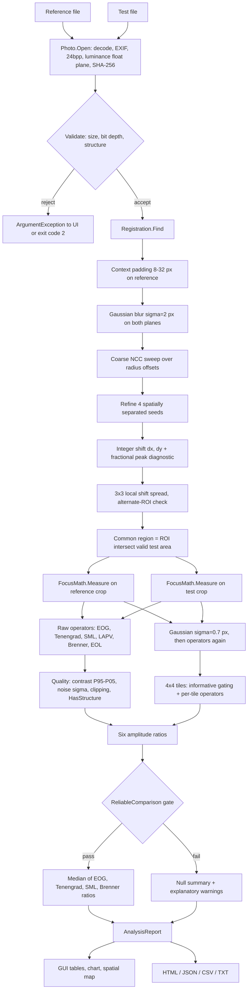
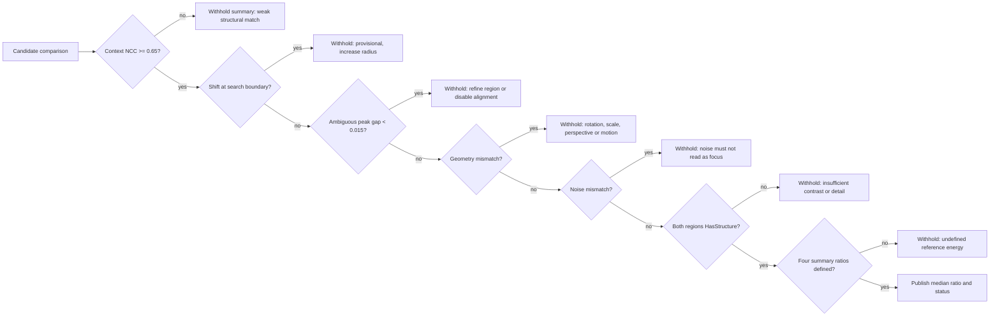

<div align="center">

# PhotoCompare 2.1

**Comparação de nitidez de imagens ancorada em referência para Windows — alinhe qualquer quadro de teste a um controle confiável, meça seis operadores de detalhe e obtenha um veredicto reprodutível com resolução espacial.**

[](https://learn.microsoft.com/en-us/dotnet/framework/install/guide-for-developers)
[](PhotoCompare.csproj)
[](src/ProductInfo.cs)
[](LICENSE)
[](#stack-tecnológico-e-arquitetura)
[](tests/PhotoTests.cs)

</div>

> [!IMPORTANT]
> Este repositório entrega uma **aplicação desktop Windows autônoma**, não um produto server-side nem orientado a console. O `PhotoCompare.exe` é um executável WinForms/GDI+ que roda sozinho: sem instalador, sem Python, sem OpenCV, sem pacotes NuGet e sem acesso à rede. A configuração é expressa apenas por flags de CLI e controles da janela — **deliberadamente não existem** variáveis de ambiente nem arquivos de configuração.

---

## Sumário

- [Recursos](#recursos)
- [Stack tecnológico e arquitetura](#stack-tecnológico-e-arquitetura)
  - [Stack principal](#stack-principal)
  - [Estrutura do projeto](#estrutura-do-projeto)
  - [Decisões de design fundamentais](#decisões-de-design-fundamentais)
  - [Pipeline de análise](#pipeline-de-análise)
  - [Portão de confiabilidade](#portão-de-confiabilidade)
- [Primeiros passos](#primeiros-passos)
  - [Pré-requisitos](#pré-requisitos)
  - [Instalação](#instalação)
  - [Compilando a partir do código-fonte](#compilando-a-partir-do-código-fonte)
  - [Solução de problemas](#solução-de-problemas)
- [Testes](#testes)
  - [Verificações numéricas do núcleo](#verificações-numéricas-do-núcleo)
  - [Verificações de integração pela linha de comando](#verificações-de-integração-pela-linha-de-comando)
  - [Verificações de fumaça de UI](#verificações-de-fumaça-de-ui)
  - [Benchmarks](#benchmarks)
  - [Matriz de cobertura de testes](#matriz-de-cobertura-de-testes)
- [Implantação](#implantação)
  - [Distribuição portátil](#distribuição-portátil)
  - [Integração CI/CD](#integração-cicd)
  - [Conteinerização](#conteinerização)
- [Uso](#uso)
  - [Início rápido na GUI](#início-rápido-na-gui)
  - [O que o percentual significa](#o-que-o-percentual-significa)
  - [Uso pela linha de comando](#uso-pela-linha-de-comando)
  - [Processamento em lote](#processamento-em-lote)
  - [Exportação](#exportação)
  - [Uso avançado](#uso-avançado)
  - [Referência de teclado](#referência-de-teclado)
- [Configuração](#configuração)
  - [Opções de linha de comando](#opções-de-linha-de-comando)
  - [Configurações da GUI](#configurações-da-gui)
  - [Variáveis de ambiente](#variáveis-de-ambiente)
  - [Constantes fixas do motor](#constantes-fixas-do-motor)
  - [Esquemas de relatório](#esquemas-de-relatório)
- [Licença](#licença)
- [Contatos e suporte da comunidade](#contatos-e-suporte-da-comunidade)

---

## Recursos

### Núcleo de medição

- **Pontuação ancorada em referência.** Cada comparação é expressa em relação ao nível de detalhe de uma região de referência escolhida pelo usuário, de modo que os resultados mantêm significado entre câmeras, lentes, sensores e pipelines de processamento.
- **Seis operadores de detalhe independentes** — EOG, Tenengrad, SML, LAPV, Brenner 2D e EOL (máscara térmica) — calculados com definições idênticas em ambas as imagens.
- **Resumo pela mediana de quatro operadores.** O percentual principal é a mediana das razões de amplitude de EOG, Tenengrad, SML e Brenner 2D, robusta ao comportamento atípico de um operador. LAPV e EOL permanecem como diagnóstico.
- **Pré-filtragem gaussiana uniforme σ = 0.7 px** aplicada a ambas as regiões antes da formação das razões, suprimindo o ruído da grade de pixels sem remover detalhe fino.
- **Razões cientes de energia.** Métricas de gradiente ao quadrado são comparadas pela raiz quadrada da razão (amplitude real), enquanto SML usa razão linear.
- **Resultados acima de 100 % nunca são truncados.** Detalhe mais nítido, ruído adicionado e nitidez digital agressiva podem legitimamente elevar a pontuação acima do nível de referência.
- **Normalização de contraste opcional** por `referência (P95−P05) / teste (P95−P05)`, desligada por padrão porque pode mascarar a perda de contraste causada pelo desfoque.

### Alinhamento e geometria

- **Busca de translação em subjanela** com raio padrão de ±32 px, ajustável até ±256 px, após suavização gaussiana σ = 2 px.
- **Busca NCC do grosso ao fino** com refinamento multi-semente, para que alvos periódicos como cartas de quatro barras não colapsem em um pico de alias.
- **Preenchimento de contexto** (8–32 px) ao redor da região selecionada apenas para alinhamento; as métricas são sempre medidas dentro da região comum em pixels originais.
- **Estimativa fracionária do pico** (interpolação parabólica do pico de correlação) reportada como diagnóstico — as medições nunca são reamostradas.
- **Triagem geométrica** via amostragem 3×3 de deslocamentos locais e correlação de ROI alternativa; rotação, mudança de escala, perspectiva e movimento independente do primeiro plano são detectados e reportados em vez de confundidos com desfoque.
- **Política de somente translação.** Nunca se aplica reescalonamento automático, correção de rotação ou deformação de perspectiva.

### Engenharia de confiabilidade

- **Retenção do resumo.** O percentual é suprimido quando o alinhamento é fraco, ambíguo ou está no limite da busca, quando a geometria é inconsistente, quando as contribuições de ruído diferem muito ou quando a região carece de detalhe utilizável. Todas as métricas brutas permanecem disponíveis.
- **Diagnóstico de qualidade de entrada**: contraste P95−P05, luminância média, desvio padrão, percentual de clipping, estimativa robusta de ruído σ, fração de energia de ruído, taxa de retenção de desfoque e flags de validade estrutural.
- **Avisos multinível** replicados na GUI, HTML, JSON, CSV e TXT.

### Análise espacial

- **Mapa de até 4×4 blocos** sobre a região comum, com classificação informativa/não informativa por bloco conduzida pela referência.
- **Gradientes suaves de fundo são excluídos** para que rampas de iluminação não possam votar como evidência de foco.
- **Resumo global, mediana local e faixa local P25–P75** reportados separadamente — uma área nítida não consegue mais esconder uma desfocada atrás de uma média global.
- **Sobreposições codificadas por cor** em ambas as pré-visualizações, mais uma tabela dedicada *Spatial tiles*.

### Produtividade e integração

- **Processamento em lote** de uma pasta de imagens com isolamento de erros por arquivo, reaproveitamento em cache das medições de referência, cancelamento e exportação para CSV/JSON.
- **Quatro formatos de exportação** — HTML autocontido (sem scripts e sem fotografias embutidas), JSON completo, CSV plano e TXT legível.
- **Procedência por design**: o SHA-256 de cada arquivo de origem, a versão da ferramenta, as configurações e as coordenadas da região medida acompanham cada relatório.
- **Imagens de origem nunca são modificadas**; o exportador se recusa a gravar um relatório sobre um caminho de entrada.
- **Cultura determinística**: o processo força `en-US` para culture e UI culture, portanto o parsing e a formatação numérica nunca dependem do host.
- **Paridade completa por CLI** para execuções de par único e em lote, com códigos de saída estáveis para automação.
- **Cancelamento em todos os lugares** — `Esc`/`Cancel` no meio da análise, verificações cooperativas de `CancellationToken` dentro dos laços de desfoque, operadores e alinhamento.
- **Cache limitado em memória** (`AnalysisSession`) que reaproveita as medições de referência e de teste mais o alinhamento quando apenas a tolerância ou o modo de contraste mudam.
- **Zero dependências de terceiros**: a aplicação inteira é um único executável compilado contra a biblioteca de classes do .NET Framework.

---

## Stack tecnológico e arquitetura

### Stack principal

| Camada | Tecnologia | Notas |
| --- | --- | --- |
| Linguagem | **C#** (sintaxe compatível com C# 5) | Sem `async`, sem strings interpoladas, sem membros com corpo de expressão |
| Runtime | **.NET Framework 4.8** | Incluído no Windows 10 1903+ / Windows 11; o targeting pack só é necessário para compilar |
| UI | **Windows Forms** (`System.Windows.Forms`) | Interface construída inteiramente em código — sem `.Designer.cs`, sem XAML, sem recursos |
| Imagem | **GDI+** (`System.Drawing`) | Decodificação, orientação EXIF, composição em 24 bpp, renderização das pré-visualizações |
| Serialização | **`System.Web.Script.Serialization.JavaScriptSerializer`** | Relatórios JSON; sem dependência de Newtonsoft/System.Text.Json |
| Build (IDE) | **MSBuild / Visual Studio 2022** | Formato de solução 12.00, toolset VS 17 |
| Build (CLI) | **`csc.exe` de `%WINDIR%\Microsoft.NET\Framework64\v4.0.30319`** | Invocado por `Build.ps1`; sem restauração de pacotes |
| Scripts | **Windows PowerShell 5.1** | `Build.ps1`, `Run-Tests.ps1`, `Run-Benchmark.ps1` |
| Concorrência | **TPL** (`Parallel.For`) + `CancellationToken` | Ativada acima de 300 000 pixels; paralelismo limitado a `min(8, cores−1)` |
| Binário | **AnyCPU, `WinExe`** | Roda em x86 ou x64 sem alterações |

> [!NOTE]
> `TreatWarningsAsErrors` está habilitado no `PhotoCompare.csproj` e o `Build.ps1` passa `/warnaserror+`. Um aviso é uma falha de build — em um projeto onde mudar uma única constante invalida medições publicadas, isso evita a deriva numérica silenciosa e o código morto.

### Estrutura do projeto

```text
reference-sharpness-comparator2/
├── PhotoCompare.sln              # Solução VS 2022 (Debug/Release, AnyCPU)
├── PhotoCompare.csproj           # v4.8 WinExe, RootNamespace=PhotoFocus, mesma lista de fontes do Build.ps1
├── PhotoCompare.exe              # Binário AnyCPU pré-compilado, sincronizado com src/ pelo BUILD.bat
├── START.bat                     # Inicia o EXE raiz no local
├── BUILD.bat                     # Wrapper do Build.ps1, pausa em caso de falha
├── BUILD_AND_RUN.bat             # Wrapper do Build.ps1 -Launch
├── Build.ps1                     # Build baseado em csc com staging e substituição atômica
├── Run-Tests.ps1                 # Verificações do núcleo + integração CLI (+ fumaça de UI opcional)
├── Run-Benchmark.ps1             # Harness sintético de desempenho
├── LICENSE                       # Apache License 2.0
├── README.md
├── src/
│   ├── Program.cs                # Ponto de entrada, parser de argumentos, modos de shell    (~108 linhas)
│   ├── ProductInfo.cs            # Nome, versão, chave de variante                         (~12 linhas)
│   ├── AssemblyInfo.cs           # Metadados do executável Win32                          (~7 linhas)
│   ├── FocusAnalysis.cs          # Imagem, operadores, alinhamento, relatórios             (~650 linhas)
│   ├── AnalysisSession.cs        # Cache limitado de medição/alinhamento                   (~43 linhas)
│   ├── PhotoForms.cs             # Janela principal, telas, gráfico, blocos                (~414 linhas)
│   ├── BatchAnalysis.cs          # Motor de lote + janela de lote                          (~150 linhas)
│   └── ReportHtml.cs             # Relatório HTML autocontido + gráfico SVG                (~79 linhas)
├── tests/
│   ├── PhotoTests.cs             # 61 verificações numéricas/de qualidade de dados         (~238 linhas)
│   ├── Benchmark.cs              # Casos de temporização sintéticos reprodutíveis           (~52 linhas)
│   └── output/                   # Fixtures geradas, relatórios, JSON de benchmark
├── bin/Release/                  # Saída do compilador (exe + pdb)
└── obj/                          # Staging e intermediários do MSBuild
```

<details>
<summary><strong>Responsabilidades por arquivo, artefatos gerados e por que a saída de build está versionada</strong></summary>

**Arquivos-fonte e seus contratos**

| Arquivo | Responsável por | Depende de |
| --- | --- | --- |
| `src/Program.cs` | Gramática de opções, seleção de modo, imposição da localidade inglesa, códigos de saída, log de erros em `%TEMP%` | `ProductInfo`, `FocusMath`, `BatchAnalysis`, `ReportFiles`, `PhotoForms` |
| `src/ProductInfo.cs` | `Name`, `Version`, `FileVersion`, `Description`, chave de variante `IsComparison` | — |
| `src/FocusAnalysis.cs` | `GrayPlane`, `Photo`, `OperatorValues`, `ImageMeasures`, `TileMeasure`, `AlignmentResult`, `AnalysisReport`, `FocusMath`, `Registration`, `ReportFiles` | GDI+, `System.Web.Extensions` |
| `src/AnalysisSession.cs` | Cache por identidade de objeto (`ReferenceEquals`) + região + configurações | `FocusMath`, `Registration` |
| `src/PhotoForms.cs` | `PhotoCanvas` (pintura/zoom/pan/ROI/arrastar e soltar/sobreposição de blocos), `PhotoForm`, controle de gráfico, resultados em abas | WinForms |
| `src/BatchAnalysis.cs` | `BatchItem`, `BatchAnalysis.Run/Save`, `BatchForm` com `BackgroundWorker` | `AnalysisSession`, WinForms |
| `src/ReportHtml.cs` | CSS inline, gráfico de barras SVG, grade de blocos, codificação HTML | `AnalysisReport` |

**Artefatos gerados (seguros de apagar, regenerados sob demanda)**

- `bin/Debug`, `bin/Release` — saída do MSBuild. Builds da IDE caem aqui; o build por CLI **deliberadamente não** os sobrescreve.
- `obj/command-line` — pasta de staging usada pelo `Build.ps1` para a substituição atômica do EXE.
- `tests/output` — fixtures sintéticas (`reference.png`, `working.png`, `shifted.png`, `color-test.png`, `large-native.png`), uma pasta `batch-input` com um `broken.png` propositalmente corrompido e os relatórios/JSON produzidos pelas verificações.

Como a saída de build é reproduzível byte a byte a partir do código-fonte com o compilador embutido, o repositório mantém um `PhotoCompare.exe` pré-compilado na raiz apenas por conveniência, para permitir usar a ferramenta em uma máquina sem SDK. Ele não é o artefato autoritativo — `src/` é.

**Identidade do assembly**

`RootNamespace` é `PhotoFocus` enquanto o nome do assembly é `PhotoCompare`. Essa divergência é intencional: namespaces descrevem o módulo de domínio, o nome do assembly descreve o produto entregue. O `Build.ps1` lê `AssemblyName` do arquivo de projeto, valida com `^[A-Za-z][A-Za-z0-9_.-]*$` e deriva dele os caminhos de staging e destino, de modo que renomear o produto não exige tocar no script.

</details>

### Decisões de design fundamentais

<details>
<summary><strong>1. Uma escala relativa de referência em vez de um limiar universal de nitidez</strong></summary>

Não existe um número absoluto e transferível de “em foco” para uma fotografia isolada: textura da cena, ruído, exposição, demosaicing, redução de ruído e nitidez movem todos a energia de alta frequência. Por isso o motor responde exatamente a uma pergunta — *quanto detalhe medido esta região de teste contém em comparação com esta região de referência?* — e declara isso sem rodeios:

- `100 %` é o **nível de detalhe medido da referência selecionada**, não foco óptico perfeito. Um controle desfocado define seu próprio 100 %.
- `80 %` significa que as amplitudes de detalhe combinadas são menores que na referência; **não** é uma afirmação de que a lente esteja “20 % fora de foco”.
- `115 %` significa que se mede mais conteúdo de alta frequência, o que pode vir de detalhe mais nítido, mais ruído ou nitidez digital mais forte.

O `Detail index` de imagem única (`100 × √Tenengrad(σ=0.7) / (P95−P05)`) existe no motor e é coberto pelas verificações, mas é uma escala relativa sem limite superior e esta variante da aplicação (`ProductInfo.IsComparison = true`) não a expõe.

</details>

<details>
<summary><strong>2. Razões de amplitudes, não de energias, e mediana em vez de média</strong></summary>

EOG, Tenengrad e Brenner 2D são quadráticos em relação à amplitude dos pixels, então uma razão ingênua dessas energias reporta algo mais próximo de uma variância do que de uma mudança de nitidez. O motor as compara pela raiz quadrada da razão (`100 × √(working / reference)`), enquanto SML — já uma medida linear de diferença de amplitude — usa a razão linear. As quatro razões de resumo são reduzidas com uma **mediana**, de modo que um operador com comportamento incomum (por exemplo, em textura predominantemente vertical) não arrasta o número principal.

Ambas as regiões são filtradas com o mesmo gaussiano σ = 0.7 px antes da formação das razões, o que torna a comparação simétrica em fase e suprime o piso de ruído sem remover a faixa de detalhe que os operadores foram desenhados para ver.

</details>

<details>
<summary><strong>3. Recusar-se a responder é um recurso</strong></summary>

Um comparador que sempre retorna um número sempre retornará um número errado nos casos ambíguos. `ReliableComparison` é `true` apenas quando **todas** as condições abaixo valem:

- NCC de contexto ≥ 0.65,
- o melhor deslocamento não está no limite da busca,
- não há pico alternativo igualmente plausível (separação de ambiguidade < 0.015 entre o melhor pico e o pico forte espacialmente distante),
- não há incompatibilidade geométrica (ganho de ROI alternativa > 0.12 com deslocamento ≥ 3 px, ou dispersão de deslocamentos locais > 3.5 px em ≥ 4 blocos aceitos),
- não há incompatibilidade de ruído (σ do mais ruidoso > max(3, 2 × σ do mais silencioso + 0.5), fração de energia de ruído > 0.5, retenção de desfoque < 0.3),
- ambas as regiões reportam `HasStructure`,
- as quatro razões de resumo estão definidas.

Quando o portão falha, `Status` passa a `Reliable comparison unavailable`, `RelativeDetailPercent` é `null` e os avisos explicam qual condição falhou. As linhas de métricas individuais permanecem preenchidas para que o engenheiro continue diagnosticando.

</details>

<details>
<summary><strong>4. Medição em pixels inteiros, sem reamostragem oculta</strong></summary>

O alinhamento retorna um deslocamento inteiro; a estimativa fracionária é derivada do pico de correlação apenas como diagnóstico. As imagens medidas **nunca** são interpoladas, porque a interpolação é ela própria um filtro passa-baixa e deprimiria sistematicamente a nitidez da imagem reamostrada. Consequentemente:

- rotação, escala e perspectiva não são corrigidas, apenas detectadas;
- dimensões de arquivo diferentes são permitidas apenas se o objeto mantiver a mesma escala de pixels;
- um deslocamento fracionário pode produzir erro de fase de pixel em barras periódicas muito finas, e o relatório diz isso explicitamente.

</details>

<details>
<summary><strong>5. Falhar rápido com entradas não suportadas em vez de degradar silenciosamente</strong></summary>

O GDI+ reduz silenciosamente alguns PNGs de 16 bits para 8 bits. Em vez de aceitar uma medição silenciosamente errada, `Photo.Open` inspeciona o byte de profundidade de bits do IHDR do cabeçalho PNG, lê a tag TIFF `BitsPerSample` (0x102) e rejeita dados de alta profundidade com uma mensagem acionável. Os limites são aplicados antes da alocação: 24 000 000 de pixels no total e 16 000 pixels por lado. A orientação EXIF (0x112) é aplicada para que a pré-visualização e a medição coincidam. A transparência é composta sobre branco com um aviso explícito. Apenas o primeiro quadro de um arquivo multipágina ou animado é carregado, também com aviso.

</details>

<details>
<summary><strong>6. Saídas determinísticas e auditáveis</strong></summary>

- O processo fixa `CultureInfo` em `en-US` no thread padrão, na UI culture e no thread atual, de modo que `int.Parse`/`ToString` nunca seguem a localidade do host.
- Campos numéricos do CSV são gravados no formato round-trip `G17` em cultura invariante; valores exibidos em TXT/HTML são arredondados para três casas.
- Cada relatório carrega a versão da ferramenta (`PhotoCompare 2.1`) e os digests SHA-256 de ambos os arquivos de origem.
- O relatório HTML é um único arquivo com CSS inline e gráfico SVG inline — **sem `<script>`, sem ``** — então renderiza igual a partir de e-mail, de uma máquina isolada ou de um arquivo de conformidade, e não consegue executar nem exfiltrar nada.
- Nomes de arquivo e strings de aviso são codificados com `WebUtility.HtmlEncode`; células CSV de lote iniciadas por `= + - @` recebem o prefixo `'` para neutralizar injeção de fórmula em planilhas.

</details>

<details>
<summary><strong>7. Estado limitado, ciclos de vida explícitos</strong></summary>

`Photo` implementa `IDisposable` e é dono do seu `Bitmap`; o carregador copia os pixels para um plano de luminância `float[]` (0–255) e libera o handle do arquivo imediatamente, portanto um arquivo de origem pode ser renomeado ou apagado enquanto a janela de análise está aberta. `AnalysisSession` mantém no máximo uma medição de referência, uma de teste e um alinhamento, é invalidado por `Clear()` e é criado por janela e por lote — nenhum estado estático de imagem é compartilhado entre janelas ou threads de trabalho. `Program` libera as fotos decodificadas em blocos `finally`.

</details>

<details>
<summary><strong>8. Nenhuma superfície de configuração além de flags e controles</strong></summary>

Uma ferramenta de medição que silenciosamente captura um `.env`, uma chave do registro ou um arquivo de configurações móvel é uma ferramenta que não pode ser reproduzida seis meses depois. Toda entrada do motor é um argumento explícito ou um controle visível, e toda saída registra esses valores. A interface também rejeita invocações contraditórias: opções duplicadas, modos misturados (`--image` com `--batch`), ambos os modos de contraste e opções de comparação em uma variante de imagem única geram erro de argumento.

</details>

<details>
<summary><strong>9. Build atômico, falhas isoladas</strong></summary>

O `Build.ps1` compila em `obj/command-line/` e só então move o resultado sobre o executável raiz. Uma falha de compilação — ou um destino bloqueado porque a aplicação ainda está rodando — deixa o binário que funcionava intacto, e o script informa isso. A análise em lote aplica a mesma filosofia em tempo de execução: um arquivo danificado ou ausente vira um erro de linha enquanto as demais imagens continuam, e o processo sai com `1` em vez de abortar.

</details>

### Pipeline de análise

<details open>
<summary><strong>Fluxo de dados de ponta a ponta: de dois arquivos a um percentual com portão</strong></summary>



</details>

<details>
<summary><strong>Definições e unidades dos operadores conforme implementadas</strong></summary>

| Operador | Índice | Definição no código | Unidade | Papel |
| --- | --- | --- | --- | --- |
| `EOG` | 0 | Média dos quadrados das diferenças para frente em X e Y | levels²/px | Resumo |
| `Tenengrad` | 1 | Energia Sobel X/Y média; cada kernel dividido por 8 | levels²/px | Resumo |
| `SML` | 2 | Média das diferenças segundas absolutas em X/Y; passo 1, limiar 0 | levels/px | Resumo (razão linear) |
| `LAPV` | 3 | Variância do Laplaciano de quatro vizinhos | levels² | Diagnóstico |
| `Brenner 2D` | 4 | Metade da soma das médias dos quadrados das diferenças de passo 2 em X e Y | levels²/px | Resumo |
| `EOL (thermal)` | 5 | Média do quadrado da resposta da máscara centro-20 / vizinho-−4 / diagonal-−1 | levels²/px | Diagnóstico |

Os seis são calculados apenas sobre posições internas válidas (normalização `(w−2)(h−2)` para os operadores internos, `(w−1)(h−1)` para EOG, `h(w−2)` e `(h−2)w` para os dois eixos do Brenner) e calculados na grade de pixels original. A coluna σ = 0.7 repete definições idênticas no plano filtrado, então “original versus filtrado” é uma comparação equivalente, não uma troca de fórmula.

</details>

<details>
<summary><strong>O algoritmo de registro em detalhe</strong></summary>

1. **Região de contexto.** Com o alinhamento ligado, a ROI selecionada é inflada em `min(32, max(8, min(w,h)/4))` pixels e intersectada com os limites da referência. Esse contexto ajuda a localizar um alvo muito desfocado ou de baixo contraste; ele nunca contribui para a região de métricas.
2. **Suavização.** Tanto o contexto de referência quanto a janela de busca do teste são desfocados com σ = 2 px para que a NCC seja insensível a ruído e aliasing fino.
3. **Janela de busca.** A janela de teste é o contexto inflado em `radius + 5`, de modo que todo deslocamento candidato até o raio permaneça inteiramente dentro da imagem de teste.
4. **Varredura grossa.** Deslocamentos são amostrados com passo `ceil(radius / 12)` (mais `0`, `−radius`, `+radius`), pontuados por correlação cruzada normalizada em uma subgrade amostrada de cerca de 40 amostras por eixo.
5. **Refinamento multi-semente.** Até quatro picos grossos espacialmente separados são refinados em resolução plena de vizinhança com passo mais fino (`/72`). Isso evita travar em um alias de uma carta de quatro barras regular.
6. **Detecção de ambiguidade.** A melhor pontuação é comparada com o candidato mais forte a pelo menos `max(6, 2 × coarse)` px; uma separação inferior a 0.015 com ambas as pontuações acima de 0.65 marca o resultado como ambíguo.
7. **Estimativa fracionária.** Um ajuste parabólico sobre os vizinhos horizontais e verticais do pico produz `FractionalDx/FractionalDy`, limitados a ±0.5 px. Valores além de 0.25 px do deslocamento inteiro geram um aviso de fase de pixel.
8. **Triagem geométrica.** Se a NCC da ROI < 0.85, uma busca alternativa que maximiza a correlação da ROI local é executada; um pico alternativo muito melhor e distante do primário indica incompatibilidade geométrica. Para ROI ≥ 128×128 px, nove buscas locais de bloco 3×3 dentro de ±3 px medem a dispersão residual de deslocamentos; dispersão > 3.5 px em ≥ 4 blocos confiáveis sinaliza rotação, escala, perspectiva ou movimento independente.
9. **Região comum.** Mede-se `ROI ∩ área válida do teste`; se o alinhamento removeu mais de 20 % da área selecionada, um aviso é emitido.

Um deslocamento reportado `dx, dy` significa que o pixel de referência `(x, y)` corresponde ao pixel de teste `(x + dx, y + dy)`.

</details>

### Portão de confiabilidade

<details>
<summary><strong>Lógica de decisão sobre se um percentual pode ser exibido</strong></summary>



Todo caso retido ainda retorna a tabela de métricas, o mapa de blocos, o diagnóstico e os avisos. `ReliableComparison` é serializado no JSON para que a automação ramifique por ele, e não pelo código de saída.

</details>

---

## Primeiros passos

### Pré-requisitos

| Requisito | Versão / Notas | Necessário para |
| --- | --- | --- |
| Windows | Windows 10 1903+ ou Windows 11 (qualquer edição) | Executar a GUI |
| .NET Framework | Runtime **4.8** — pré-instalado nas compilações suportadas do Windows | Executar a aplicação |
| PowerShell | **Windows PowerShell 5.1** (`powershell.exe`, não apenas `pwsh`) | `Build.ps1`, `Run-Tests.ps1`, `Run-Benchmark.ps1` |
| .NET Framework 4.8 Developer Pack | Apenas ao compilar com **Visual Studio** | Compilação MSBuild/VS |
| Visual Studio 2022 (opcional) | Carga de trabalho *.NET desktop development* | Edição e depuração na IDE |
| `csc.exe` | `%WINDIR%\Microsoft.NET\Framework64\v4.0.30319\csc.exe` | Build por script sem SDK |

> [!TIP]
> Se o `PhotoCompare.exe` já inicia na sua máquina, você tem tudo o que é necessário para *usar* a ferramenta. O compilador, o SDK e os scripts PowerShell só são necessários para *modificá-la*.

> [!WARNING]
> Windows on ARM executa esta aplicação via emulação x64 apenas quando o .NET Framework 4.8 está presente. macOS, Linux e Wine não são alvos suportados: a UI é WinForms e a camada de imagem é GDI+, nenhuma delas multiplataforma.

### Instalação

Não existe instalador. Clone e execute:

```powershell
# 1. Clonar o repositório
git clone https://github.com/DroneNotes/reference-sharpness-comparator2.git
cd reference-sharpness-comparator2

# 2. Verificar se o runtime está presente (imprime a chave de versão 4.8, ex.: 528040)
reg query "HKLM\SOFTWARE\Microsoft\NET Framework Setup\NDP\v4\Full" /v Release

# 3. Iniciar o binário pré-compilado
.\START.bat
# ou diretamente:
.\PhotoCompare.exe
```

Prefere um build compilado por você? Substitua o passo 3 por:

```powershell
# Recompilar o executável raiz a partir de src/ e iniciá-lo
.\BUILD_AND_RUN.bat
```

**Passo a passo do primeiro uso**

1. Clique em **1. Open reference…** (ou `Ctrl+Shift+O`, ou arraste um arquivo para a pré-visualização esquerda).
2. Clique em **2. Open test image…** (ou `Ctrl+O`, ou arraste para a pré-visualização direita).
3. Arraste com o botão esquerdo para selecionar um alvo ou objeto texturizado **na pré-visualização de referência**.
4. A análise começa automaticamente. Veja o percentual principal, a tabela de métricas e os avisos.
5. Ative **Spatial map** ou abra **Spatial tiles** para inspecionar as diferenças locais.
6. Use **Save result…** (`Ctrl+S`) para exportar em HTML, JSON, CSV ou TXT.

### Compilando a partir do código-fonte

<details>
<summary><strong>Build por script, Visual Studio, invocação manual do <code>csc</code> e parâmetros dos scripts</strong></summary>

#### A. Build por script (sem SDK)

```powershell
# Recompilar .\PhotoCompare.exe a partir de src/
powershell -NoProfile -ExecutionPolicy Bypass -File .\Build.ps1

# Recompilar e iniciar
powershell -NoProfile -ExecutionPolicy Bypass -File .\Build.ps1 -Launch

# Recompilar e executar a suíte completa de verificações
powershell -NoProfile -ExecutionPolicy Bypass -File .\Build.ps1 -Tests
```

Comportamento do `Build.ps1`, passo a passo:

1. Localiza exatamente um `*.csproj` na pasta do script e falha caso contrário.
2. Lê `<AssemblyName>` e valida contra `^[A-Za-z][A-Za-z0-9_.-]*$`.
3. Resolve `csc.exe` primeiro em `Framework64`, com fallback para `Framework`.
4. Expande cada entrada `<Compile Include=…>` e rejeita qualquer caminho que escape da raiz do projeto.
5. Compila em `obj\command-line\<AssemblyName>.exe` com `/target:winexe /platform:anycpu /optimize+ /warn:4 /warnaserror+ /main:PhotoFocus.Program`.
6. Move o arquivo temporário sobre `.\PhotoCompare.exe` — preservando atomicamente o binário anterior em qualquer falha.

#### B. Visual Studio

```powershell
# Equivalente por linha de comando de "Build Solution" para a configuração Release
msbuild .\PhotoCompare.sln /t:Rebuild /p:Configuration=Release /p:Platform="Any CPU"
```

Abra `PhotoCompare.sln` para trabalho interativo; a saída da IDE cai em `bin\Debug` ou `bin\Release`. Requer o .NET Framework 4.8 Developer/Targeting Pack ([guia da Microsoft](https://learn.microsoft.com/en-us/dotnet/framework/install/guide-for-developers)).

#### C. Invocação manual do compilador

```powershell
$csc = "$env:WINDIR\Microsoft.NET\Framework64\v4.0.30319\csc.exe"
& $csc /nologo /target:winexe /platform:anycpu /optimize+ /warn:4 /warnaserror+ /main:PhotoFocus.Program `
  /out:.\PhotoCompare.exe `
  /r:System.dll,System.Core.dll,System.Drawing.dll,System.Windows.Forms.dll,System.Web.Extensions.dll `
  .\src\ProductInfo.cs .\src\AssemblyInfo.cs .\src\Program.cs .\src\FocusAnalysis.cs `
  .\src\AnalysisSession.cs .\src\PhotoForms.cs .\src\BatchAnalysis.cs .\src\ReportHtml.cs
```

#### D. Adicionando um arquivo-fonte

Novos arquivos `.cs` devem ser listados em **`PhotoCompare.csproj`** (`<Compile Include=…>`) e em nenhum outro lugar — o `Build.ps1` deriva sua lista do arquivo de projeto, então o arquivo de projeto é a única fonte de verdade. Mantenha o código novo compatível com C# 5 se pretende compilar com o compilador embutido; introduza sintaxe mais recente apenas se elevar a versão da linguagem nos dois caminhos de build.

</details>

### Solução de problemas

<details>
<summary><strong>Falhas comuns de build e execução e suas causas exatas</strong></summary>

| Sintoma | Causa | Correção |
| --- | --- | --- |
| `Expected one C# project file in this folder.` | Zero ou vários arquivos `.csproj` | Mantenha exatamente um arquivo de projeto ao lado de `Build.ps1` |
| `The Windows .NET Framework C# compiler was not found.` | Execução fora do Windows ou ambiente reduzido | Instale o .NET Framework 4.8 ou use o Visual Studio 2022 |
| `Compilation failed. The previous executable has been preserved.` | Erro de compilação, ou recurso de linguagem que o compilador embutido rejeita | Corrija o erro; mantenha sintaxe compatível com C# 5 ou compile com o toolset do VS |
| `Close the running application and build again.` | O EXE de destino está bloqueado por uma instância em execução | Feche o PhotoCompare e recompile |
| `error CS0246: … System.Web.Extensions` | Lista de referências alterada | Mantenha as cinco referências listadas no arquivo de projeto |
| `Run BUILD.bat before running checks.` | `Run-Tests.ps1` exige um EXE raiz | Compile primeiro e execute novamente |
| `16-bit PNG is not supported.` | Profundidade de bits do IHDR > 8 | Exporte uma imagem de exibição de 8 bits sem redimensionar |
| `TIFF channels above 8 bits are not supported.` | `BitsPerSample` > 8 | Exporte um TIFF de 8 bits |
| `The limit is 24 million pixels and 16,000 pixels per side.` | Arquivo grande demais | Recorte na resolução original em vez de redimensionar |
| `The region must be inside the image and at least 16×16 pixels.` | ROI pequena demais ou fora dos limites | Use ≥ 48×48 px em um objeto texturizado |
| `No common image region.` | O alinhamento não consegue posicionar a ROI no quadro de teste | Aumente a tela de teste ou reduza o raio de busca |
| `A report cannot overwrite a source image.` | `--out` igual a um caminho de entrada | Escolha outro caminho de saída |
| `Unknown option or missing value: …` | Erro de digitação ou flag sem valor | Compare com a tabela de opções |
| `Duplicate option: …` | A mesma flag foi passada duas vezes | Passe cada opção uma única vez |
| `Batch, single-image and test modes must be run separately.` | Dois entre `--image`, `--batch`, `--smoke`, `--smoke-batch` combinados | Execute um modo por processo |
| `Specify --image / --batch, or start the application without arguments.` | Opções sem modo | Adicione um modo ou inicie a GUI |
| SmartScreen “editor desconhecido” | Binário não assinado | Verifique o SHA-256 contra o seu próprio build e permita; ou assine o seu build |
| Valores diferem do run de um colega | Caminhos de ponto flutuante distintos, versão diferente ou região diferente | Compare `ToolVersion`, `RequestedArea` e o SHA-256 de origem no JSON |

**Código de saída 2 sem diálogo** é esperado no modo CLI: um processo de subsistema GUI não tem console anexado, então a mensagem vai para `%TEMP%\PhotoCompare-error.txt`. Leia esse arquivo e corrija a invocação.

</details>

---

## Testes

A suíte é intencionalmente dividida em **verificações numéricas puras** (rápidas, determinísticas, sem GUI) e **verificações em nível de aplicação** (execuções reais de processo, exportações reais, códigos de saída reais).

```powershell
# Tudo: verificações do núcleo + verificações de integração CLI
powershell -NoProfile -ExecutionPolicy Bypass -File .\Run-Tests.ps1

# Tudo, mais execuções de fumaça da GUI da janela principal e da janela de lote
powershell -NoProfile -ExecutionPolicy Bypass -File .\Run-Tests.ps1 -Ui

# Harness sintético de desempenho (medianas de três execuções)
powershell -NoProfile -ExecutionPolicy Bypass -File .\Run-Benchmark.ps1
```

> [!IMPORTANT]
> O `Run-Tests.ps1` exige um `PhotoCompare.exe` previamente compilado na raiz do projeto e termina com código diferente de zero na primeira falha, com uma mensagem `FAIL: <check name>` em stderr. Uma execução bem-sucedida termina com `PASS: PhotoCompare local numerical, command-line, export and batch checks.` e grava `tests/output/test-results.json` com a contagem de aprovações e as medições-chave.

### Verificações numéricas do núcleo

O `Run-Tests.ps1` compila `ProductInfo.cs`, `FocusAnalysis.cs`, `AnalysisSession.cs`, `ReportHtml.cs`, `BatchAnalysis.cs` junto com `tests/PhotoTests.cs` em `tests/output/CoreChecks.exe` (sem fontes de GUI), depois o executa com a pasta de saída como `argv[0]`. As fixtures são geradas em processo a partir de sementes fixas (`Random(72)`, `Random(91)`, `Random(103)`), portanto os resultados são estáveis bit a bit entre máquinas.

O harness constrói uma cena sintética deliberadamente não periódica — senoides moduladas, dois grupos de quatro barras em orientações diferentes, um disco e uma borda inclinada — além de auxiliares que aplicam ganho/offset/ruído/deslocamento (`Change`) e rotação/escala/deformações subpixel (`Warp`).

```powershell
# Executar apenas as verificações do núcleo (equivalente ao interno da suíte)
powershell -NoProfile -Command "& .\tests\output\CoreChecks.exe .\tests\output"
```

Cada verificação imprime `PASS: <name>`; a linha final é `All 61 checks passed.` O arquivo de resultados registrado é assim:

```json
{"passed":61,"identity":100,"gain":100.45,"sharper":155.59,"noise":11.99,
 "measurements":[{"sigma":0.5,"score":97.64,"ncc":0.99997},
                 {"sigma":1.0,"score":83.50,"ncc":0.99941},
                 {"sigma":1.8,"score":64.38,"ncc":0.99543},
                 {"sigma":3.0,"score":38.53,"ncc":0.98071}]}
```

### Verificações de integração pela linha de comando

Depois das verificações do núcleo, o `Run-Tests.ps1` inicia o executável real com `Start-Process -WindowStyle Hidden -Wait` e valida códigos de saída e conteúdo:

1. **Quatro caminhos de exportação** — `application.json`, `.html`, `.csv`, `.txt` devem cada um concluir com código de saída `0`.
2. **Semântica de identidade** — `ToolVersion` começa com `PhotoCompare `, a largura de trabalho reportada é `320`, e uma comparação da referência consigo mesma gera `RelativeDetailPercent == 100` dentro de `1e-7`.
3. **Isolamento de falhas em lote** — uma pasta com duas imagens válidas e um arquivo de texto `broken.png` deve sair com `1` e produzir exatamente três linhas, das quais exatamente uma leva `Error`.
4. **Imutabilidade da origem** — o hash da imagem de teste antes e depois de uma tentativa de exportar sobre ela deve ser idêntico, e a tentativa deve sair com `2`.

### Verificações de fumaça de UI

`-Ui` acrescenta duas execuções de fumaça que exercitam todo o caminho de construção do WinForms:

```powershell
powershell -NoProfile -ExecutionPolicy Bypass -File .\Run-Tests.ps1 -Ui
```

- `--smoke <folder>` — abre o par referência/teste, seleciona a ROI, conclui uma análise e salva `compare-ui.png` / `compare-ui.json`.
- `--smoke-batch <folder>` — abre o motor de lote com uma referência sintética e grava `compare-batch-ui.png` / `compare-batch-ui.json`.

A execução falha se qualquer um desses quatro arquivos estiver ausente.

### Benchmarks

```powershell
powershell -NoProfile -ExecutionPolicy Bypass -File .\Run-Benchmark.ps1
# → tests/output/benchmark.json
```

O `tests/Benchmark.cs` aquece com um caso de 48×48 e então mede os modos **single** e **compare** em **640×512** e **3840×2400** com três repetições cronometradas cada (a mediana é reportada). Compilado com `/define:PHOTO_V2`, acrescenta um caso `compare_cached_settings` que roda 25 iterações por um `AnalysisSession` já aquecido com tolerância variável, isolando o custo do caminho de apenas-configurações. A saída JSON registra nome da máquina, número de processadores, versão do runtime e arrays de amostras brutas, de modo que regressões podem ser atribuídas ao hardware ou ao código.

> [!TIP]
> Execute o benchmark antes e depois de mexer em qualquer coisa em `GrayPlane`, `Operators` ou `Registration`. O limiar de 300 000 pixels que ativa `Parallel.For`, o tamanho de bloco de 64 linhas e o limite `min(8, cores−1)` são críticos para desempenho; alterá-los muda tanto os tempos quanto — por ordens de soma diferentes — os últimos dígitos de cada métrica.

### Matriz de cobertura de testes

<details>
<summary><strong>O que as 61 verificações do núcleo realmente afirmam</strong></summary>

| Área | Afirmações representativas |
| --- | --- |
| Identidade e álgebra | Imagens idênticas pontuam exatamente 100 %; toda razão de operador é 100; `dx = dy = 0` |
| Resposta monotônica ao desfoque | Gaussiano σ = 0.5 → 97.6 %, 1.0 → 83.5 %, 1.8 → 64.4 %, 3.0 → 38.5 %, estritamente decrescente |
| Correção de alinhamento | Deslocamentos `(11,−7)`, `(−17,12)`, `(0,19)` são recuperados exatamente e a pontuação volta a 100 ± 0.01 |
| Independência da tela | A mesma cena em uma tela maior com offset `(9,5)` gera pontuação idêntica; sem reescalonamento |
| Ambiguidade | Um padrão de barras de 4 px reporta `Ambiguous` e retém o resumo |
| Limite de busca | Um deslocamento de 32 px com `radius = 32` reporta `AtSearchLimit` e não é confiável |
| Geometria | Rotação de 3°, escala de 1.05× e um bloco de primeiro plano movido independentemente falham no portão |
| Honestidade subpixel | Uma deformação `(0.4,−0.3)` produz estimativa fracionária dentro de 0.18 px enquanto as métricas continuam sem interpolação |
| Contraste | Ganho 0.65 + offset 25 pontua 100.45 % com normalização e ~65 % sem ela |
| Risco da normalização | Um desfoque senoidal que lê 80 % bruto sobe acima de 95 % ao normalizar e emite aviso de mascaramento |
| Ruído | Ruído adicionado σ = 18 dispara `NoiseMismatch`; uma imagem só de ruído é marcada e não recebe índice de nitidez |
| Sobre-nitidez | Comparar uma referência desfocada com o original nítido produz 155.6 % — nunca truncado para 100 % |
| Matemática dos operadores | Rampa linear `2x + 3y`: EOG = Tenengrad = 13, Brenner = 26, SML/EOL/LAPV = 0 (analítico) |
| Precisão gaussiana | O desfoque otimizado σ = 0.7 coincide com convolução 2-D direta dentro de 1e-3, incluindo bordas |
| Isolamento de ROI | Pixels fora da região selecionada não podem alterar nenhuma métrica |
| Com stride versus recortado | Operadores baseados em visão igualam os recortados independentemente dentro de 1e-12 relativo |
| Robustez sem estrutura | Imagens uniformes, referências planas, rampas de fundo e estrutura invertida são rejeitadas como evidência |
| Mapa espacial | Imagem meio desfocada mostra P75−P25 > 20 e 0 < `LowerDetailTiles` < `InformativeTiles`; as grades coincidem em 16 blocos |
| Integridade da exportação | CSV contém todas as métricas; JSON desserializa sem ciclos; HTML contém SVG e todos os blocos, sem `<script>` nem `` |
| Escape | `<script>` em nome de arquivo ou aviso é codificado; `&` vira `&amp;` |
| Higiene de NaN/Inf | O HTML de imagem plana não contém `NaN` nem `Infinity` |
| Cache | Mudar apenas configurações reaproveita os caches de imagem e alinhamento (2 medições + 1 alinhamento), `Clear()` invalida |
| Cancelamento | Tokens pré-cancelados abortam mesmo em cache hit; análise de 1024×768 é abortada em pleno voo |
| Contrato do carregador | Luminância e dimensões nativas preservadas; handle do arquivo liberado após o carregamento; SHA-256 de 64 caracteres hex |
| Lote | Arquivos válidos/ausentes misturados isolam erros e ainda exportam CSV e JSON |

</details>

---

## Implantação

### Distribuição portátil

O PhotoCompare é implantado como um **executável solto em uma pasta**. Não há MSI, nem serviço, nem rastro no registro, nem estado no perfil do usuário.

```powershell
# 1. Produzir um binário de release (otimizado, sem avisos)
powershell -NoProfile -ExecutionPolicy Bypass -File .\Build.ps1

# 2. Verificar o artefato antes de distribuir
powershell -NoProfile -ExecutionPolicy Bypass -File .\Run-Tests.ps1
Get-FileHash .\PhotoCompare.exe -Algorithm SHA256

# 3. Montar a pasta de distribuição
$dist = ".\dist\PhotoCompare-2.1"
New-Item -ItemType Directory -Force $dist | Out-Null
Copy-Item .\PhotoCompare.exe, .\README.md, .\LICENSE, .\START.bat $dist
Compress-Archive -Path $dist -DestinationPath ".\dist\PhotoCompare-2.1-win-anycpu.zip" -Force
```

**Checklist de release**

- [ ] `Run-Tests.ps1` reporta `PASS` e `All 61 checks passed.`
- [ ] `Run-Tests.ps1 -Ui` produz os quatro artefatos de fumaça
- [ ] `benchmark.json` regenerado e comparado com o release anterior
- [ ] `ProductInfo.Version` e `FileVersion` incrementados; `README.md` reflete a nova versão
- [ ] SHA-256 do EXE distribuído publicado junto ao arquivo
- [ ] O arquivo não contém `tests/output`, nem `bin`, nem `obj`
- [ ] Assinado com um certificado Authenticode se distribuído fora da sua organização

> [!CAUTION]
> Distribua apenas binários compilados a partir de um commit revisado. O `PhotoCompare.exe` pré-compilado no repositório é uma conveniência para o mantenedor; um EXE não assinado baixado de um espelho não confiável é um risco desnecessário para a cadeia de suprimentos. Publique seu SHA-256 e, preferencialmente, assine-o com Authenticode.

<details>
<summary><strong>Assinatura de código para um build de release</strong></summary>

```powershell
$cert = Get-ChildItem Cert:\CurrentUser\My -CodeSigningCert | Select-Object -First 1
Set-AuthenticodeSignature -FilePath .\PhotoCompare.exe -Certificate $cert `
  -TimestampServer "http://timestamp.digicert.com" -HashAlgorithm SHA256
Get-AuthenticodeSignature .\PhotoCompare.exe | Format-List Status, SignerCertificate
```

`Status` deve ler `Valid`. Assine **depois** do build final e **antes** de calcular o hash ou arquivar; executar `Build.ps1` novamente substitui o arquivo e descarta a assinatura.

</details>

### Integração CI/CD

Este repositório não inclui arquivos de workflow, portanto não há badge de pipeline ao vivo. O workflow do GitHub Actions abaixo é um ponto de partida pronto para uso; ele roda em `windows-latest`, que já fornece o targeting pack do .NET Framework 4.8 e o PowerShell 5.1.

```yaml
# .github/workflows/windows-build.yml
name: Windows build and checks

on:
  push:
    branches: [main]
  pull_request:
  workflow_dispatch:

jobs:
  build-and-test:
    runs-on: windows-latest
    steps:
      - uses: actions/checkout@v4

      - name: Show runtime
        shell: powershell
        run: |
          reg query "HKLM\SOFTWARE\Microsoft\NET Framework Setup\NDP\v4\Full" /v Release

      - name: Build root executable
        shell: powershell
        run: powershell -NoProfile -ExecutionPolicy Bypass -File .\Build.ps1

      - name: Core and integration checks
        shell: powershell
        run: powershell -NoProfile -ExecutionPolicy Bypass -File .\Run-Tests.ps1

      - name: UI smoke checks
        shell: powershell
        run: powershell -NoProfile -ExecutionPolicy Bypass -File .\Run-Tests.ps1 -Ui

      - name: Benchmark
        shell: powershell
        run: powershell -NoProfile -ExecutionPolicy Bypass -File .\Run-Benchmark.ps1

      - name: Upload results
        uses: actions/upload-artifact@v4
        with:
          name: photocompare-results
          path: |
            tests/output/test-results.json
            tests/output/benchmark.json
            tests/output/compare-ui.json
            tests/output/compare-batch-ui.json
```

> [!NOTE]
> Os passos de fumaça de UI exigem uma sessão de desktop interativa. Runners Windows hospedados no GitHub a fornecem para WinForms; se o seu runner executa como serviço sem desktop, remova o passo `-Ui` e mantenha as verificações do núcleo e de integração.

**Contrato de automação.** Uma invocação CLI é segura para agendar. Os códigos de saída são estáveis: `0` = concluído (incluindo comparação não confiável), `1` = lote concluído com erros por arquivo, `2` = erro de entrada, argumentos ou saída. Ramifique por `ReliableComparison` no JSON, não pelo código de saída, quando a validade da comparação importar.

### Conteinerização

<details>
<summary><strong>Por que não há uma imagem de contêiner suportada e como é um experimento com contêineres Windows</strong></summary>

A aplicação tem como alvo **.NET Framework 4.8** e **Windows Forms**, que dependem de APIs de sessão de usuário Win32/GDI+. Não há caminho de contêiner Linux: imagens `mcr.microsoft.com/dotnet/framework/*` podem hospedar o *runtime*, mas um GUI `WinExe` ainda precisa de uma sessão de desktop, e operações `System.Drawing` exigem GDI+ presente na imagem. Considere a conteinerização como não suportada e use uma pasta portátil mais uma tarefa agendada, sessão SSH ou runner de CI.

Se você controla um host de contêineres Windows e aceita as restrições, este Dockerfile experimental demonstra a única forma viável — compilar e executar dentro de uma imagem Windows com sessão interativa:

```dockerfile
# Dockerfile.windows — EXPERIMENTAL, apenas contêineres Windows, requer sessão interativa
FROM mcr.microsoft.com/dotnet/framework/sdk:4.8-windowsservercore-ltsc2022 AS build
WORKDIR C:\src
COPY . .
RUN powershell -NoProfile -ExecutionPolicy Bypass -File .\Build.ps1

FROM mcr.microsoft.com/dotnet/framework/runtime:4.8-windowsservercore-ltsc2022
WORKDIR C:\app
COPY --from=build C:\src\PhotoCompare.exe .
COPY --from=build C:\src\README.md .
# Uma sessão GUI já deve existir no host do contêiner; isto não é um serviço headless.
ENTRYPOINT ["C:\\app\\PhotoCompare.exe"]
```

Um arquivo Compose equivalente apenas adiciona orquestração em torno dessa restrição:

```yaml
services:
  photocompare:
    build:
      context: .
      dockerfile: Dockerfile.windows
    isolation: process
    stdin_open: true
    tty: true
```

> [!WARNING]
> Este caminho não é validado pela suíte de verificações do projeto e não é um alvo de implantação suportado. Para trabalho em lote não assistido, prefira a CLI documentada em um host Windows normal ou runner de CI — essa é a configuração que os testes de integração realmente validam.

</details>

---

## Uso

### Início rápido na GUI

A janela é construída inteiramente em código e dividida em cinco regiões: a barra de ferramentas, a faixa de opções, as duas pré-visualizações (apenas a de referência aceita o arraste de região), o bloco de veredicto e um painel inferior com três abas (*Metrics and chart*, *Spatial tiles*, *Interpretation and warnings*).

**Fluxo de trabalho com referência**

1. Carregue a imagem de controle na pré-visualização esquerda.
2. Carregue a imagem a avaliar na pré-visualização direita.
3. Arraste um retângulo sobre um objeto texturizado **na imagem de referência**. A mesma região é localizada na imagem de teste pelo alinhamento.
4. Leia o percentual principal e a frase de `Status`.
5. Inspecione a tabela de métricas: `Reference raw`, `Test raw`, `Raw, %`, `σ0.7, %` (ou `σ0.7 / C, %` com correção de contraste) e `In summary`.
6. Abra *Interpretation and warnings* — é ali que resumos retidos e suas causas aparecem.
7. Salve um relatório HTML para compartilhar ou um relatório JSON para arquivar.

**Regras práticas para números confiáveis**

- Use o mesmo objeto, na mesma escala de pixels e orientação, em ambas as imagens.
- Mantenha idênticos o processamento da câmera, AGC/DDE, a redução de ruído e as configurações de exibição.
- A região mínima é 16×16 px; **prefira 48×48 px ou mais**, e 128×128 px habilita a triagem geométrica completa.
- O zoom da pré-visualização nunca altera os pixels usados na medição — o zoom é puramente visual.
- Inclua estrutura. Céu, paredes vazias e gradientes suaves não carregam evidência de foco e são excluídos do voto espacial.

### O que o percentual significa

| Leitura | Interpretação |
| --- | --- |
| `100 %` | As métricas de resumo coincidem com o nível de referência — **não** é prova de foco óptico perfeito |
| `95–105 %` | Dentro da tolerância de UI de ±5 % padrão: “métricas próximas da referência” |
| `< 100 − tolerance` | “Menos detalhe que a referência” — amplitude de detalhe combinada menor |
| `> 100 + tolerance` | “Mais conteúdo de alta frequência que a referência” — detalhe mais nítido, ruído ou nitidez digital |
| `—` (retido) | `ReliableComparison = false`; veja os avisos para a condição que falhou |

- **Raw, %** mostra as razões de amplitude antes do filtro σ = 0.7 (e sem correção de contraste).
- **σ0.7, %** mostra as razões filtradas que alimentam o resumo; com a correção de contraste ativada, essa coluna é adicionalmente normalizada.
- **Close to reference ±%** (±5 % padrão) altera apenas a categoria exibida e a contagem de blocos. É uma **tolerância de UI**, não um limite de aceitação de produção estabelecido — calibre critérios de aceitação com seus próprios pares de controle.

> [!IMPORTANT]
> Qualquer pontuação global pode esconder uma área desfocada atrás de uma nítida. Sempre verifique a mediana local, a faixa P25–P75 e o mapa espacial antes de aprovar ou rejeitar uma unidade. P25–P75 descreve variação entre blocos, **não um intervalo de confiança**.

### Uso pela linha de comando

Execute a partir da pasta que contém o executável.

```powershell
# Comparar uma imagem de teste com uma referência sobre uma ROI explícita, exportar HTML
.\PhotoCompare.exe `
  --reference "C:\Images\reference.png" `
  --image     "C:\Images\test.png" `
  --roi       100,100,240,240 `
  --radius    48 `
  --out       "C:\Results\comparison.html"

# A mesma comparação sem alinhamento (as imagens já estão registradas), saída JSON
.\PhotoCompare.exe --reference .\ctl.png --image .\unit42.png --no-align --out .\unit42.json

# Comparação com correção de contraste e tolerância de UI mais rígida, saída em texto
.\PhotoCompare.exe --reference .\ctl.png --image .\unit42.png --normalize --tolerance 3 --out .\unit42.txt

# Processar em lote uma pasta inteira contra uma referência, resumo CSV
.\PhotoCompare.exe --reference "C:\Images\reference.png" --batch "C:\Images\series" --roi 100,100,240,240 --out "C:\Results\batch.csv"
```

> [!WARNING]
> O `PhotoCompare.exe` é um executável do **subsistema GUI do Windows**. Em um script você precisa esperar por ele antes de ler o arquivo de saída ou checar `$LASTEXITCODE`; caso contrário você vai competir com a análise e ler um relatório obsoleto ou ausente.

```powershell
# Padrão correto para automação
$run = Start-Process -FilePath ".\PhotoCompare.exe" `
  -ArgumentList '--reference "C:\Images\reference.png" --image "C:\Images\test.png" --out "C:\Results\comparison.json"' `
  -Wait -PassThru
$run.ExitCode                       # 0 | 1 | 2

$report = Get-Content "C:\Results\comparison.json" -Raw -Encoding UTF8 | ConvertFrom-Json
"score  = {0:N2}%" -f $report.RelativeDetailPercent
"status = {0}"     -f $report.Status
"reliable = {0}"   -f $report.ReliableComparison
$report.Warnings | ForEach-Object { "! $_" }
```

**Códigos de saída**

| Código | Significado |
| --- | --- |
| `0` | Concluído — incluindo comparação não confiável ou com dados insuficientes. Inspecione `ReliableComparison`. |
| `1` | Lote concluído com pelo menos um erro por arquivo. Linhas válidas ainda estão presentes na saída. |
| `2` | Erro de entrada, argumentos ou saída. Detalhes em `%TEMP%\PhotoCompare-error.txt`. |

`--roi` usa `x,y,width,height` em **pixels da imagem de referência**. Sem ele, a imagem de referência inteira é selecionada — aceitável apenas quando ambos os arquivos já estão recortados para a mesma cena. Um lote varre apenas a pasta indicada, **sem recursão**, em ordem de nome sem diferenciar maiúsculas, e apenas para `.png`, `.jpg`, `.jpeg`, `.bmp`, `.tif`, `.tiff`.

### Processamento em lote

**Pela GUI:** abra uma referência, selecione uma região e clique em **Batch images…**. A referência, a região, o raio de busca, a configuração de contraste e a tolerância atuais são aplicados a todas as imagens de teste.

**Pela CLI:** `--batch <folder> --out <file.csv|file.json>` (mais `--reference`, `--roi`, `--radius`, `--normalize`, `--tolerance`, `--no-align` conforme necessário).

Comportamento do lote:

- As imagens são processadas **uma de cada vez** em uma thread de trabalho, reaproveitando medições de referência e alinhamento por meio de um único `AnalysisSession`.
- Um arquivo danificado, ausente ou não suportado é registrado como **linha de erro** e não interrompe a execução.
- **Cancel** mantém as linhas concluídas, de modo que resultados parciais continuam exportáveis.
- A saída em lote suporta apenas **CSV e JSON**; relatórios HTML/TXT por arquivo são um recurso de par único.
- O código de saída é `1` se qualquer linha tiver erro, `0` caso contrário.

### Exportação

| Formato | Conteúdo | Notas |
| --- | --- | --- |
| **HTML** | Relatório autocontido com CSS inline, gráfico de barras SVG, grade de blocos, parâmetros, avisos e hashes | Sem `<script>`, sem ``, sem fotografias embutidas; adequado para impressão |
| **JSON** | `AnalysisReport` completo: medições, alinhamento, blocos, parâmetros, caches, avisos | Precisão numérica round-trip; ramifique a automação por este arquivo |
| **CSV** | Uma linha por operador com coordenadas da região, configurações, versão e SHA-256 | Números `G17` round-trip, cultura invariante, protegido contra injeção de fórmula |
| **TXT** | Resumo legível com métricas, diagnóstico, avisos e tempos | Valores arredondados para exibição |

> [!NOTE]
> Relatórios não podem sobrescrever as imagens de origem — o exportador compara caminhos completos e se recusa. Valores exibidos são arredondados (três casas), enquanto JSON e CSV mantêm precisão completa. A exportação de par único aceita `.html`, `.json`, `.csv`, `.txt`; a de lote aceita `.csv` e `.json`. Qualquer outra extensão é erro de argumento.

### Uso avançado

<details>
<summary><strong>Usando o motor como biblioteca C# (<code>AnalysisSession</code>, <code>FocusMath</code>, <code>ReportFiles</code>)</summary>

`src/FocusAnalysis.cs` expõe tipos públicos sem dependência de UI, que é exatamente como o `Run-Tests.ps1` compila `CoreChecks.exe`. O padrão abaixo compila contra `ProductInfo.cs`, `FocusAnalysis.cs`, `AnalysisSession.cs`, `ReportHtml.cs` (adicione `BatchAnalysis.cs` apenas se precisar de lote).

```csharp
using System;
using System.Drawing;
using System.Threading;
using PhotoFocus;

// Uma sessão cacheia no máximo uma medição de referência, uma de teste
// e um alinhamento; crie uma por janela de documento ou por execução de lote.
using (AnalysisSession session = new AnalysisSession())
using (Photo reference = Photo.Open(@"C:\Images\reference.png"))
using (Photo working   = Photo.Open(@"C:\Images\test.png"))
{
    // A ROI está em pixels da imagem de referência; o mínimo rígido é 16x16, recomenda-se 48x48+.
    Rectangle roi = new Rectangle(100, 100, 240, 240);

    // Orçamento de tempo: o cancelamento cooperativo é respeitado dentro dos laços
    // de desfoque, operadores e alinhamento, não apenas entre etapas.
    using (CancellationTokenSource cts = new CancellationTokenSource(TimeSpan.FromSeconds(30)))
    {
        AnalysisReport report = session.Compare(
            reference, working,
            roi,
            align: true,            // busca de translação (apenas pixels inteiros)
            radius: 32,             // raio de busca +/-, 0..256
            normalize: false,       // correção de contraste DESLIGADA por padrão
            tolerance: 5.0,         // apenas tolerância de UI, 0..50
            token: cts.Token);

        // Nunca presuma que há um número: passe primeiro pelo portão de validade.
        if (report.ReliableComparison && report.RelativeDetailPercent.HasValue)
        {
            Console.WriteLine("detail = {0:0.0}% of reference", report.RelativeDetailPercent.Value);
            Console.WriteLine("test shift dx={0} dy={1}, NCC={2:0.000}",
                report.Alignment.Dx, report.Alignment.Dy, report.Alignment.Correlation);
        }
        else
        {
            Console.WriteLine("summary withheld: " + report.Status);
        }

        foreach (string warning in report.Warnings) Console.WriteLine("warning: " + warning);

        // Reexecutar com outra tolerância reaproveita medições
        // e alinhamento em cache; apenas a lógica de apresentação muda.
        AnalysisReport again = session.Compare(reference, working, roi, true, 32, false, 10.0);
        Console.WriteLine("cache: ref={0} test={1} align={2}",
            again.CachedReference, again.CachedWorking, again.CachedAlignment);

        // Persistir com o mesmo escritor validado usado pela aplicação.
        ReportFiles.Save(@"C:\Results\single.html", again);  // recusa sobrescrever entradas
        ReportFiles.Save(@"C:\Results\single.json", again);
    }
    session.Clear(); // descartar os planos em cache antes de liberar as fotos
}
```

Os operadores também podem ser usados diretamente em um plano de luminância:

```csharp
GrayPlane plane = new GrayPlane(320, 240, pixelValues);        // float[], luminância 0..255
OperatorValues raw      = FocusMath.Operators(plane);         // EOG, Tenengrad, SML, LAPV, Brenner, EOL
OperatorValues filtered = FocusMath.Operators(plane.Blur(0.7)); // mesmas definições, sigma 0.7
double eogRaw = raw.EOG;
```

</details>

<details>
<summary><strong>Escolhendo uma ROI, um raio de busca e uma tolerância que resistem a revisão</strong></summary>

**Seleção da região**

- Escolha um objeto rígido e texturizado com bordas em pelo menos duas orientações; bordas inclinadas e cartas de quatro barras são ideais.
- Evite padrões repetitivos que sejam periódicos dentro do raio de busca — eles tornam o registro genuinamente ambíguo e o portão (corretamente) retém o resumo.
- Evite bordas artificiais de transparência, altas luzes saturadas, clipping profundo de sombras e blocos de compressão.
- ≥ 48×48 px é o mínimo prático; ≥ 128×128 px desbloqueia a triagem geométrica de deslocamentos locais 3×3.
- Quando a região contiver um objeto em movimento à frente de um fundo estático, a triagem geométrica o marcará em vez de deixar o fundo mascarar o movimento.

**Raio de busca**

- O ±32 px padrão serve para comparações tripé-a-tripé ou de recorte. Use ±64–256 px para capturas na mão ou multiframe.
- Se `AtSearchLimit` aparecer, o deslocamento real provavelmente é maior que o raio. Aumente-o — não “conserte” o resultado reduzindo a região.
- Desative o alinhamento por completo (`--no-align`) quando ambas as imagens já estiverem registradas; isso remove um modo de falha e economiza tempo.

**Tolerância**

- O ±5 % padrão é um limiar de **exibição**. Ele colore o veredicto e conta blocos abaixo da faixa.
- Deduza sua faixa de aceitação empiricamente: rode 20–50 unidades boas representativas, pegue a dispersão das pontuações e defina a faixa a partir dessa distribuição. Registre a dedução — revisores futuros vão perguntar.

</details>

<details>
<summary><strong>Casos de borda: térmicas, HDR, JPEG, animadas e entradas de dimensões atípicas</strong></summary>

| Caso | Comportamento | Tratamento recomendado |
| --- | --- | --- |
| **Imagens térmicas** | Somente luminância; o operador EOL mede a máscara térmica 20/−4/−1 | Mantenha idênticos paleta, ganho/AGC, DDE, redução de ruído e escala de exibição em ambas as imagens; temperaturas e valores radiométricos não são medidos |
| **PNG/TIFF de 16 bits ou dados brutos de sensor** | Rejeitados com mensagem explícita (profundidade detectada antes de decodificar) | Exporte uma imagem de exibição de 8 bits na resolução nativa |
| **Arquivo animado / multipágina** | O primeiro quadro/página é carregado; aviso emitido | Achate para um único quadro antes de comparar |
| **Transparência** | Composta sobre branco; o carregador emite aviso | Exclua as bordas alfa da ROI |
| **Dimensões diferentes** | Permitido se a escala de pixels coincidir; mede-se a região comum, sem reescalonamento | Recorte, nunca redimensione; um aviso registra a divergência |
| **JPEG** | Aceito; blocagem e quantização adicionam conteúdo de alta frequência | Prefira PNG/BMP para medições repetíveis |
| **Desfoque de movimento** | Conta como perda de detalhe, indistinguível do desfoque na métrica | Verifique a exposição EXIF; recapture se suspeitar de movimento |
| **Nitidez digital / DDE** | Pode empurrar pontuações acima de 100 % | Mantenha o processamento idêntico em toda a série, ou compare as colunas bruta e filtrada |
| **Mudança global de contraste** | Distorce as razões | Ative a correção de contraste e inspecione também as razões brutas — ela pode mascarar a perda de contraste por desfoque |
| **Rotação / escala / perspectiva** | Detectadas pela triagem geométrica, resumo retido | Recapture com geometria correspondente; a ferramenta não deforma |
| **Deslocamento subpixel** | O deslocamento fracionário é reportado; as métricas continuam sem interpolação | Barras periódicas finas podem mostrar erro de fase de pixel — mova a ROI |
| **Região uniforme ou plana** | `HasStructure = false`, sem índice de nitidez | Selecione um alvo texturizado |
| **Região apenas com ruído** | Marcada como `NoiseDominated`; índice suprimido | Reduza o ruído de forma idêntica ou exclua a região |
| **Caminho de saída igual a um de entrada** | Recusado com código de saída `2` | Escolha um diretório de saída separado |

</details>

### Referência de teclado

| Ação | Controle |
| --- | --- |
| Abrir uma imagem de teste | `Ctrl+O` |
| Abrir uma referência | `Ctrl+Shift+O` |
| Selecionar a região de medição | Arraste com o botão esquerdo na pré-visualização de referência |
| Zoom / pan de uma pré-visualização | Roda do mouse / arraste com o botão direito |
| Redefinir uma pré-visualização | **Fit preview** |
| Recalcular (comparar / analisar) | `F5` |
| Salvar o resultado | `Ctrl+S` |
| Cancelar uma análise em execução | `Cancel` ou `Esc` |

---

## Configuração

### Opções de linha de comando

| Opção | Valor | Padrão | Faixa / Regras |
| --- | --- | --- | --- |
| `--reference <path>` | Imagem de referência | — | Obrigatória na variante de comparação e para `--batch` |
| `--image <path>` | Uma imagem de teste | — | Mutuamente exclusiva com `--batch`, `--smoke`, `--smoke-batch` |
| `--batch <folder>` | Pasta de imagens de teste | — | Sem recursão; `.png .jpg .jpeg .bmp .tif .tiff`; não pode estar vazia |
| `--out <path>` | Destino do relatório | — | Obrigatório com `--image` e `--batch`; `.html .json .csv .txt` (par único) / `.csv .json` (lote); não pode igualar um caminho de entrada |
| `--roi x,y,w,h` | Região de medição | Imagem de referência inteira | Quatro inteiros separados por vírgula em pixels da referência; ≥ 16×16 |
| `--radius <px>` | Raio de busca do alinhamento | `32` | `0`–`256` (o spinner da GUI expõe `1`–`256`) |
| `--tolerance <pct>` | Faixa “próximo da referência” | `5` | `0`–`50`; apenas apresentação |
| `--no-align` | Desativar a busca de translação | alinhamento ativo | Flag |
| `--normalize` | Ativar correção de contraste | desativada | Conflita com `--no-normalize` |
| `--no-normalize` | Desativar explicitamente a correção | desativada | Conflita com `--normalize` |
| `--smoke <folder>` | Harness interno de fumaça de UI | — | Apenas para testes; grava `compare-ui.*` |
| `--smoke-batch <folder>` | Harness interno de fumaça de lote | — | Apenas para testes; grava `compare-batch-ui.*` |

**Regras gramaticais impostas pelo parser**

- Nomes de opção não diferenciam maiúsculas; cada um pode aparecer **no máximo uma vez** (duplicatas lançam `Duplicate option`).
- Flags não recebem valor; qualquer outra opção consome exatamente um token seguinte (senão `Unknown option or missing value`).
- Uma execução deve selecionar exatamente um modo, ou nenhum (GUI). Misturar modos lança `Batch, single-image and test modes must be run separately.`
- Passar apenas opções sem modo lança `Specify --image / --batch, or start the application without arguments.`
- Opções exclusivas de comparação (`--reference`, `--no-align`, `--radius`, `--normalize`, `--no-normalize`, `--tolerance`) são rejeitadas pela variante de imagem única.

### Configurações da GUI

| Controle | Efeito | Padrão |
| --- | --- | --- |
| **Open reference… / Open test image…** | Carregar um arquivo; arrastar e soltar na pré-visualização também funciona | — |
| **Full image** | Definir a ROI como a referência inteira | ROI = imagem inteira após o carregamento |
| **Fit preview** | Redefinir zoom e pan (nunca altera os pixels medidos) | ajuste automático ao carregar |
| **Spatial map** | Sobrepõe valores por bloco em ambas as pré-visualizações | desativado |
| **Align translation** | Ativa a busca NCC de translação | ativado |
| **± px** | Spinner do raio de busca | `32` |
| **Contrast correction** | Normaliza pela razão P95−P05 referência/teste | desativado |
| **Close to reference ±%** | Faixa do veredicto e contagem de blocos baixos | `5` |
| **Compare (F5) / Analyze (F5)** | Recalcular com as configurações atuais | automático após alterar a ROI |
| **Save result…** | Exportar HTML/JSON/CSV/TXT | — |
| **Batch images…** | Abrir a janela de lote com as configurações atuais | — |

As configurações vivem apenas durante a vida da janela por design — nada é persistido em disco ou no registro.

### Variáveis de ambiente

> [!NOTE]
> **O PhotoCompare não lê nenhuma variável de ambiente nem arquivo de configuração.** É uma garantia deliberada de reprodutibilidade: as únicas entradas são os argumentos CLI, as próprias imagens e os controles visíveis. A única dependência de ambiente é o `%WINDIR%` padrão usado pelos scripts de build para localizar `csc.exe`, e o `%TEMP%` padrão para o log de erros.

| Variável | Usada por | Finalidade |
| --- | --- | --- |
| `%WINDIR%` | `Build.ps1`, `Run-Tests.ps1`, `Run-Benchmark.ps1` | Localizar `Microsoft.NET\Framework64\v4.0.30319\csc.exe` (com fallback para `Framework`) |
| `%TEMP%` | `Program.cs` | Gravar `PhotoCompare-error.txt` quando uma invocação CLI falha |

Artefatos de runtime gravados fora do projeto:

```text
%TEMP%\PhotoCompare-error.txt     # stack trace de uma execução CLI com falha (apenas quando há argumentos)
tests\output\                     # fixtures, relatórios, benchmark.json, test-results.json (apenas árvore de trabalho)
```

### Constantes fixas do motor

<details>
<summary><strong>Todas as constantes de medição codificadas em código (mudar qualquer uma invalida relatórios históricos)</strong></summary>

| Constante | Valor | Local | Consequência |
| --- | --- | --- | --- |
| Pré-filtro das métricas | Gaussiano σ = 0.7 px | `FocusMath.FilterSigma` | Define a coluna `σ0.7` e o resumo |
| Pré-filtro do alinhamento | Gaussiano σ = 2 px | `Registration.Find` | Robustez da NCC contra ruído |
| ROI mínima | 16×16 px | `FocusMath.ValidateArea` | Regiões menores lançam erro de argumento |
| Aviso de região pequena | < 48 px no lado menor | `Measure` | Resultado sensível a pixels individuais |
| Imagem máxima | 24 000 000 px, 16 000 px por lado | `Photo.Open` | Recusa antes da alocação |
| Profundidade suportada | 8 bits por canal | `Photo.Open` | PNG/TIFF de 16 bits rejeitados |
| Luminância | `Y = 0.299R + 0.587G + 0.114B`, 0–255 | `Photo.Open` | Cor → plano de medição |
| Raio de alinhamento | 0–256 px, padrão 32 | `Compare`, `Registration` | Extensão da busca |
| Preenchimento de contexto | `min(32, max(8, min(w,h)/4))` px | `Registration.Find` | Contexto de alinhamento, nunca medido |
| Separação de ambiguidade | < 0.015 com ambos os picos > 0.65 | `Registration.Find` | Dispara a flag de ambiguidade |
| NCC mínimo para confiabilidade | ≥ 0.65 (contexto), ≥ 0.65 (aviso de ROI) | `Compare` | Entrada do portão |
| Suspeita de ROI alternativa | ganho > 0.12 a ≥ 3 px | `Registration.Find` | Incompatibilidade geométrica |
| Triagem de deslocamentos locais | 3×3 amostras, ±3 px, ROI ≥ 128×128 | `Registration.Find` | Detecção de rotação/escala |
| Limite de dispersão residual | > 3.5 px em ≥ 4 blocos confiáveis | `Registration.Find` | Incompatibilidade geométrica |
| Grade de blocos | `min(4, w/32)` × `min(4, h/32)` | `Measure` | Até 4×4 |
| Portão de bloco informativo | contrast ≥ 5, EOG > 0.0025, SML ≥ max(0.01, 0.0025·contrast) | `Measure` | Exclui rampas suaves |
| Portão `HasStructure` | contrast ≥ 5, σ ≥ 1, EOG filtrado > 0.0025 | `Measure` | Requisito de evidência |
| Portão `NoiseDominated` | fração de ruído > 0.9 e retenção de desfoque < 0.12 | `Measure` | Supressão do índice |
| Incompatibilidade de ruído | σ > max(3, 2σ_quiet + 0.5), fração > 0.5, retenção < 0.3 | `Compare` | Entrada do portão |
| Clipping | contam ≤ 1 ou ≥ 254 | `Measure` | Aviso acima de 10 % |
| Curva de retenção de desfoque | σ = 0, 0.7, 1.4, 2.8 | `Measure` | Gráfico de imagem única |
| Divergência entre métricas | max − min > 20 pp | `Compare` | Aviso para inspecionar linhas |
| Perda desigual | P75 − P25 > 20 pp com ≥ 4 blocos | `Compare` | Aviso para inspecionar o mapa |
| Região consumida pelo alinhamento | > 20 % removido | `Compare` | Aviso |
| Aviso de offset fracionário | > 0.25 px do inteiro | `Compare` | Aviso de fase de pixel |
| Limiar de paralelismo | 300 000 px | `GrayPlane.Blur`, `Operators` | Serial abaixo, TPL acima |
| Limite de paralelismo | `min(8, ProcessorCount − 1)` | idem | Soma determinística em blocos de 64 linhas |
| Limites de tamanho JSON | 16 MB único, 64 MB lote | `ReportFiles`, `BatchAnalysis` | Proteção do serializador |
| Localidade | `en-US`, forçada | `Program.Main` | Saída independente de locale |

</details>

### Esquemas de relatório

<details>
<summary><strong>Esquema JSON de par único (<code>AnalysisReport</code>)</strong></summary>

Os nomes de chave, o aninhamento e os tipos abaixo vêm do serializador; os valores numéricos de exemplo são apenas ilustrativos.

```jsonc
{
  "ToolVersion": "PhotoCompare 2.1",
  "Mode": "compare",                        // "compare" | "single"
  "ReferenceFile": "C:\\Images\\reference.png",
  "WorkingFile": "C:\\Images\\test.png",
  "Status": "Metrics are close to the reference",
  "Interpretation": "100% is the level of the selected reference, not ideal optical focus. ...",
  "CreatedLocal": "/Date(1795291154431)/",   // formato de data do JavaScriptSerializer
  "RequestedArea": { "X": 100, "Y": 100, "Width": 240, "Height": 240 /* + Left/Top/Right/Bottom/Size */ },

  "Reference": {                             // ImageMeasures da região de referência medida
    "Raw":      { "EOG": 789.301, "Tenengrad": 371.626, "SML": 14.585, "LaplacianVariance": 1780.528, "Brenner": 784.050, "EOL": 59218.504 },
    "Filtered": { "EOG": 302.653, "Tenengrad": 235.860, "SML": 7.709,  "LaplacianVariance": 272.028,  "Brenner": 477.906, "EOL": 9594.490 },
    "Width": 320, "Height": 240,
    "Mean": 95.896, "StandardDeviation": 46.078,
    "ContrastP95P05": 156,
    "NoiseSigmaEstimate": 0.247,
    "ClippedPercent": 0,
    "DetailIndex": 9.845,
    "BlurSigmas": [0, 0.7, 1.4, 2.8],
    "BlurEnergy": [789.301, 302.653, 132.688, 25.602],
    "HasStructure": true,
    "NoiseDominated": false,
    "NoiseEnergyFractionEstimate": 0.00031,
    "BlurRetention": 0.383,
    "Tiles": [ { "Area": { /* Rectangle */ }, "Contrast": 140, "DetailIndex": 9.923, "Informative": true, "Filtered": { /* OperatorValues */ } } ],
    "Warnings": []
  },
  "Working": { /* mesma estrutura, medida sobre a região de teste alinhada */ },

  "Alignment": {
    "Dx": 0, "Dy": 0, "SearchRadius": 32,
    "Correlation": 0.9999, "SecondPeakCorrelation": 0.61,
    "RoiCorrelation": 0.9998,
    "FractionalDx": 0.02, "FractionalDy": -0.01,
    "ResidualShiftSpread": 0.0,
    "AlternateRoiCorrelation": 0.0, "AlternateRoiDx": 0, "AlternateRoiDy": 0,
    "GeometrySamples": 9, "GeometryMismatch": false,
    "ContextArea": { /* Rectangle */ },
    "Enabled": true, "Ambiguous": false, "AtSearchLimit": false,
    "ReferenceArea": { /* Rectangle, medido */ },
    "WorkingArea": { /* Rectangle, medido */ }
  },

  "Metrics": [
    { "Metric": "EOG", "Unit": "levels²/px", "ReferenceRaw": 789.301, "WorkingRaw": 302.653,
      "ReferenceFiltered": 302.653, "WorkingFiltered": 235.860,
      "RawAmplitudePercent": 61.94, "AdjustedAmplitudePercent": 88.27, "UsedForSummary": true }
  ],
  "Warnings": ["..."],
  "ContrastAdjusted": false,
  "ReliableComparison": true,
  "NoiseMismatch": false,
  "RelativeDetailPercent": 99.4,             // null quando retido
  "LossPercent": 0.6,                        // 100 - RelativeDetailPercent, null quando retido
  "TolerancePercent": 5,
  "AnalysisMilliseconds": 412.7,
  "Tiles": [ { "Area": { /* Rectangle */ }, "RelativePercent": 98.7, "Informative": true } ],
  "LocalMedianPercent": 99.1,
  "LocalP25Percent": 96.4, "LocalP75Percent": 101.2,
  "MetricMinPercent": 94.8, "MetricMaxPercent": 103.1,
  "InformativeTiles": 16, "LowerDetailTiles": 0,
  "CachedReference": false, "CachedWorking": false, "CachedAlignment": false,
  "ReferenceSha256": "…64 hex chars…", "WorkingSha256": "…64 hex chars…"
}
```

Valores `Rectangle` são serializados com `Location`, `Size`, `X`, `Y`, `Width`, `Height`, `Left`, `Top`, `Right`, `Bottom`, `IsEmpty`.

</details>

<details>
<summary><strong>Contratos das colunas CSV</strong></summary>

**CSV de par único** — uma linha de cabeçalho e depois uma linha por operador (seis linhas):

```text
metric,reference_raw,working_raw,reference_filtered,working_filtered,
raw_amplitude_percent,adjusted_amplitude_percent,used_for_summary,
tool_version,contrast_adjusted,tolerance_percent,requested_roi,
reference_roi,working_roi,reference_sha256,working_sha256
```

- `*_raw` e `*_filtered` usam o round-trip `G17` em cultura invariante.
- `used_for_summary` é `1` para EOG, Tenengrad, SML e Brenner 2D, e `0` caso contrário.
- Retângulos são codificados como `x:y:width:height`.
- No modo de imagem única as colunas de referência ficam vazias e os valores de teste preenchem as posições `reference_raw`/`reference_filtered`.

**CSV em lote** — uma linha de cabeçalho e depois uma linha por arquivo, **incluindo falhas**:

```text
file,status,relative_detail_percent,detail_index,local_p25,local_median,local_p75,
lower_detail_tiles,informative_tiles,ncc,dx,dy,
roi_x,roi_y,roi_width,roi_height,contrast_adjusted,tolerance_percent,
tool_version,warnings,error
```

- Linhas de erro carregam `status = error`, uma coluna `error` preenchida e medições vazias.
- `warnings` une várias mensagens com ` | `.
- Células são entre aspas; um `=`, `+`, `-` ou `@` inicial recebe o prefixo `'` para impedir execução de fórmulas em planilhas.

</details>

<details>
<summary><strong>Conteúdo do relatório HTML</strong></summary>

O documento gerado é um único arquivo com tudo inline:

1. Linha de título (`PhotoCompare 2.1 — analysis report`), cabeçalho e timestamp.
2. Linha de resultado: percentual da referência + `Status`, ou `Detail index` no modo de imagem única.
3. Nomes dos arquivos de teste/referência, região solicitada, região medida e estado da correção de contraste.
4. Declaração de tolerância com a faixa das métricas, rotulada explicitamente como “não é intervalo de confiança nem limite de aceitação de produção”.
5. Parágrafo de alinhamento: `dx`, `dy`, NCC de contexto, NCC de ROI, estimativa fracionária, dispersão de deslocamentos locais.
6. Parágrafo de interpretação e lista de avisos.
7. Tabela de métricas (referência bruta, teste bruto, bruto %, σ0.7 %, participação no resumo).
8. Gráfico de barras SVG inline com linha de referência tracejada em 100 %; barras podem ultrapassar 100 %; barras diagnósticas ou provisórias são cinza.
9. Diagnóstico de entrada: contraste, média, estimativa de ruído, clipping, fração de energia de ruído.
10. Grade de blocos espaciais com percentuais por bloco, mais mediana local e P25–P75.
11. Bloco de reprodutibilidade: fórmula de luminância, σ do filtro, sistema de coordenadas, SHA-256 de ambos os arquivos, tempo de análise e flags de cache.

O estilo é compatível com impressão (`break-inside: avoid` para tabelas e figuras) e responsivo até larguras estreitas de celular. Nada é executado e nada é carregado da rede.

</details>

---

## Licença

Este projeto é licenciado sob a **Apache License 2.0**. O texto completo está em [`LICENSE`](LICENSE).

[](LICENSE)

| Permissão | Condição | Limitação |
| --- | --- | --- |
| Uso comercial | Incluir a licença e o aviso de copyright | Sem direitos de marca |
| Modificação | Indicar mudanças significativas | Sem responsabilidade |
| Distribuição | Manter o `NOTICE` se existir | Sem garantia |
| Uso de patentes | A concessão de patente está incluída | Termina em caso de litígio de patentes |
| Uso privado | — | — |

> [!NOTE]
> Não há arquivo `NOTICE` neste repositório nem CLA. Contribuições são aceitas sob os mesmos termos Apache-2.0. Se você redistribuir um build modificado, inclua o texto Apache-2.0 e deixe claro quais mudanças fez — ferramentas de medição só são auditáveis quando a procedência sobrevive à distribuição.

---

## Contatos e suporte da comunidade

## Support the Project

[](https://devs-in-exile.pages.dev/)
[](https://www.patreon.com/OstinFCT)
[](https://ko-fi.com/fctostin)
[](https://boosty.to/ostinfct)
[](https://www.youtube.com/@FCT-Ostin)
[](https://t.me/FCTostin)

If you find this tool useful, consider leaving a star on GitHub or supporting the author directly.
