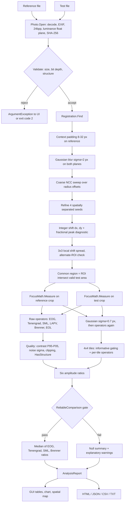
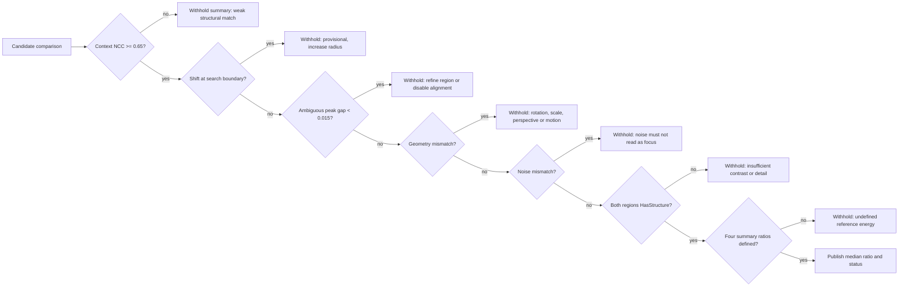

<div align="center">

# PhotoCompare 2.1

**Порівняння різкості зображень із прив'язкою до еталона для Windows — вирівняйте будь-який тестовий кадр відносно перевіреного контролю, виміряйте шість операторів деталізації та отримайте просторово розділений, відтворюваний висновок.**

[](https://learn.microsoft.com/en-us/dotnet/framework/install/guide-for-developers)
[](PhotoCompare.csproj)
[](src/ProductInfo.cs)
[](LICENSE)
[](#технологічний-стек-та-архітектура)
[](tests/PhotoTests.cs)

</div>

> [!IMPORTANT]
> Цей репозиторій містить **самостійний настільний застосунок для Windows**, а не серверний продукт чи продукт, орієнтований на консоль. `PhotoCompare.exe` — це виконуваний файл WinForms/GDI+, який працює самодостатньо: без інсталятора, без Python, без OpenCV, без пакунків NuGet і без доступу до мережі. Конфігурація виражається виключно через прапорці CLI та елементи керування у вікні — змінні середовища й файли конфігурації **навмисно відсутні**.

---

## Зміст

- [Можливості](#можливості)
- [Технологічний стек та архітектура](#технологічний-стек-та-архітектура)
  - [Базовий стек](#базовий-стек)
  - [Структура проєкту](#структура-проєкту)
  - [Ключові архітектурні рішення](#ключові-архітектурні-рішення)
  - [Конвеєр аналізу](#конвеєр-аналізу)
  - [Шлюз достовірності](#шлюз-достовірності)
- [Початок роботи](#початок-роботи)
  - [Передумови](#передумови)
  - [Встановлення](#встановлення)
  - [Збирання з вихідного коду](#збирання-з-вихідного-коду)
  - [Усунення несправностей](#усунення-несправностей)
- [Тестування](#тестування)
  - [Основні числові перевірки](#основні-числові-перевірки)
  - [Інтеграційні перевірки командного рядка](#інтеграційні-перевірки-командного-рядка)
  - [Димові перевірки інтерфейсу](#димові-перевірки-інтерфейсу)
  - [Бенчмарки](#бенчмарки)
  - [Матриця покриття тестами](#матриця-покриття-тестами)
- [Розгортання](#розгортання)
  - [Портативний дистрибутив](#портативний-дистрибутив)
  - [Інтеграція з CI/CD](#інтеграція-з-cicd)
  - [Контейнеризація](#контейнеризація)
- [Використання](#використання)
  - [Швидкий старт у GUI](#швидкий-старт-у-gui)
  - [Що означає відсоток](#що-означає-відсоток)
  - [Використання з командного рядка](#використання-з-командного-рядка)
  - [Пакетна обробка](#пакетна-обробка)
  - [Експорт](#експорт)
  - [Розширене використання](#розширене-використання)
  - [Довідник комбінацій клавіш](#довідник-комбінацій-клавіш)
- [Конфігурація](#конфігурація)
  - [Параметри командного рядка](#параметри-командного-рядка)
  - [Налаштування GUI](#налаштування-gui)
  - [Змінні середовища](#змінні-середовища)
  - [Фіксовані константи рушія](#фіксовані-константи-рушія)
  - [Схеми звітів](#схеми-звітів)
- [Ліцензія](#ліцензія)
- [Контакти та підтримка спільноти](#контакти-та-підтримка-спільноти)

---

## Можливості

### Ядро вимірювань

- **Оцінювання з прив'язкою до еталона.** Кожне порівняння виражається відносно рівня деталізації обраної користувачем еталонної області, тому результати зберігають змістовність між камерами, об'єктивами, сенсорами та конвеєрами обробки.
- **Шість незалежних операторів деталізації** — EOG, Tenengrad, SML, LAPV, Brenner 2D та EOL (тепловізійна маска) — обчислюються за ідентичними визначеннями на обох зображеннях.
- **Медіана з чотирьох операторів.** Головний відсоток — це медіана амплітудних співвідношень EOG, Tenengrad, SML і Brenner 2D, стійка до викиду одного оператора. LAPV та EOL залишаються діагностичними.
- **Уніфікована попередня фільтрація Gaussian σ = 0.7 px** застосовується до обох областей до формування співвідношень, пригнічуючи шум піксельної сітки та зберігаючи дрібні деталі.
- **Енергообізнані співвідношення.** Метрики квадратичного градієнта порівнюються через квадратний корінь співвідношення (істинна амплітуда), тоді як SML використовує лінійне співвідношення.
- **Результати понад 100% ніколи не обрізаються.** Гостріша деталізація, доданий шум і цифрове підвищення різкості цілком законно можуть підняти оцінку вище еталонного рівня.
- **Опційна нормалізація контрасту** за `еталон (P95−P05) / тест (P95−P05)`, вимкнена за замовчуванням, оскільки може маскувати спричинену розфокусуванням втрату контрасту.

### Вирівнювання та геометрія

- **Пошук зсуву в підвікні** з типовою межею ±32 px, що регулюється до ±256 px, після згладжування Gaussian σ = 2 px.
- **Пошук NCC від грубого до точного** з багатопочатковим уточненням, тож періодичні цілі, як-от чотирисмугові міри, не зливаються з аліасним піком.
- **Розширення контексту** (8–32 px) навколо обраної області лише для вирівнювання; метрики завжди вимірюються всередині спільної області в оригінальних пікселях.
- **Дробова оцінка піку** (параболічна інтерполяція кореляційного піку) подається як діагностика — самі вимірювання ніколи не передискретизуються.
- **Геометричний скринінг** за допомогою 3×3 вибірки локальних зсувів і кореляції альтернативної ROI; обертання, зміна масштабу, перспектива та незалежний рух переднього плану виявляються й повідомляються, а не сприймаються як розфокусування.
- **Політика лише трансляції.** Автоматичне перемасштабування, корекція обертання чи перспективна деформація ніколи не застосовуються.

### Забезпечення достовірності

- **Утримання підсумку.** Відсоток пригнічується, коли вирівнювання слабке, неоднозначне чи на межі пошуку, коли геометрія неузгоджена, коли внески шуму суттєво різняться або коли області бракує придатної деталізації. Усі сирі метрики залишаються доступними.
- **Діагностика якості вхідних даних**: контраст P95−P05, середня яскравість, стандартне відхилення, відсоток відсікання, робастна оцінка шуму σ, частка енергії шуму, коефіцієнт збереження розмиття та прапорці структурної валідності.
- **Багаторівневі попередження**, віддзеркалені в GUI, HTML, JSON, CSV та TXT.

### Просторовий аналіз

- **Карта до 4×4 плиток** по спільній області, з класифікацією «інформативна/неінформативна» для кожної плитки на основі еталона.
- **Плавні градієнти фону виключаються**, щоб м'які освітлювальні перепади не могли голосувати як доказ фокусування.
- **Глобальний підсумок, локальна медіана та локальний діапазон P25–P75** подаються окремо — різка ділянка більше не може приховати розмиту за глобальним середнім.
- **Кольорові накладення** в обох прев'ю та окрема таблиця *Spatial tiles*.

### Продуктивність та інтеграція

- **Пакетна обробка** цілої теки зображень з ізоляцією помилок для кожного файла, повторним використанням еталонних вимірювань, скасуванням і експортом у CSV/JSON.
- **Чотири формати експорту** — самодостатній HTML (без скриптів і вбудованих фотографій), повний JSON, плоский CSV і зрозумілий для людини TXT.
- **Походження за задумом**: SHA-256 кожного вихідного файла, версія інструмента, налаштування та координати виміряної області супроводжують кожен звіт.
- **Вихідні зображення ніколи не змінюються**; експортер відмовляється записувати звіт поверх вхідного шляху.
- **Детермінована культура**: процес примусово використовує `en-US` для culture та UI culture, тому розбір і форматування чисел ніколи не залежать від хоста.
- **Повний паритет CLI** для одиночних пар і пакетних запусків зі стабільними кодами виходу для автоматизації.
- **Скасування всюди** — `Esc`/`Cancel` посеред аналізу, кооперативні перевірки `CancellationToken` усередині циклів розмиття, операторів і вирівнювання.
- **Обмежений кеш у пам'яті** (`AnalysisSession`), що повторно використовує еталонні й тестові вимірювання та вирівнювання, якщо змінюються лише допуск чи режим контрасту.
- **Жодних сторонніх залежностей**: увесь застосунок — це один скомпільований виконуваний файл проти бібліотеки класів .NET Framework.

---

## Технологічний стек та архітектура

### Базовий стек

| Рівень | Технологія | Примітки |
| --- | --- | --- |
| Мова | **C#** (синтаксис, сумісний із C# 5) | Без `async`, без інтерпольованих рядків, без членів з тілом-виразом |
| Середовище виконання | **.NET Framework 4.8** | Постачається з Windows 10 1903+ / Windows 11; targeting pack потрібен лише для збирання |
| UI | **Windows Forms** (`System.Windows.Forms`) | Інтерфейс побудований повністю в коді — без `.Designer.cs`, без XAML, без ресурсів |
| Обробка зображень | **GDI+** (`System.Drawing`) | Декодування, EXIF-орієнтація, 24-bpp компонування, рендеринг прев'ю |
| Серіалізація | **`System.Web.Script.Serialization.JavaScriptSerializer`** | JSON-звіти; без залежності від Newtonsoft/System.Text.Json |
| Збирання (IDE) | **MSBuild / Visual Studio 2022** | Формат рішення 12.00, набір інструментів VS 17 |
| Збирання (CLI) | **`csc.exe` з `%WINDIR%\Microsoft.NET\Framework64\v4.0.30319`** | Викликається `Build.ps1`; без відновлення пакунків |
| Скрипти | **Windows PowerShell 5.1** | `Build.ps1`, `Run-Tests.ps1`, `Run-Benchmark.ps1` |
| Паралельність | **TPL** (`Parallel.For`) + `CancellationToken` | Активується понад 300 000 пікселів; паралелізм обмежений `min(8, cores−1)` |
| Бінарний файл | **AnyCPU, `WinExe`** | Працює на x86 або x64 без змін |

> [!NOTE]
> У `PhotoCompare.csproj` увімкнено `TreatWarningsAsErrors`, а `Build.ps1` передає `/warnaserror+`. Попередження — це помилка збирання: у проєкті, де зміна однієї константи робить опубліковані вимірювання недійсними, це запобігає тихому дрейфу чисел і мертвого коду.

### Структура проєкту

```text
reference-sharpness-comparator2/
├── PhotoCompare.sln              # Рішення VS 2022 (Debug/Release, AnyCPU)
├── PhotoCompare.csproj           # v4.8 WinExe, RootNamespace=PhotoFocus, той самий список джерел, що й Build.ps1
├── PhotoCompare.exe              # Попередньо зібраний AnyCPU бінарник, синхронізується з src/ через BUILD.bat
├── START.bat                     # Запуск кореневого EXE на місці
├── BUILD.bat                     # Обгортка Build.ps1, зупиняється при помилці
├── BUILD_AND_RUN.bat             # Обгортка Build.ps1 -Launch
├── Build.ps1                     # Збирання через csc із проміжним каталогом і атомарною заміною
├── Run-Tests.ps1                 # Основні перевірки + інтеграційні CLI-перевірки (+ опційний UI-дим)
├── Run-Benchmark.ps1             # Синтетичний стенд продуктивності
├── LICENSE                       # Apache License 2.0
├── README.md
├── src/
│   ├── Program.cs                # Точка входу, парсер аргументів, режими оболонки   (~108 рядків)
│   ├── ProductInfo.cs            # Назва, версія, перемикач варіанта                 (~12 рядків)
│   ├── AssemblyInfo.cs           # Метадані виконуваного файла Win32                 (~7 рядків)
│   ├── FocusAnalysis.cs          # Обробка зображень, оператори, вирівнювання, звіти (~650 рядків)
│   ├── AnalysisSession.cs        # Обмежений кеш вимірювань/вирівнювання             (~43 рядки)
│   ├── PhotoForms.cs             # Головне вікно, полотна, графік, плитки             (~414 рядків)
│   ├── BatchAnalysis.cs          # Рушій пакетної обробки + вікно пакетної обробки    (~150 рядків)
│   └── ReportHtml.cs             # Самодостатній HTML-звіт + SVG-графік              (~79 рядків)
├── tests/
│   ├── PhotoTests.cs             # 61 числова/даних-якості перевірка                 (~238 рядків)
│   ├── Benchmark.cs              # Відтворювані синтетичні вимірювання часу          (~52 рядки)
│   └── output/                   # Згенеровані фікстури, звіти, benchmark JSON
├── bin/Release/                  # Вихідні дані компілятора (exe + pdb)
└── obj/                          # Проміжні файли та проміжні файли MSBuild
```

<details>
<summary><strong>Обов'язки файлів, згенеровані артефакти та чому вихідні файли збирання додані до репозиторію</strong></summary>

**Вихідні файли та їхні контракти**

| Файл | Відповідає за | Залежить від |
| --- | --- | --- |
| `src/Program.cs` | Граматика параметрів, вибір режиму, примусова англійська локаль, коди виходу, журнал помилок у `%TEMP%` | `ProductInfo`, `FocusMath`, `BatchAnalysis`, `ReportFiles`, `PhotoForms` |
| `src/ProductInfo.cs` | `Name`, `Version`, `FileVersion`, `Description`, перемикач варіанта `IsComparison` | — |
| `src/FocusAnalysis.cs` | `GrayPlane`, `Photo`, `OperatorValues`, `ImageMeasures`, `TileMeasure`, `AlignmentResult`, `AnalysisReport`, `FocusMath`, `Registration`, `ReportFiles` | GDI+, `System.Web.Extensions` |
| `src/AnalysisSession.cs` | Кешування за ідентичністю об'єкта (`ReferenceEquals`) + область + налаштування | `FocusMath`, `Registration` |
| `src/PhotoForms.cs` | `PhotoCanvas` (малювання/масштаб/панорамування/ROI/drag-and-drop/накладення плиток), `PhotoForm`, елемент графіка, результати у вкладках | WinForms |
| `src/BatchAnalysis.cs` | `BatchItem`, `BatchAnalysis.Run/Save`, `BatchForm` на `BackgroundWorker` | `AnalysisSession`, WinForms |
| `src/ReportHtml.cs` | Вбудований CSS, SVG-стовпчикова діаграма, сітка плиток, HTML-кодування | `AnalysisReport` |

**Згенеровані артефакти (можна безпечно видаляти, відтворюються на вимогу)**

- `bin/Debug`, `bin/Release` — вихідні дані MSBuild. Збирання в IDE потрапляє сюди; CLI-збирання **навмисно** їх не перезаписує.
- `obj/command-line` — проміжний каталог, який використовує `Build.ps1` для атомарної заміни EXE.
- `tests/output` — синтетичні фікстури (`reference.png`, `working.png`, `shifted.png`, `color-test.png`, `large-native.png`), тека `batch-input` з навмисно пошкодженим `broken.png` та звіти/JSON, створені перевірками.

Оскільки вихідні дані збирання побайтово відтворювані з джерела вбудованим компілятором, репозиторій зберігає попередньо зібраний `PhotoCompare.exe` у корені виключно для зручності, щоб інструмент можна було використовувати на машині без SDK. Це не авторитетний артефакт — ним є `src/`.

**Ідентичність збірки**

`RootNamespace` — `PhotoFocus`, тоді як ім'я збірки — `PhotoCompare`. Ця розбіжність навмисна: простори імен описують доменний модуль, а ім'я збірки описує продукт, що постачається. `Build.ps1` читає `AssemblyName` з файла проєкту, перевіряє його за `^[A-Za-z][A-Za-z0-9_.-]*$` і виводить з нього проміжний та цільовий шляхи, тож перейменування продукту не вимагає редагування скрипта.

</details>

### Ключові архітектурні рішення

<details>
<summary><strong>1. Відносна шкала еталона замість універсального порогу різкості</strong></summary>

Для окремої фотографії не існує абсолютного переносного числа «у фокусі»: текстура сцени, шум, експозиція, демозаїкинг, шумозаглушення та підвищення різкості змінюють високочастотну енергію. Тому рушій відповідає рівно на одне питання — *скільки виміряної деталізації містить ця тестова область порівняно з цією еталонною областю?* — і формулює це прямо:

- `100%` — це **виміряний рівень деталізації обраного еталона**, а не ідеальне оптичне фокусування. Розмитий контроль визначає власні 100%.
- `80%` означає, що сукупні амплітуди деталізації нижчі за еталон; це **не** твердження, що об'єктив «на 20% не у фокусі».
- `115%` означає, що виміряно більше високочастотного вмісту, що може походити від гострішої деталізації, більшого шуму або сильнішого цифрового підвищення різкості.

Одиночний `Detail index` (`100 × √Tenengrad(σ=0.7) / (P95−P05)`) існує в рушії та перевіряється тестами, але це необмежена відносна шкала, і цей варіант застосунку (`ProductInfo.IsComparison = true`) її не показує.

</details>

<details>
<summary><strong>2. Співвідношення амплітуд, а не енергій, і медіана замість середнього</strong></summary>

EOG, Tenengrad і Brenner 2D квадратичні за амплітудою пікселів, тому наївне співвідношення цих енергій радше повідомляє дисперсію, ніж зміну різкості. Рушій порівнює їх через квадратний корінь співвідношення (`100 × √(working / reference)`), тоді як SML — уже лінійна міра різниці першого порядку за амплітудою — використовує лінійне співвідношення. Чотири підсумкові співвідношення зводяться **медіаною**, тож окремий оператор, що поводиться нетипово (наприклад, на переважно вертикальній текстурі), не може змістити головне число.

Обидві області фільтруються однаковим Gaussian σ = 0.7 px до формування співвідношень, що робить порівняння фазово симетричним і пригнічує шумовий поріг, не видаляючи смугу деталей, для якої призначені оператори.

</details>

<details>
<summary><strong>3. Відмова відповідати — це можливість</strong></summary>

Порівнювач, який завжди повертає число, завжди повертатиме неправильне число в неоднозначних випадках. `ReliableComparison` дорівнює `true` лише коли **виконуються всі** умови:

- контекст NCC ≥ 0.65,
- найкращий зсув не на межі пошуку,
- немає рівноцінно правдоподібного альтернативного піку (розрив неоднозначності < 0.015 між найкращим і найсильнішим просторово віддаленим піком),
- немає геометричної невідповідності (перевага альтернативної ROI > 0.12 при зміщенні ≥ 3 px, або розкид локальних зсувів > 3.5 px за ≥ 4 прийнятими плитками),
- немає невідповідності шуму (σ шумнішого > max(3, 2 × σ тихішого + 0.5), частка енергії шуму > 0.5, збереження розмиття < 0.3),
- обидві області повідомляють `HasStructure`,
- усі чотири підсумкові співвідношення визначені.

Коли шлюз не пройдено, `Status` стає `Reliable comparison unavailable`, `RelativeDetailPercent` стає `null`, а попередження пояснюють, яка умова не виконана. Рядки окремих метрик залишаються заповненими, щоб інженер міг продовжити діагностику.

</details>

<details>
<summary><strong>4. Вимірювання в цілих пікселях, без прихованої передискретизації</strong></summary>

Вирівнювання повертає цілочисельний зсув; дробова оцінка виводиться з кореляційного піку виключно як діагностика. Вимірювані зображення **ніколи** не інтерполюються, оскільки інтерполяція сама є фільтром низьких частот і систематично занижувала б різкість того зображення, яке передискретизується. Отже:

- обертання, масштаб і перспектива не коригуються, лише виявляються;
- різні розміри файлів допустимі лише тоді, коли об'єкт зберігає той самий піксельний масштаб;
- дробовий зсув може спричинити піксельну фазову похибку на дуже дрібних періодичних смугах, і звіт про це прямо повідомляє.

</details>

<details>
<summary><strong>5. Швидка відмова на непідтримуваних вхідних даних замість тихого погіршення</strong></summary>

GDI+ тихо звужує деякі 16-бітні PNG до 8 біт. Замість прийняття непомітно хибного вимірювання, `Photo.Open` перевіряє байт глибини кольору IHDR заголовка PNG, читає тег TIFF `BitsPerSample` (0x102) і відхиляє дані з високою глибиною кольору з практичним повідомленням. Межі застосовуються до виділення пам'яті: 24 000 000 пікселів загалом і 16 000 пікселів на сторону. EXIF-орієнтація (0x112) застосовується, щоб прев'ю та вимірювання збігалися. Прозорість компонується на білому тлі з явним попередженням. Із багатосторінкового або анімованого файла завантажується лише перший кадр, також із попередженням.

</details>

<details>
<summary><strong>6. Детерміновані, придатні до аудиту результати</strong></summary>

- Процес фіксує `CultureInfo` на `en-US` для стандартного потоку, UI culture та поточного потоку, тож `int.Parse`/`ToString` ніколи не залежать від локалі хоста.
- Числові поля CSV записуються в round-trip форматі `G17` з інваріантною культурою; відображувані значення в TXT/HTML округлюються до трьох знаків.
- Кожен звіт містить версію інструмента (`PhotoCompare 2.1`) і SHA-256 обох вихідних файлів.
- HTML-звіт — це один файл із вбудованим CSS і вбудованою SVG-діаграмою, **без `<script>`, без ``** — тому він однаково рендериться з пошти, з машини без мережі чи з архіву відповідності та не може нічого виконати чи передати назовні.
- Імена файлів і рядки попереджень кодуються через `WebUtility.HtmlEncode`; комірки пакетного CSV, що починаються з `= + - @`, отримують префікс `'`, щоб нейтралізувати ін'єкцію формул у таблицях.

</details>

<details>
<summary><strong>7. Обмежений стан, явні життєві цикли</strong></summary>

`Photo` реалізує `IDisposable` і володіє своїм `Bitmap`; завантажувач копіює пікселі у площину яскравості `float[]` (0–255) і негайно звільняє дескриптор файла, тож вихідний файл можна перейменувати чи видалити, поки вікно аналізу відкрите. `AnalysisSession` утримує щонайбільше одне еталонне вимірювання, одне тестове вимірювання й одне вирівнювання, інвалідується через `Clear()` і створюється для кожного вікна та кожного пакета — жоден статичний стан зображення не є спільним між вікнами чи робочими потоками. `Program` звільняє декодовані фото в блоках `finally`.

</details>

<details>
<summary><strong>8. Жодної конфігураційної поверхні, крім прапорців і елементів керування</strong></summary>

Інструмент вимірювань, який тихо підхоплює `.env`, ключ реєстру чи файл налаштувань у профілі користувача, — це інструмент, який неможливо відтворити через пів року. Кожне вхідне значення рушія є або явним аргументом, або видимим елементом керування, і кожен вихідний звіт фіксує ці значення. Інтерфейс також відхиляє суперечливі виклики: дубльовані параметри, змішані режими (`--image` разом із `--batch`), обидва режими контрасту та параметри порівняння в одиночному варіанті спричиняють помилку аргументів.

</details>

<details>
<summary><strong>9. Атомарне збирання, ізольовані збої</strong></summary>

`Build.ps1` компілює в `obj/command-line/` і лише потім переміщує результат поверх кореневого виконуваного файла. Помилка компіляції — або заблокована ціль, бо застосунок ще працює — залишає попередній робочий бінарник недоторканим, і скрипт це повідомляє. Пакетний аналіз застосовує ту саму філософію під час виконання: пошкоджений або відсутній файл стає помилкою окремого рядка, решта зображень обробляється далі, а процес завершується з `1`, а не аварійно.

</details>

### Конвеєр аналізу

<details open>
<summary><strong>Наскрізний потік даних: від двох файлів до відсотка, пропущеного через шлюз</strong></summary>



</details>

<details>
<summary><strong>Визначення операторів і одиниці згідно з реалізацією</strong></summary>

| Оператор | Індекс | Визначення в коді | Одиниця | Роль |
| --- | --- | --- | --- | --- |
| `EOG` | 0 | Середній квадрат прямих різниць уздовж X і Y | levels²/px | Підсумок |
| `Tenengrad` | 1 | Середня енергія Sobel X/Y; кожне ядро поділене на 8 | levels²/px | Підсумок |
| `SML` | 2 | Середнє абсолютних других різниць уздовж X/Y; крок 1, поріг 0 | levels/px | Підсумок (лінійне співвідношення) |
| `LAPV` | 3 | Дисперсія чотири-сусідського Laplacian | levels² | Діагностика |
| `Brenner 2D` | 4 | Половина суми середніх квадратів різниць із кроком 2 уздовж X і Y | levels²/px | Підсумок |
| `EOL (thermal)` | 5 | Середній квадрат відгуку маски центр-20 / сусід-−4 / діагональ-−1 | levels²/px | Діагностика |

Усі шість усереднюються лише за валідними внутрішніми позиціями (нормалізація `(w−2)(h−2)` для внутрішніх операторів, `(w−1)(h−1)` для EOG, `h(w−2)` і `(h−2)w` для двох осей Brenner) і обчислюються на оригінальній піксельній сітці. Стовпець σ = 0.7 повторює ідентичні визначення на відфільтрованій площині, тож «оригінал проти фільтра» — це порівняння однакових величин, а не зміна формули.

</details>

<details>
<summary><strong>Алгоритм реєстрації докладно</strong></summary>

1. **Контекстна область.** Коли вирівнювання ввімкнене, обрана ROI розширюється на `min(32, max(8, min(w,h)/4))` пікселів і перетинається з межами еталона. Цей контекст допомагає знайти сильно розмиту чи низькоконтрастну ціль; він ніколи не входить до області метрик.
2. **Згладжування.** І еталонний контекст, і пошукове вікно тесту розмиваються з σ = 2 px, щоб NCC був нечутливим до шуму та дрібного аліасингу.
3. **Пошукове вікно.** Вікно тесту — це контекст, розширений на `radius + 5`, тож кожен кандидатний зсув у межах радіуса лишається повністю всередині тестового зображення.
4. **Грубий прохід.** Зсуви семплюються з кроком `ceil(radius / 12)` (плюс `0`, `−radius`, `+radius`) і оцінюються нормалізованою крос-кореляцією на розрідженій підсітці приблизно 40 семплів на вісь.
5. **Багатопочаткове уточнення.** До чотирьох просторово розділених грубих піків уточнюються на повній роздільності околу з дрібнішим кроком (`/72`). Це запо­бігає фіксації на аліасній копії регулярної чотирисмугової міри.
6. **Виявлення неоднозначності.** Найкраща оцінка порівнюється з найсильнішим кандидатом щонайменше за `max(6, 2 × coarse)` px; розрив менше 0.015 при обох оцінках понад 0.65 позначає результат як неоднозначний.
7. **Дробова оцінка.** Параболічне наближення по горизонтальних і вертикальних сусідах піку дає `FractionalDx/FractionalDy`, обмежені ±0.5 px. Значення, що відхиляються від цілочисельного зсуву більше ніж на 0.25 px, породжують попередження про піксельну фазу.
8. **Геометричний скринінг.** Якщо ROI NCC < 0.85, запускається альтернативний пошук, що максимізує кореляцію локальної ROI; значно кращий альтернативний пік далеко від основного свідчить про геометричну невідповідність. Для ROI ≥ 128×128 px дев'ять локальних пошуків блока 3×3 у межах ±3 px вимірюють розкид залишкових зсувів; розкид > 3.5 px за ≥ 4 впевненими плитками сигналізує про обертання, масштаб, перспективу або незалежний рух.
9. **Спільна область.** Вимірюється `ROI ∩ валідна область тесту`; якщо вирівнювання забрало понад 20% обраної площі, видається попередження.

Повідомлений зсув `dx, dy` означає, що еталонний піксель `(x, y)` відповідає тестовому пікселю `(x + dx, y + dy)`.

</details>

### Шлюз достовірності

<details>
<summary><strong>Логіка рішення про те, чи можна показати відсоток</strong></summary>



Кожен випадок утримання все одно повертає таблицю метрик, карту плиток, діагностику та попередження. `ReliableComparison` серіалізується в JSON, тож автоматизація може розгалужуватися за ним, а не за кодом виходу.

</details>

---

## Початок роботи

### Передумови

| Вимога | Версія / Примітки | Потрібно для |
| --- | --- | --- |
| Windows | Windows 10 1903+ або Windows 11 (будь-яка редакція) | Запуск GUI |
| .NET Framework | **4.8** runtime — попередньо встановлено в підтримуваних збірках Windows | Запуск застосунку |
| PowerShell | **Windows PowerShell 5.1** (`powershell.exe`, не лише `pwsh`) | `Build.ps1`, `Run-Tests.ps1`, `Run-Benchmark.ps1` |
| .NET Framework 4.8 Developer Pack | Лише для збирання у **Visual Studio** | Компіляція MSBuild/VS |
| Visual Studio 2022 (опційно) | Робоче навантаження *.NET desktop development* | Редагування та налагодження в IDE |
| `csc.exe` | `%WINDIR%\Microsoft.NET\Framework64\v4.0.30319\csc.exe` | Скриптове збирання без SDK |

> [!TIP]
> Якщо `PhotoCompare.exe` уже запускається на вашій машині, у вас є все необхідне для *використання* інструмента. Компілятор, SDK і скрипти PowerShell потрібні лише для його *зміни*.

> [!WARNING]
> Windows on ARM запускає цей застосунок через емуляцію x64 лише за наявності .NET Framework 4.8. macOS, Linux і Wine не є підтримуваними цілями: інтерфейс — WinForms, а шар обробки зображень — GDI+, і жоден із них не є кросплатформним.

### Встановлення

Інсталятора не існує. Склонуйте та запустіть:

```powershell
# 1. Клонувати репозиторій
git clone https://github.com/DroneNotes/reference-sharpness-comparator2.git
cd reference-sharpness-comparator2

# 2. Перевірити наявність runtime (виводить ключ випуску 4.8, наприклад 528040)
reg query "HKLM\SOFTWARE\Microsoft\NET Framework Setup\NDP\v4\Full" /v Release

# 3. Запустити попередньо зібраний бінарник
.\START.bat
# або напряму:
.\PhotoCompare.exe
```

Бажаєте збірку, яку скомпілювали самостійно? Замініть крок 3 на:

```powershell
# Перебудувати кореневий виконуваний файл із src/, а потім запустити
.\BUILD_AND_RUN.bat
```

**Перший запуск покроково**

1. Натисніть **1. Open reference…** (або `Ctrl+Shift+O`, або перетягніть файл у ліве прев'ю).
2. Натисніть **2. Open test image…** (або `Ctrl+O`, або перетягніть у праве прев'ю).
3. Протягніть лівою кнопкою миші, щоб вибрати ціль або текстурований об'єкт **у прев'ю еталона**.
4. Аналіз починається автоматично. Перегляньте головний відсоток, таблицю метрик і вкладку попереджень.
5. Увімкніть **Spatial map** або відкрийте вкладку **Spatial tiles**, щоб оглянути локальні відмінності.
6. Скористайтеся **Save result…** (`Ctrl+S`) для експорту в HTML, JSON, CSV або TXT.

### Збирання з вихідного коду

<details>
<summary><strong>Збирання скриптом, у Visual Studio, ручний виклик <code>csc</code> та параметри скриптів</strong></summary>

#### A. Збирання скриптом (SDK не потрібен)

```powershell
# Перебудувати .\PhotoCompare.exe із src/
powershell -NoProfile -ExecutionPolicy Bypass -File .\Build.ps1

# Перебудувати, а потім запустити
powershell -NoProfile -ExecutionPolicy Bypass -File .\Build.ps1 -Launch

# Перебудувати, а потім виконати повний набір перевірок
powershell -NoProfile -ExecutionPolicy Bypass -File .\Build.ps1 -Tests
```

Поведінка `Build.ps1` крок за кроком:

1. Знаходить рівно один `*.csproj` у теці скрипта й інакше завершується з помилкою.
2. Читає `<AssemblyName>` і перевіряє його за `^[A-Za-z][A-Za-z0-9_.-]*$`.
3. Визначає `csc.exe` спершу з `Framework64`, потім із `Framework`.
4. Розгортає кожен запис `<Compile Include=…>` і відхиляє будь-який шлях, що виходить за межі кореня проєкту.
5. Компілює в `obj\command-line\<AssemblyName>.exe` з `/target:winexe /platform:anycpu /optimize+ /warn:4 /warnaserror+ /main:PhotoFocus.Program`.
6. Переміщує тимчасовий файл поверх `.\PhotoCompare.exe` — атомарно зберігаючи попередній бінарник у разі будь-якого збою.

#### B. Visual Studio

```powershell
# Еквівалент «Build Solution» для конфігурації Release з командного рядка MSBuild
msbuild .\PhotoCompare.sln /t:Rebuild /p:Configuration=Release /p:Platform="Any CPU"
```

Для інтерактивної роботи відкрийте `PhotoCompare.sln`; вихідні дані IDE потрапляють у `bin\Debug` або `bin\Release`. Потрібен .NET Framework 4.8 Developer/Targeting Pack ([інструкція Microsoft](https://learn.microsoft.com/en-us/dotnet/framework/install/guide-for-developers)).

#### C. Ручний виклик компілятора

```powershell
$csc = "$env:WINDIR\Microsoft.NET\Framework64\v4.0.30319\csc.exe"
& $csc /nologo /target:winexe /platform:anycpu /optimize+ /warn:4 /warnaserror+ /main:PhotoFocus.Program `
  /out:.\PhotoCompare.exe `
  /r:System.dll,System.Core.dll,System.Drawing.dll,System.Windows.Forms.dll,System.Web.Extensions.dll `
  .\src\ProductInfo.cs .\src\AssemblyInfo.cs .\src\Program.cs .\src\FocusAnalysis.cs `
  .\src\AnalysisSession.cs .\src\PhotoForms.cs .\src\BatchAnalysis.cs .\src\ReportHtml.cs
```

#### D. Додавання вихідного файла

Нові файли `.cs` необхідно внести до **`PhotoCompare.csproj`** (`<Compile Include=…>`) — більше нікуди, оскільки `Build.ps1` виводить список файлів із файла проєкту, а файл проєкту є єдиним джерелом істини. Якщо ви плануєте збирати вбудованим компілятором, зберігайте сумісність нового коду з C# 5; вводьте новіший синтаксис лише тоді, коли підвищуєте версію мови в обох шляхах збирання.

</details>

### Усунення несправностей

<details>
<summary><strong>Типові збої збирання та виконання і їхні точні причини</strong></summary>

| Симптом | Причина | Виправлення |
| --- | --- | --- |
| `Expected one C# project file in this folder.` | Нуль або кілька файлів `.csproj` | Залиште рівно один файл проєкту поруч із `Build.ps1` |
| `The Windows .NET Framework C# compiler was not found.` | Запуск поза Windows або в урізаному середовищі | Встановіть .NET Framework 4.8 або використайте Visual Studio 2022 |
| `Compilation failed. The previous executable has been preserved.` | Помилка компіляції або нова мовна можливість, яку не приймає вбудований компілятор | Виправте помилку; тримайте синтаксис сумісним із C# 5 або збирайте набором інструментів VS |
| `Close the running application and build again.` | Цільовий EXE заблокований запущеним екземпляром | Закрийте PhotoCompare і перебудуйте |
| `error CS0246: … System.Web.Extensions` | Змінено список посилань | Збережіть п'ять посилань, перелічених у файлі проєкту |
| `Run BUILD.bat before running checks.` | `Run-Tests.ps1` потребує кореневий EXE | Спочатку зберіть, потім повторіть |
| `16-bit PNG is not supported.` | Глибина кольору IHDR > 8 | Експортуйте 8-бітне зображення відображення без зміни розміру |
| `TIFF channels above 8 bits are not supported.` | `BitsPerSample` > 8 | Експортуйте 8-бітний TIFF |
| `The limit is 24 million pixels and 16,000 pixels per side.` | Завеликий файл | Обріжте в оригінальній роздільності замість масштабування |
| `The region must be inside the image and at least 16×16 pixels.` | ROI замала або поза межами | Використовуйте ≥ 48×48 px на текстурованому об'єкті |
| `No common image region.` | Вирівнювання не може розмістити ROI у тестовому кадрі | Збільште тестове полотно або зменште радіус пошуку |
| `A report cannot overwrite a source image.` | `--out` збігається з вхідним шляхом | Виберіть інший вихідний шлях |
| `Unknown option or missing value: …` | Друкарська помилка або прапорець без значення | Порівняйте з таблицею параметрів |
| `Duplicate option: …` | Той самий перемикач передано двічі | Передавайте кожен параметр один раз |
| `Batch, single-image and test modes must be run separately.` | Два з `--image`, `--batch`, `--smoke`, `--smoke-batch` об'єднано | Запускайте один режим на процес |
| `Specify --image / --batch, or start the application without arguments.` | Параметри без режиму | Додайте режим або запустіть GUI |
| SmartScreen «невідомий видавець» | Бінарник не підписаний | Перевірте SHA-256 проти власної збірки й дозвольте; або підпишіть свою збірку |
| Значення відрізняються від результатів колеги | Інші шляхи обчислень із рухомою комою, інша версія інструмента або інша область | Порівняйте `ToolVersion`, `RequestedArea` та SHA-256 джерела в JSON |

**Код виходу 2 без діалогу** в режимі CLI є очікуваним: у процесу підсистеми GUI немає приєднаної консолі, тому повідомлення записується у `%TEMP%\PhotoCompare-error.txt`. Прочитайте цей файл, потім виправте виклик.

</details>

---

## Тестування

Набір навмисно розділений на **чисті числові перевірки** (швидкі, детерміновані, без GUI) та **перевірки рівня застосунку** (справжні запуски процесів, справжні експорти, справжні коди виходу).

```powershell
# Усе: основні перевірки + інтеграційні CLI-перевірки
powershell -NoProfile -ExecutionPolicy Bypass -File .\Run-Tests.ps1

# Усе, плюс димові запуски GUI головного вікна та вікна пакетної обробки
powershell -NoProfile -ExecutionPolicy Bypass -File .\Run-Tests.ps1 -Ui

# Синтетичний стенд продуктивності (медіани трьох запусків)
powershell -NoProfile -ExecutionPolicy Bypass -File .\Run-Benchmark.ps1
```

> [!IMPORTANT]
> `Run-Tests.ps1` вимагає попередньо зібраного `PhotoCompare.exe` у корені проєкту і завершується з ненульовим кодом на першому збої з повідомленням `FAIL: <check name>` у stderr. Успішний запуск завершується рядком `PASS: PhotoCompare local numerical, command-line, export and batch checks.` і записує `tests/output/test-results.json` із кількістю пройдених перевірок і ключовими вимірюваннями.

### Основні числові перевірки

`Run-Tests.ps1` компілює `ProductInfo.cs`, `FocusAnalysis.cs`, `AnalysisSession.cs`, `ReportHtml.cs`, `BatchAnalysis.cs` разом із `tests/PhotoTests.cs` у `tests/output/CoreChecks.exe` (без джерел GUI), потім виконує його з текою виводу як `argv[0]`. Фікстури генеруються в процесі з фіксованих зерен (`Random(72)`, `Random(91)`, `Random(103)`), тому результати біт-стабільні між машинами.

Стенд будує навмисно неперіодичну синтетичну сцену — модульовані синусоїди, дві групи чотирисмугових мір різної орієнтації, диск і похилу межу — плюс хелпери, що застосовують підсилення/зміщення/шум/зсув (`Change`) та обертання/масштаб/субпіксельні деформації (`Warp`).

```powershell
# Запустити лише основні перевірки (еквівалент того, що робить набір усередині)
powershell -NoProfile -Command "& .\tests\output\CoreChecks.exe .\tests\output"
```

Кожна перевірка друкує `PASS: <name>`; фінальний рядок — `All 61 checks passed.` Записаний файл результатів виглядає так:

```json
{"passed":61,"identity":100,"gain":100.45,"sharper":155.59,"noise":11.99,
 "measurements":[{"sigma":0.5,"score":97.64,"ncc":0.99997},
                 {"sigma":1.0,"score":83.50,"ncc":0.99941},
                 {"sigma":1.8,"score":64.38,"ncc":0.99543},
                 {"sigma":3.0,"score":38.53,"ncc":0.98071}]}
```

### Інтеграційні перевірки командного рядка

Після проходження основних перевірок `Run-Tests.ps1` запускає справжній виконуваний файл через `Start-Process -WindowStyle Hidden -Wait` і перевіряє коди виходу та вміст виводу:

1. **Чотири шляхи експорту** — `application.json`, `.html`, `.csv`, `.txt` кожен має завершитися успішно з кодом `0`.
2. **Семантика ідентичності** — `ToolVersion` починається з `PhotoCompare `, повідомлена ширина робочого зображення `320`, а порівняння еталона із самим собою дає `RelativeDetailPercent == 100` з точністю `1e-7`.
3. **Ізоляція збоїв пакетної обробки** — тека з двома валідними зображеннями та текстовим файлом `broken.png` має завершитися з `1` і дати рівно три рядки, з яких рівно один містить `Error`.
4. **Незмінність джерела** — хеш тестового зображення до і після спроби експорту поверх нього має бути незмінним, а спроба — завершитися з `2`.

### Димові перевірки інтерфейсу

`-Ui` додає два димові запуски, що проходять повний шлях побудови WinForms:

```powershell
powershell -NoProfile -ExecutionPolicy Bypass -File .\Run-Tests.ps1 -Ui
```

- `--smoke <folder>` — відкриває пару еталон/тест, вибирає ROI, завершує аналіз і зберігає `compare-ui.png` / `compare-ui.json`.
- `--smoke-batch <folder>` — відкриває рушій пакетної обробки із синтетичним еталоном і записує `compare-batch-ui.png` / `compare-batch-ui.json`.

Запуск вважається невдалим, якщо будь-який із цих чотирьох файлів відсутній.

### Бенчмарки

```powershell
powershell -NoProfile -ExecutionPolicy Bypass -File .\Run-Benchmark.ps1
# → tests/output/benchmark.json
```

`tests/Benchmark.cs` прогрівається на випадку 48×48, потім вимірює режими **single** і **compare** на **640×512** та **3840×2400** по три рази кожен (подається медіана). Зібраний із `/define:PHOTO_V2`, він додає випадок `compare_cached_settings`, що виконує 25 ітерацій через прогрітий `AnalysisSession` із варіацією допуску, ізолюючи вартість шляху «лише зміна налаштувань». JSON-вивід фіксує ім'я машини, кількість процесорів, версію середовища виконання та масиви сирих семплів, тож регресії можна віднести до апаратного забезпечення чи коду.

> [!TIP]
> Запускайте бенчмарк до і після будь-яких змін у `GrayPlane`, `Operators` або `Registration`. Поріг 300 000 пікселів, що вмикає `Parallel.For`, розмір блоку 64 рядки та обмеження `min(8, cores−1)` є критичними для продуктивності; їхня зміна змінює і час, і — через інший порядок додавання — останні цифри кожної метрики.

### Матриця покриття тестами

<details>
<summary><strong>Що насправді перевіряють 61 основна перевірка</strong></summary>

| Область | Репрезентативні твердження |
| --- | --- |
| Ідентичність та алгебра | Ідентичні зображення дають рівно 100%; кожне співвідношення операторів дорівнює 100; `dx = dy = 0` |
| Монотонна реакція на розмиття | Gaussian σ = 0.5 → 97.6%, 1.0 → 83.5%, 1.8 → 64.4%, 3.0 → 38.5%, строго спадний ряд |
| Коректність вирівнювання | Зсуви `(11,−7)`, `(−17,12)`, `(0,19)` відновлюються точно, оцінка повертається до 100 ± 0.01 |
| Незалежність від полотна | Та сама сцена на більшому полотні зі зміщенням `(9,5)` дає ідентичну оцінку; без перемасштабування |
| Неоднозначність | Смугова картина з кроком 4 px повідомляє `Ambiguous` і утримує підсумок |
| Межа пошуку | Зсув 32 px при `radius = 32` дає `AtSearchLimit` і визнається недостовірним |
| Геометрія | Обертання на 3°, масштаб 1.05× і незалежно переміщений блок переднього плану не проходять шлюз |
| Чесність субпікселя | Деформація `(0.4,−0.3)` дає дробову оцінку в межах 0.18 px, а метрики залишаються без інтерполяції |
| Контраст | Підсилення 0.65 + зміщення 25 дає 100.45% з нормалізацією і ~65% без неї |
| Ризик нормалізації | Синусоїдальне розмиття, що читається як 80% сирих, піднімається понад 95% після нормалізації й видає попередження про маскування |
| Шум | Доданий шум σ = 18 викликає `NoiseMismatch`; зображення лише з шумом позначається й не отримує індексу різкості |
| Перепідвищення різкості | Порівняння розмитого еталона з різким оригіналом дає 155.6% — ніколи не обрізається до 100% |
| Математика операторів | Лінійний нахил `2x + 3y`: EOG = Tenengrad = 13, Brenner = 26, SML/EOL/LAPV = 0 (аналітично) |
| Точність Gaussian | Оптимізоване розмиття σ = 0.7 збігається з прямою 2-D згорткою в межах 1e-3, включно з межами |
| Ізоляція ROI | Піксели поза обраною областю не можуть змінити жодну метрику |
| Розріджено проти обрізаного | Оператори на основі перегляду дорівнюють незалежно обрізаним у межах 1e-12 відносно |
| Стійкість без структури | Уніформні зображення, плоскі еталони, нахили фону та обернена структура відхиляються як докази |
| Просторова карта | Напіврозмите зображення показує P75−P25 > 20 і 0 < `LowerDetailTiles` < `InformativeTiles`; сітки збігаються на 16 плитках |
| Цілісність експорту | CSV містить кожну метрику; JSON десеріалізується без циклів; HTML містить SVG і всі плитки, без `<script>` і `` |
| Екранування | `<script>` в імені файла чи попередженні кодується; `&` стає `&amp;` |
| Гігієна NaN/Inf | HTML для плаского зображення не містить ні `NaN`, ні `Infinity` |
| Кешування | Зміна лише налаштувань повторно використовує кеш зображень і вирівнювання (2 вимірювання + 1 вирівнювання), `Clear()` його інвалідує |
| Скасування | Попередньо скасовані токени переривають навіть при влучанні в кеш; аналіз 1024×768 переривається на льоту |
| Контракт завантажувача | Нативна яскравість і розміри збережені; дескриптор файла звільнено після завантаження; SHA-256 — 64 шістнадцяткові символи |
| Пакетна обробка | Змішані валідні/відсутні файли ізолюють помилки й усе одно експортують і CSV, і JSON |

</details>

---

## Розгортання

### Портативний дистрибутив

PhotoCompare розгортається як **окремий виконуваний файл у теці**. Немає ні MSI, ні служби, ні слідів у реєстрі, ні стану в профілі користувача.

```powershell
# 1. Створити релізний бінарник (оптимізований, без попереджень)
powershell -NoProfile -ExecutionPolicy Bypass -File .\Build.ps1

# 2. Перевірити артефакт перед постачанням
powershell -NoProfile -ExecutionPolicy Bypass -File .\Run-Tests.ps1
Get-FileHash .\PhotoCompare.exe -Algorithm SHA256

# 3. Зібрати дистрибутивну теку
$dist = ".\dist\PhotoCompare-2.1"
New-Item -ItemType Directory -Force $dist | Out-Null
Copy-Item .\PhotoCompare.exe, .\README.md, .\LICENSE, .\START.bat $dist
Compress-Archive -Path $dist -DestinationPath ".\dist\PhotoCompare-2.1-win-anycpu.zip" -Force
```

**Контрольний список релізу**

- [ ] `Run-Tests.ps1` повідомляє `PASS` та `All 61 checks passed.`
- [ ] `Run-Tests.ps1 -Ui` створює всі чотири димові артефакти
- [ ] `benchmark.json` перегенеровано й порівняно з попереднім релізом
- [ ] `ProductInfo.Version` і `FileVersion` підвищено; `README.md` відображає нову версію
- [ ] SHA-256 поставленого EXE опубліковано разом з архівом
- [ ] Архів не містить `tests/output`, `bin` чи `obj`
- [ ] Підписано сертифікатом Authenticode, якщо розповсюджується поза вашою організацією

> [!CAUTION]
> Розповсюджуйте лише бінарники, зібрані з перевіреного коміту. Попередньо зібраний `PhotoCompare.exe` у репозиторії — це зручність для супровідника; завантажений непідписаний EXE з недовіреного дзеркала є непотрібним ризиком для ланцюга постачання. Публікуйте його SHA-256 і, бажано, підписуйте Authenticode.

<details>
<summary><strong>Підписування коду для релізної збірки</strong></summary>

```powershell
$cert = Get-ChildItem Cert:\CurrentUser\My -CodeSigningCert | Select-Object -First 1
Set-AuthenticodeSignature -FilePath .\PhotoCompare.exe -Certificate $cert `
  -TimestampServer "http://timestamp.digicert.com" -HashAlgorithm SHA256
Get-AuthenticodeSignature .\PhotoCompare.exe | Format-List Status, SignerCertificate
```

`Status` має бути `Valid`. Підписуйте **після** фінального збирання і **перед** гешуванням чи архівуванням; повторний запуск `Build.ps1` замінює файл і знищує підпис.

</details>

### Інтеграція з CI/CD

У цьому репозиторії немає закомічених файлів робочих процесів, тому живого бейджа конвеєра немає. Наведений нижче робочий процес GitHub Actions є готовою відправною точкою; він працює на `windows-latest`, де вже є .NET Framework 4.8 targeting pack і PowerShell 5.1.

```yaml
# .github/workflows/windows-build.yml
name: Windows build and checks

on:
  push:
    branches: [main]
  pull_request:
  workflow_dispatch:

jobs:
  build-and-test:
    runs-on: windows-latest
    steps:
      - uses: actions/checkout@v4

      - name: Show runtime
        shell: powershell
        run: |
          reg query "HKLM\SOFTWARE\Microsoft\NET Framework Setup\NDP\v4\Full" /v Release

      - name: Build root executable
        shell: powershell
        run: powershell -NoProfile -ExecutionPolicy Bypass -File .\Build.ps1

      - name: Core and integration checks
        shell: powershell
        run: powershell -NoProfile -ExecutionPolicy Bypass -File .\Run-Tests.ps1

      - name: UI smoke checks
        shell: powershell
        run: powershell -NoProfile -ExecutionPolicy Bypass -File .\Run-Tests.ps1 -Ui

      - name: Benchmark
        shell: powershell
        run: powershell -NoProfile -ExecutionPolicy Bypass -File .\Run-Benchmark.ps1

      - name: Upload results
        uses: actions/upload-artifact@v4
        with:
          name: photocompare-results
          path: |
            tests/output/test-results.json
            tests/output/benchmark.json
            tests/output/compare-ui.json
            tests/output/compare-batch-ui.json
```

> [!NOTE]
> Кроки димових перевірок інтерфейсу потребують інтерактивного сеансу робочого столу. Хостингові Windows-раннери GitHub надають його для WinForms; якщо ваш раннер працює як служба без робочого столу, приберіть крок `-Ui` і залиште основні та інтеграційні перевірки.

**Контракт автоматизації.** Виклик CLI безпечно ставити в розклад. Коди виходу стабільні: `0` — завершено (включно з недостовірним порівнянням), `1` — пакетна обробка завершена з помилками окремих файлів, `2` — помилка вводу, аргументів або виводу. Якщо валідність порівняння важлива, розгалужуйтеся за `ReliableComparison` у JSON, а не за кодом виходу.

### Контейнеризація

<details>
<summary><strong>Чому підтримуваного образу контейнера немає і як виглядає експеримент із Windows-контейнером</strong></summary>

Застосунок орієнтований на **.NET Framework 4.8** і **Windows Forms**, які обидва залежать від API користувацького сеансу Win32/GDI+. Шляху через Linux-контейнер немає: образи `mcr.microsoft.com/dotnet/framework/*` можуть надати *середовище виконання*, але `WinExe` GUI усе одно потребує сеансу робочого столу, а операції `System.Drawing` вимагають наявності GDI+ в образі. Вважайте контейнеризацію непідтримуваною і використовуйте портативну теку плюс заплановане завдання, SSH-сеанс або CI-раннер.

Якщо ви контролюєте хост Windows-контейнерів і приймаєте ці обмеження, наведений нижче експериментальний Dockerfile демонструє єдину життєздатну форму — збирання й запуск усередині Windows-образу з інтерактивним сеансом:

```dockerfile
# Dockerfile.windows — ЕКСПЕРИМЕНТАЛЬНО, лише Windows-контейнери, потрібен інтерактивний сеанс
FROM mcr.microsoft.com/dotnet/framework/sdk:4.8-windowsservercore-ltsc2022 AS build
WORKDIR C:\src
COPY . .
RUN powershell -NoProfile -ExecutionPolicy Bypass -File .\Build.ps1

FROM mcr.microsoft.com/dotnet/framework/runtime:4.8-windowsservercore-ltsc2022
WORKDIR C:\app
COPY --from=build C:\src\PhotoCompare.exe .
COPY --from=build C:\src\README.md .
# У хості контейнера вже має існувати сеанс GUI; це не безголовий сервіс.
ENTRYPOINT ["C:\\app\\PhotoCompare.exe"]
```

Еквівалентний файл Compose лише додає оркестрацію навколо цього обмеження:

```yaml
services:
  photocompare:
    build:
      context: .
      dockerfile: Dockerfile.windows
    isolation: process
    stdin_open: true
    tty: true
```

> [!WARNING]
> Цей шлях не перевірявся набором тестів проєкту й не є підтримуваною ціллю розгортання. Для необслуговуваної пакетної роботи віддавайте перевагу задокументованому CLI на звичайному хості Windows або CI-раннері — саме цю конфігурацію справді перевіряють інтеграційні тести.

</details>

---

## Використання

### Швидкий старт у GUI

Вікно побудоване повністю в коді й поділене на п'ять областей: панель інструментів, рядок параметрів, два прев'ю (лише прев'ю еталона приймає виділення області), блок вердикту та нижня панель із трьома вкладками (*Metrics and chart*, *Spatial tiles*, *Interpretation and warnings*).

**Робочий процес з еталоном**

1. Завантажте контрольне зображення в ліве прев'ю.
2. Завантажте оцінюване зображення в праве прев'ю.
3. Протягніть прямокутник на текстурованому об'єкті **в еталоні**. Те саме місце буде знайдено в тестовому зображенні через вирівнювання.
4. Прочитайте головний відсоток і речення `Status`.
5. Огляньте таблицю метрик: `Reference raw`, `Test raw`, `Raw, %`, `σ0.7, %` (або `σ0.7 / C, %` з корекцією контрасту) та `In summary`.
6. Відкрийте *Interpretation and warnings* — саме там з'являються утримані підсумки та їхні причини.
7. Збережіть HTML-звіт для поширення або JSON-звіт для архівування.

**Практичні правила для достовірних чисел**

- Використовуйте той самий об'єкт у тому ж піксельному масштабі й орієнтації на обох зображеннях.
- Тримайте обробку камери, AGC/DDE, шумозаглушення та налаштування відображення ідентичними.
- Мінімальна область — 16×16 px; **бажано 48×48 px і більше**, а 128×128 px вмикає повний геометричний скринінг.
- Масштаб прев'ю ніколи не змінює піксели, що використовуються для вимірювання — масштабування суто візуальне.
- Включайте структуру. Небо, порожні стіни та плавні градієнти не несуть доказів фокусування й виключаються з просторового голосування.

### Що означає відсоток

| Показник | Тлумачення |
| --- | --- |
| `100%` | Підсумкові метрики збігаються з рівнем еталона — **не** доказ ідеального оптичного фокусування |
| `95–105%` | У межах типового допуску UI ±5%: «метрики близькі до еталона» |
| `< 100 − tolerance` | «Менше деталізації, ніж в еталона» — нижча сукупна амплітуда деталізації |
| `> 100 + tolerance` | «Більше високочастотного вмісту, ніж в еталона» — гостріша деталізація, шум або цифрове підвищення різкості |
| `—` (утримано) | `ReliableComparison = false`; див. попередження з умовою, що не виконана |

- **Raw, %** показує амплітудні співвідношення до фільтра σ = 0.7 (і без корекції контрасту).
- **σ0.7, %** показує відфільтровані співвідношення, що живлять підсумок; з увімкненою корекцією контрасту цей стовпець додатково нормалізується.
- **Close to reference ±%** (типово ±5%) змінює лише відображувану категорію та підрахунок плиток. Це **допуск інтерфейсу**, а не встановлена межа виробничого приймання — калібруйте критерії приймання на власних контрольних парах.

> [!IMPORTANT]
> Будь-яка глобальна оцінка може приховати розмиту ділянку за різкою. Завжди перевіряйте локальну медіану, діапазон P25–P75 і просторову карту, перш ніж приймати чи відхиляти виріб. P25–P75 описує варіацію між плитками, **а не довірчий інтервал**.

### Використання з командного рядка

Запускайте з теки, що містить виконуваний файл.

```powershell
# Порівняти одне тестове зображення з еталоном на явній ROI, експорт HTML
.\PhotoCompare.exe `
  --reference "C:\Images\reference.png" `
  --image     "C:\Images\test.png" `
  --roi       100,100,240,240 `
  --radius    48 `
  --out       "C:\Results\comparison.html"

# Те саме порівняння без вирівнювання (зображення вже суміщені), вивід JSON
.\PhotoCompare.exe --reference .\ctl.png --image .\unit42.png --no-align --out .\unit42.json

# Порівняння з корекцією контрасту та жорсткішим допуском UI, вивід у текст
.\PhotoCompare.exe --reference .\ctl.png --image .\unit42.png --normalize --tolerance 3 --out .\unit42.txt

# Пакетна обробка цілої теки проти одного еталона, зведення CSV
.\PhotoCompare.exe --reference "C:\Images\reference.png" --batch "C:\Images\series" --roi 100,100,240,240 --out "C:\Results\batch.csv"
```

> [!WARNING]
> `PhotoCompare.exe` — це виконуваний файл **підсистеми Windows GUI**. У скрипті ви маєте дочекатися його завершення, перш ніж читати вихідний файл чи перевіряти `$LASTEXITCODE`; інакше ви будете змагатися з аналізом і прочитаєте застарілий або відсутній звіт.

```powershell
# Правильний шаблон для автоматизації
$run = Start-Process -FilePath ".\PhotoCompare.exe" `
  -ArgumentList '--reference "C:\Images\reference.png" --image "C:\Images\test.png" --out "C:\Results\comparison.json"' `
  -Wait -PassThru
$run.ExitCode                       # 0 | 1 | 2

$report = Get-Content "C:\Results\comparison.json" -Raw -Encoding UTF8 | ConvertFrom-Json
"score  = {0:N2}%" -f $report.RelativeDetailPercent
"status = {0}"     -f $report.Status
"reliable = {0}"   -f $report.ReliableComparison
$report.Warnings | ForEach-Object { "! $_" }
```

**Коди виходу**

| Код | Значення |
| --- | --- |
| `0` | Завершено — включно з недостовірним порівнянням або недостатніми даними. Перевірте `ReliableComparison`. |
| `1` | Пакетна обробка завершена, але принаймні один файл має помилку. Валідні рядки все одно присутні у виводі. |
| `2` | Помилка вводу, аргументів або виводу. Деталі в `%TEMP%\PhotoCompare-error.txt`. |

`--roi` використовує `x,y,width,height` у **пікселях еталонного зображення**. Без нього вибирається все еталонне зображення — це прийнятно лише тоді, коли обидва файли вже обрізані до тієї самої сцени. Пакетна обробка сканує лише вказану теку, **без рекурсії**, у порядку імен без урахування регістру, і лише для `.png`, `.jpg`, `.jpeg`, `.bmp`, `.tif`, `.tiff`.

### Пакетна обробка

**З GUI:** відкрийте еталон, виберіть область, потім натисніть **Batch images…**. Поточний еталон, область, радіус пошуку, налаштування контрасту й допуск застосовуються до кожного тестового зображення.

**З CLI:** `--batch <folder> --out <file.csv|file.json>` (плюс `--reference`, `--roi`, `--radius`, `--normalize`, `--tolerance`, `--no-align` за потреби).

Поведінка пакетної обробки:

- Зображення обробляються **по одному** в робочому потоці, з повторним використанням еталонних вимірювань і вирівнювання через один `AnalysisSession`.
- Пошкоджений, відсутній або непідтримуваний файл записується як **рядок помилки** й не зупиняє обробку.
- **Скасування** зберігає завершені рядки, тож часткові результати залишаються придатними до експорту.
- Пакетний вивід підтримує лише **CSV і JSON**; звіти HTML/TXT на кожен файл — функція одиночної пари.
- Код виходу — `1`, якщо будь-який рядок має помилку, інакше `0`.

### Експорт

| Формат | Вміст | Примітки |
| --- | --- | --- |
| **HTML** | Самодостатній звіт із вбудованим CSS, SVG-стовпчиковою діаграмою, сіткою плиток, параметрами, попередженнями й хешами | Без `<script>`, без ``, без вбудованих фотографій; придатний для друку |
| **JSON** | Повний `AnalysisReport`: вимірювання, вирівнювання, плитки, параметри, кеші, попередження | Повна числова точність; розгалужуйте автоматизацію за цим файлом |
| **CSV** | Один рядок на оператор із координатами області, налаштуваннями, версією та SHA-256 | Round-trip `G17`, інваріантна культура, захист від ін'єкції формул |
| **TXT** | Зрозуміле людині зведення з метриками, діагностикою, попередженнями й часом | Округлені значення для відображення |

> [!NOTE]
> Звіти не можуть перезаписувати вихідні зображення — експортер порівнює повні шляхи й відмовляє. Відображувані значення округлюються (три знаки), тоді як JSON і CSV зберігають повну точність. Експорт одиночної пари приймає `.html`, `.json`, `.csv`, `.txt`; пакетний — `.csv` і `.json`. Будь-яке інше розширення є помилкою аргументів.

### Розширене використання

<details>
<summary><strong>Використання рушія як бібліотеки C# (<code>AnalysisSession</code>, <code>FocusMath</code>, <code>ReportFiles</code>)</summary>

`src/FocusAnalysis.cs` надає публічні типи без залежності від UI — саме так `Run-Tests.ps1` компілює `CoreChecks.exe`. Наведений шаблон компілюється проти `ProductInfo.cs`, `FocusAnalysis.cs`, `AnalysisSession.cs`, `ReportHtml.cs` (додавайте `BatchAnalysis.cs` лише якщо потрібна пакетна обробка).

```csharp
using System;
using System.Drawing;
using System.Threading;
using PhotoFocus;

// Сесія кешує щонайбільше одне еталонне вимірювання, одне тестове
// і одне вирівнювання; створюйте її на кожне вікно документа або запуск пакета.
using (AnalysisSession session = new AnalysisSession())
using (Photo reference = Photo.Open(@"C:\Images\reference.png"))
using (Photo working   = Photo.Open(@"C:\Images\test.png"))
{
    // ROI у пікселях еталонного зображення; жорсткий мінімум 16x16, бажано 48x48+.
    Rectangle roi = new Rectangle(100, 100, 240, 240);

    // Бюджет часу: кооперативне скасування діє всередині циклів розмиття,
    // операторів і вирівнювання, а не лише між етапами.
    using (CancellationTokenSource cts = new CancellationTokenSource(TimeSpan.FromSeconds(30)))
    {
        AnalysisReport report = session.Compare(
            reference, working,
            roi,
            align: true,            // пошук трансляції (лише цілі піксели)
            radius: 32,             // +/- радіус пошуку, 0..256
            normalize: false,       // корекція контрасту ВИМКНЕНА за замовчуванням
            tolerance: 5.0,         // лише допуск UI, 0..50
            token: cts.Token);

        // Ніколи не припускайте наявність числа: спершу пройдіть шлюз валідності.
        if (report.ReliableComparison && report.RelativeDetailPercent.HasValue)
        {
            Console.WriteLine("detail = {0:0.0}% of reference", report.RelativeDetailPercent.Value);
            Console.WriteLine("test shift dx={0} dy={1}, NCC={2:0.000}",
                report.Alignment.Dx, report.Alignment.Dy, report.Alignment.Correlation);
        }
        else
        {
            Console.WriteLine("summary withheld: " + report.Status);
        }

        foreach (string warning in report.Warnings) Console.WriteLine("warning: " + warning);

        // Повторний запуск з іншим допуском повторно використовує кешовані
        // вимірювання та вирівнювання; змінюється лише логіка подання.
        AnalysisReport again = session.Compare(reference, working, roi, true, 32, false, 10.0);
        Console.WriteLine("cache: ref={0} test={1} align={2}",
            again.CachedReference, again.CachedWorking, again.CachedAlignment);

        // Збереження тим самим валідованим записувачем, що й у застосунку.
        ReportFiles.Save(@"C:\Results\single.html", again);  // відмовляє перезаписувати вхідні файли
        ReportFiles.Save(@"C:\Results\single.json", again);
    }
    session.Clear(); // відкинути кешовані площини до звільнення фото
}
```

Оператори можна також використовувати напряму на площині яскравості:

```csharp
GrayPlane plane = new GrayPlane(320, 240, pixelValues);        // float[], яскравість 0..255
OperatorValues raw      = FocusMath.Operators(plane);         // EOG, Tenengrad, SML, LAPV, Brenner, EOL
OperatorValues filtered = FocusMath.Operators(plane.Blur(0.7)); // ті самі визначення, sigma 0.7
double eogRaw = raw.EOG;
```

</details>

<details>
<summary><strong>Вибір ROI, радіуса пошуку й допуску, що витримають рецензування</strong></summary>

**Вибір області**

- Оберіть жорсткий, текстурований об'єкт з краями принаймні у двох напрямках; ідеальними є похилі краї та чотирисмугові міри.
- Уникайте повторюваних візерунків, періодичних у межах радіуса пошуку — вони роблять реєстрацію справді неоднозначною, і шлюз (правильно) утримає підсумок.
- Уникайте штучних меж прозорості, насичених відблисків, глибокого відсікання тіней і блоків компресії.
- ≥ 48×48 px — практичний мінімум; ≥ 128×128 px відкриває геометричний скринінг локальних зсувів 3×3.
- Якщо область містить рухомий об'єкт перед статичним фоном, геометричний скринінг його позначить, а не дозволить фону замаскувати рух.

**Радіус пошуку**

- Типовий ±32 px підходить для порівнянь штатив-до-штатива або повторного кадрування. Для зйомки з рук чи багатокадрових серій використовуйте ±64–256 px.
- Якщо з'являється `AtSearchLimit`, справжній зсув, імовірно, більший за радіус. Збільште його — не «виправляйте» результат зменшенням області.
- Вимикайте вирівнювання повністю (`--no-align`), коли обидва зображення вже суміщені; це прибирає один режим збою й заощаджує час.

**Допуск**

- Типовий ±5% — це поріг **відображення**. Він забарвлює вердикт і рахує плитки поза смугою.
- Виводьте смугу приймання емпірично: проженіть 20–50 репрезентативних придатних виробів, візьміть розкид оцінок і задайте смугу з цього розподілу. Запишіть виведення — майбутні рецензенти обов'язково запитають.

</details>

<details>
<summary><strong>Граничні випадки: тепловізійні, HDR, JPEG, анімовані та незвичайні за розміром вхідні дані</strong></summary>

| Випадок | Поведінка | Рекомендована дія |
| --- | --- | --- |
| **Тепловізійні зображення** | Лише яскравість; оператор EOL вимірює тепловізійну маску 20/−4/−1 | Тримайте палітру, підсилення/AGC, DDE, шумозаглушення та масштаб відображення ідентичними на обох зображеннях; температури й радіометричні значення не вимірюються |
| **16-бітні PNG/TIFF або сирі дані сенсора** | Відхиляються з явним повідомленням (глибина кольору визначається до декодування) | Експортуйте 8-бітне зображення відображення в оригінальній роздільності |
| **Анімований/багатосторінковий файл** | Завантажується перша сторінка/кадр; видається попередження | Сплющіть до одного кадру перед порівнянням |
| **Прозорість** | Компонується на білому тлі; завантажувач видає попередження | Виключіть межі альфа-каналу з ROI |
| **Різні розміри** | Допустимо, якщо піксельний масштаб збігається; вимірюється спільна область, без перемасштабування | Обрізайте, ніколи не масштабуйте; попередження фіксує розбіжність |
| **JPEG** | Приймається; блочність і квантизація додають високочастотний вміст | Для відтворюваних вимірювань віддавайте перевагу PNG/BMP |
| **Розмиття руху** | Враховується як втрата деталізації, у метриках не відрізняється від розфокусування | Перевірте EXIF-експозицію; перезніміть, якщо підозрюєте рух |
| **Цифрове підвищення різкості / DDE** | Може підняти оцінку понад 100% | Тримайте обробку ідентичною по всій серії або порівнюйте сирі та відфільтровані стовпці |
| **Глобальна зміна контрасту** | Спотворює співвідношення | Увімкніть корекцію контрасту, потім також перегляньте сирі співвідношення — вона може маскувати втрату контрасту від розфокусування |
| **Обертання / масштаб / перспектива** | Виявляються геометричним скринінгом, підсумок утримується | Переснимайте з відповідною геометрією; інструмент не деформує |
| **Субпіксельний зсув** | Повідомляється дробовий зсув; метрики залишаються без інтерполяції | Дрібні періодичні смуги можуть показати піксельну фазову похибку — перемістіть ROI |
| **Уніформна або пласка область** | `HasStructure = false`, без індексу різкості | Виберіть текстуровану ціль |
| **Область лише з шумом** | Позначається як `NoiseDominated`; індекс пригнічується | Зменшуйте шум ідентично або виключіть область |
| **Вихідний шлях дорівнює вхідному** | Відмова з кодом виходу `2` | Виберіть окрему вихідну теку |

</details>

### Довідник комбінацій клавіш

| Дія | Елемент керування |
| --- | --- |
| Відкрити тестове зображення | `Ctrl+O` |
| Відкрити еталон | `Ctrl+Shift+O` |
| Вибрати область вимірювання | Протягування лівою кнопкою в прев'ю еталона |
| Масштаб / панорамування прев'ю | Колесо миші / протягування правою кнопкою |
| Скинути прев'ю | **Fit preview** |
| Перерахувати (порівняти / проаналізувати) | `F5` |
| Зберегти результат | `Ctrl+S` |
| Скасувати аналіз, що виконується | `Cancel` або `Esc` |

---

## Конфігурація

### Параметри командного рядка

| Параметр | Значення | Типово | Діапазон / Правила |
| --- | --- | --- | --- |
| `--reference <path>` | Еталонне зображення | — | Обов'язковий у варіанті порівняння та для `--batch` |
| `--image <path>` | Одне тестове зображення | — | Взаємовиключний із `--batch`, `--smoke`, `--smoke-batch` |
| `--batch <folder>` | Тека тестових зображень | — | Без рекурсії; `.png .jpg .jpeg .bmp .tif .tiff`; має бути непорожньою |
| `--out <path>` | Призначення звіту | — | Обов'язковий із `--image` і `--batch`; `.html .json .csv .txt` (одиночний) / `.csv .json` (пакетний); не має дорівнювати вхідному шляху |
| `--roi x,y,w,h` | Область вимірювання | Усе еталонне зображення | Чотири цілі числа через кому в пікселях еталона; ≥ 16×16 |
| `--radius <px>` | Радіус пошуку вирівнювання | `32` | `0`–`256` (спінер GUI показує `1`–`256`) |
| `--tolerance <pct>` | Смуга «близько до еталона» | `5` | `0`–`50`; лише подання |
| `--no-align` | Вимкнути пошук трансляції | вирівнювання увімкнене | Прапорець |
| `--normalize` | Увімкнути корекцію контрасту | вимкнено | Конфліктує з `--no-normalize` |
| `--no-normalize` | Явно вимкнути корекцію | вимкнено | Конфліктує з `--normalize` |
| `--smoke <folder>` | Внутрішній димовий стенд UI | — | Лише для тестів; пише `compare-ui.*` |
| `--smoke-batch <folder>` | Внутрішній пакетний димовий стенд | — | Лише для тестів; пише `compare-batch-ui.*` |

**Граматичні правила, що їх забезпечує парсер**

- Імена параметрів нечутливі до регістру; кожен може з'явитися **не більше одного разу** (дублікати спричиняють `Duplicate option`).
- Прапорці не приймають значення; кожен інший параметр споживає рівно один наступний токен (інакше `Unknown option or missing value`).
- Запуск має вибрати рівно один режим або жодного (GUI). Змішування режимів спричиняє `Batch, single-image and test modes must be run separately.`
- Передача лише параметрів без режиму спричиняє `Specify --image / --batch, or start the application without arguments.`
- Параметри, що стосуються лише порівняння (`--reference`, `--no-align`, `--radius`, `--normalize`, `--no-normalize`, `--tolerance`), відхиляються одиночним варіантом.

### Налаштування GUI

| Елемент керування | Дія | Типово |
| --- | --- | --- |
| **Open reference… / Open test image…** | Завантажити файл; drag-and-drop на прев'ю також працює | — |
| **Full image** | Встановити ROI на все еталонне зображення | Після завантаження ROI = усе зображення |
| **Fit preview** | Скинути масштаб і панорамування (ніколи не змінює вимірювані піксели) | Автоматично при завантаженні |
| **Spatial map** | Накласти значення плиток на обидва прев'ю | вимкнено |
| **Align translation** | Увімкнути пошук трансляції NCC | увімкнено |
| **± px** | Спінер радіуса пошуку | `32` |
| **Contrast correction** | Нормалізація за співвідношенням P95−P05 еталон/тест | вимкнено |
| **Close to reference ±%** | Смуга вердикту й підрахунок плиток нижче неї | `5` |
| **Compare (F5) / Analyze (F5)** | Перерахувати з поточними налаштуваннями | автоматично після зміни ROI |
| **Save result…** | Експорт HTML/JSON/CSV/TXT | — |
| **Batch images…** | Запустити вікно пакетної обробки з поточними налаштуваннями | — |

Налаштування за задумом існують лише протягом життєвого циклу вікна — нічого не зберігається на диск чи в реєстр.

### Змінні середовища

> [!NOTE]
> **PhotoCompare не читає жодних змінних середовища й жодних файлів конфігурації.** Це навмисна гарантія відтворюваності: єдині вхідні дані — аргументи CLI, самі зображення та видимі елементи керування. Єдина залежність від середовища — стандартна `%WINDIR%`, яку скрипти збирання використовують для пошуку `csc.exe`, і стандартна `%TEMP%` для журналу помилок.

| Змінна | Використовується | Призначення |
| --- | --- | --- |
| `%WINDIR%` | `Build.ps1`, `Run-Tests.ps1`, `Run-Benchmark.ps1` | Пошук `Microsoft.NET\Framework64\v4.0.30319\csc.exe` (з відкатом до `Framework`) |
| `%TEMP%` | `Program.cs` | Запис `PhotoCompare-error.txt` при збої виклику CLI |

Артефакти середовища виконання, що пишуться поза проєктом:

```text
%TEMP%\PhotoCompare-error.txt     # трасування стека невдалого запуску CLI (лише коли передано аргументи)
tests\output\                     # фікстури, звіти, benchmark.json, test-results.json (лише робоче дерево)
```

### Фіксовані константи рушія

<details>
<summary><strong>Усі жорстко закодовані константи вимірювань (зміна будь-якої робить історичні звіти недійсними)</strong></summary>

| Константа | Значення | Місце | Наслідок |
| --- | --- | --- | --- |
| Попередній фільтр метрик | Gaussian σ = 0.7 px | `FocusMath.FilterSigma` | Визначає стовпець `σ0.7` і підсумок |
| Попередній фільтр вирівнювання | Gaussian σ = 2 px | `Registration.Find` | Стійкість NCC до шуму |
| Мінімальна ROI | 16×16 px | `FocusMath.ValidateArea` | Менші області спричиняють помилку аргументів |
| Попередження про малу область | < 48 px по короткій стороні | `Measure` | Результат чутливий до окремих пікселів |
| Максимальне зображення | 24 000 000 px, 16 000 px на сторону | `Photo.Open` | Відмова до виділення пам'яті |
| Підтримувана глибина | 8 біт на канал | `Photo.Open` | 16-бітні PNG/TIFF відхиляються |
| Яскравість | `Y = 0.299R + 0.587G + 0.114B`, 0–255 | `Photo.Open` | Колір → площина вимірювань |
| Радіус вирівнювання | 0–256 px, типово 32 | `Compare`, `Registration` | Протяжність пошуку |
| Розширення контексту | `min(32, max(8, min(w,h)/4))` px | `Registration.Find` | Контекст вирівнювання, ніколи не вимірюється |
| Розрив неоднозначності | < 0.015 при обох піках > 0.65 | `Registration.Find` | Спричиняє прапорець неоднозначності |
| Мінімальний NCC для достовірності | ≥ 0.65 (контекст), ≥ 0.65 (попередження ROI) | `Compare` | Вхід шлюзу |
| Підозра на альтернативну ROI | перевага > 0.12 при ≥ 3 px | `Registration.Find` | Геометрична невідповідність |
| Скринінг локальних зсувів | 3×3 семпли, ±3 px, ROI ≥ 128×128 | `Registration.Find` | Виявлення обертання/масштабу |
| Межа залишкового розкиду | > 3.5 px за ≥ 4 впевненими плитками | `Registration.Find` | Геометрична невідповідність |
| Сітка плиток | `min(4, w/32)` × `min(4, h/32)` | `Measure` | До 4×4 |
| Шлюз інформативності плитки | contrast ≥ 5, EOG > 0.0025, SML ≥ max(0.01, 0.0025·contrast) | `Measure` | Виключає плавні нахили |
| Шлюз `HasStructure` | contrast ≥ 5, σ ≥ 1, відфільтрований EOG > 0.0025 | `Measure` | Вимога до доказів |
| Шлюз `NoiseDominated` | частка шуму > 0.9 і збереження розмиття < 0.12 | `Measure` | Пригнічення індексу |
| Невідповідність шуму | σ > max(3, 2σ_quiet + 0.5), частка > 0.5, збереження < 0.3 | `Compare` | Вхід шлюзу |
| Відсікання | ≤ 1 або ≥ 254 рахуються | `Measure` | Попередження при > 10% |
| Крива збереження розмиття | σ = 0, 0.7, 1.4, 2.8 | `Measure` | Графік для одного зображення |
| Розбіжність метрик | max − min > 20 в.п. | `Compare` | Попередження переглянути рядки |
| Нерівномірна втрата | P75 − P25 > 20 в.п. при ≥ 4 плитках | `Compare` | Попередження переглянути карту |
| Площа, спожита вирівнюванням | > 20% видалено | `Compare` | Попередження |
| Попередження про дробовий зсув | > 0.25 px від цілочисельного зсуву | `Compare` | Попередження про піксельну фазу |
| Поріг паралельності | 300 000 px | `GrayPlane.Blur`, `Operators` | Нижче — послідовно, вище — TPL |
| Межа паралельності | `min(8, ProcessorCount − 1)` | те саме | Детерміноване додавання блоками по 64 рядки |
| Ліміти розміру JSON | 16 МБ одиночний, 64 МБ пакетний | `ReportFiles`, `BatchAnalysis` | Захист серіалізатора |
| Локаль | `en-US`, примусово | `Program.Main` | Незалежний від локалі вивід |

</details>

### Схеми звітів

<details>
<summary><strong>Схема JSON для одиночної пари (<code>AnalysisReport</code>)</strong></summary>

Назви ключів, вкладеність і типи нижче взяті з серіалізатора; числові приклади лише ілюстративні.

```jsonc
{
  "ToolVersion": "PhotoCompare 2.1",
  "Mode": "compare",                        // "compare" | "single"
  "ReferenceFile": "C:\\Images\\reference.png",
  "WorkingFile": "C:\\Images\\test.png",
  "Status": "Metrics are close to the reference",
  "Interpretation": "100% is the level of the selected reference, not ideal optical focus. ...",
  "CreatedLocal": "/Date(1795291154431)/",   // формат дати JavaScriptSerializer
  "RequestedArea": { "X": 100, "Y": 100, "Width": 240, "Height": 240 /* + Left/Top/Right/Bottom/Size */ },

  "Reference": {                             // ImageMeasures виміряної еталонної області
    "Raw":      { "EOG": 789.301, "Tenengrad": 371.626, "SML": 14.585, "LaplacianVariance": 1780.528, "Brenner": 784.050, "EOL": 59218.504 },
    "Filtered": { "EOG": 302.653, "Tenengrad": 235.860, "SML": 7.709,  "LaplacianVariance": 272.028,  "Brenner": 477.906, "EOL": 9594.490 },
    "Width": 320, "Height": 240,
    "Mean": 95.896, "StandardDeviation": 46.078,
    "ContrastP95P05": 156,
    "NoiseSigmaEstimate": 0.247,
    "ClippedPercent": 0,
    "DetailIndex": 9.845,
    "BlurSigmas": [0, 0.7, 1.4, 2.8],
    "BlurEnergy": [789.301, 302.653, 132.688, 25.602],
    "HasStructure": true,
    "NoiseDominated": false,
    "NoiseEnergyFractionEstimate": 0.00031,
    "BlurRetention": 0.383,
    "Tiles": [ { "Area": { /* Rectangle */ }, "Contrast": 140, "DetailIndex": 9.923, "Informative": true, "Filtered": { /* OperatorValues */ } } ],
    "Warnings": []
  },
  "Working": { /* та сама структура, виміряна на вирівняній тестовій області */ },

  "Alignment": {
    "Dx": 0, "Dy": 0, "SearchRadius": 32,
    "Correlation": 0.9999, "SecondPeakCorrelation": 0.61,
    "RoiCorrelation": 0.9998,
    "FractionalDx": 0.02, "FractionalDy": -0.01,
    "ResidualShiftSpread": 0.0,
    "AlternateRoiCorrelation": 0.0, "AlternateRoiDx": 0, "AlternateRoiDy": 0,
    "GeometrySamples": 9, "GeometryMismatch": false,
    "ContextArea": { /* Rectangle */ },
    "Enabled": true, "Ambiguous": false, "AtSearchLimit": false,
    "ReferenceArea": { /* Rectangle, виміряна */ },
    "WorkingArea": { /* Rectangle, виміряна */ }
  },

  "Metrics": [
    { "Metric": "EOG", "Unit": "levels²/px", "ReferenceRaw": 789.301, "WorkingRaw": 302.653,
      "ReferenceFiltered": 302.653, "WorkingFiltered": 235.860,
      "RawAmplitudePercent": 61.94, "AdjustedAmplitudePercent": 88.27, "UsedForSummary": true }
  ],
  "Warnings": ["..."],
  "ContrastAdjusted": false,
  "ReliableComparison": true,
  "NoiseMismatch": false,
  "RelativeDetailPercent": 99.4,             // null, коли підсумок утримано
  "LossPercent": 0.6,                        // 100 - RelativeDetailPercent, null коли утримано
  "TolerancePercent": 5,
  "AnalysisMilliseconds": 412.7,
  "Tiles": [ { "Area": { /* Rectangle */ }, "RelativePercent": 98.7, "Informative": true } ],
  "LocalMedianPercent": 99.1,
  "LocalP25Percent": 96.4, "LocalP75Percent": 101.2,
  "MetricMinPercent": 94.8, "MetricMaxPercent": 103.1,
  "InformativeTiles": 16, "LowerDetailTiles": 0,
  "CachedReference": false, "CachedWorking": false, "CachedAlignment": false,
  "ReferenceSha256": "…64 hex chars…", "WorkingSha256": "…64 hex chars…"
}
```

Значення `Rectangle` серіалізуються з `Location`, `Size`, `X`, `Y`, `Width`, `Height`, `Left`, `Top`, `Right`, `Bottom`, `IsEmpty`.

</details>

<details>
<summary><strong>Контракти стовпців CSV</strong></summary>

**CSV одиночної пари** — один рядок заголовка, потім по одному рядку на оператор (шість рядків):

```text
metric,reference_raw,working_raw,reference_filtered,working_filtered,
raw_amplitude_percent,adjusted_amplitude_percent,used_for_summary,
tool_version,contrast_adjusted,tolerance_percent,requested_roi,
reference_roi,working_roi,reference_sha256,working_sha256
```

- `*_raw` і `*_filtered` використовують round-trip `G17` в інваріантній культурі.
- `used_for_summary` дорівнює `1` для EOG, Tenengrad, SML і Brenner 2D, інакше `0`.
- Прямокутники кодуються як `x:y:width:height`.
- У режимі одного зображення еталонні стовпці лишаються порожніми, а тестові значення заповнюють позиції `reference_raw`/`reference_filtered`.

**Пакетний CSV** — один рядок заголовка, потім по рядку на файл, **включно з невдалими**:

```text
file,status,relative_detail_percent,detail_index,local_p25,local_median,local_p75,
lower_detail_tiles,informative_tiles,ncc,dx,dy,
roi_x,roi_y,roi_width,roi_height,contrast_adjusted,tolerance_percent,
tool_version,warnings,error
```

- Рядки помилок мають `status = error`, заповнений стовпець `error` і порожні вимірювання.
- `warnings` з'єднує кілька повідомлень через ` | `.
- Комірки в лапках; значення, що починаються з `=`, `+`, `-` або `@`, отримують префікс `'`, щоб запобігти виконанню формул у таблицях.

</details>

<details>
<summary><strong>Вміст HTML-звіту</strong></summary>

Згенерований документ — один файл, усе вбудовано:

1. Рядок заголовка (`PhotoCompare 2.1 — analysis report`), заголовок і позначка часу.
2. Рядок результату: відсоток від еталона + `Status` або `Detail index` у режимі одного зображення.
3. Імена тестового/еталонного файлів, запитана область, виміряна область і стан корекції контрасту.
4. Твердження про допуск із діапазоном метрик, явно позначене «не довірчий інтервал і не межа виробничого приймання».
5. Абзац про вирівнювання: `dx`, `dy`, контекст NCC, ROI NCC, дробова оцінка, розкид локальних зсувів.
6. Абзац тлумачення й список попереджень.
7. Таблиця метрик (еталон сирий, тест сирий, сирий %, σ0.7 %, чи входить у підсумок).
8. Вбудована SVG-стовпчикова діаграма з пунктирною лінією 100%; стовпці можуть перевищувати 100%; діагностичні або тимчасові стовпці — сірі.
9. Діагностика вхідних даних: контраст, середнє, оцінка шуму, відсікання, частка енергії шуму.
10. Сітка просторових плиток із відсотками, плюс локальна медіана та P25–P75.
11. Блок відтворюваності: формула яскравості, фільтр σ, система координат, SHA-256 обох файлів, час аналізу та прапорці кешу.

Стилі враховують друк (`break-inside: avoid` для таблиць і рисунків) і адаптивні аж до вузьких екранів телефонів. Нічого не виконується і нічого не завантажується з мережі.

</details>

---

## Ліцензія

Цей проєкт ліцензовано за **Apache License 2.0**. Повний текст — у [`LICENSE`](LICENSE).

[](LICENSE)

| Дозвіл | Умова | Обмеження |
| --- | --- | --- |
| Комерційне використання | Додайте ліцензію та повідомлення про авторські права | Без прав на торгові марки |
| Модифікація | Зазначте суттєві зміни | Без відповідальності |
| Розповсюдження | Збережіть `NOTICE`, якщо він існує | Без гарантій |
| Використання патентів | Патентна ліцензія включена | Припиняється у разі патентного позову |
| Приватне використання | — | — |

> [!NOTE]
> У цьому репозиторії немає файла `NOTICE` і немає CLA. Внески приймаються на тих самих умовах Apache-2.0. Якщо ви розповсюджуєте змінену збірку, додайте текст Apache-2.0 і чітко вкажіть, які зміни ви зробили — інструменти вимірювань піддаються аудиту лише тоді, коли походження зберігається під час розповсюдження.

---

## Контакти та підтримка спільноти

## Support the Project

[](https://devs-in-exile.pages.dev/)
[](https://www.patreon.com/OstinFCT)
[](https://ko-fi.com/fctostin)
[](https://boosty.to/ostinfct)
[](https://www.youtube.com/@FCT-Ostin)
[](https://t.me/FCTostin)

If you find this tool useful, consider leaving a star on GitHub or supporting the author directly.
