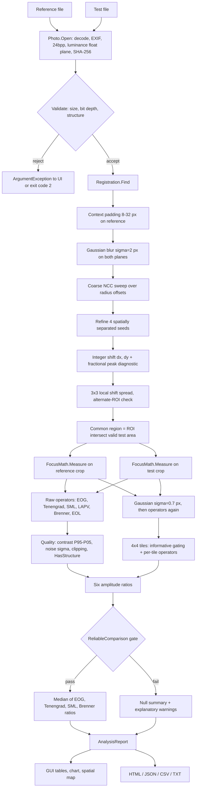
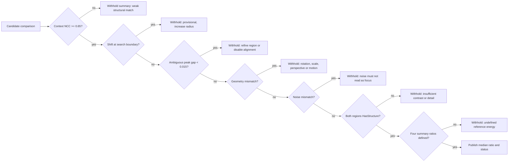

<div align="center">

# PhotoCompare 2.1

**面向 Windows 的参考基准图像清晰度对比工具 —— 将任意测试帧与可信对照图像对齐，测量六种细节算子，并获得具备空间分辨能力的可复现判定。**

[](https://learn.microsoft.com/en-us/dotnet/framework/install/guide-for-developers)
[](PhotoCompare.csproj)
[](src/ProductInfo.cs)
[](LICENSE)
[](#技术栈与架构)
[](tests/PhotoTests.cs)

</div>

> [!IMPORTANT]
> 本仓库提供的是一个**独立的 Windows 桌面应用程序**，而非服务端或控制台优先的产品。`PhotoCompare.exe` 是一个 WinForms/GDI+ 可执行文件，可独立运行：无需安装程序、无需 Python、无需 OpenCV、无需 NuGet 包，也无需网络访问。配置仅通过命令行参数和窗口内控件表达 —— **刻意不提供**环境变量和配置文件。

---

## 目录

- [功能特性](#功能特性)
- [技术栈与架构](#技术栈与架构)
  - [核心技术栈](#核心技术栈)
  - [项目结构](#项目结构)
  - [关键设计决策](#关键设计决策)
  - [分析流水线](#分析流水线)
  - [可靠性判定闸门](#可靠性判定闸门)
- [快速开始](#快速开始)
  - [前置要求](#前置要求)
  - [安装](#安装)
  - [从源码构建](#从源码构建)
  - [故障排查](#故障排查)
- [测试](#测试)
  - [核心数值校验](#核心数值校验)
  - [命令行集成校验](#命令行集成校验)
  - [UI 冒烟校验](#ui-冒烟校验)
  - [性能基准测试](#性能基准测试)
  - [测试覆盖矩阵](#测试覆盖矩阵)
- [部署](#部署)
  - [便携式分发](#便携式分发)
  - [CI/CD 集成](#cicd-集成)
  - [容器化](#容器化)
- [使用说明](#使用说明)
  - [GUI 快速上手](#gui-快速上手)
  - [百分比的含义](#百分比的含义)
  - [命令行用法](#命令行用法)
  - [批处理](#批处理)
  - [导出](#导出)
  - [进阶用法](#进阶用法)
  - [快捷键参考](#快捷键参考)
- [配置](#配置)
  - [命令行选项](#命令行选项)
  - [GUI 设置](#gui-设置)
  - [环境变量](#环境变量)
  - [固定引擎常量](#固定引擎常量)
  - [报告 Schema](#报告-schema)
- [许可证](#许可证)
- [联系与社区支持](#联系与社区支持)

---

## 功能特性

### 测量内核

- **以参考图像为锚点的评分。** 每次对比都以用户所选参考区域的细节水平为基准，因此结果可跨相机、镜头、传感器和处理流水线保持意义一致。
- **六种独立的细节算子** —— EOG、Tenengrad、SML、LAPV、Brenner 2D 与 EOL（热成像掩模）—— 在两幅图像上使用完全相同的定义计算。
- **四算子中位数汇总。** 头部百分比取 EOG、Tenengrad、SML 与 Brenner 2D 四个幅值比的中位数，可抵御单个算子异常带来的偏差。LAPV 与 EOL 仅作为诊断项。
- **统一的 Gaussian σ = 0.7 px 预滤波** 同时作用于两个区域，之后才计算比值，在抑制像素网格噪声的同时保留细节。
- **能量感知比值。** 平方梯度类指标通过比值的平方根进行比较（真实幅值），而 SML 使用线性比值。
- **高于 100% 的结果永不截断。** 更锐利的细节、额外的噪声或数字锐化都有可能合法地把分数推高至参考水平之上。
- **可选对比度归一化**，按 `参考 (P95−P05) / 测试 (P95−P05)` 计算，默认关闭 —— 因为它可能掩盖散焦导致的对比度损失。

### 对齐与几何

- **子窗口平移搜索**，默认 ±32 px 半径，可调至 ±256 px，搜索前施加 Gaussian σ = 2 px 平滑。
- **粗到精的 NCC 搜索**，配合多种子细化，使四杆图卡等周期性目标不会塌陷到混叠峰上。
- **上下文外扩**（8–32 px）仅用于对齐；指标始终在公共区域内以原始像素测量。
- **亚像素峰位估计**（相关峰的抛物线插值）作为诊断项报告 —— 测量本身从不重采样。
- **几何筛查** 通过 3×3 局部位移采样与备用 ROI 相关性实现；旋转、缩放变化、透视以及独立前景运动会被检测并报告，而不是被误判为散焦。
- **仅平移策略。** 绝不自动重缩放、旋转校正或透视形变。

### 可靠性工程

- **汇总值扣留。** 当对齐偏弱、存在歧义或触及搜索边界，几何不一致，噪声贡献差异过大，或区域缺少可用细节时，百分比会被抑制。所有原始指标仍然可用。
- **输入质量诊断**：P95−P05 对比度、平均亮度、标准差、裁剪百分比、稳健噪声 σ 估计、噪声能量占比、模糊保留比以及结构有效性标志。
- **多级警告** 同步镜像到 GUI、HTML、JSON、CSV 与 TXT 输出中。

### 空间分析

- **最高 4×4 瓦片图** 覆盖公共区域，逐瓦片的有信息/无信息分类由参考图像驱动。
- **平滑背景渐变会被排除**，因此柔和的照明斜坡无法充当对焦证据。
- **全局汇总值、局部中位数与局部 P25–P75 区间** 分别报告 —— 清晰区域再也无法隐藏在全局平均值背后而掩盖模糊区域。
- **两个预览均可着色叠加**，并另有专门的 *Spatial tiles* 表格。

### 效率与集成

- **批处理** 可对整个文件夹的映像执行，具备逐文件错误隔离、参考测量缓存复用、取消操作以及 CSV/JSON 导出。
- **四种导出格式** —— 自包含 HTML（无脚本、不嵌入照片）、完整 JSON、扁平 CSV 与人可读 TXT。
- **溯源设计**：每个源文件的 SHA-256、工具版本、设置以及测量区域坐标都会随报告一同留存。
- **源图像永不被修改**；导出器会拒绝把报告写入输入路径。
- **确定性文化环境**：进程强制使用 `en-US` 作为 culture 与 UI culture，因此数值解析与格式化永远不依赖宿主环境。
- **完整 CLI 对等能力**，支持单对与批处理运行，并提供稳定的退出码供自动化使用。
- **全链路取消** —— 分析中途可用 `Esc`/`Cancel`，模糊、算子与对齐循环内部均执行协作式 `CancellationToken` 检查。
- **有界内存缓存**（`AnalysisSession`），在仅修改容差或对比度模式时复用参考与测试测量结果以及对齐结果。
- **零第三方依赖**：整个应用程序是针对 .NET Framework 类库编译的单个可执行文件。

---

## 技术栈与架构

### 核心技术栈

| 层级 | 技术 | 说明 |
| --- | --- | --- |
| 语言 | **C#**（兼容 C# 5 语法） | 不使用 `async`、不使用内插字符串、不使用表达式主体成员 |
| 运行时 | **.NET Framework 4.8** | Windows 10 1903+ / Windows 11 随附；仅构建时需要 targeting pack |
| UI | **Windows Forms**（`System.Windows.Forms`） | 界面完全以代码构建 —— 无 `.Designer.cs`、无 XAML、无资源文件 |
| 图像处理 | **GDI+**（`System.Drawing`） | 解码、EXIF 方向、24-bpp 合成、预览渲染 |
| 序列化 | **`System.Web.Script.Serialization.JavaScriptSerializer`** | JSON 报告；不依赖 Newtonsoft/System.Text.Json |
| 构建（IDE） | **MSBuild / Visual Studio 2022** | 解决方案格式 12.00，VS 17 工具集 |
| 构建（CLI） | **`%WINDIR%\Microsoft.NET\Framework64\v4.0.30319` 中的 `csc.exe`** | 由 `Build.ps1` 调用；无需包还原 |
| 脚本 | **Windows PowerShell 5.1** | `Build.ps1`、`Run-Tests.ps1`、`Run-Benchmark.ps1` |
| 并发 | **TPL**（`Parallel.For`）+ `CancellationToken` | 像素数超过 300 000 时启用；并行度上限为 `min(8, cores−1)` |
| 二进制 | **AnyCPU，`WinExe`** | 无需修改即可在 x86 或 x64 上运行 |

> [!NOTE]
> `PhotoCompare.csproj` 中启用了 `TreatWarningsAsErrors`，`Build.ps1` 也会传递 `/warnaserror+`。警告即构建失败 —— 在一个改动单个常量就会让已发布测量结果失效的项目中，这可防止数值漂移和死代码被无声引入。

### 项目结构

```text
reference-sharpness-comparator2/
├── PhotoCompare.sln              # VS 2022 解决方案（Debug/Release，AnyCPU）
├── PhotoCompare.csproj           # v4.8 WinExe，RootNamespace=PhotoFocus，源文件列表与 Build.ps1 一致
├── PhotoCompare.exe              # 预构建的 AnyCPU 二进制，由 BUILD.bat 与 src/ 保持同步
├── START.bat                     # 就地启动根目录 EXE
├── BUILD.bat                     # Build.ps1 包装脚本，失败时暂停
├── BUILD_AND_RUN.bat             # Build.ps1 -Launch 包装脚本
├── Build.ps1                     # 基于 csc 的构建，含暂存与原子替换
├── Run-Tests.ps1                 # 核心校验 + CLI 集成校验（可选 UI 冒烟）
├── Run-Benchmark.ps1             # 合成性能测试框架
├── LICENSE                       # Apache License 2.0
├── README.md
├── src/
│   ├── Program.cs                # 入口点、参数解析器、外壳模式                （约 108 行）
│   ├── ProductInfo.cs            # 名称、版本、变体开关                        （约 12 行）
│   ├── AssemblyInfo.cs           # Win32 可执行文件元数据                      （约 7 行）
│   ├── FocusAnalysis.cs          # 成像、算子、对齐、报告                      （约 650 行）
│   ├── AnalysisSession.cs        # 有界测量/对齐缓存                          （约 43 行）
│   ├── PhotoForms.cs             # 主窗口、画布、图表、瓦片                    （约 414 行）
│   ├── BatchAnalysis.cs          # 批处理引擎 + 批处理窗口                    （约 150 行）
│   └── ReportHtml.cs             # 自包含 HTML 报告 + SVG 图表                （约 79 行）
├── tests/
│   ├── PhotoTests.cs             # 61 项数值/数据质量校验                     （约 238 行）
│   ├── Benchmark.cs              # 可复现的合成计时用例                       （约 52 行）
│   └── output/                   # 生成的测试夹具、报告、基准 JSON
├── bin/Release/                  # 编译器输出（exe + pdb）
└── obj/                          # 暂存与 MSBuild 中间文件
```

<details>
<summary><strong>文件级职责、生成产物，以及为何将构建输出纳入版本控制</strong></summary>

**源文件与其契约**

| 文件 | 负责内容 | 依赖于 |
| --- | --- | --- |
| `src/Program.cs` | 选项语法、模式选择、英文区域设置强制、退出码、`%TEMP%` 错误日志 | `ProductInfo`、`FocusMath`、`BatchAnalysis`、`ReportFiles`、`PhotoForms` |
| `src/ProductInfo.cs` | `Name`、`Version`、`FileVersion`、`Description`、`IsComparison` 变体开关 | — |
| `src/FocusAnalysis.cs` | `GrayPlane`、`Photo`、`OperatorValues`、`ImageMeasures`、`TileMeasure`、`AlignmentResult`、`AnalysisReport`、`FocusMath`、`Registration`、`ReportFiles` | GDI+、`System.Web.Extensions` |
| `src/AnalysisSession.cs` | 以对象标识（`ReferenceEquals`）+ 区域 + 设置为键的缓存 | `FocusMath`、`Registration` |
| `src/PhotoForms.cs` | `PhotoCanvas`（绘制/缩放/平移/ROI/拖放/瓦片叠加）、`PhotoForm`、图表控件、分页结果 | WinForms |
| `src/BatchAnalysis.cs` | `BatchItem`、`BatchAnalysis.Run/Save`、基于 `BackgroundWorker` 的 `BatchForm` | `AnalysisSession`、WinForms |
| `src/ReportHtml.cs` | 内联 CSS、SVG 柱状图、瓦片网格、HTML 编码 | `AnalysisReport` |

**生成产物（可安全删除，按需重新生成）**

- `bin/Debug`、`bin/Release` —— MSBuild 输出。IDE 构建产物落在此处；CLI 构建刻意**不会**覆盖它们。
- `obj/command-line` —— `Build.ps1` 用于原子替换 EXE 的暂存目录。
- `tests/output` —— 合成夹具（`reference.png`、`working.png`、`shifted.png`、`color-test.png`、`large-native.png`）、包含故意损坏的 `broken.png` 的 `batch-input` 文件夹，以及校验生成的报告/JSON。

由于构建输出可用内置编译器从源码逐字节复现，仓库在根目录保留一个预构建的 `PhotoCompare.exe`，纯粹是为了让没有 SDK 的机器也能直接使用。它不是权威产物 —— `src/` 才是。

**程序集标识**

`RootNamespace` 为 `PhotoFocus`，而程序集名为 `PhotoCompare`。这种不一致是刻意的：命名空间描述领域模块，程序集名描述交付的产品。`Build.ps1` 从项目文件读取 `AssemblyName`，按 `^[A-Za-z][A-Za-z0-9_.-]*$` 校验，并据此推导暂存与目标路径，因此在重命名产品时无需改动脚本。

</details>

### 关键设计决策

<details>
<summary><strong>1. 采用相对参考尺度，而非通用清晰度阈值</strong></summary>

对于单张照片而言，不存在可迁移的绝对“对焦”数值：场景纹理、噪声、曝光、去马赛克、降噪与锐化都会改变高频能量。因此引擎只回答一个问题 —— *该测试区域相比该参考区域含有多少可测细节？* —— 并明确陈述：

- `100%` 是**所选参考的实测细节水平**，而非完美光学对焦。模糊的对照图会定义它自己的 100%。
- `80%` 表示综合细节幅值低于参考；这**并不**意味着镜头“有 20% 失焦”。
- `115%` 表示测得更多高频内容，可能来自更锐利的细节、更多噪声或更强的数字锐化。

单图 `Detail index`（`100 × √Tenengrad(σ=0.7) / (P95−P05)`）在引擎中存在并由校验覆盖，但它是一个无上界的相对尺度，且本应用变体（`ProductInfo.IsComparison = true`）并不将其呈现给用户。

</details>

<details>
<summary><strong>2. 幅值之比而非能量之比，中位数而非平均数</strong></summary>

EOG、Tenengrad 与 Brenner 2D 对像素幅值呈二次关系，因此直接对这些能量取比值更接近报告方差而非清晰度变化。引擎通过比值的平方根来比较它们（`100 × √(working / reference)`），而 SML —— 本身就是幅值的一阶差分度量 —— 使用线性比值。随后用**中位数**归并四个汇总比值，使某个在特定纹理（例如以垂直纹理为主）上表现异常的算子无法拖动头部数值。

两个区域在形成比值之前都会施加相同的 Gaussian σ = 0.7 px 滤波，使比较在相位上对称，并在不删除算子所需细节频带的前提下抑制噪声基底。

</details>

<details>
<summary><strong>3. 拒绝作答本身就是一项功能</strong></summary>

一个总会返回数字的对比器，在所有歧义情形下也总会返回错误的数字。仅当**以下全部条件**满足时，`ReliableComparison` 才为 `true`：

- 上下文 NCC ≥ 0.65，
- 最佳位移不在搜索边界，
- 不存在同样可信的备选峰（最佳峰与空间上相距最远的强峰之间差距 < 0.015），
- 无几何不匹配（备用 ROI 在 ≥ 3 px 位移处增益 > 0.12，或在 ≥ 4 个被接受瓦片上的局部位移离散度 > 3.5 px），
- 无噪声不匹配（较噪者 σ > max(3, 2 × 较静者 σ + 0.5)，噪声能量占比 > 0.5，模糊保留 < 0.3），
- 两个区域均报告 `HasStructure`，
- 四个汇总比值全部有定义。

当闸门不通过时，`Status` 变为 `Reliable comparison unavailable`，`RelativeDetailPercent` 为 `null`，并由警告说明哪一条件失败。各指标行仍保留数值，以便工程师继续诊断。

</details>

<details>
<summary><strong>4. 整像素测量，无隐藏重采样</strong></summary>

对齐返回整像素位移；小数位移估计仅由相关峰推导，纯粹作为诊断。被测量的图像**从不**插值，因为插值本身就是一个低通滤波器，会系统性地压低被重采样图像的清晰度。因此：

- 旋转、缩放与透视不被校正，只会被检测；
- 仅当物体保持相同像素尺度时才允许文件尺寸不同；
- 小数偏移可能在极细周期条纹上造成像素相位误差，报告会明确说明这一点。

</details>

<details>
<summary><strong>5. 对不支持输入快速失败，而非静默降级</strong></summary>

GDI+ 会静默地把某些 16 位 PNG 收窄为 8 位。与其接受一个悄然错误的测量，`Photo.Open` 会检查 PNG 头的 IHDR 位深字节、读取 TIFF `BitsPerSample` 标签（0x102），并以可操作的信息拒绝高位深数据。上限在分配内存之前强制校验：总计 24 000 000 像素，单边 16 000 像素。EXIF 方向（0x112）会被应用，以使预览与测量一致。透明度会合成到白色背景并给出明确警告。多页或动画文件只加载第一帧，同样附带警告。

</details>

<details>
<summary><strong>6. 确定性、可审计的输出</strong></summary>

- 进程把 `CultureInfo` 固定为 `en-US`（默认线程、UI culture 与当前线程均设置），因此 `int.Parse`/`ToString` 永不跟随宿主区域设置。
- CSV 数值字段使用不变文化下的往返格式 `G17`；TXT/HTML 中的展示值保留三位小数。
- 每份报告都携带工具版本（`PhotoCompare 2.1`）与两个源文件的 SHA-256 摘要。
- HTML 报告是单文件，内联 CSS 与内联 SVG 图表 —— **无 `<script>`、无 ``** —— 因此在邮件、离线机器或合规归档中渲染一致，且无法执行或外泄任何内容。
- 文件名与警告字符串经 `WebUtility.HtmlEncode` 编码；批处理 CSV 中以 `= + - @` 开头的单元格会前缀 `'`，以中和电子表格公式注入。

</details>

<details>
<summary><strong>7. 有界状态，显式生命周期</strong></summary>

`Photo` 实现 `IDisposable` 并拥有其 `Bitmap`；加载器把像素复制到 `float[]` 亮度平面（0–255）后立即释放文件句柄，因此分析窗口打开期间源文件可被重命名或删除。`AnalysisSession` 最多持有一份参考测量、一份测试测量与一次对齐，由 `Clear()` 失效，并按窗口和按批次创建 —— 窗口与工作线程之间不共享任何静态图像状态。`Program` 在 `finally` 块中释放已解码的图片。

</details>

<details>
<summary><strong>8. 除参数与控件外不提供配置面</strong></summary>

一个会静默读取 `.env`、注册表键或漫游设置文件的测量工具，是六个月后无法复现的测量工具。引擎的每一项输入要么是显式参数，要么是可见控件，且每项输出都会记录这些值。界面同样拒绝矛盾调用：重复选项、混合模式（`--image` 与 `--batch` 并用）、同时指定两种对比度模式，以及在单图变体中传入对比专用选项，都会抛出参数错误。

</details>

<details>
<summary><strong>9. 原子构建，故障隔离</strong></summary>

`Build.ps1` 先编译到 `obj/command-line/`，随后才把结果移动到根可执行文件。编译失败 —— 或因应用仍在运行导致目标被占用 —— 都会让此前可用的二进制保持不变，脚本也会明确说明。批处理在运行时遵循同样的理念：损坏或缺失的文件变成一行错误，其余图像继续处理，进程以 `1` 而非中断退出。

</details>

### 分析流水线

<details open>
<summary><strong>端到端数据流：从两个文件到受门控的百分比</strong></summary>



</details>

<details>
<summary><strong>按实现定义的算子与单位</strong></summary>

| 算子 | 索引 | 代码中的定义 | 单位 | 角色 |
| --- | --- | --- | --- | --- |
| `EOG` | 0 | 沿 X、Y 方向前向差分的均方值 | levels²/px | 汇总 |
| `Tenengrad` | 1 | 平均 Sobel X/Y 能量；每个卷积核除以 8 | levels²/px | 汇总 |
| `SML` | 2 | 沿 X/Y 方向二阶差分绝对值的均值；步长 1，阈值 0 | levels/px | 汇总（线性比值） |
| `LAPV` | 3 | 四邻域 Laplacian 的方差 | levels² | 诊断 |
| `Brenner 2D` | 4 | 沿 X、Y 方向步长为 2 的差分均方值之和的一半 | levels²/px | 汇总 |
| `EOL (thermal)` | 5 | 中心 20 / 邻域 −4 / 对角 −1 掩模响应的均方值 | levels²/px | 诊断 |

六种算子都只在有效内部位置求平均（内部算子按 `(w−2)(h−2)` 归一化，EOG 按 `(w−1)(h−1)`，Brenner 两轴分别按 `h(w−2)` 与 `(h−2)w`），并在原始像素网格上计算。σ = 0.7 列在滤波后的平面上重复完全相同的定义，因此“原始 vs 滤波”是同口径比较，而非更换公式。

</details>

<details>
<summary><strong>配准算法详解</strong></summary>

1. **上下文区域。** 启用对齐时，所选 ROI 向外扩展 `min(32, max(8, min(w,h)/4))` 像素并与参考边界求交。该上下文有助于定位强烈模糊或低对比度的目标；它绝不参与指标区域。
2. **平滑。** 参考上下文与测试搜索窗口都施加 σ = 2 px 模糊，使 NCC 对噪声与细粒度混叠不敏感。
3. **搜索窗口。** 测试窗口为上下文向外扩展 `radius + 5`，确保搜索半径内的每个候选位移仍完整位于测试图像内。
4. **粗搜索。** 位移以 `ceil(radius / 12)` 为步长采样（并额外包含 `0`、`−radius`、`+radius`），在约每轴 40 个采样点的抽样子网格上按归一化互相关评分。
5. **多种子细化。** 最多四个空间上分离的粗峰按完整邻域分辨率、以更细步长（`/72`）细化。这可避免锁定到规则四杆目标的混叠峰。
6. **歧义检测。** 最佳分数与至少相距 `max(6, 2 × coarse)` px 的最强候选项比较；两者均高于 0.65 而差距小于 0.015 时，结果被标记为有歧义。
7. **小数估计。** 对峰值的水平与垂直邻居做抛物线拟合，得到 `FractionalDx/FractionalDy`，截断至 ±0.5 px。与整像素位移相差超过 0.25 px 时会产生像素相位警告。
8. **几何筛查。** 若 ROI NCC < 0.85，则执行一次最大化局部 ROI 相关性的备选搜索；若远处存在明显更优的备选峰，即表示几何不匹配。对于 ≥ 128×128 px 的 ROI，在 ±3 px 范围内进行九个局部 3×3 块搜索以测量残余位移离散度；在 ≥ 4 个高置信瓦片上离散度 > 3.5 px 即标记旋转、缩放、透视或独立运动。
9. **公共区域。** 测量 `ROI ∩ 有效测试区域`；若对齐移除了超过 20% 的所选区域，则发出警告。

报告的位移 `dx, dy` 表示参考像素 `(x, y)` 对应测试像素 `(x + dx, y + dy)`。

</details>

### 可靠性判定闸门

<details>
<summary><strong>决定是否允许展示百分比的判定逻辑</strong></summary>



每个被扣留的情形仍会返回指标表、瓦片图、诊断信息与警告。`ReliableComparison` 会序列化到 JSON 中，因此自动化可据此分支，而不必依赖退出码。

</details>

---

## 快速开始

### 前置要求

| 要求 | 版本 / 说明 | 用途 |
| --- | --- | --- |
| Windows | Windows 10 1903+ 或 Windows 11（任意版本） | 运行 GUI |
| .NET Framework | **4.8** 运行时 —— 受支持的 Windows 版本已预装 | 运行应用 |
| PowerShell | **Windows PowerShell 5.1**（`powershell.exe`，而非仅 `pwsh`） | `Build.ps1`、`Run-Tests.ps1`、`Run-Benchmark.ps1` |
| .NET Framework 4.8 Developer Pack | 仅在使用 **Visual Studio** 构建时需要 | MSBuild/VS 编译 |
| Visual Studio 2022（可选） | 工作负载 *.NET desktop development* | IDE 编辑与调试 |
| `csc.exe` | `%WINDIR%\Microsoft.NET\Framework64\v4.0.30319\csc.exe` | 无需 SDK 的脚本构建 |

> [!TIP]
> 如果 `PhotoCompare.exe` 已能在你的机器上启动，说明你已具备*使用*该工具的全部条件。编译器、SDK 与 PowerShell 脚本仅在需要*修改*它时才需要。

> [!WARNING]
> Windows on ARM 仅在存在 .NET Framework 4.8 时才通过 x64 仿真运行本应用。macOS、Linux 与 Wine 不是受支持目标：UI 是 WinForms，成像层是 GDI+，二者均不跨平台。

### 安装

不存在安装程序。克隆并运行：

```powershell
# 1. 克隆仓库
git clone https://github.com/DroneNotes/reference-sharpness-comparator2.git
cd reference-sharpness-comparator2

# 2. 验证运行时存在（打印 4.8 发布键，例如 528040）
reg query "HKLM\SOFTWARE\Microsoft\NET Framework Setup\NDP\v4\Full" /v Release

# 3. 启动预构建二进制
.\START.bat
# 或直接：
.\PhotoCompare.exe
```

希望使用自行编译的构建？将第 3 步替换为：

```powershell
# 从 src/ 重建根可执行文件，然后启动
.\BUILD_AND_RUN.bat
```

**首次运行流程**

1. 点击 **1. Open reference…**（或 `Ctrl+Shift+O`，或将文件拖放到左侧预览区）。
2. 点击 **2. Open test image…**（或 `Ctrl+O`，或拖放到右侧预览区）。
3. 在**参考预览区**内按住鼠标左键拖动，选择目标或具有纹理的物体。
4. 分析自动开始。阅读头部百分比、指标表与警告页签。
5. 打开 **Spatial map** 或 **Spatial tiles** 页签以检查局部差异。
6. 使用 **Save result…**（`Ctrl+S`）导出 HTML、JSON、CSV 或 TXT。

### 从源码构建

<details>
<summary><strong>脚本构建、Visual Studio 构建、手动 <code>csc</code> 调用与脚本参数</strong></summary>

#### A. 脚本构建（无需 SDK）

```powershell
# 从 src/ 重建 .\PhotoCompare.exe
powershell -NoProfile -ExecutionPolicy Bypass -File .\Build.ps1

# 重建后启动
powershell -NoProfile -ExecutionPolicy Bypass -File .\Build.ps1 -Launch

# 重建后运行完整校验套件
powershell -NoProfile -ExecutionPolicy Bypass -File .\Build.ps1 -Tests
```

`Build.ps1` 的行为，逐步说明：

1. 在脚本目录中定位且仅定位一个 `*.csproj`，否则失败。
2. 读取 `<AssemblyName>` 并按 `^[A-Za-z][A-Za-z0-9_.-]*$` 校验。
3. 优先从 `Framework64` 解析 `csc.exe`，回退到 `Framework`。
4. 展开每个 `<Compile Include=…>` 条目，并拒绝任何逃逸出项目根目录的路径。
5. 以 `/target:winexe /platform:anycpu /optimize+ /warn:4 /warnaserror+ /main:PhotoFocus.Program` 编译到 `obj\command-line\<AssemblyName>.exe`。
6. 把临时文件移动到 `.\PhotoCompare.exe` —— 原子替换，任何失败都保留此前二进制。

#### B. Visual Studio

```powershell
# 与「生成解决方案」等价的 Release 配置命令行 MSBuild
msbuild .\PhotoCompare.sln /t:Rebuild /p:Configuration=Release /p:Platform="Any CPU"
```

交互式开发请打开 `PhotoCompare.sln`；IDE 输出落在 `bin\Debug` 或 `bin\Release`。需要 .NET Framework 4.8 Developer/Targeting Pack（[Microsoft 安装指南](https://learn.microsoft.com/en-us/dotnet/framework/install/guide-for-developers)）。

#### C. 手动调用编译器

```powershell
$csc = "$env:WINDIR\Microsoft.NET\Framework64\v4.0.30319\csc.exe"
& $csc /nologo /target:winexe /platform:anycpu /optimize+ /warn:4 /warnaserror+ /main:PhotoFocus.Program `
  /out:.\PhotoCompare.exe `
  /r:System.dll,System.Core.dll,System.Drawing.dll,System.Windows.Forms.dll,System.Web.Extensions.dll `
  .\src\ProductInfo.cs .\src\AssemblyInfo.cs .\src\Program.cs .\src\FocusAnalysis.cs `
  .\src\AnalysisSession.cs .\src\PhotoForms.cs .\src\BatchAnalysis.cs .\src\ReportHtml.cs
```

#### D. 新增源文件

新的 `.cs` 文件必须列入 **`PhotoCompare.csproj`**（`<Compile Include=…>`）—— 除此之外无需改动其他清单，因为 `Build.ps1` 从项目文件推导文件列表，项目文件是唯一事实来源。若希望继续使用内置编译器构建，请保持新代码兼容 C# 5；只有在两条构建路径都提升语言版本时才引入更新的语法。

</details>

### 故障排查

<details>
<summary><strong>常见构建与运行时故障及其确切原因</strong></summary>

| 症状 | 原因 | 修复方式 |
| --- | --- | --- |
| `Expected one C# project file in this folder.` | 存在零个或多个 `.csproj` 文件 | 在 `Build.ps1` 旁仅保留一个项目文件 |
| `The Windows .NET Framework C# compiler was not found.` | 在 Windows 之外运行，或为精简环境 | 安装 .NET Framework 4.8 或使用 Visual Studio 2022 |
| `Compilation failed. The previous executable has been preserved.` | 编译错误，或内置编译器不支持的新语法特性 | 修正错误；保持 C# 5 语法兼容或使用 VS 工具集构建 |
| `Close the running application and build again.` | 目标 EXE 被运行中的实例锁定 | 关闭 PhotoCompare 后重新构建 |
| `error CS0246: … System.Web.Extensions` | 引用列表被改动 | 保留项目文件中列出的五个引用 |
| `Run BUILD.bat before running checks.` | `Run-Tests.ps1` 需要根目录 EXE | 先构建，再重新运行 |
| `16-bit PNG is not supported.` | IHDR 位深 > 8 | 导出未缩放的 8 位显示图像 |
| `TIFF channels above 8 bits are not supported.` | `BitsPerSample` > 8 | 导出 8 位 TIFF |
| `The limit is 24 million pixels and 16,000 pixels per side.` | 文件过大 | 以原始分辨率裁剪，而不要缩放 |
| `The region must be inside the image and at least 16×16 pixels.` | ROI 过小或越界 | 在有纹理的物体上使用 ≥ 48×48 px |
| `No common image region.` | 对齐无法把 ROI 放入测试帧内 | 扩大测试画布或减小搜索半径 |
| `A report cannot overwrite a source image.` | `--out` 与某个输入路径相同 | 选择其他输出路径 |
| `Unknown option or missing value: …` | 拼写错误，或标志缺少取值 | 对照选项表检查 |
| `Duplicate option: …` | 同一开关被传入两次 | 每个选项仅传入一次 |
| `Batch, single-image and test modes must be run separately.` | `--image`、`--batch`、`--smoke`、`--smoke-batch` 中两项被组合使用 | 每个进程只运行一种模式 |
| `Specify --image / --batch, or start the application without arguments.` | 给出选项但未指定模式 | 追加模式参数，或不带参数启动 GUI |
| SmartScreen「未知发布者」 | 二进制未签名 | 对照自建结果校验 SHA-256 后允许；或自行签名构建 |
| 数值与同事的运行结果不同 | 浮点路径不同、工具版本不同或区域不同 | 在 JSON 中比较 `ToolVersion`、`RequestedArea` 与源文件 SHA-256 |

**CLI 模式下退出码 2 且无对话框**属预期行为：GUI 子系统进程没有附加控制台，消息被写入 `%TEMP%\PhotoCompare-error.txt`。请读取该文件后再修正调用方式。

</details>

---

## 测试

校验套件被刻意拆分为**纯数值校验**（快速、确定、无 GUI）与**应用级集成校验**（真实进程启动、真实导出、真实退出码）。

```powershell
# 全部执行：核心校验 + CLI 集成校验
powershell -NoProfile -ExecutionPolicy Bypass -File .\Run-Tests.ps1

# 全部执行，并对主窗口与批处理窗口进行 GUI 冒烟运行
powershell -NoProfile -ExecutionPolicy Bypass -File .\Run-Tests.ps1 -Ui

# 合成性能测试框架（三次运行取中位数）
powershell -NoProfile -ExecutionPolicy Bypass -File .\Run-Benchmark.ps1
```

> [!IMPORTANT]
> `Run-Tests.ps1` 需要项目根目录中已存在构建好的 `PhotoCompare.exe`，并在首个失败处以 `FAIL: <check name>` 消息向 stderr 输出且以非零码退出。成功运行以 `PASS: PhotoCompare local numerical, command-line, export and batch checks.` 结束，并写入 `tests/output/test-results.json`，其中包含通过计数与关键测量值。

### 核心数值校验

`Run-Tests.ps1` 把 `ProductInfo.cs`、`FocusAnalysis.cs`、`AnalysisSession.cs`、`ReportHtml.cs`、`BatchAnalysis.cs` 与 `tests/PhotoTests.cs` 一起编译为 `tests/output/CoreChecks.exe`（不含 GUI 源文件），并以输出目录作为 `argv[0]` 执行。夹具在进程内由固定种子（`Random(72)`、`Random(91)`、`Random(103)`）生成，因此结果在不同机器间逐位稳定。

测试框架构造一个刻意非周期的合成场景 —— 调制正弦、两组不同方向的四杆图、一个圆盘与一条斜边 —— 并提供施加增益/偏移/噪声/位移（`Change`）与旋转/缩放/亚像素形变（`Warp`）的辅助函数。

```powershell
# 仅运行核心校验（与套件内部行为等价）
powershell -NoProfile -Command "& .\tests\output\CoreChecks.exe .\tests\output"
```

每项校验打印 `PASS: <name>`；最终行是 `All 61 checks passed.`。记录的结果文件形如：

```json
{"passed":61,"identity":100,"gain":100.45,"sharper":155.59,"noise":11.99,
 "measurements":[{"sigma":0.5,"score":97.64,"ncc":0.99997},
                 {"sigma":1.0,"score":83.50,"ncc":0.99941},
                 {"sigma":1.8,"score":64.38,"ncc":0.99543},
                 {"sigma":3.0,"score":38.53,"ncc":0.98071}]}
```

### 命令行集成校验

核心校验通过后，`Run-Tests.ps1` 使用 `Start-Process -WindowStyle Hidden -Wait` 启动真实可执行文件，并断言退出码与输出内容：

1. **四条导出路径** —— `application.json`、`.html`、`.csv`、`.txt` 均须以退出码 `0` 成功。
2. **身份语义** —— `ToolVersion` 以 `PhotoCompare ` 开头，报告的工作宽度为 `320`，参考与自身对比得到 `RelativeDetailPercent == 100`，误差在 `1e-7` 以内。
3. **批处理故障隔离** —— 含两幅有效图像与一个 `broken.png` 文本文件的文件夹必须以 `1` 退出，并产出恰好三行，其中恰好一行带 `Error`。
4. **源文件不可变** —— 在尝试向其导出前后，测试图像的哈希必须保持不变，且该尝试必须以 `2` 退出。

### UI 冒烟校验

`-Ui` 额外执行两次冒烟运行，覆盖完整的 WinForms 构造路径：

```powershell
powershell -NoProfile -ExecutionPolicy Bypass -File .\Run-Tests.ps1 -Ui
```

- `--smoke <folder>` —— 打开参考/测试图像对，选择 ROI，完成一次分析并保存 `compare-ui.png` / `compare-ui.json`。
- `--smoke-batch <folder>` —— 以合成参考启动批处理引擎，写出 `compare-batch-ui.png` / `compare-batch-ui.json`。

若上述四个文件任一缺失，运行即视为失败。

### 性能基准测试

```powershell
powershell -NoProfile -ExecutionPolicy Bypass -File .\Run-Benchmark.ps1
# → tests/output/benchmark.json
```

`tests/Benchmark.cs` 先在 48×48 用例上预热，然后在 **640×512** 与 **3840×2400** 下测量 **single** 与 **compare** 两种模式，每种三次计时（取中位数）。以 `/define:PHOTO_V2` 构建时，还会增加 `compare_cached_settings` 用例：通过预热的 `AnalysisSession` 运行 25 次迭代并轻微变动容差，以隔离「仅改设置」路径的开销。JSON 输出记录机器名、处理器数量、运行时版本与原始样本数组，因此回归可归因于硬件或代码。

> [!TIP]
> 在改动 `GrayPlane`、`Operators` 或 `Registration` 中任何内容之前与之后都应运行基准测试。启用 `Parallel.For` 的 300 000 像素阈值、64 行的块大小以及 `min(8, cores−1)` 上限都是性能关键点；改动它们不仅改变耗时，也会通过不同的求和顺序改变每个指标的最后几位数字。

### 测试覆盖矩阵

<details>
<summary><strong>61 项核心校验究竟断言了什么</strong></summary>

| 领域 | 代表性断言 |
| --- | --- |
| 身份与代数 | 相同图像评分恰为 100%；每个算子比值均为 100；`dx = dy = 0` |
| 模糊单调响应 | Gaussian σ = 0.5 → 97.6%，1.0 → 83.5%，1.8 → 64.4%，3.0 → 38.5%，严格递减 |
| 对齐正确性 | 位移 `(11,−7)`、`(−17,12)`、`(0,19)` 被精确恢复，评分回到 100 ± 0.01 |
| 画布独立性 | 同一场景置于带偏移 `(9,5)` 的更大画布上得分相同；不发生重缩放 |
| 歧义 | 4 px 条纹图报告 `Ambiguous` 并扣留汇总值 |
| 搜索边界 | 在 `radius = 32` 下施加 32 px 位移会报告 `AtSearchLimit` 且不可靠 |
| 几何 | 3° 旋转、1.05× 缩放与独立移动的前景块均无法通过闸门 |
| 亚像素诚实性 | `(0.4,−0.3)` 形变给出误差在 0.18 px 内的小数估计，同时指标保持不插值 |
| 对比度 | 增益 0.65 + 偏移 25 在归一化下得 100.45%，未归一化时约 65% |
| 归一化风险 | 原始读数 80% 的正弦模糊在归一化后升至 95% 以上，并发出掩盖警告 |
| 噪声 | 加入 σ = 18 噪声会触发 `NoiseMismatch`；纯噪声图像被标记且不给出清晰度指数 |
| 过锐化 | 以模糊参考对比清晰原图得到 155.6% —— 永不截断为 100% |
| 算子数学 | 线性斜坡 `2x + 3y`：EOG = Tenengrad = 13，Brenner = 26，SML/EOL/LAPV = 0（解析解） |
| Gaussian 精度 | 优化后的可分离 σ = 0.7 模糊与直接 2-D 卷积在 1e-3 内一致，含边界 |
| ROI 隔离 | 所选区域之外的像素不能改变任何指标 |
| 跨步 vs 裁剪 | 基于视图的算子与独立裁剪的算子相对误差在 1e-12 内一致 |
| 无结构鲁棒性 | 均匀图像、平坦参考、背景斜坡与反转结构均被拒绝作为证据 |
| 空间图 | 半模糊图像显示 P75−P25 > 20 且 0 < `LowerDetailTiles` < `InformativeTiles`；网格匹配 16 瓦片 |
| 导出完整性 | CSV 含全部指标；JSON 无循环引用可反序列化；HTML 含 SVG 与全部瓦片，无 `<script>`、无 `` |
| 转义 | 文件名或警告中的 `<script>` 被编码；`&` 变为 `&amp;` |
| NaN/Inf 卫生 | 平坦图像 HTML 既不含 `NaN` 也不含 `Infinity` |
| 缓存 | 仅改设置时复用图像与对齐缓存（2 次测量 + 1 次对齐），`Clear()` 使其失效 |
| 取消 | 预取消令牌即使在缓存命中时也会中止；1024×768 分析可中途中止 |
| 加载器契约 | 保留原生亮度与尺寸；加载后释放文件句柄；SHA-256 为 64 位十六进制字符 |
| 批处理 | 有效/缺失文件混合时隔离错误，并仍导出 CSV 与 JSON |

</details>

---

## 部署

### 便携式分发

PhotoCompare 以**文件夹中的松散可执行文件**形式部署。没有 MSI、没有服务、没有注册表痕迹，也没有用户配置状态。

```powershell
# 1. 生成发布二进制（优化、零警告）
powershell -NoProfile -ExecutionPolicy Bypass -File .\Build.ps1

# 2. 交付前验证产物
powershell -NoProfile -ExecutionPolicy Bypass -File .\Run-Tests.ps1
Get-FileHash .\PhotoCompare.exe -Algorithm SHA256

# 3. 组装分发包
$dist = ".\dist\PhotoCompare-2.1"
New-Item -ItemType Directory -Force $dist | Out-Null
Copy-Item .\PhotoCompare.exe, .\README.md, .\LICENSE, .\START.bat $dist
Compress-Archive -Path $dist -DestinationPath ".\dist\PhotoCompare-2.1-win-anycpu.zip" -Force
```

**发布检查清单**

- [ ] `Run-Tests.ps1` 报告 `PASS` 与 `All 61 checks passed.`
- [ ] `Run-Tests.ps1 -Ui` 产出全部四个冒烟产物
- [ ] 重新生成 `benchmark.json` 并与上一版本比较
- [ ] 递增 `ProductInfo.Version` 与 `FileVersion`；`README.md` 反映新版本
- [ ] 随归档一同发布所交付 EXE 的 SHA-256
- [ ] 归档中不含 `tests/output`，不含 `bin`，不含 `obj`
- [ ] 若在组织之外分发，请使用 Authenticode 证书签名

> [!CAUTION]
> 只分发由已审阅提交构建出的二进制。仓库中的预构建 `PhotoCompare.exe` 只是为维护者提供的便利；从不可信镜像下载的未签名 EXE 是不必要的供应链风险。请发布其 SHA-256，最好再使用 Authenticode 签名。

<details>
<summary><strong>为发布构建进行代码签名</strong></summary>

```powershell
$cert = Get-ChildItem Cert:\CurrentUser\My -CodeSigningCert | Select-Object -First 1
Set-AuthenticodeSignature -FilePath .\PhotoCompare.exe -Certificate $cert `
  -TimestampServer "http://timestamp.digicert.com" -HashAlgorithm SHA256
Get-AuthenticodeSignature .\PhotoCompare.exe | Format-List Status, SignerCertificate
```

`Status` 必须为 `Valid`。请在最终构建**之后**、哈希或归档**之前**签名；重新运行 `Build.ps1` 会替换该文件并丢弃签名。

</details>

### CI/CD 集成

本仓库未提交任何工作流文件，因此没有可展示的实时流水线徽章。下面的 GitHub Actions 工作流可直接作为起点；它运行于 `windows-latest`，该镜像已提供 .NET Framework 4.8 targeting pack 与 PowerShell 5.1。

```yaml
# .github/workflows/windows-build.yml
name: Windows build and checks

on:
  push:
    branches: [main]
  pull_request:
  workflow_dispatch:

jobs:
  build-and-test:
    runs-on: windows-latest
    steps:
      - uses: actions/checkout@v4

      - name: Show runtime
        shell: powershell
        run: |
          reg query "HKLM\SOFTWARE\Microsoft\NET Framework Setup\NDP\v4\Full" /v Release

      - name: Build root executable
        shell: powershell
        run: powershell -NoProfile -ExecutionPolicy Bypass -File .\Build.ps1

      - name: Core and integration checks
        shell: powershell
        run: powershell -NoProfile -ExecutionPolicy Bypass -File .\Run-Tests.ps1

      - name: UI smoke checks
        shell: powershell
        run: powershell -NoProfile -ExecutionPolicy Bypass -File .\Run-Tests.ps1 -Ui

      - name: Benchmark
        shell: powershell
        run: powershell -NoProfile -ExecutionPolicy Bypass -File .\Run-Benchmark.ps1

      - name: Upload results
        uses: actions/upload-artifact@v4
        with:
          name: photocompare-results
          path: |
            tests/output/test-results.json
            tests/output/benchmark.json
            tests/output/compare-ui.json
            tests/output/compare-batch-ui.json
```

> [!NOTE]
> UI 冒烟步骤需要交互式桌面会话。GitHub 托管的 Windows runner 为 WinForms 提供该会话；若你的 runner 以无桌面的服务方式运行，请去掉 `-Ui` 步骤并保留核心与集成校验。

**自动化契约。** CLI 调用可安全地放入定时任务。退出码稳定：`0` = 已完成（包括不可靠对比），`1` = 批处理完成但存在逐文件错误，`2` = 输入、参数或输出错误。当对比有效性重要时，请依据 JSON 中的 `ReliableComparison` 分支，而不是依赖退出码。

### 容器化

<details>
<summary><strong>为何没有官方支持的容器镜像，以及 Windows 容器实验的样子</strong></summary>

本应用面向 **.NET Framework 4.8** 与 **Windows Forms**，二者都依赖 Win32/GDI+ 用户会话 API。不存在 Linux 容器路径：`mcr.microsoft.com/dotnet/framework/*` 镜像可以提供*运行时*，但 `WinExe` GUI 仍需要桌面会话，且 `System.Drawing` 操作要求镜像中存在 GDI+。请把容器化视为不受支持，并改用便携式文件夹加计划任务、SSH 会话或 CI runner。

如果你掌控 Windows 容器宿主并接受这些限制，下面的实验性 Dockerfile 展示了唯一可行的形态 —— 在具备交互式会话的 Windows 镜像内构建并运行：

```dockerfile
# Dockerfile.windows —— 实验性，仅限 Windows 容器，需要交互式会话
FROM mcr.microsoft.com/dotnet/framework/sdk:4.8-windowsservercore-ltsc2022 AS build
WORKDIR C:\src
COPY . .
RUN powershell -NoProfile -ExecutionPolicy Bypass -File .\Build.ps1

FROM mcr.microsoft.com/dotnet/framework/runtime:4.8-windowsservercore-ltsc2022
WORKDIR C:\app
COPY --from=build C:\src\PhotoCompare.exe .
COPY --from=build C:\src\README.md .
# 容器宿主中必须已存在 GUI 会话；这不是无头服务。
ENTRYPOINT ["C:\\app\\PhotoCompare.exe"]
```

等价的 Compose 文件只是在该约束之上增加编排：

```yaml
services:
  photocompare:
    build:
      context: .
      dockerfile: Dockerfile.windows
    isolation: process
    stdin_open: true
    tty: true
```

> [!WARNING]
> 该路径未经本项目校验套件验证，且不是受支持的部署目标。对于无人值守的批处理任务，请优先使用普通 Windows 主机或 CI runner 上已文档化的 CLI —— 那才是集成校验真正验证过的配置。

</details>

---

## 使用说明

### GUI 快速上手

窗口完全以代码构建，分为五个区域：工具栏、选项条、两个预览区（仅参考预览区接受区域拖选）、结论区，以及三页签下方面板（*Metrics and chart*、*Spatial tiles*、*Interpretation and warnings*）。

**参考工作流**

1. 把对照图像加载到左侧预览区。
2. 把待评估图像加载到右侧预览区。
3. 在**参考图像**的某个有纹理物体上拖出矩形。对齐会在测试图像中定位同一区域。
4. 阅读头部百分比与 `Status` 语句。
5. 检查指标表：`Reference raw`、`Test raw`、`Raw, %`、`σ0.7, %`（启用对比度校正时为 `σ0.7 / C, %`）以及 `In summary`。
6. 打开 *Interpretation and warnings* —— 被扣留的汇总值及其原因都显示在这里。
7. 保存 HTML 报告用于分享，或保存 JSON 报告用于归档。

**获得可信数值的实践准则**

- 两幅图像中使用同一物体、相同像素尺度与朝向。
- 相机处理、AGC/DDE、降噪与显示设置保持完全一致。
- 最小区域为 16×16 px；**更推荐 48×48 px 及以上**，且 128×128 px 可启用完整几何筛查。
- 预览缩放从不改变用于测量的像素 —— 缩放纯粹是视觉操作。
- 区域内须包含结构。天空、空白墙面与平滑渐变不携带对焦证据，会被排除在空间投票之外。

### 百分比的含义

| 读数 | 解释 |
| --- | --- |
| `100%` | 汇总指标与参考水平一致 —— **并非**完美光学对焦的证明 |
| `95–105%` | 在默认 ±5% UI 容差内：“指标接近参考” |
| `< 100 − tolerance` | “细节少于参考” —— 综合细节幅值更低 |
| `> 100 + tolerance` | “高频内容多于参考” —— 更锐利的细节、噪声或数字锐化 |
| `—`（扣留） | `ReliableComparison = false`；请查看警告中的失败条件 |

- **Raw, %** 显示 σ = 0.7 滤波之前（且未做对比度校正）的幅值比。
- **σ0.7, %** 显示供给汇总值的滤波后比值；启用对比度校正时该列还会被额外归一化。
- **Close to reference ±%**（默认 ±5%）仅改变展示类别与瓦片计数。它是**界面容差**，而非既定的生产验收限值 —— 请以你自己的对照图像对校准验收标准。

> [!IMPORTANT]
> 任何全局分数都可能被清晰区域掩盖模糊区域。在放行或拒收单元之前，请务必检查局部中位数、P25–P75 区间与空间图。P25–P75 描述的是瓦片之间的差异，**不是置信区间**。

### 命令行用法

在包含可执行文件的文件夹中运行。

```powershell
# 在显式 ROI 上把一张测试图像与参考对比，导出 HTML
.\PhotoCompare.exe `
  --reference "C:\Images\reference.png" `
  --image     "C:\Images\test.png" `
  --roi       100,100,240,240 `
  --radius    48 `
  --out       "C:\Results\comparison.html"

# 同样对比，但不做对齐（图像已配准），输出 JSON
.\PhotoCompare.exe --reference .\ctl.png --image .\unit42.png --no-align --out .\unit42.json

# 启用对比度校正并使用更紧的界面容差，输出纯文本
.\PhotoCompare.exe --reference .\ctl.png --image .\unit42.png --normalize --tolerance 3 --out .\unit42.txt

# 针对一个参考批量处理整个文件夹，输出 CSV 汇总
.\PhotoCompare.exe --reference "C:\Images\reference.png" --batch "C:\Images\series" --roi 100,100,240,240 --out "C:\Results\batch.csv"
```

> [!WARNING]
> `PhotoCompare.exe` 是 **Windows GUI 子系统**可执行文件。在脚本中必须先等待其结束，再读取输出文件或检查 `$LASTEXITCODE`；否则会与分析过程竞争，读到过期或缺失的报告。

```powershell
# 自动化的正确模式
$run = Start-Process -FilePath ".\PhotoCompare.exe" `
  -ArgumentList '--reference "C:\Images\reference.png" --image "C:\Images\test.png" --out "C:\Results\comparison.json"' `
  -Wait -PassThru
$run.ExitCode                       # 0 | 1 | 2

$report = Get-Content "C:\Results\comparison.json" -Raw -Encoding UTF8 | ConvertFrom-Json
"score  = {0:N2}%" -f $report.RelativeDetailPercent
"status = {0}"     -f $report.Status
"reliable = {0}"   -f $report.ReliableComparison
$report.Warnings | ForEach-Object { "! $_" }
```

**退出码**

| 代码 | 含义 |
| --- | --- |
| `0` | 已完成 —— 包括不可靠或数据不足的对比。请检查 `ReliableComparison`。 |
| `1` | 批处理已完成，但至少有一个逐文件错误。有效行仍存在于输出中。 |
| `2` | 输入、参数或输出错误。详情见 `%TEMP%\PhotoCompare-error.txt`。 |

`--roi` 使用**参考图像像素**坐标 `x,y,width,height`。省略时选中整幅参考图像 —— 仅当两个文件已裁剪到同一场景时才可接受。批处理只扫描指定文件夹，**不递归**，按名称大小写不敏感排序，且仅处理 `.png`、`.jpg`、`.jpeg`、`.bmp`、`.tif`、`.tiff`。

### 批处理

**从 GUI：** 打开参考图像、选择区域，然后点击 **Batch images…**。当前的参考、区域、搜索半径、对比度设置与容差会应用于每张测试图像。

**从 CLI：** `--batch <folder> --out <file.csv|file.json>`（按需附加 `--reference`、`--roi`、`--radius`、`--normalize`、`--tolerance`、`--no-align`）。

批处理行为：

- 图像在工作线程上**逐张**处理，参考测量与对齐通过单个 `AnalysisSession` 复用。
- 损坏、缺失或不受支持的文件被记录为**错误行**，不会中断整个运行。
- **取消**会保留已完成的行，因此部分结果仍可导出。
- 批处理输出仅支持 **CSV 与 JSON**；逐文件 HTML/TXT 报告属于单对功能。
- 若任一行存在错误，退出码为 `1`，否则为 `0`。

### 导出

| 格式 | 内容 | 说明 |
| --- | --- | --- |
| **HTML** | 自包含报告，含内联 CSS、SVG 柱状图、瓦片网格、参数、警告与哈希 | 无 `<script>`、无 ``、不嵌入照片；适合打印 |
| **JSON** | 完整 `AnalysisReport`：测量、对齐、瓦片、参数、缓存、警告 | 数值可往返；自动化请依据此文件分支 |
| **CSV** | 每个算子一行，含区域坐标、设置、版本与 SHA-256 | 往返 `G17` 数值、不变文化、防公式注入 |
| **TXT** | 人可读摘要，含指标、诊断、警告与耗时 | 展示用取整数值 |

> [!NOTE]
> 报告不能覆盖源图像 —— 导出器会比较完整路径并拒绝写入。展示值经过取整（三位小数），JSON 与 CSV 保留完整精度。单对导出接受 `.html`、`.json`、`.csv`、`.txt`；批处理导出接受 `.csv` 与 `.json`。其他扩展名会触发参数错误。

### 进阶用法

<details>
<summary><strong>把引擎当作 C# 库使用（<code>AnalysisSession</code>、<code>FocusMath</code>、<code>ReportFiles</code>）</summary>

`src/FocusAnalysis.cs` 暴露了不依赖 UI 的公开类型，这正是 `Run-Tests.ps1` 编译 `CoreChecks.exe` 的方式。下面的模式针对 `ProductInfo.cs`、`FocusAnalysis.cs`、`AnalysisSession.cs`、`ReportHtml.cs` 编译（仅在需要批处理时才加入 `BatchAnalysis.cs`）。

```csharp
using System;
using System.Drawing;
using System.Threading;
using PhotoFocus;

// 一个 session 最多缓存一份参考测量、一份测试测量和一次对齐；
// 每个文档窗口或每次批处理运行创建一个。
using (AnalysisSession session = new AnalysisSession())
using (Photo reference = Photo.Open(@"C:\Images\reference.png"))
using (Photo working   = Photo.Open(@"C:\Images\test.png"))
{
    // ROI 使用参考图像像素坐标；硬下限为 16x16，建议 48x48 及以上。
    Rectangle roi = new Rectangle(100, 100, 240, 240);

    // 时间预算：协作式取消在模糊、算子与对齐循环内部生效，
    // 而不只是在各阶段之间。
    using (CancellationTokenSource cts = new CancellationTokenSource(TimeSpan.FromSeconds(30)))
    {
        AnalysisReport report = session.Compare(
            reference, working,
            roi,
            align: true,            // 平移搜索（仅整像素）
            radius: 32,             // +/- 搜索半径，0..256
            normalize: false,       // 对比度校正默认关闭
            tolerance: 5.0,         // 仅界面容差，0..50
            token: cts.Token);

        // 永远不要假定存在数值：先经由有效性闸门。
        if (report.ReliableComparison && report.RelativeDetailPercent.HasValue)
        {
            Console.WriteLine("detail = {0:0.0}% of reference", report.RelativeDetailPercent.Value);
            Console.WriteLine("test shift dx={0} dy={1}, NCC={2:0.000}",
                report.Alignment.Dx, report.Alignment.Dy, report.Alignment.Correlation);
        }
        else
        {
            Console.WriteLine("summary withheld: " + report.Status);
        }

        foreach (string warning in report.Warnings) Console.WriteLine("warning: " + warning);

        // 仅改变容差重跑会复用缓存的测量与对齐；
        // 变化的只是展示逻辑。
        AnalysisReport again = session.Compare(reference, working, roi, true, 32, false, 10.0);
        Console.WriteLine("cache: ref={0} test={1} align={2}",
            again.CachedReference, again.CachedWorking, again.CachedAlignment);

        // 使用与应用相同的受校验写入器持久化。
        ReportFiles.Save(@"C:\Results\single.html", again);  // 拒绝覆盖输入文件
        ReportFiles.Save(@"C:\Results\single.json", again);
    }
    session.Clear(); // 在释放照片之前丢弃缓存的平面数据
}
```

算子也可以直接作用于亮度平面：

```csharp
GrayPlane plane = new GrayPlane(320, 240, pixelValues);        // float[]，0..255 亮度
OperatorValues raw      = FocusMath.Operators(plane);         // EOG、Tenengrad、SML、LAPV、Brenner、EOL
OperatorValues filtered = FocusMath.Operators(plane.Blur(0.7)); // 相同定义，sigma 0.7
double eogRaw = raw.EOG;
```

</details>

<details>
<summary><strong>选择经得起评审的 ROI、搜索半径与容差</strong></summary>

**区域选择**

- 选择具有刚性、纹理丰富且在至少两个方向上都有边缘的物体；斜边与四杆图最为理想。
- 避免在搜索半径内呈周期性的重复图案 —— 它们会让配准真正产生歧义，闸门将（正确地）扣留汇总值。
- 避免人工透明边界、饱和高光、深阴影裁剪与压缩块效应。
- ≥ 48×48 px 是实践下限；≥ 128×128 px 可解锁 3×3 局部位移几何筛查。
- 当区域内包含静止背景前的运动物体时，几何筛查会标记它，而不会让背景掩盖该运动。

**搜索半径**

- 默认 ±32 px 适用于三脚架对三脚架或重新裁剪的对比。手持或多帧采集请使用 ±64–256 px。
- 若出现 `AtSearchLimit`，说明真实偏移很可能大于该半径。请增大半径 —— 不要通过缩小区域来「修复」结果。
- 当两幅图像已配准时，直接关闭对齐（`--no-align`）；这样可减少一种失败模式并节省时间。

**容差**

- 默认 ±5% 是一个**展示**阈值。它为结论着色并统计低于该带的瓦片数。
- 以经验方式推导验收带：运行 20–50 个有代表性的合格单元，取分数分布范围，据此设定区间。请记录推导过程 —— 未来的评审者一定会问。

</details>

<details>
<summary><strong>边界情形：热成像、HDR、JPEG、动画与异常尺寸输入</strong></summary>

| 情形 | 行为 | 建议处理 |
| --- | --- | --- |
| **热成像图像** | 仅使用亮度；EOL 算子测量 20/−4/−1 热成像掩模 | 两幅图像保持调色板、增益/AGC、DDE、降噪与显示尺度一致；不测量任何温度或辐射值 |
| **16 位 PNG/TIFF 或原始传感器数据** | 在解码前检测位深并以明确消息拒绝 | 以原生分辨率导出 8 位显示图像 |
| **动画/多页文件** | 加载第一页/帧；发出警告 | 对比前压平为单帧 |
| **透明度** | 合成到白色背景；加载器发出警告 | 从 ROI 中排除 alpha 边界 |
| **尺寸不同** | 像素尺度匹配时允许；测量公共区域，不做重缩放 | 裁剪，绝不缩放；警告会记录该不匹配 |
| **JPEG** | 可接受；块效应与量化会引入高频内容 | 为可重复测量优先使用 PNG/BMP |
| **运动模糊** | 计为细节损失，在指标上无法与散焦区分 | 检查 EXIF 曝光；若怀疑运动请重拍 |
| **数字锐化 / DDE** | 可能把分数推至 100% 以上 | 整个系列保持处理一致，或比较原始列与滤波列 |
| **全局对比度变化** | 扭曲比值 | 启用对比度校正，同时也要检查原始比值 —— 它可能掩盖散焦导致的对比度损失 |
| **旋转 / 缩放 / 透视** | 由几何筛查检出，汇总值被扣留 | 以匹配的几何重新拍摄；工具不做形变 |
| **亚像素偏移** | 报告小数位移；指标保持不插值 | 细微周期条纹可能出现像素相位误差 —— 移动 ROI |
| **均匀或平坦区域** | `HasStructure = false`，无清晰度指数 | 选择有纹理的目标 |
| **纯噪声区域** | 标记为 `NoiseDominated`；指数被抑制 | 以相同方式降噪，或排除该区域 |
| **输出路径等于输入路径** | 拒绝执行并以退出码 `2` 结束 | 选择其他输出目录 |

</details>

### 快捷键参考

| 操作 | 控件 |
| --- | --- |
| 打开测试图像 | `Ctrl+O` |
| 打开参考图像 | `Ctrl+Shift+O` |
| 选择测量区域 | 在参考预览区按住左键拖动 |
| 缩放 / 平移预览 | 鼠标滚轮 / 右键拖动 |
| 重置预览 | **Fit preview** |
| 重新计算（对比 / 分析） | `F5` |
| 保存结果 | `Ctrl+S` |
| 取消正在运行的分析 | `Cancel` 或 `Esc` |

---

## 配置

### 命令行选项

| 选项 | 取值 | 默认值 | 范围 / 规则 |
| --- | --- | --- | --- |
| `--reference <path>` | 参考图像 | — | 对比变体与 `--batch` 必填 |
| `--image <path>` | 单张测试图像 | — | 与 `--batch`、`--smoke`、`--smoke-batch` 互斥 |
| `--batch <folder>` | 测试图像文件夹 | — | 非递归；`.png .jpg .jpeg .bmp .tif .tiff`；不得为空 |
| `--out <path>` | 报告目标路径 | — | 与 `--image`、`--batch` 并用时必填；`.html .json .csv .txt`（单对）/ `.csv .json`（批处理）；不得等于输入路径 |
| `--roi x,y,w,h` | 测量区域 | 整幅参考图像 | 四个逗号分隔整数，使用参考图像像素坐标；≥ 16×16 |
| `--radius <px>` | 对齐搜索半径 | `32` | `0`–`256`（GUI 微调器暴露 `1`–`256`） |
| `--tolerance <pct>` | 「接近参考」带 | `5` | `0`–`50`；仅影响展示 |
| `--no-align` | 关闭平移搜索 | 对齐开启 | 标志 |
| `--normalize` | 启用对比度校正 | 关闭 | 与 `--no-normalize` 冲突 |
| `--no-normalize` | 显式关闭校正 | 关闭 | 与 `--normalize` 冲突 |
| `--smoke <folder>` | 内部 UI 冒烟工具 | — | 仅测试用途；写出 `compare-ui.*` |
| `--smoke-batch <folder>` | 内部批处理冒烟工具 | — | 仅测试用途；写出 `compare-batch-ui.*` |

**解析器强制的语法规则**

- 选项名大小写不敏感；每个选项最多出现**一次**（重复会抛出 `Duplicate option`）。
- 标志不取值；其余选项各消耗紧随其后的一个 token（否则抛出 `Unknown option or missing value`）。
- 一次运行必须恰好选择一种模式，或完全不选（GUI）。混合模式会抛出 `Batch, single-image and test modes must be run separately.`
- 仅给出选项而未指定模式会抛出 `Specify --image / --batch, or start the application without arguments.`
- 对比专用选项（`--reference`、`--no-align`、`--radius`、`--normalize`、`--no-normalize`、`--tolerance`）在单图变体中会被拒绝。

### GUI 设置

| 控件 | 作用 | 默认值 |
| --- | --- | --- |
| **Open reference… / Open test image…** | 加载文件；也可拖放到预览区 | — |
| **Full image** | 把 ROI 设为整幅参考图像 | 加载后 ROI = 整幅图像 |
| **Fit preview** | 重置缩放与平移（从不改变被测像素） | 加载时自动适配 |
| **Spatial map** | 在两个预览区上叠加逐瓦片数值 | 关闭 |
| **Align translation** | 启用 NCC 平移搜索 | 开启 |
| **± px** | 搜索半径微调器 | `32` |
| **Contrast correction** | 按参考/测试 P95−P05 比值归一化 | 关闭 |
| **Close to reference ±%** | 结论带与低分瓦片计数 | `5` |
| **Compare (F5) / Analyze (F5)** | 以当前设置重新计算 | ROI 变化后自动执行 |
| **Save result…** | 导出 HTML/JSON/CSV/TXT | — |
| **Batch images…** | 以当前设置运行批处理窗口 | — |

设置按设计仅存在于窗口生命周期内 —— 不向磁盘或注册表持久化任何内容。

### 环境变量

> [!NOTE]
> **PhotoCompare 不读取任何环境变量，也不读取任何配置文件。** 这是刻意设定的可复现性保证：唯一输入是 CLI 参数、图像本身与可见控件。唯一的环境依赖是构建脚本用于定位 `csc.exe` 的标准 `%WINDIR%`，以及用于错误日志的标准 `%TEMP%`。

| 变量 | 使用方 | 用途 |
| --- | --- | --- |
| `%WINDIR%` | `Build.ps1`、`Run-Tests.ps1`、`Run-Benchmark.ps1` | 定位 `Microsoft.NET\Framework64\v4.0.30319\csc.exe`（回退到 `Framework`） |
| `%TEMP%` | `Program.cs` | CLI 调用失败时写入 `PhotoCompare-error.txt` |

在项目之外写入的运行时产物：

```text
%TEMP%\PhotoCompare-error.txt     # 失败的 CLI 运行的堆栈跟踪（仅在提供参数时）
tests\output\                     # 夹具、报告、benchmark.json、test-results.json（仅工作树）
```

### 固定引擎常量

<details>
<summary><strong>所有硬编码的测量常量（改动其中任何一个都会使历史报告失效）</strong></summary>

| 常量 | 取值 | 位置 | 影响 |
| --- | --- | --- | --- |
| 指标预滤波 | Gaussian σ = 0.7 px | `FocusMath.FilterSigma` | 定义 `σ0.7` 列与汇总值 |
| 对齐预滤波 | Gaussian σ = 2 px | `Registration.Find` | NCC 对噪声的稳健性 |
| 最小 ROI | 16×16 px | `FocusMath.ValidateArea` | 更小的区域会抛出参数错误 |
| 小区域警告 | 短边 < 48 px | `Measure` | 结果对单个像素敏感 |
| 最大图像 | 24 000 000 px，单边 16 000 px | `Photo.Open` | 分配前拒绝 |
| 支持位深 | 每通道 8 位 | `Photo.Open` | 拒绝 16 位 PNG/TIFF |
| 亮度公式 | `Y = 0.299R + 0.587G + 0.114B`，0–255 | `Photo.Open` | 彩色 → 测量平面 |
| 对齐半径 | 0–256 px，默认 32 | `Compare`、`Registration` | 搜索范围 |
| 上下文外扩 | `min(32, max(8, min(w,h)/4))` px | `Registration.Find` | 对齐上下文，从不测量 |
| 歧义差距 | < 0.015 且两峰 > 0.65 | `Registration.Find` | 触发歧义标志 |
| 可靠性最小 NCC | ≥ 0.65（上下文），≥ 0.65（ROI 警告） | `Compare` | 闸门输入 |
| 备用 ROI 可疑阈值 | 增益 > 0.12 且位移 ≥ 3 px | `Registration.Find` | 几何不匹配 |
| 局部位移筛查 | 3×3 采样，±3 px，ROI ≥ 128×128 | `Registration.Find` | 旋转/缩放检测 |
| 残余离散度上限 | 在 ≥ 4 个高置信瓦片上 > 3.5 px | `Registration.Find` | 几何不匹配 |
| 瓦片网格 | `min(4, w/32)` × `min(4, h/32)` | `Measure` | 最高 4×4 |
| 有信息瓦片闸门 | contrast ≥ 5，EOG > 0.0025，SML ≥ max(0.01, 0.0025·contrast) | `Measure` | 排除平滑斜坡 |
| `HasStructure` 闸门 | contrast ≥ 5，σ ≥ 1，滤波后 EOG > 0.0025 | `Measure` | 证据要求 |
| `NoiseDominated` 闸门 | 噪声占比 > 0.9 且模糊保留 < 0.12 | `Measure` | 指数抑制 |
| 噪声不匹配 | σ > max(3, 2σ_quiet + 0.5)，占比 > 0.5，保留 < 0.3 | `Compare` | 闸门输入 |
| 裁剪 | ≤ 1 或 ≥ 254 计入 | `Measure` | > 10% 时警告 |
| 模糊保留曲线 | σ = 0、0.7、1.4、2.8 | `Measure` | 单图图表 |
| 指标分歧 | max − min > 20 百分点 | `Compare` | 提示检查各行 |
| 不均匀损失 | ≥ 4 个瓦片时 P75 − P25 > 20 百分点 | `Compare` | 提示检查空间图 |
| 对齐消耗区域 | 移除 > 20% | `Compare` | 警告 |
| 小数偏移警告 | 距整像素位移 > 0.25 px | `Compare` | 像素相位警告 |
| 并行阈值 | 300 000 px | `GrayPlane.Blur`、`Operators` | 低于则串行，高于则 TPL |
| 并行上限 | `min(8, ProcessorCount − 1)` | 同上 | 64 行块的确定性求和 |
| JSON 大小上限 | 单对 16 MB，批处理 64 MB | `ReportFiles`、`BatchAnalysis` | 序列化器防护 |
| 区域设置 | `en-US`，强制 | `Program.Main` | 与区域无关的输出 |

</details>

### 报告 Schema

<details>
<summary><strong>单对 JSON schema（<code>AnalysisReport</code>）</strong></summary>

下列键名、嵌套与类型取自序列化器；数值示例仅作说明。

```jsonc
{
  "ToolVersion": "PhotoCompare 2.1",
  "Mode": "compare",                        // "compare" | "single"
  "ReferenceFile": "C:\\Images\\reference.png",
  "WorkingFile": "C:\\Images\\test.png",
  "Status": "Metrics are close to the reference",
  "Interpretation": "100% is the level of the selected reference, not ideal optical focus. ...",
  "CreatedLocal": "/Date(1795291154431)/",   // JavaScriptSerializer 日期形式
  "RequestedArea": { "X": 100, "Y": 100, "Width": 240, "Height": 240 /* + Left/Top/Right/Bottom/Size */ },

  "Reference": {                             // 被测参考区域的 ImageMeasures
    "Raw":      { "EOG": 789.301, "Tenengrad": 371.626, "SML": 14.585, "LaplacianVariance": 1780.528, "Brenner": 784.050, "EOL": 59218.504 },
    "Filtered": { "EOG": 302.653, "Tenengrad": 235.860, "SML": 7.709,  "LaplacianVariance": 272.028,  "Brenner": 477.906, "EOL": 9594.490 },
    "Width": 320, "Height": 240,
    "Mean": 95.896, "StandardDeviation": 46.078,
    "ContrastP95P05": 156,
    "NoiseSigmaEstimate": 0.247,
    "ClippedPercent": 0,
    "DetailIndex": 9.845,
    "BlurSigmas": [0, 0.7, 1.4, 2.8],
    "BlurEnergy": [789.301, 302.653, 132.688, 25.602],
    "HasStructure": true,
    "NoiseDominated": false,
    "NoiseEnergyFractionEstimate": 0.00031,
    "BlurRetention": 0.383,
    "Tiles": [ { "Area": { /* Rectangle */ }, "Contrast": 140, "DetailIndex": 9.923, "Informative": true, "Filtered": { /* OperatorValues */ } } ],
    "Warnings": []
  },
  "Working": { /* 结构相同，在对齐后的测试区域上测量 */ },

  "Alignment": {
    "Dx": 0, "Dy": 0, "SearchRadius": 32,
    "Correlation": 0.9999, "SecondPeakCorrelation": 0.61,
    "RoiCorrelation": 0.9998,
    "FractionalDx": 0.02, "FractionalDy": -0.01,
    "ResidualShiftSpread": 0.0,
    "AlternateRoiCorrelation": 0.0, "AlternateRoiDx": 0, "AlternateRoiDy": 0,
    "GeometrySamples": 9, "GeometryMismatch": false,
    "ContextArea": { /* Rectangle */ },
    "Enabled": true, "Ambiguous": false, "AtSearchLimit": false,
    "ReferenceArea": { /* Rectangle，被测区域 */ },
    "WorkingArea": { /* Rectangle，被测区域 */ }
  },

  "Metrics": [
    { "Metric": "EOG", "Unit": "levels²/px", "ReferenceRaw": 789.301, "WorkingRaw": 302.653,
      "ReferenceFiltered": 302.653, "WorkingFiltered": 235.860,
      "RawAmplitudePercent": 61.94, "AdjustedAmplitudePercent": 88.27, "UsedForSummary": true }
  ],
  "Warnings": ["..."],
  "ContrastAdjusted": false,
  "ReliableComparison": true,
  "NoiseMismatch": false,
  "RelativeDetailPercent": 99.4,             // 被扣留时为 null
  "LossPercent": 0.6,                        // 100 - RelativeDetailPercent，被扣留时为 null
  "TolerancePercent": 5,
  "AnalysisMilliseconds": 412.7,
  "Tiles": [ { "Area": { /* Rectangle */ }, "RelativePercent": 98.7, "Informative": true } ],
  "LocalMedianPercent": 99.1,
  "LocalP25Percent": 96.4, "LocalP75Percent": 101.2,
  "MetricMinPercent": 94.8, "MetricMaxPercent": 103.1,
  "InformativeTiles": 16, "LowerDetailTiles": 0,
  "CachedReference": false, "CachedWorking": false, "CachedAlignment": false,
  "ReferenceSha256": "…64 hex chars…", "WorkingSha256": "…64 hex chars…"
}
```

`Rectangle` 值会序列化为 `Location`、`Size`、`X`、`Y`、`Width`、`Height`、`Left`、`Top`、`Right`、`Bottom`、`IsEmpty`。

</details>

<details>
<summary><strong>CSV 列契约</strong></summary>

**单对 CSV** —— 一行表头，随后每个算子一行（共六行）：

```text
metric,reference_raw,working_raw,reference_filtered,working_filtered,
raw_amplitude_percent,adjusted_amplitude_percent,used_for_summary,
tool_version,contrast_adjusted,tolerance_percent,requested_roi,
reference_roi,working_roi,reference_sha256,working_sha256
```

- `*_raw` 与 `*_filtered` 使用不变文化下的往返格式 `G17`。
- `used_for_summary` 对 EOG、Tenengrad、SML 与 Brenner 2D 为 `1`，其余为 `0`。
- 矩形编码为 `x:y:width:height`。
- 单图模式下参考列保持为空，测试值填入 `reference_raw`/`reference_filtered` 位置。

**批处理 CSV** —— 一行表头，随后每个文件一行，**包括失败项**：

```text
file,status,relative_detail_percent,detail_index,local_p25,local_median,local_p75,
lower_detail_tiles,informative_tiles,ncc,dx,dy,
roi_x,roi_y,roi_width,roi_height,contrast_adjusted,tolerance_percent,
tool_version,warnings,error
```

- 错误行的 `status = error`，`error` 列有值，测量列留空。
- `warnings` 以 ` | ` 连接多条消息。
- 单元格带引号；以 `=`、`+`、`-` 或 `@` 开头的值会前缀 `'` 以防止电子表格公式执行。

</details>

<details>
<summary><strong>HTML 报告内容</strong></summary>

生成的文档是单文件，所有内容均内联：

1. 标题行（`PhotoCompare 2.1 — analysis report`）、标题与时间戳。
2. 结果行：占参考的百分比 + `Status`，单图模式下为 `Detail index`。
3. 测试/参考文件名、请求区域、被测区域与对比度校正状态。
4. 容差说明及指标范围，并明确标注「不是置信区间或生产验收限值」。
5. 对齐段落：`dx`、`dy`、上下文 NCC、ROI NCC、小数估计、局部位移离散度。
6. 解释段落与警告列表。
7. 指标表（参考原始、测试原始、原始 %、σ0.7 %、是否参与汇总）。
8. 内联 SVG 柱状图，含 100% 虚线参考线；柱体可超过 100%；诊断性或临时性柱体为灰色。
9. 输入诊断：对比度、均值、噪声估计、裁剪、噪声能量占比。
10. 空间瓦片网格，含逐瓦片百分比、局部中位数与 P25–P75。
11. 可复现性区块：亮度公式、滤波 σ、坐标系、两文件 SHA-256、分析耗时与缓存标志。

样式支持打印（表格与图表使用 `break-inside: avoid`），并可响应至窄屏手机宽度。不执行任何脚本，也不从网络加载任何资源。

</details>

---

## 许可证

本项目依据 **Apache License 2.0** 授权。完整文本见 [`LICENSE`](LICENSE)。

[](LICENSE)

| 许可 | 条件 | 限制 |
| --- | --- | --- |
| 商业使用 | 附上许可证与版权声明 | 不授予商标权 |
| 修改 | 声明重大变更 | 不承担任何责任 |
| 分发 | 若存在 `NOTICE` 则予以保留 | 不提供任何担保 |
| 专利使用 | 包含专利授权 | 发生专利诉讼时终止 |
| 私人使用 | — | — |

> [!NOTE]
> 本仓库不含 `NOTICE` 文件，也不设 CLA。贡献按同样的 Apache-2.0 条款接受。若你分发修改过的构建，请随附 Apache-2.0 全文并清楚说明你所做的改动 —— 只有当溯源信息在分发过程中得以保留，测量工具才具备可审计性。

---

## 联系与社区支持

## Support the Project

[](https://devs-in-exile.pages.dev/)
[](https://www.patreon.com/OstinFCT)
[](https://ko-fi.com/fctostin)
[](https://boosty.to/ostinfct)
[](https://www.youtube.com/@FCT-Ostin)
[](https://t.me/FCTostin)

If you find this tool useful, consider leaving a star on GitHub or supporting the author directly.
